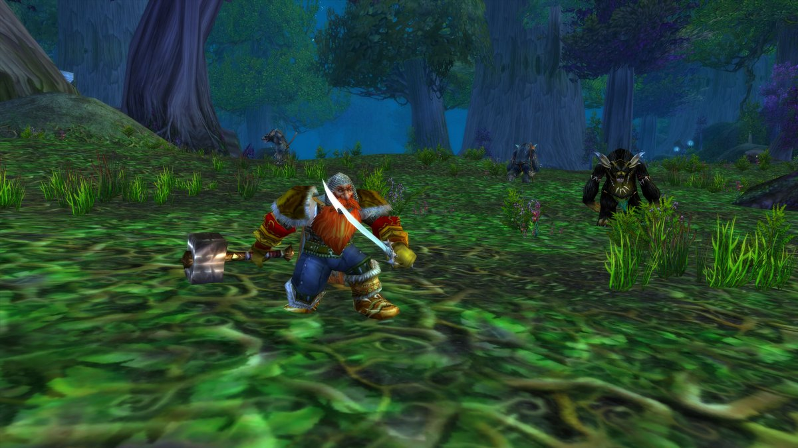

Le Warrior grandit à chaque niveau. Au début, vous appuyez surtout sur Heroic Strike et laissez Rend faire effet. D'autres attaques instantanées arrivent au fil des niveaux, et avec les grands talents dès le niveau 40, vous sentez vraiment ce que la classe sait faire. Au niveau 30, vous choisissez entre Arms, Fury et Protection, et les trois montent bien. Ce guide couvre les builds, la rotation, les niveaux clés, les quêtes de classe et le fonctionnement des postures et de la Rage.

| | |
|---|---|
| Spé la plus facile pour monter | Arms, avec une arme à deux mains lente |
| Talents clés | Improved Overpower, Deep Wounds, Impale, Sweeping Strikes, Bloodthrill |
| Points forts | Grosses prises avec de forts temps de recharge, beaucoup de burst, aucun composant |
| Points faibles | Pas de soins à lui, des pauses pour manger, un début lent |
| Talent par niveau | [Build de leveling du Warrior](/fr/leveling/warrior/) |
| Guides par spé | [Fury Warrior](/fr/guides/fury-warrior/), [Arms Warrior](/fr/guides/arms-warrior/), [Protection Warrior](/fr/guides/protection-warrior/) |
| Builds jusqu'au niveau 60 | Après la sortie le 4 novembre |

## Quelle spé pour monter

Les trois arbres montent bien. La plupart des joueurs montent traditionnellement en **Arms**, pour son burst et son jeu stable. **Fury** encaisse beaucoup, vous vous arrêtez donc plus souvent pour manger, mais ses dégâts peuvent en valoir la peine. **Protection** est bien plus forte qu'avant : elle brûle des groupes de monstres pendant que vous perdez peu de vie.

Les builds ci-dessous sont faits pour la bêta, qui s'arrête au niveau 30. Chacun a 26 points : vous les avez au niveau 30 avec cinq points de plus de Talented du système Legacy, ou au niveau 35 sans eux. Le calculateur de talents affiche un tel build comme niveau 35, car il compte chaque point comme un niveau. Les builds niveau 60 suivront après la sortie.

## Niveaux 1 à 10

Vous commencez avec Heroic Strike et <a class="wf-wh wf-spell" href="https://www.wowhead.com/forever/spell=6673">Battle Shout</a>, sans talent ni posture à choisir. Rend et Charge arrivent au 4, Thunder Clap au 6 et Hamstring au 8.

1. Gardez Battle Shout en combat.
2. Chargez le monstre avec Charge.
3. Lancez Rend s'il vit assez longtemps pour quelques ticks.
4. Dépensez votre Rage en trop dans Heroic Strike.

Besoin d'espace ? Hamstring ralentit le monstre pour que vous puissiez vous éloigner. Contre plusieurs monstres, lancez Thunder Clap dès qu'il est prêt pour ralentir leurs attaques.

Stats à ces niveaux : d'abord les dégâts par seconde de l'arme, puis la Force et la puissance d'attaque, puis l'Endurance, puis l'Agilité, puis l'armure.

## Build Arms niveau 30

Le build conseillé pour monter. Il tourne autour d'Overpower et des gros coups avec une arme à deux mains lente. Une bonne partie du temps, vous laissez Rend faire effet et attendez Overpower. Sweeping Strikes ajoute plus tard les dégâts de zone dont Arms a besoin, et c'est un plaisir à utiliser. [Ouvrir le build dans le calculateur de talents](/fr/talents/warrior/?t=323202031224101).

| Talent | Points |
|---|---|
| **Improved Heroic Strike** | 3/3 |
| **<a class="wf-wh wf-spell" href="https://www.wowhead.com/forever/spell=16462">Deflection</a>** | 2/5 |
| **Improved Rend** | 3/3 |
| **Improved Charge** | 2/2 |
| **Improved Overpower** | 2/2 |
| **Deep Wounds** | 3/3 |
| **Spearing Strike** | 1/1 |
| **Two-Handed Weapon Specialization** | 2/3 |
| **Impale** | 2/2 |
| **Bloodthrill** | 4/5 |
| **Sweeping Strikes** | 1/1 |
| **Improved Slam** | 1/2 |

Bloodthrill est le cœur du build : vos attaques de main droite sur un monstre qui porte votre Rend peuvent rendre Overpower disponible. Improved Overpower augmente ses chances de critique de 50 %, et Deep Wounds et Impale rendent ces critiques douloureux. Sweeping Strikes fait toucher à vos cinq attaques suivantes un monstre voisin.

Il y a un peu de marge. Vous pouvez prendre Improved Tactical Mastery au lieu de <a class="wf-wh wf-spell" href="https://www.wowhead.com/forever/spell=16462">Deflection</a>, mais vous aurez alors du mal à trouver les points pour Anger Management. Spearing Strike aide surtout contre les Giants et les Dragonkin, rares en début de jeu ; sans lui, vous pouvez maximiser Two-Handed Weapon Specialization. À la fin, vous choisissez entre Bloodthrill et Weaponmaster. Vous voudrez les deux à terme, la question est de savoir lequel prendre en premier. Bloodthrill, c'est plus d'Overpower.

1. Gardez Battle Shout en combat.
2. Chargez le monstre avec Charge.
3. Lancez Overpower dès qu'il s'allume.
4. Lancez Rend si le monstre vit assez longtemps pour quelques ticks.
5. Dépensez votre Rage en trop dans Heroic Strike, ou dans Slam une fois que vous avez Improved Slam.

Stats : les dégâts de l'arme comptent plus que les dégâts par seconde, puis la Force et la puissance d'attaque, puis l'Endurance, puis l'Agilité, puis l'armure.

## Build Fury niveau 30

En Fury, vous combattez avec deux armes et utilisez toute la Rage en plus que ça donne. Vos meilleures attaques n'arrivent qu'après le niveau 30, la spé peut donc sembler un peu faible jusque-là. [Ouvrir le build dans le calculateur de talents](/fr/talents/warrior/?t=-0505302505001).

| Talent | Points |
|---|---|
| **Cruelty** | 5/5 |
| **Unbridled Wrath** | 5/5 |
| **Furious Precision** | 3/3 |
| **Blood Craze** | 2/3 |
| **Dual Wield Specialization** | 5/5 |
| **<a class="wf-wh wf-spell" href="https://www.wowhead.com/forever/spell=12317">Enrage</a>** | 5/5 |
| **Death Wish** | 1/1 |

Unbridled Wrath et Dual Wield Specialization vous donnent plus de Rage à chaque coup, et Furious Precision fait moins rater votre main gauche. Cruelty ajoute des chances de critique, et <a class="wf-wh wf-spell" href="https://www.wowhead.com/forever/spell=12317">Enrage</a> augmente vos dégâts après un coup reçu. Death Wish augmente vos dégâts physiques de 20 % pendant 30 secondes, mais vous en subissez aussi 5 % de plus.

Il y a quelques options. <a class="wf-wh wf-spell" href="https://www.wowhead.com/forever/spell=12323">Piercing Howl</a> ralentit tout autour de vous, pratique pour tenir à distance monstres et joueurs. Lingering Rage garde votre Rage plus longtemps après un combat, ce qui garde le rythme quand vous enchaînez les monstres. Une fois Whirlwind obtenu au 36, Raging Blows vaut aussi le coup, mais pas avant.

1. Gardez Battle Shout en combat.
2. Chargez le monstre avec Charge.
3. Lancez Overpower dès qu'il s'allume.
4. Lancez Rend si le monstre vit assez longtemps pour quelques ticks.
5. Dépensez votre Rage en trop dans Heroic Strike.

À partir du niveau 30, Fury combat en Berserker Stance, où vous subissez 10 % de dégâts en plus, magie comprise, et encore 5 % de plus tant que Death Wish est actif. Plus d'infos dans [cet article](/fr/news/fury-takes-10-percent-more-damage-in-berserker-stance/).

Stats : les dégâts par seconde de l'arme, puis la Force et la puissance d'attaque, puis l'Endurance, puis l'Agilité, puis l'armure.

## Build Protection niveau 30

Monter en tank était lent autrefois. Plus maintenant : en Protection, vous brûlez des groupes de monstres en perdant peu de vie. Il vous faut une arme à une main et un bouclier. [Ouvrir le build dans le calculateur de talents](/fr/talents/warrior/?t=--2505301203010013).

| Talent | Points |
|---|---|
| **Improved Bloodrage** | 2/2 |
| **Shield Specialization** | 5/5 |
| **Anticipation** | 5/5 |
| **Improved Revenge** | 3/3 |
| **Last Stand** | 1/1 |
| **Master of Defense** | 2/2 |
| **Defiance** | 3/3 |
| **Vanguard** | 1/1 |
| **Concussion Blow** | 1/1 |
| **Focused Rage** | 3/3 |

Shield Specialization et Master of Defense vous donnent de la Rage à chaque blocage, esquive ou parade : plus les monstres vous frappent, plus vous pouvez agir. Vanguard vous permet d'utiliser Charge en Defensive Stance, vous n'avez donc jamais à changer de posture. Focused Rage rend vos attaques moins chères, et Concussion Blow étourdit un monstre pendant 5 secondes. Last Stand vous donne 30 % de vie en plus pendant 20 secondes quand ça tourne mal.

Il y a peu de marge si vous allez loin dans l'arbre. Vous faites peu de donjons ? Déplacez les points de Defiance vers Improved Thunder Clap.

1. Gardez Battle Shout en combat.
2. Chargez le monstre avec Charge.
3. Lancez Revenge dès qu'il s'allume.
4. Lancez Rend si le monstre vit assez longtemps pour quelques ticks.
5. Lancez Thunder Clap dès qu'il est prêt.
6. Dépensez votre Rage en trop dans Heroic Strike.

Stats : les dégâts par seconde de l'arme, puis la Force et la puissance d'attaque, puis l'Endurance, puis l'Agilité, puis l'armure.

## Niveaux clés

| Niveau | Ce que vous obtenez | Auprès de |
|---|---|---|
| 1 | Heroic Strike, Battle Shout | Par défaut, maître de classe |
| 4 | Rend, <a class="wf-wh wf-spell" href="https://www.wowhead.com/forever/spell=100">Charge</a> | Maître de classe |
| 6 | Thunder Clap | Maître de classe |
| 8 | Hamstring | Maître de classe |
| 10 | <a class="wf-wh wf-spell" href="https://www.wowhead.com/forever/spell=71">Defensive Stance</a>, <a class="wf-wh wf-spell" href="https://www.wowhead.com/forever/spell=355">Taunt</a>, <a class="wf-wh wf-spell" href="https://www.wowhead.com/forever/spell=7386">Sunder Armor</a> | Quête de classe |
| 10 | <a class="wf-wh wf-spell" href="https://www.wowhead.com/forever/spell=2687">Bloodrage</a> | Maître de classe |
| 10 | Premier point de talent | Arbre de talents |
| 12 | Overpower, Shield Bash | Maître de classe |
| 14 | Revenge, Demoralizing Shout, <a class="wf-wh wf-spell" href="https://www.wowhead.com/forever/spell=1310185">Tactical Mastery</a> | Maître de classe |
| 16 | Shield Block, Mocking Blow | Maître de classe |
| 18 | <a class="wf-wh wf-spell" href="https://www.wowhead.com/forever/spell=676">Disarm</a> | Maître de classe |
| 20 | <a class="wf-wh wf-spell" href="https://www.wowhead.com/forever/spell=402927">Victory Rush</a>, <a class="wf-wh wf-spell" href="https://www.wowhead.com/forever/spell=845">Cleave</a>, Retaliation, Slam, ambidextrie | Maître de classe |
| 20 | Armes d'hast | Maître d'armes |
| 22 | Intimidating Shout | Maître de classe |
| 24 | Execute | Maître de classe |
| 26 | Challenging Shout | Maître de classe |
| 28 | Shield Wall | Maître de classe |
| 30 | <a class="wf-wh wf-spell" href="https://www.wowhead.com/forever/spell=2458">Berserker Stance</a>, <a class="wf-wh wf-spell" href="https://www.wowhead.com/forever/spell=20252">Intercept</a> | Quête de classe |
| 30 | Berserker Rage | Maître de classe |
| 30 | Sweeping Strikes, Death Wish, Concussion Blow | Arbre de talents |
| 36 | Whirlwind | Maître de classe |
| 38 | <a class="wf-wh wf-spell" href="https://www.wowhead.com/forever/spell=6552">Pummel</a> | Maître de classe |
| 40 | Armure en plaques, monte, Dual Specialization | Maîtres |
| 50 | <a class="wf-wh wf-spell" href="https://www.wowhead.com/forever/spell=1719">Recklessness</a> | Maître de classe |

Victory Rush est nouveau pour monter : après avoir tué un monstre, il frappe et vous soigne de 10 % de votre vie maximale. Slam a un temps de recharge de 18 secondes dans Forever. Avec des points dans Talented du système Legacy, vous atteignez chaque talent jusqu'à cinq niveaux plus tôt.

## Les quêtes de classe

Les Warriors ont quelques quêtes de classe importantes. Les plus importantes débloquent Defensive Stance et Berserker Stance, et vous donnent votre arme Whirlwind.

| Niveau | Récompense | Alliance | Horde |
|---|---|---|---|
| 10 | Defensive Stance, Taunt, Sunder Armor | Human : <a href="https://www.wowhead.com/forever/quest=1665">Bartleby's Mug</a>. Dwarf et Gnome : <a href="https://www.wowhead.com/forever/quest=1678">Vejrek</a>. Night Elf : <a href="https://www.wowhead.com/forever/quest=1683">Vorlus Vilehoof</a>. Skyborne du High Order : <a href="https://www.wowhead.com/forever/quest=94003">The Skybreaker Bulwark</a> | Orc, Troll et Tauren : <a href="https://www.wowhead.com/forever/quest=1498">Path of Defense</a>. Undead : <a href="https://www.wowhead.com/forever/quest=1819">Ulag the Cleaver</a> |
| 20 | Armure | <a class="wf-wh wf-q3" href="https://www.wowhead.com/forever/item=6972">Fire Hardened Hauberk</a>, avec la chaîne qui commence par <a href="https://www.wowhead.com/forever/quest=1701">Fire Hardened Mail</a> | <a class="wf-wh wf-q3" href="https://www.wowhead.com/forever/item=7133">Brutal Hauberk</a>, avec <a href="https://www.wowhead.com/forever/quest=1848">Brutal Hauberk</a> |
| 30 | Berserker Stance, Intercept | <a href="https://www.wowhead.com/forever/quest=1719">The Affray</a> | <a href="https://www.wowhead.com/forever/quest=1719">The Affray</a> |
| 30 | <a class="wf-wh wf-q3" href="https://www.wowhead.com/forever/item=6975">Whirlwind Axe</a>, <a class="wf-wh wf-q3" href="https://www.wowhead.com/forever/item=6977">Whirlwind Sword</a> ou <a class="wf-wh wf-q3" href="https://www.wowhead.com/forever/item=6976">Whirlwind Warhammer</a> | <a href="https://www.wowhead.com/forever/quest=1792">Whirlwind Weapon</a> | <a href="https://www.wowhead.com/forever/quest=1792">Whirlwind Weapon</a> |

La chaîne des Humans commence à Stormwind avec <a href="https://www.wowhead.com/forever/quest=1639">Bartleby the Drunk</a>. Path of Defense vient d'Uzzek dans les Barrens. The Affray commence auprès de Klannoc Macleod dans les Barrens et a une limite de 10 minutes. Whirlwind Weapon vient de Bath'rah the Windwatcher dans les Alterac Mountains et c'est une longue chaîne : vous pouvez la commencer au 30, mais la plupart des joueurs la terminent plus tard.

## Armes

Un Warrior peut utiliser toutes les armes sauf les baguettes, mais vous apprenez la plupart auprès d'un maître d'armes.

| Arme | Alliance | Horde |
|---|---|---|
| **Haches à une et deux mains** | Buliwyf Stonehand (Ironforge) | Hanashi, Sayoc (Orgrimmar) |
| **Masses à une et deux mains** | Buliwyf Stonehand (Ironforge) | Ansekhwa (Thunder Bluff) |
| **Épées à une et deux mains** | Woo Ping (Stormwind) | Archibald (Undercity) |
| **Dagues** | Ilyenia Moonfire (Darnassus), Bixi Wobblebonk (Ironforge), Woo Ping (Stormwind) | Sayoc (Orgrimmar), Archibald (Undercity) |
| **Armes de pugilat** | Ilyenia Moonfire (Darnassus), Buliwyf Stonehand (Ironforge) | Sayoc (Orgrimmar) |
| **Bâtons** | Ilyenia Moonfire (Darnassus), Woo Ping (Stormwind) | Hanashi, Sayoc (Orgrimmar), Ansekhwa (Thunder Bluff) |
| **Armes d'hast**, dès le niveau 20 | Woo Ping (Stormwind) | Archibald (Undercity) |
| **Arcs** | Ilyenia Moonfire (Darnassus) | Hanashi, Sayoc (Orgrimmar) |
| **Arbalètes** | Bixi Wobblebonk (Ironforge), Woo Ping (Stormwind) | Archibald (Undercity) |
| **Armes à feu** | Buliwyf Stonehand (Ironforge) | Ansekhwa (Thunder Bluff) |
| **Armes de jet** | Connues dès le départ | Connues dès le départ |

Quand vous apprenez un nouveau type d'arme, il faut d'abord monter sa compétence avant de toucher de façon fiable.

## Équipement

**L'arme** est de loin l'amélioration la plus importante. La plupart du temps, vous voulez une arme lente et lourde : elle augmente les dégâts des attaques instantanées comme Overpower, Whirlwind et Mortal Strike. Les Humans, Dwarves et Orcs n'ont plus de compétence d'arme en plus pour un type d'arme, le choix de l'arme est donc libre. Plus d'infos dans [cet article](/fr/news/humans-dwarves-and-orcs-lose-their-weapon-racials/).

## Métiers

Montez vos métiers en même temps que votre Warrior, pour récolter et fabriquer au bon niveau. Les camps donnent des bonus à chaque métier.

- **Cooking** est indispensable : la nourriture à bonus donne de l'expérience en plus, et il vous le faut pour un feu de camp.
- **Blacksmithing** fabrique votre propre équipement, y compris des pièces liées avec des stats qu'on trouve rarement ailleurs, comme plus de Défense pour un tank.
- **Mining** va avec Blacksmithing, sauf si vous préférez acheter tout votre minerai.

## Consommables

- **Nourriture.** Restez Well Fed pour l'expérience en plus ; n'importe quelle nourriture à bonus vaut mieux que rien. Un Warrior n'a pas de soins à lui, vous mangerez donc entre les combats.
- **Potions et bandages.** Des potions de soins pour les urgences, maintenant aussi avec First Aid. Les bandages de First Aid font économiser beaucoup de nourriture.
- **Les élixirs** avec les bonnes stats coûtent cher à entretenir, mais valent le coup pour une quête ou un monstre difficile.
- **Composants.** Aucun. Un Warrior n'a besoin d'aucun composant.

## Postures

Seuls les Warriors ont des postures. Beaucoup d'attaques ne marchent que dans une ou deux d'entre elles : Overpower en Battle Stance, Revenge en Defensive Stance, Whirlwind en Berserker Stance. Thunder Clap marche en Battle Stance et en Defensive Stance.

- **Battle Stance** est la posture neutre, sans bonus.
- **Defensive Stance** réduit les dégâts subis de 10 %, réduit aussi vos dégâts de 10 %, et augmente votre menace de 30 %.
- **Berserker Stance** augmente vos chances de critique de 3 %, mais vous subissez 10 % de dégâts en plus.

Changer de posture coûte d'habitude votre Rage. <a class="wf-wh wf-spell" href="https://www.wowhead.com/forever/spell=1310185">Tactical Mastery</a> au niveau 14 vous laisse 10 de Rage, et le talent Improved Tactical Mastery monte ça à 25. Ça compte quand vous passez en Berserker Stance pour Intercept, ou en Battle Stance pour Mocking Blow. Votre spé décide de la posture dans laquelle vous montez surtout, mais pas toujours : Whirlwind est fort dans chaque spé contre plusieurs monstres. Apprenez à sentir quelle posture chaque combat demande.

## Rage

Dépensez bien votre Rage. Prévoyez vos changements de posture, et ne jetez pas toute votre Rage dans Execute sur un monstre à qui il reste 60 points de vie. Pensez au monstre suivant avant que l'actuel ne meure, et gardez-lui un peu de Rage.

La Rage est normalisée : ce que vous gagnez par coup dépend de la vitesse de votre arme, pas de ses dégâts. Une épée légendaire donne autant de Rage que votre épée de départ, tant qu'elles ont la même vitesse. La Rage est donc stable, mais elle peut sembler lente. Les coups critiques redonnent plus de Rage, voir [cet article](/fr/news/warriors-keep-rage-through-armor-and-every-priest-gets-fear-ward/).

## Grosses prises et temps de recharge

Un Warrior survit aux grosses prises, au moins une fois toutes les 15 minutes : Retaliation et Shield Wall ont un temps de recharge de 15 minutes, Intimidating Shout de 3 minutes. Ils peuvent vous sauver la vie. Ne les gardez pas que pour les urgences : un temps de recharge prêt et inutilisé, c'est de la vitesse de leveling perdue. Servez-vous-en pour engager plus que d'habitude.

Vous pouvez aussi passer à tout moment à une arme à une main et un bouclier avec Defensive Stance. Shield Block arrête alors beaucoup de dégâts. Demoralizing Shout et Thunder Clap réduisent les dégâts des monstres, contre un seul ou contre beaucoup. N'ayez pas peur d'y dépenser de la Rage.

## Utilitaires

Les Warriors ne passent pas pour une classe utilitaire, mais vous apportez beaucoup à un groupe. Battle Shout augmente la puissance d'attaque de votre groupe. Thunder Clap et Demoralizing Shout réduisent les dégâts des monstres, même quand vous ne tankez pas. Et Sunder Armor augmente les dégâts de chaque attaquant physique sur ce monstre, vous compris.

Plus d'infos sur la nourriture, les camps et l'expérience reposée dans le [guide de l'expérience](/fr/guides/experience/).
