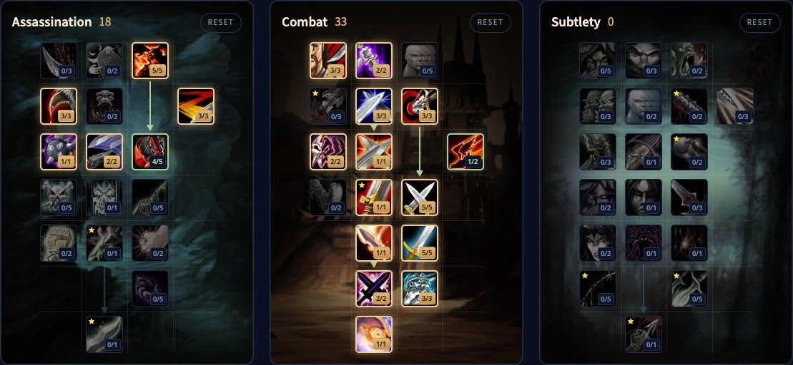

Il Combat Rogue di WoW Forever infligge danni enormi con gli attacchi automatici e ha un forte picco di danni con Blade Flurry e Adrenaline Rush. Forever riunisce tutte le vecchie specializzazioni d'arma in un solo talento, Hack and Slash, quindi ora va bene ogni tipo d'arma. I veleni possono fare critici e scalano con il potere d'attacco, e Combat è l'unica specializzazione del Rogue che colpisce più bersagli. Questa guida copre una build di livello 30, due di livello 60, la rotazione, l'energia, i veleni, le stats e le razze.

| | |
|---|---|
| Ruolo | Danni in mischia con due armi |
| Build | Combat di livello 30, standard di livello 60 (18/33/0) e pugnali di livello 60 (16/33/2) |
| Talenti chiave | Malice, Improved Slice and Dice, Precision, Dual Wield Specialization, Hack and Slash, Blade Flurry, Aggression, Adrenaline Rush |
| Punti forti | Danni molto alti, forte picco di danni, l'unico attacco su più bersagli del Rogue, ogni tipo d'arma |
| Punti deboli | Dipende molto dall'equipaggiamento, soprattutto dalle armi |
| Livellare | [Guida al leveling del Rogue](/it/guides/rogue-leveling/), [build di leveling del Rogue](/it/leveling/rogue/) |

## Punti forti e deboli

**Danni.** Attacchi automatici molto forti e un grande picco di danni con Blade Flurry e Adrenaline Rush attivi.

**Ogni arma.** Hack and Slash funziona con spade, asce, pugnali, armi da pugno e mazze, quindi non devi mai cambiare talenti per un'arma nuova.

**Più bersagli.** Blade Flurry è l'unico modo per un Rogue di colpire due mostri insieme.

**Controllo.** Kick, Gouge, Sap, Cheap Shot, Kidney Shot e Blind, più veleni che rallentano, allungano i lanci o riducono le cure.

**Equipaggiamento.** Combat dipende dall'equipaggiamento più di ogni altra cosa, e soprattutto dalle armi, perché tanti danni vengono dagli attacchi automatici.

## Build di livello 30

Al livello 30 hai 21 punti, e Talented ne aggiunge 5. La build punta a sopravvivere e uccidere in fretta: Deflection e Riposte accorciano le pause, Improved Eviscerate e gli attacchi automatici fanno i danni. [Apri la build nel calcolatore di talenti](/it/talents/rogue/?t=-3200332110141), [versione Talented](/it/talents/rogue/?t=-32003321101415) con Hack and Slash 5/5. Altro nella nostra [guida al leveling del Rogue](/it/guides/rogue-leveling/).

## Build standard di livello 60: 18/33/0

La beta si è fermata al livello 30, ma gli alberi dei talenti del livello 60 sono nei file del gioco. Abbiamo verificato questa build punto per punto nel [nostro calcolatore di talenti](/it/talents/rogue/?t=005303124-32003321101515231). Arriva fino ad Adrenaline Rush e prende Malice, Slice and Dice, punti combo ed energia da Assassination.

| Talento | Punti |
|---|---|
| **Malice** (Assassination) | 5/5 |
| **Ruthlessness** (Assassination) | 3/3 |
| **Improved Slice and Dice** (Assassination) | 3/3 |
| **Relentless Strikes** (Assassination) | 1/1 |
| **Improved Expose Armor** (Assassination) | 2/2 |
| **Lethality** (Assassination) | 4/5 |
| **Improved Eviscerate** | 3/3 |
| **Improved Sinister Strike** | 2/2 |
| **Deflection** | 3/3 |
| **Precision** | 3/3 |
| **Endurance** | 2/2 |
| **Riposte** | 1/1 |
| **Improved Sprint** | 1/2 |
| **Flawless Execution** | 1/1 |
| **Dual Wield Specialization** | 5/5 |
| **Blade Flurry** | 1/1 |
| **Hack and Slash** | 5/5 |
| **Weapon Expertise** | 2/2 |
| **Aggression** | 3/3 |
| **Adrenaline Rush** | 1/1 |

## Build a pugnali di livello 60: 16/33/2

Lo stesso percorso, ma attorno a Backstab. [Apri la build nel calcolatore di talenti](/it/talents/rogue/?t=005303122-32030320201515231-002). Puncturing Wounds e un secondo punto in Improved Sprint sostituiscono Deflection e Riposte, Lethality scende a 2/5, e Opportunity 2/2 in Subtlety fa colpire più forte Backstab e Ambush.

| Talento | Punti |
|---|---|
| **Malice** (Assassination) | 5/5 |
| **Ruthlessness** (Assassination) | 3/3 |
| **Improved Slice and Dice** (Assassination) | 3/3 |
| **Relentless Strikes** (Assassination) | 1/1 |
| **Improved Expose Armor** (Assassination) | 2/2 |
| **Lethality** (Assassination) | 2/5 |
| **Improved Eviscerate** | 3/3 |
| **Improved Sinister Strike** | 2/2 |
| **Puncturing Wounds** | 3/3 |
| **Precision** | 3/3 |
| **Endurance** | 2/2 |
| **Improved Sprint** | 2/2 |
| **Flawless Execution** | 1/1 |
| **Dual Wield Specialization** | 5/5 |
| **Blade Flurry** | 1/1 |
| **Hack and Slash** | 5/5 |
| **Weapon Expertise** | 2/2 |
| **Aggression** | 3/3 |
| **Adrenaline Rush** | 1/1 |
| **Opportunity** (Subtlety) | 2/2 |

Se un altro giocatore del gruppo riduce già l'armatura, puoi mettere altrove i punti di Improved Expose Armor.

## Cosa fanno i talenti chiave

| Talento | Cosa fa in Forever |
|---|---|
| **Malice** | Il 5% di critico in più con attacchi e veleni |
| **Ruthlessness** | Le mosse finali hanno il 60% di probabilità di aggiungere un punto combo |
| **Improved Slice and Dice** | Slice and Dice dura il 45% in più |
| **Relentless Strikes** | Le mosse finali hanno il 20% di probabilità per punto combo di restituire 25 di energia |
| **Lethality** | Più danni critici per Sinister Strike, Gouge, Backstab e altri generatori |
| **Improved Expose Armor** | Expose Armor costa 10 di energia in meno e restituisce 2 punti combo con 5 |
| **Improved Eviscerate** | Eviscerate infligge il 20% di danni in più |
| **Precision** | Il 3% di probabilità di colpire in più |
| **Riposte** | Dopo una parata: il 150% dei danni dell'arma e un disarmo di 6 secondi |
| **Flawless Execution** | Eviscerate costa 10 di energia in meno |
| **Dual Wield Specialization** | L'arma nella mano secondaria infligge il 25% di danni in più |
| **Hack and Slash** | Spade e asce: il 5% di probabilità di un colpo extra. Pugnali e armi da pugno: più critico. Mazze: il 15% di penetrazione dell'armatura |
| **Blade Flurry** | Il 20% di velocità d'attacco in più, e gli attacchi colpiscono anche un nemico vicino, per 15 secondi |
| **Weapon Expertise** | I tuoi attacchi vengono schivati e parati il 2% in meno |
| **Aggression** | Sinister Strike, Backstab ed Eviscerate infliggono il 6% di danni in più |
| **Adrenaline Rush** | L'energia torna il 100% più in fretta per 15 secondi |

## Rotazione

### Un bersaglio

1. Entra in Stealth.
2. Apri con Ambush nella build a pugnali, o con Garrote o Cheap Shot con un'altra arma.
3. Usa Sinister Strike come generatore, o Backstab nella build a pugnali.
4. Usa Blade Flurry appena è pronto.
5. Usa Adrenaline Rush per un picco di danni, insieme a Blade Flurry quando puoi.
6. Con 5 punti combo, lancia Slice and Dice e rinnovalo quando scade.
7. Negli scontri lunghi, lancia Expose Armor con i 5 punti combo successivi.
8. Spendi il resto in Eviscerate finché non va rinnovato Slice and Dice o Expose Armor.

### Più mostri

Blade Flurry è il tuo unico danno ad area: gioca la rotazione normale mentre è attivo, e ogni attacco colpisce un secondo mostro. Non cambiare mai bersaglio mentre accumuli punti combo, o li perdi.

## Stealth, punti combo e mosse finali

Stealth ti rallenta, fino al 50% ai livelli bassi e al 30% al livello 60, quindi lo usi contro i mostri pericolosi più che per viaggiare. In Stealth hai le aperture: Ambush per un colpo grosso, Garrote per un sanguinamento, Sap e Cheap Shot per neutralizzare.

Sinister Strike resta il tuo generatore fino al livello 60, a meno che tu non giochi con i pugnali. Slice and Dice viene prima, è il tuo aumento di danni più grande. Eviscerate è la mossa finale che usi di più, ed Expose Armor si aggiunge negli scontri lunghi. Combat non usa Rupture.

## Energia

L'energia ora torna in modo continuo, 10 punti al secondo. Adrenaline Rush la raddoppia a 20 al secondo per 15 secondi, e Thistle Tea ne restituisce una bella quantità. Non usare mai un generatore con 5 punti combo, non chiudere con troppo pochi punti, e non spendere energia in Kick, Feint, Gouge o Blind senza motivo.

## Veleni

Dal livello 20, una catena di missioni ti insegna a creare veleni. Usa Instant Poison e Deadly Poison nella maggior parte degli scontri: Instant Poison sulle armi lente, Deadly Poison su quelle veloci. Passa a Crippling, Mind-numbing o Wound Poison quando un mostro va rallentato, deve lanciare più lentamente o ricevere meno cure.

## Sopravvivenza

Usa Sap su un mostro di un gruppo, meglio se un incantatore. Apri con Cheap Shot, continua con Kidney Shot e allunga con Gouge o Blind quando ti servono energia o tempi di recupero. Usa Evasion quando devi incassare, interrompi con Kick ogni incantatore, e Vanish quando nient'altro funziona. Riposte, nella build standard, disarma un mostro dopo una parata.

## Stats ed equipaggiamento

Le priorità delle stats per il livello 60 arriveranno dopo il lancio. Fino ad allora:

- **Agilità**: 1 di potere d'attacco per punto, l'1% di critico ogni 29 di Agilità, l'1% di schivata ogni 14,5 di Agilità.
- **Potere d'attacco**, che ora aumenta anche i danni dei veleni.
- **Probabilità di critico**, anche per i veleni.
- **Forza**: 1 di potere d'attacco per punto.
- **Tempra** per la salute, presente su quasi tutto l'equipaggiamento.
- **Spirito** solo per rigenerare tra uno scontro e l'altro.

**Armatura.** Cuoio con le stats qui sopra. Set come Defias Leather ed Embrace of the Viper sono buoni mentre livelli.

**Armi.** Le armi ora sono molto più forti a ogni livello, e grazie a Hack and Slash va bene ogni tipo. Per Combat contano più che per qualsiasi altra specializzazione del Rogue.

## Razze e professioni

| Fazione | Razza | Perché |
|---|---|---|
| Alliance | Human | L’1% di critico con Ruthless |
| Alliance | Night Elf | Elune's Light, il 10% di critico per 15 secondi; Shadowmeld e uno Stealth migliore |
| Alliance | Gnome | Eureka! per un picco di danni, Engineering Specialization con Engineering |
| Alliance | Dwarf | Stoneform rimuove sanguinamenti, veleni e malattie; Artisan's Precision dà l'1% di hit |
| Alliance | Skyborne | Il 2% di celerità con Wind Blessed |
| Horde | Orc | Il 10% di potere d'attacco con Blood Fury, la scelta migliore |
| Horde | Troll | Il 10% di celerità con Berserking e uno strumento di sopravvivenza |
| Horde | Undead | Meglio in PvP; Cannibalize fa risparmiare tempo nel mondo aperto |
| Horde | Skyborne | Il 2% di celerità con Wind Blessed |

**Leatherworking** con Skinning è la coppia migliore: un buon equipaggiamento in cuoio a ogni livello, kit d'armatura e la Camp Tent del campeggio, che velocizza il leveling. **Engineering** porta aggeggi ed esplosivi per più danni. **Herbalism** con **Alchemy** ti dà elisir, pozioni e fiale. Per una build a veleni, vedi la [guida all'Assassination Rogue](/it/guides/assassination-rogue/), e per Ambush e sanguinamenti la [guida al Subtlety Rogue](/it/guides/subtlety-rogue/).
