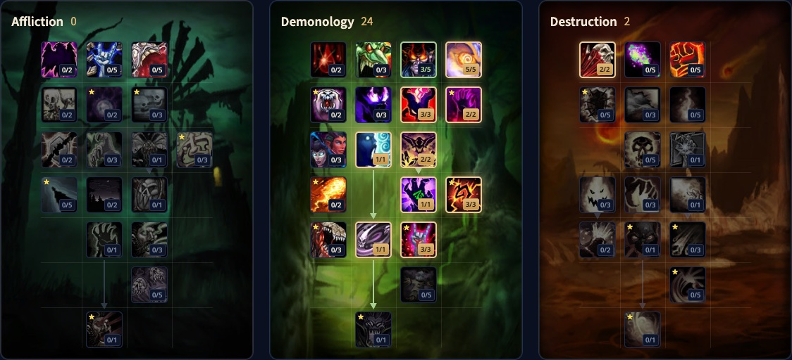

Il Demonology Warlock in WoW Forever lascia lavorare il suo demone. Marchi il nemico con Searing Pain, la tua Succubus lo tanka e fa la maggior parte dei tuoi danni, e tu riempi i vuoti con i DoT. Questa guida copre build, rotazione, minaccia, demoni e statistiche.

| | |
|---|---|
| Ruolo | Danni tramite il demone, la spec Warlock più sicura in solo |
| Build al livello 30 | 24 punti in Demonology e 2 in Destruction, con i 5 punti extra di Talented |
| Talenti chiave | Unholy Power, Demonic Energies, Demonic Brand, Demonic Knowledge, Soul Link |
| Punti forti | Il tuo demone tanka, danni alti del famiglio, utilità per il gruppo |
| Punti deboli | Tutto dipende dal demone, il marchio chiede manutenzione continua |
| Livellare | [Guida al leveling del Warlock](/it/guides/warlock-leveling/), [build di leveling del Warlock](/it/leveling/warlock/) |
| Altre spec | [Affliction Warlock](/it/guides/affliction-warlock/), [Destruction Warlock](/it/guides/destruction-warlock/) |

## Cosa cambia per Demonology

- **Demonic Brand è nuovo.** Searing Pain marchia il bersaglio per 10 secondi. A 3/3 i 6 attacchi successivi del tuo demone su di esso fanno danni da Fuoco o da Ombra extra e minaccia extra.
- **I demoni scalano con il tuo equipaggiamento.** Il tuo potere magico ora rende più forte anche il demone.
- **Demonic Knowledge è nuovo.** Dà a te e al tuo demone potere magico pari al 33% del tuo livello per punto, finché il demone è vivo.
- **Demonic Energies è nuovo.** I tuoi incantesimi curano il demone, e Life Tap gli ridà anche mana.
- **I Bane non sono Curse.** <a class="wf-wh wf-spell" href="https://www.wowhead.com/forever/spell=980">Bane of Agony</a> ora è un Bane, quindi puoi aggiungere <a class="wf-wh wf-spell" href="https://www.wowhead.com/forever/spell=6205">Curse of Weakness</a> o <a class="wf-wh wf-spell" href="https://www.wowhead.com/forever/spell=1714">Curse of Tongues</a> sullo stesso bersaglio.
- **Ritual of Summoning conta di più.** Le Meeting Stones non evocano più, quindi <a class="wf-wh wf-spell" href="https://www.wowhead.com/forever/spell=698">Ritual of Summoning</a> è l’unico modo per evocare i giocatori.

## Punti di forza e debolezze

| Punti forti | Punti deboli |
|---|---|
| La tua Succubus tanka quasi ogni combattimento, Soul Link le passa il 30% dei danni che subisci | Se il demone muore, perdi in un colpo il tank e la maggior parte dei danni |
| Il demone fa la maggior parte dei danni mentre tu lanci DoT e Searing Pain | Il marchio scade circa ogni 6 secondi e Searing Pain è un lancio di 1,5 secondi |
| Soulstone, Healthstones, evocazioni e una Succubus che seduce un nemico in più | Un bersaglio alla volta, il demone non ha danni ad area |

## La build di livello 30

Questa build usa 26 punti: i 21 punti del livello 30 più 5 di <a class="wf-wh wf-spell" href="https://www.wowhead.com/forever/spell=1225474">Talented</a> nel sistema Legacy. Venti punti in Demonology aprono Demonic Knowledge e Soul Link. Gli ultimi 2 punti sono liberi: <a class="wf-wh wf-spell" href="https://www.wowhead.com/forever/spell=17917">Destructive Reach</a> per il 20% di portata in più sugli incantesimi di Destruction come Searing Pain, Improved Corruption per una Corruption più rapida, o Improved Life Tap per più mana. [Apri la build nel calcolatore dei talenti](/it/talents/warlock/?t=-00350032012013013-2).

| Talento | Punti |
|---|---|
| **Demonic Embrace** | 3/5 |
| **Unholy Power** | 5/5 |
| **Fel Vitality** | 3/3 |
| **Demonic Energies** | 2/2 |
| **Demonic Sacrifice** | 1/1 |
| **Master Summoner** | 2/2 |
| **Fel Domination** | 1/1 |
| **Demonic Brand** | 3/3 |
| **Soul Link** | 1/1 |
| **Demonic Knowledge** | 3/3 |
| **Destructive Reach** | 2/2 |

Dopo il livello 30 arrivano Master Demonologist e Demonic Pact in fondo all’albero.

## Cosa fanno i talenti chiave

| Talento | Cosa fa in Forever |
|---|---|
| **Unholy Power** | Il 10% di danni in più per il demone a 5/5. Il demone fa la maggior parte dei danni, quindi prendili tutti e 5 |
| **Demonic Energies** | I tuoi incantesimi curano il demone, e Life Tap gli ridà mana |
| **Demonic Brand** | Searing Pain marchia il bersaglio, il demone gli fa danni e minaccia extra. Il talento più importante della build |
| **Demonic Knowledge** | Potere magico per te e il demone pari al tuo livello a 3/3 |
| **Soul Link** | Il 30% dei danni che subisci va al demone, ed entrambi fate il 3% di danni in più |
| **Master Summoner** | Evocazioni più rapide, e la strada verso Fel Domination per un nuovo demone quasi istantaneo |
| **Demonic Sacrifice** | Solo un requisito per Soul Link. Non usarlo |

Improved Voidwalker rafforza lo scudo di Sacrifice, una buona scelta in PvP. Improved Sayaad aumenta solo i danni base di Lash of Pain, quindi il guadagno reale è piccolo.

## Rotazione

**Un nemico**
1. Manda il tuo demone.
2. Lancia <a class="wf-wh wf-spell" href="https://www.wowhead.com/forever/spell=5676">Searing Pain</a> per marchiare il bersaglio.
3. Lancia <a class="wf-wh wf-spell" href="https://www.wowhead.com/forever/spell=980">Bane of Agony</a>, <a class="wf-wh wf-spell" href="https://www.wowhead.com/forever/spell=348">Immolate</a> e <a class="wf-wh wf-spell" href="https://www.wowhead.com/forever/spell=172">Corruption</a>.
4. Lancia Searing Pain finché il nemico muore. Ogni lancio rinnova il marchio.
5. Poco mana? Lancia <a class="wf-wh wf-spell" href="https://www.wowhead.com/forever/spell=1454">Life Tap</a> se hai vita in avanzo. Poca vita? Lancia <a class="wf-wh wf-spell" href="https://www.wowhead.com/forever/spell=689">Drain Life</a>, e rinnova il marchio con Searing Pain quando scade.

**Due nemici.** Metti Bane of Agony, Immolate e Corruption sul primo e lanciagli <a class="wf-wh wf-spell" href="https://www.wowhead.com/forever/spell=5782">Fear</a>. Manda il demone sul secondo, mettigli i DoT e marchialo con Searing Pain. Rimetti Fear sul primo quando torna. Quando il secondo muore, manda il demone sul primo e marchialo. Con un bersaglio focus e un tasto modificatore lanci sul nemico in Fear senza cambiare bersaglio.

**Dungeon.** Sui boss lancia <a class="wf-wh wf-spell" href="https://www.wowhead.com/forever/spell=440892">Curse of the Elements</a> in un gruppo con molti incantatori, o <a class="wf-wh wf-spell" href="https://www.wowhead.com/forever/spell=704">Curse of Recklessness</a> in un gruppo soprattutto da mischia. Salta le maledizioni sui nemici comuni. Manda il demone dopo il tank, metti i DoT, e saltali sui nemici che muoiono entro circa 12 secondi. Lancia <a class="wf-wh wf-spell" href="https://www.wowhead.com/forever/spell=686">Shadow Bolt</a> o Drain Life sul bersaglio del tank. In gruppo Shadow Bolt conviene, perché il guaritore paga parte dei tuoi Life Tap.

## Demonic Brand e minaccia

A 3/3 <a class="wf-wh wf-spell" href="https://www.wowhead.com/forever/spell=5676">Searing Pain</a> genera il 50% di minaccia in meno e marchia il bersaglio per 10 secondi. Ogni rango aggiunge 2 attacchi del demone al marchio, quindi i 6 attacchi successivi del demone fanno danni da Fuoco o da Ombra extra, a seconda del demone, e minaccia extra. Il marchio finisce dopo 10 secondi o dopo l’ultimo di quegli attacchi, quindi in pratica lo rilanci circa ogni 6 secondi.

Searing Pain non ha tempo di volo, e il rango 2 arriva al livello 26. Non lanciarlo prima di avere Demonic Brand: genera così tanta minaccia da strappare i nemici al demone. Dal livello 28 metti sull’arma una Firestone da <a class="wf-wh wf-spell" href="https://www.wowhead.com/forever/spell=6366">Create Firestone</a> per danni da Fuoco e critico extra su Searing Pain.

## Demoni

- **Succubus o Incubus** (<a class="wf-wh wf-spell" href="https://www.wowhead.com/forever/spell=712">Summon Succubus</a>): i danni più alti di tutti i demoni, e con Demonic Brand tiene la minaccia per quasi tutto il combattimento. Il tuo demone standard in solo. <a class="wf-wh wf-spell" href="https://www.wowhead.com/forever/spell=6358">Seduction</a> tiene fuori dal combattimento un umanoide nei dungeon.
- **Voidwalker** (<a class="wf-wh wf-spell" href="https://www.wowhead.com/forever/spell=697">Summon Voidwalker</a>): il tank di riserva per i nemici che colpiscono troppo forte. Torment tiene la minaccia molto meglio che in Classic, e il rango 3 al livello 30 risolve i problemi di minaccia della fine dei 20.
- **Felhunter** (<a class="wf-wh wf-spell" href="https://www.wowhead.com/forever/spell=691">Summon Felhunter</a>): quasi i danni della Succubus, e <a class="wf-wh wf-spell" href="https://www.wowhead.com/forever/spell=19505">Devour Magic</a> rimuove gli effetti magici. <a class="wf-wh wf-spell" href="https://www.wowhead.com/forever/spell=19244">Spell Lock</a> arriva solo al livello 36.
- **Imp** (<a class="wf-wh wf-spell" href="https://www.wowhead.com/forever/spell=688">Summon Imp</a>): pochi danni, ma <a class="wf-wh wf-spell" href="https://www.wowhead.com/forever/spell=6307">Blood Pact</a> dà Tempra al gruppo.

Assegna Attack e Follow a tasti che premi senza pensare, così mandi o richiami il demone prima che finisca in un altro gruppo. Il nuovo comando Move ti lascia piazzare il demone dove vuoi.

## Vita e mana

<a class="wf-wh wf-spell" href="https://www.wowhead.com/forever/spell=1454">Life Tap</a> ora scala con lo Spirito. Il rango 3 converte 140 punti vita più il tuo Spirito nella stessa quantità di mana, più il 10% per punto in Improved Life Tap. Con Demonic Energies ogni Life Tap ridà mana anche al demone. Il rango 2 di Searing Pain costa 68 mana, quindi un Life Tap da 200 mana paga circa 3 lanci. Due regole ti evitano di bere:

- **Molta più vita che mana?** Lancia Life Tap.
- **Poca vita?** Lancia <a class="wf-wh wf-spell" href="https://www.wowhead.com/forever/spell=689">Drain Life</a> finché hai abbastanza vita per un nuovo Life Tap.

## Statistiche ed equipaggiamento

**Potere magico, danni da Ombra e danni da Fuoco** prima, poi **Tempra e Spirito**, poi **Intelletto**. Il potere magico rende più forte anche il demone. I danni da Ombra aiutano Corruption e Bane of Agony, quelli da Fuoco Searing Pain. La Tempra dà più vita da convertire, lo Spirito più mana per Life Tap. Colpire e critico sono rari sull’equipaggiamento al livello 30, e questa build non ha Suppression, quindi manchi i nemici del tuo livello il 4% delle volte.

- **Tailoring** ha nuovi pezzi d’Ombra vincolati come <a class="wf-wh wf-q3" href="https://www.wowhead.com/forever/item=253967">Shadow Gown</a> e <a class="wf-wh wf-q3" href="https://www.wowhead.com/forever/item=253919">Shadow Gloves</a>, e pezzi di Fiamma che potenziano Searing Pain. Solo il sarto che li crea può indossarli.
- **Armi.** La tua arma è un bastone di statistiche, il suo potere magico conta più dei danni. La missione Warlock dell’Orb of Soran'ruk ti fa scegliere tra <a class="wf-wh wf-q3" href="https://www.wowhead.com/forever/item=15109">Staff of Soran'ruk</a> e <a class="wf-wh wf-q3" href="https://www.wowhead.com/forever/item=6898">Orb of Soran'ruk</a>. <a class="wf-wh wf-q3" href="https://www.wowhead.com/forever/item=2549">Staff of the Shade</a> da Razorfen Kraul ha più danni da Ombra, ma non fa nulla per Searing Pain.
- **Bacchette.** <a class="wf-wh wf-q3" href="https://www.wowhead.com/forever/item=7001">Gravestone Scepter</a> da Blackfathom Deeps è la bacchetta più forte prima del livello 30. Al livello 30 Searing Pain è il tuo riempitivo; usa la bacchetta per finire i nemici sotto il 20% circa.

## Razze e professioni

| Fazione | Razza | Perché |
|---|---|---|
| Alleanza | Human | Ruthless per il 2% di probabilità di critico in più, <a class="wf-wh wf-spell" href="https://www.wowhead.com/forever/spell=20598">The Human Spirit</a> per più Spirito. La scelta migliore |
| Alleanza | Gnome | <a class="wf-wh wf-spell" href="https://www.wowhead.com/forever/spell=20591">Expansive Mind</a> per più mana, <a class="wf-wh wf-spell" href="https://www.wowhead.com/forever/spell=1259817">Eureka!</a> per incantesimi più forti ed economici |
| Orda | Undead | <a class="wf-wh wf-spell" href="https://www.wowhead.com/forever/spell=1260201">Touch of the Grave</a> scala con la Tempra, <a class="wf-wh wf-spell" href="https://www.wowhead.com/forever/spell=20577">Cannibalize</a> ridà anche mana, <a class="wf-wh wf-spell" href="https://www.wowhead.com/forever/spell=7744">Will of the Forsaken</a> spezza la paura. La scelta migliore nella maggior parte dei casi |
| Orda | Orc | <a class="wf-wh wf-spell" href="https://www.wowhead.com/forever/spell=20572">Blood Fury</a>: il 10% di potere magico in più per 15 secondi, <a class="wf-wh wf-spell" href="https://www.wowhead.com/forever/spell=1299026">Shatter Curse</a> contro le maledizioni |
| Orda | Troll | <a class="wf-wh wf-spell" href="https://www.wowhead.com/forever/spell=1260270">Rapid Regeneration</a> cura il 50% della tua vita in 6 secondi, <a class="wf-wh wf-spell" href="https://www.wowhead.com/forever/spell=20557">Beast Slaying</a> contro le bestie |

Nessuna è abbastanza forte da farti rinunciare a una razza che ti piace di più.

**Professioni.** Tailoring crea equipaggiamento d’Ombra e di Fiamma a quasi ogni livello, e il suo bonus da accampamento dà Spirito. Enchanting si abbina bene. First Aid dà bende e ora anche pozioni e rimedi contro veleno, malattia e sanguinamento, che un Warlock non può togliere in altro modo. Alchemy crea <a class="wf-wh wf-q1" href="https://www.wowhead.com/forever/item=250342">Lesser Arcane Elixir</a> e <a class="wf-wh wf-q1" href="https://www.wowhead.com/forever/item=250340">Lesser Mageblood Elixir</a>.
