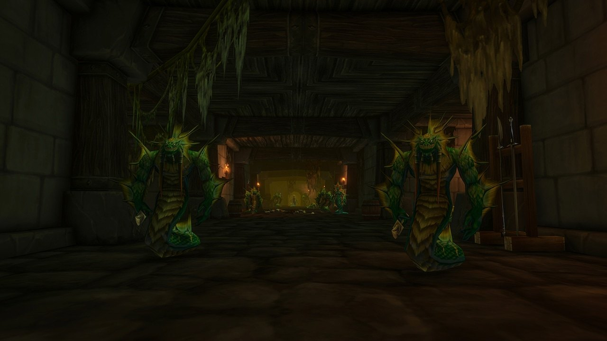

## Come arrivarci

Alcaz Prison è un nuovo dungeon di World of Warcraft: Forever, per i livelli da 48 a 53, su Alcaz Island al largo di Dustwallow Marsh. Dal molo, prendi il sentiero che sale sulla collina a sinistra fino al grande edificio. Il portale è nel seminterrato, verso /way 75 15.

## La storia

Si diceva da tempo che la prigione di Alcaz Island custodisse prigionieri importanti, tra cui King Varian Wrynn, ma nessuno poteva entrarci. In Forever le sue porte si aprono. Dentro, la Defias Brotherhood e i naga si combattono, e attendono nuovi pezzi di un mistero noto, secondo [Blizzard](/it/news/blizzard-describes-all-nine-new-dungeons/).

## I boss

### The Questioner

Il primo boss. Lascialo in vita se vuoi il travestimento segreto: la missione <a href="https://www.wowhead.com/forever/quest=96335">The Man in the Iron Chains</a>, alla fine del dungeon, ti rimanda da lui.

### Blazeroar

L'unico boss noto finora, citato nella sfida Legacy del dungeon.

## Il travestimento segreto

Qui inizia una catena nascosta che porta all'<a class="wf-wh wf-q3" href="https://www.wowhead.com/forever/item=279471">Alcaz Operative Insignia</a>, un giocattolo che ti traveste da agente Defias per 10 minuti. Ripulisci il dungeon senza uccidere The Questioner, prendi <a href="https://www.wowhead.com/forever/quest=96335">The Man in the Iron Chains</a> alla fine, poi segui la pista fino a Moonbrook, nel Westfall, e poi a Stormwind (Alliance) o Booty Bay (Horde) per una <a class="wf-wh wf-q2" href="https://www.wowhead.com/forever/item=279450">Fractured Insignia</a>. Sei di queste formano il giocattolo. I passaggi sono nel [post sul giocattolo](/it/news/alcaz-prison-hides-a-defias-disguise-toy/).

## Cosa non si sa ancora

- **Gli altri boss** e come funzionano gli scontri.
- **La mappa** dell'interno.
- **Il bottino** e **le altre missioni**.
