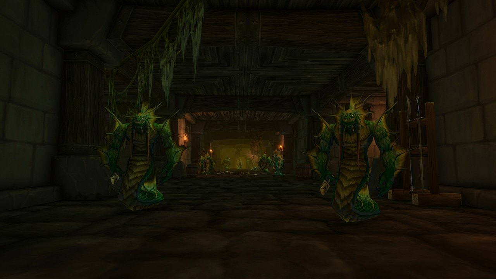

## Come arrivarci

Alcaz Prison è un nuovo dungeon di World of Warcraft: Forever, per i livelli da 48 a 53, su Alcaz Island, a nord-est di Dustwallow Marsh. Arrivi dal lato ovest dell'isola; la fortezza è sul lato nord. Segui il sentiero su per la collina fino al grande edificio. Il portale è nel seminterrato, verso /way 75 15. Lo spirit healer è proprio fuori, quindi un wipe costa solo una breve corsa.

- **Orda:** vola a Brackenwall Village. Senza quella rotta, arriva da Ratchet e segui la costa verso sud.
- **Alleanza:** prendi la nave da Menethil Harbor a Theramore e vai verso nord.

## La storia

Si è detto a lungo che la prigione di Alcaz Island tenesse prigionieri importanti, tra cui re Varian Wrynn, ma nessuno riusciva a entrare. In Forever le porte si aprono, e dentro la Defias Brotherhood e i naga combattono tra loro, secondo [Blizzard](/it/news/blizzard-describes-all-nine-new-dungeons/). Traditori di Theramore lavorano con i Defias, l'Alleanza cerca il suo re scomparso e l'Orda i suoi Kor'kron catturati. Il dungeon è lungo più o meno come The Stockade, ma alcuni scontri picchiano duro.

## Nemici da tenere d'occhio

- **<a class="wf-wh wf-plain" href="https://www.wowhead.com/forever/npc=255373">Strashaz Soldiers</a> e <a class="wf-wh wf-plain" href="https://www.wowhead.com/forever/npc=255995">Strashaz Enchantresses</a>** aspettano all'inizio. Le Enchantresses lanciano <a class="wf-wh wf-spell" href="https://www.wowhead.com/forever/spell=13323">Polymorph</a> su un giocatore a caso e <a class="wf-wh wf-spell" href="https://www.wowhead.com/forever/spell=12737">Frostbolt Volley</a>, e i Soldiers colpiscono chiunque sia a 8 metri o più con <a class="wf-wh wf-spell" href="https://www.wowhead.com/forever/spell=1270802">Berserker Charge</a>. Mettiti subito dietro di loro così i Soldiers non hanno nessuno da colpire, interrompi le Enchantresses e togli la Polymorph se ne passa una.
- **<a class="wf-wh wf-plain" href="https://www.wowhead.com/forever/npc=255262">Alcaz Chaplains</a>** sono i guaritori qui e lanciano <a class="wf-wh wf-spell" href="https://www.wowhead.com/forever/spell=15586">Heal</a> su se stessi e sui loro alleati. Uccidili per primi in ogni gruppo, o tienine uno fuori dallo scontro con <a class="wf-wh wf-spell" href="https://www.wowhead.com/forever/spell=12825">Polymorph</a> se sono due. Il <a class="wf-wh wf-plain" href="https://www.wowhead.com/forever/npc=271784">Alcaz Jailer</a> che li accompagna usa <a class="wf-wh wf-spell" href="https://www.wowhead.com/forever/spell=15496">Cleave</a>, quindi il tank lo gira lontano dal gruppo.
- **<a class="wf-wh wf-plain" href="https://www.wowhead.com/forever/npc=255271">Defias Truthfinders</a> e <a class="wf-wh wf-plain" href="https://www.wowhead.com/forever/npc=255364">Renegade Conjurers</a>** sono gli incantatori. I Truthfinders lanciano <a class="wf-wh wf-spell" href="https://www.wowhead.com/forever/spell=14032">Shadow Word: Pain</a> e <a class="wf-wh wf-spell" href="https://www.wowhead.com/forever/spell=17165">Mind Flay</a>: togli entrambi. I Conjurers usano incantesimi da mago come <a class="wf-wh wf-spell" href="https://www.wowhead.com/forever/spell=14034">Fireball</a> e portano un <a class="wf-wh wf-plain" href="https://www.wowhead.com/forever/npc=255369">Arcane Servitor</a>. I gruppi da quattro o cinque sono frequenti: tienine uno fuori con un controllo e attirali dietro un angolo perché vengano da te.

## I boss

Cinque boss. Non uccidere The Questioner prima di aver ripulito il resto del dungeon, vedi sotto.

### 1. Tidemistress Ca'zass

<a class="wf-wh wf-plain" href="https://www.wowhead.com/forever/npc=255997">Tidemistress Ca'zass</a> combatte con due Strashaz Enchantresses: uccidile prima o tienile fuori con un controllo. La sua Frostbolt Volley colpisce tutto il gruppo, Frost Nova blocca i giocatori e lancia Blizzard su se stessa. Portala fuori dal Blizzard, e un paladino o un sacerdote toglie la Frost Nova a chi resta bloccato. La sua testa serve per A Bit of Wet Work e A Little Payback.

### 2. Overseer Wrex

<a class="wf-wh wf-plain" href="https://www.wowhead.com/forever/npc=255391">Overseer Wrex</a> pattuglia i tre blocchi di celle della sua ala. Se ti vede, tutte le guardie di quelle tre stanze si uniscono allo scontro. Quindi passagli accanto di nascosto e ripulisci prima le tre stanze mentre va dall'altra parte. Ha solo Mortal Strike, un colpo pesante sul tank che riduce le cure del 50% per 5 secondi, e lancia Battle Shout su di sé e sugli alleati all'inizio. Lascia il <a class="wf-wh wf-q1" href="https://www.wowhead.com/forever/item=263992">Overseer's Keyring</a>.

### 3. The Questioner

<a class="wf-wh wf-plain" href="https://www.wowhead.com/forever/npc=256236">The Questioner</a> sta nella sua stanza con qualche guardia. Attirane alcune prima del boss e lo scontro è facile: usa solo Rend e Drain Life, e un paladino o un sacerdote può togliere il Drain Life. **Lascialo vivo finché non muore l'ultimo boss** se vuoi il giocattolo: la missione <a href="https://www.wowhead.com/forever/quest=96335">The Man in the Iron Chains</a> compare solo se è ancora vivo.

### 4. Katerina the Cleaner

<a class="wf-wh wf-plain" href="https://www.wowhead.com/forever/npc=257016">Katerina the Cleaner</a> arriva con due Alcaz Chaplains. Tienili fuori con <a class="wf-wh wf-spell" href="https://www.wowhead.com/forever/spell=12825">Polymorph</a>, <a class="wf-wh wf-spell" href="https://www.wowhead.com/forever/spell=2070">Sap</a> o <a class="wf-wh wf-spell" href="https://www.wowhead.com/forever/spell=6213">Fear</a>, o uccidili prima perché nessuno la curi. Mette Grievous Garrote su un giocatore a caso: un colpo forte che continua a togliere vita finché quel giocatore non viene curato sopra il 90%. Deadly Poison finisce sul tank: toglilo subito.

### 5. Zarla Ober e Blazeroar

<a class="wf-wh wf-plain" href="https://www.wowhead.com/forever/npc=255707">Zarla Ober</a> è l'ultimo scontro e picchia molto più forte. Da umana lancia Fireball e Flamestrike; i giocatori in mischia spesso devono restare nel Flamestrike. Al 30% mostra la sua vera forma, <a class="wf-wh wf-plain" href="https://www.wowhead.com/forever/npc=255702">Blazeroar</a>, con la vita piena. Searing Scales brucia ora tutto il gruppo di continuo, Flame Breath colpisce il tank molto forte, Thrash colpisce più volte insieme e una paura fa fuggire tutti tranne il tank. Il tank tiene da parte un cooldown per questa fase, e uno sciamano mette giù <a class="wf-wh wf-spell" href="https://www.wowhead.com/forever/spell=8143">Tremor Totem</a>. Zarla lascia il suo diario per The Dragon's Journal.

## Il giocattolo travestimento segreto

Qui inizia una catena nascosta che finisce con il <a class="wf-wh wf-q3" href="https://www.wowhead.com/forever/item=279471">Alcaz Operative Insignia</a>, un giocattolo che ti traveste da agente Defias per 10 minuti. Ripulisci il dungeon senza uccidere The Questioner, prendi <a href="https://www.wowhead.com/forever/quest=96335">The Man in the Iron Chains</a> alla fine, poi segui la pista fino a Moonbrook a Westfall e poi a Stormwind (Alleanza) o Booty Bay (Orda) per un <a class="wf-wh wf-q2" href="https://www.wowhead.com/forever/item=279450">Fractured Insignia</a>. Con sei ottieni il giocattolo. I passaggi sono nel [post sul giocattolo](/it/news/alcaz-prison-hides-a-defias-disguise-toy/).
