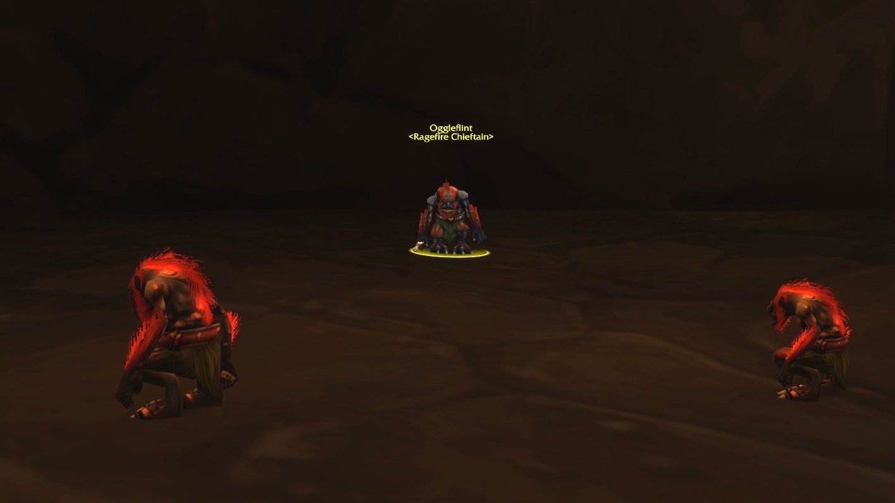
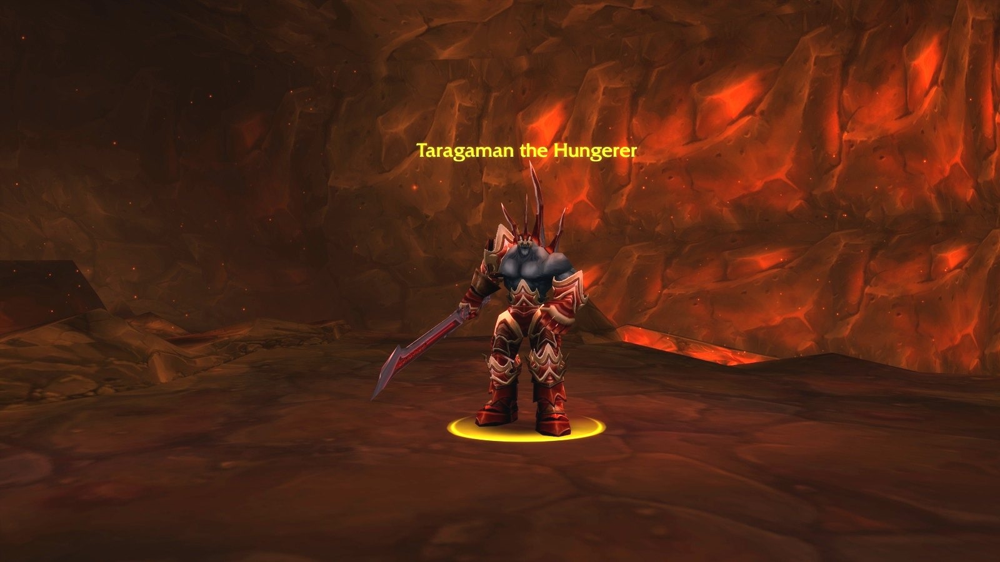
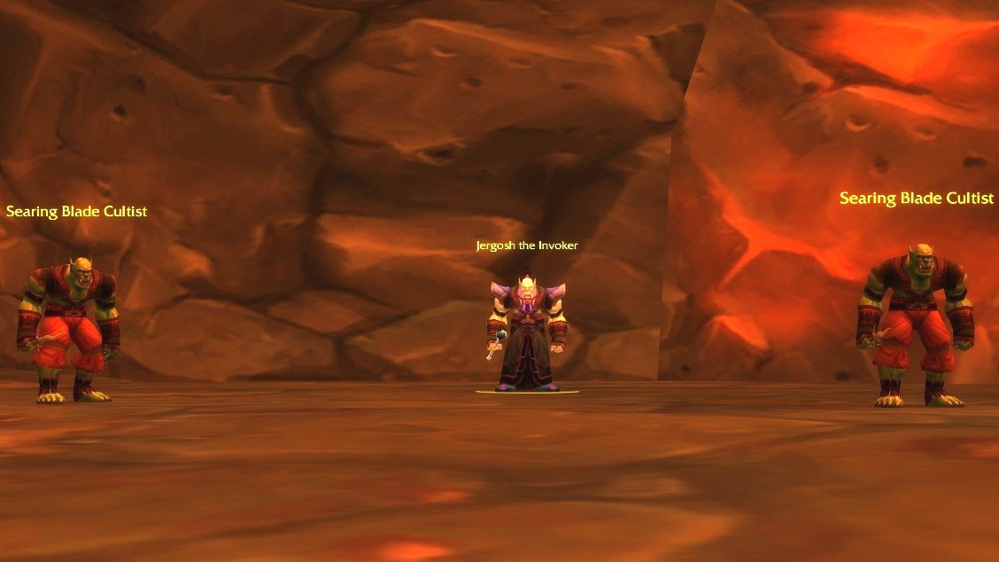
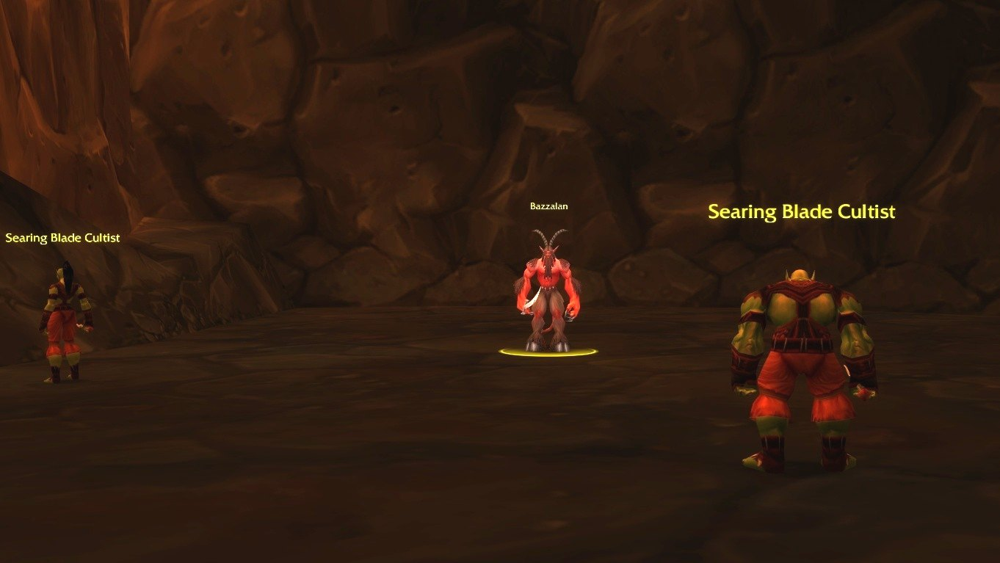

## Come arrivarci

**Horde.** Entra nella Cleft of Shadow di Orgrimmar, /way 53.0 48.9, e scendi fino al portale.

**Alliance.** Ragefire Chasm si trova nel cuore di una capitale della Horde. Prendi la nave per Ratchet e corri fino alla punta nord-est di The Barrens, dove l’ingresso ovest di Orgrimmar è più tranquillo. Togli l’equipaggiamento e fai una corsa da fantasma nella Cleft of Shadow finché non puoi entrare.

Dopo un wipe, lo Spirit Healer si trova a Durotar, fuori dalla città.

## Il percorso

Una grotta breve con un solo bivio. I numeri corrispondono alla mappa qui sopra.

1. **La prima grotta.** Dal portale scendi fino a un incrocio e gira a ovest. <a class="wf-wh wf-plain" href="https://www.wowhead.com/forever/npc=11517">Oggleflint</a> (1) aspetta tra i suoi troggs.
2. **La borsa perduta.** Lungo il sentiero accanto alla lava, un vicolo cieco custodisce il corpo di <a class="wf-wh wf-plain" href="https://www.wowhead.com/forever/npc=11834">Maur Grimtotem</a> per Searching for the Lost Satchel.
3. **Il campo di lava.** Tornato all’incrocio, prendi il sentiero a sud e sali. <a class="wf-wh wf-plain" href="https://www.wowhead.com/forever/npc=11520">Taragaman the Hungerer</a> (2) sta su una piattaforma in mezzo alla lava.
4. **La sporgenza.** Gira lungo il bordo ovest e sali fino a <a class="wf-wh wf-plain" href="https://www.wowhead.com/forever/npc=11519">Bazzalan</a> (4).
5. **L’ultima sala.** Salta giù dalla sporgenza di Bazzalan e atterri accanto a <a class="wf-wh wf-plain" href="https://www.wowhead.com/forever/npc=11518">Jergosh the Invoker</a> (3).

## Il trash importante

Gli incantatori colpiscono più forte. Attirateli dietro un angolo, fuori vista, così vengono da voi senza che si aggiunga un altro gruppo.

**Ragefire Shamans.** Lightning Bolt, e Healing Wave sugli alleati. Interrompete o stordite la cura.

**Molten Elementals.** Fire Shield infligge danni Fire a chi li colpisce in mischia.

**Searing Blade Cultists.** Curse of Agony sul tank.

**Searing Blade Enforcers.** Shield Slam stordisce il tank per 2 secondi. Due insieme possono concatenare lo stordimento, quindi attirateli uno alla volta.

**Searing Blade Warlocks.** Un Voidwalker al fianco e una raffica di Shadow Bolts. Rompete la linea di vista per attirarli.

## I boss

### Oggleflint

Un capo trogg circondato da troggs. Attiratene prima qualcuno, così il gruppo non viene travolto. La sua unica abilità è Cleave, quindi il tank lo gira lontano dal gruppo.

### Taragaman the Hungerer

Sta su una piattaforma circondata dalla lava. Fire Nova colpisce tutti in mischia e Uppercut sbalza il tank indietro e in alto. Tankatelo al centro della piattaforma così nessuno vola nella lava, e attirate prima le pattuglie vicine.

### Jergosh the Invoker

Nell’ultima sala, con due add che si possono controllare entrambi. Lancia Immolate e Curse of Weakness, che rende più difficile al tank tenere la minaccia. Rimuovete la maledizione e uccidete prima Jergosh: è il più forte dei tre.

### Bazzalan

Su una sporgenza con due add; quello a destra si può attirare senza di lui. Bazzalan colpisce forte con Sinister Strike e avvelena il tank. Rimuovete il veleno e uccidetelo in fretta, poi gli add.

## Cosa non si sa ancora

- **Le probabilità di drop** del bottino dei boss.
- **Le ricompense delle missioni** possono ancora cambiare prima del lancio.
