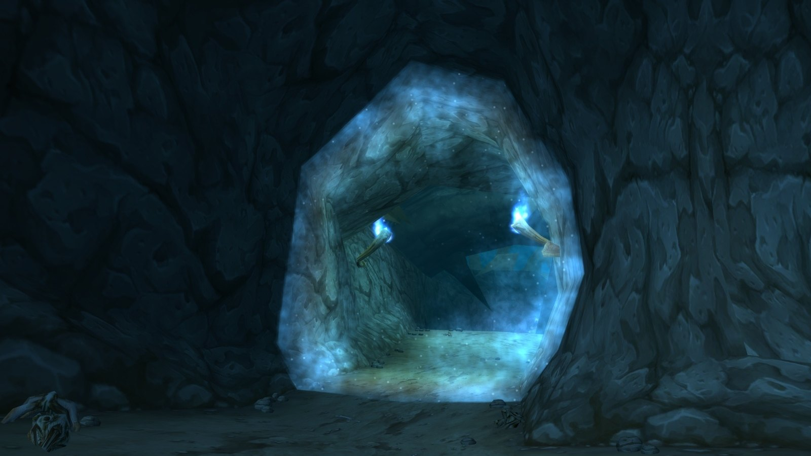
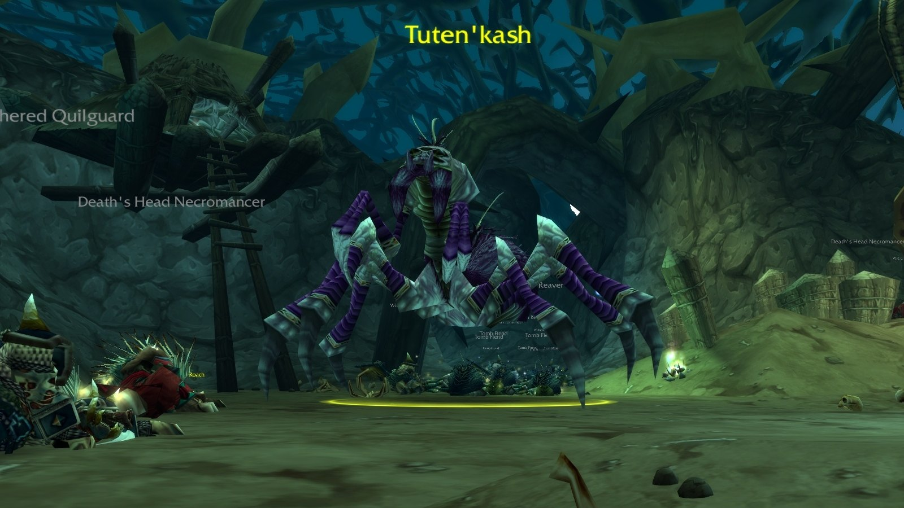
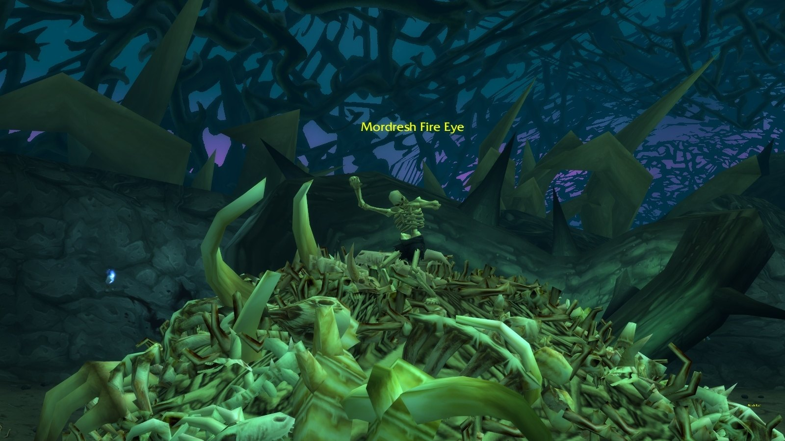
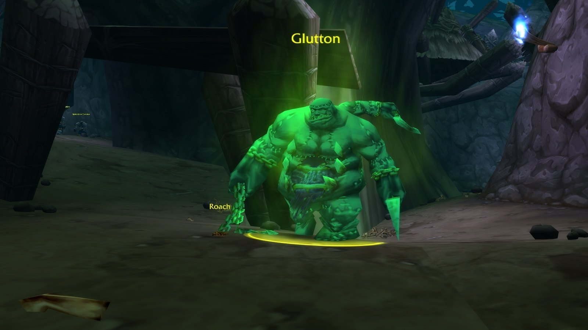
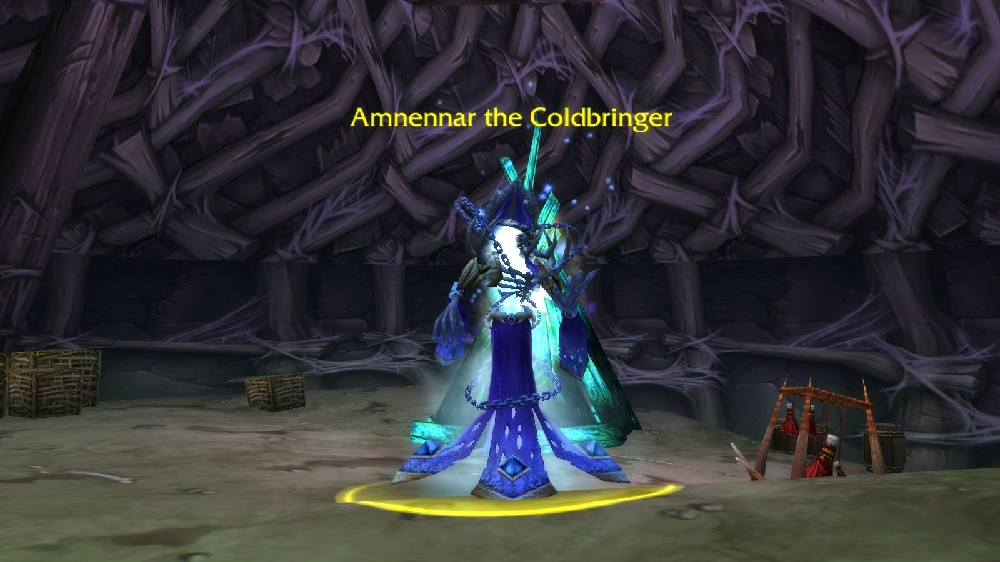

## Come arrivarci

**Horde.** Vola a Camp Taurajo e cavalca verso sud. Gira a est appena prima del Great Lift verso Thousand Needles; l’ingresso è a /way 50.8 92.8.

**Alliance.** Prendi la nave da Booty Bay a Ratchet, cavalca fino al sud di The Barrens e gira a est prima del Great Lift.

## Il percorso

I numeri corrispondono alla mappa qui sopra.

1. **The Caller's Chamber.** Suona il gong per <a class="wf-wh wf-plain" href="https://www.wowhead.com/forever/npc=7355">Tuten'kash</a> (1).
2. **The Bone Pile.** <a class="wf-wh wf-plain" href="https://www.wowhead.com/forever/npc=7357">Mordresh Fire Eye</a> (3) siede su un mucchio di ossa a est, dietro scheletri danzanti.
3. **The Spiral of Thorns.** Il sentiero scende a spirale intorno a una collina. <a class="wf-wh wf-plain" href="https://www.wowhead.com/forever/npc=8567">Glutton</a> (5) aspetta lungo il percorso, e il raro <a class="wf-wh wf-plain" href="https://www.wowhead.com/forever/npc=7354">Ragglesnout</a> (4) può trovarsi sull’anello inferiore.
4. **L’idolo.** Belnistrasz aspetta nelle celle vicino a Mordresh. La sua scorta finisce con <a class="wf-wh wf-plain" href="https://www.wowhead.com/forever/npc=7356">Plaguemaw the Rotting</a> (2).
5. **La cima della collina.** <a class="wf-wh wf-plain" href="https://www.wowhead.com/forever/npc=7358">Amnennar the Coldbringer</a> (6), l’ultimo boss.

## Il trash importante

**Freezing Spirits.** Fantasmi che lanciano Frost Nova. Raggruppatevi sul tank così nessuno resta congelato nel posto sbagliato.

**Gli incantatori Death's Head.** Cultists e Necromancers colpiscono forte a distanza. Interrompeteli o portateli fuori vista.

## I boss

### Tuten'kash

Si evoca con il gong: ripulite prima le ondate di ragni e suonate di nuovo il gong dopo ognuna. Giratelo lontano dal gruppo per Web Spray, e rimuovete la Curse of Tuten'kash e il Virulent Poison dei suoi attacchi.

### Plaguemaw the Rotting

La fine della scorta di Belnistrasz. Uccidete le ondate una alla volta, meglio con un secondo tank che le allontani da Belnistrasz. Plaguemaw è uno scontro semplice con Putrid Stench e Withered Touch.

### Mordresh Fire Eye

Un boss con poca armatura su un mucchio di ossa. Ripulite prima gli scheletri danzanti; l’ultimo gruppo lo attira, quindi uccidetelo in fretta con danni ad area. Interrompete la sua Fireball e uscite dalla Fire Nova.

### Ragglesnout

Un raro. Il suo Dominate Mind è il pericolo: se il tank o il guaritore viene dominato, subentrano le classi ibride. Interrompete il suo Heal e i suoi Shadow Bolts.

### Glutton

Uno scontro semplice. State fuori dalla sua Disease Cloud e curate il tank durante il suo Enrage.

### Amnennar the Coldbringer

L’ultimo boss. Tankatelo rivolto verso la tenda dove si trova per bloccare Amnennar's Wrath, raggruppatevi sul tank per Frost Nova, passate ai Frost Spectres quando li evoca e interrompete Frostbolt.

## Cosa non si sa ancora

- **Le missioni**: i dati di Forever non ne hanno ancora per Razorfen Downs.
- **Il bottino mancante**, come X'caliboar e il Dragonclaw Ring: se cade ancora.
- **Le probabilità di drop** del bottino dei boss.
