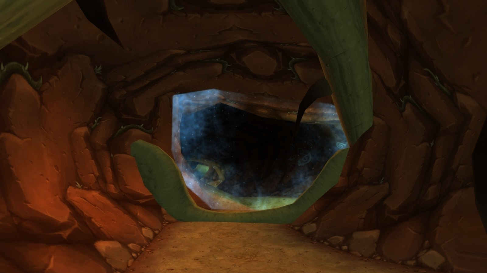
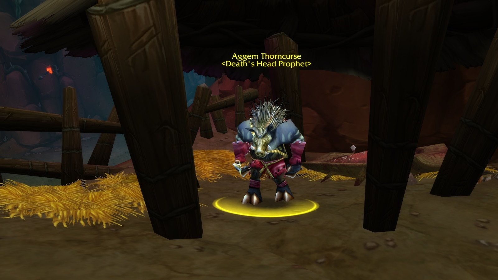
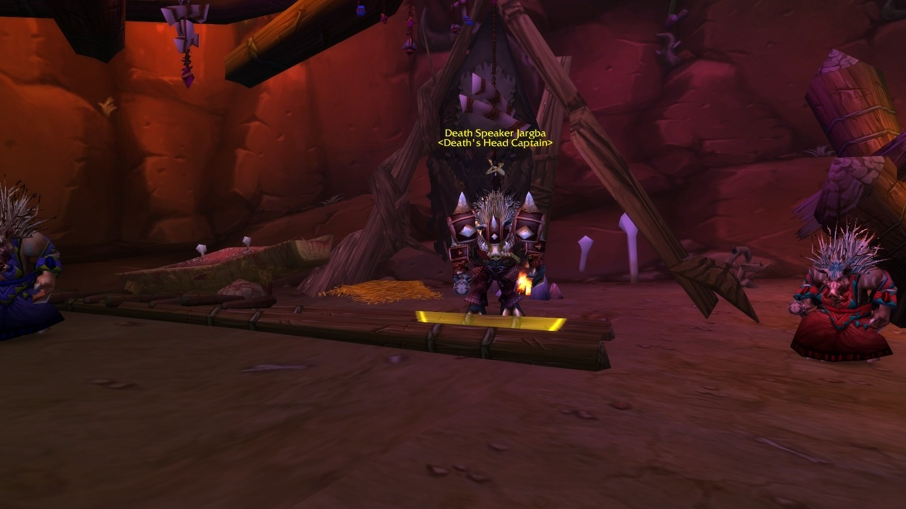
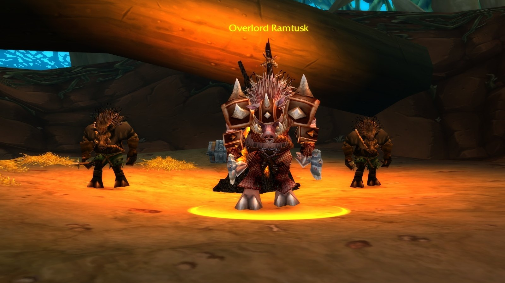
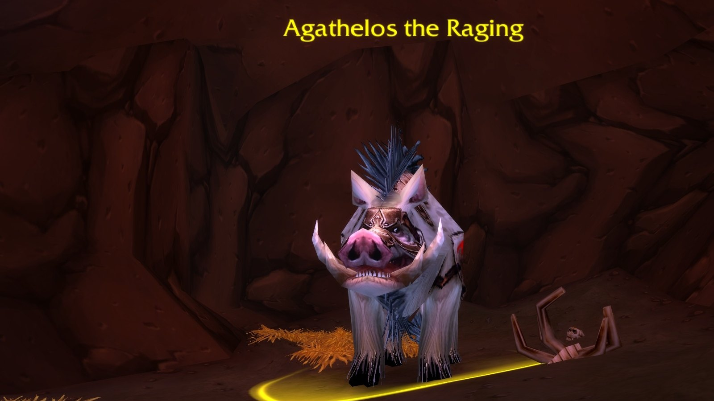
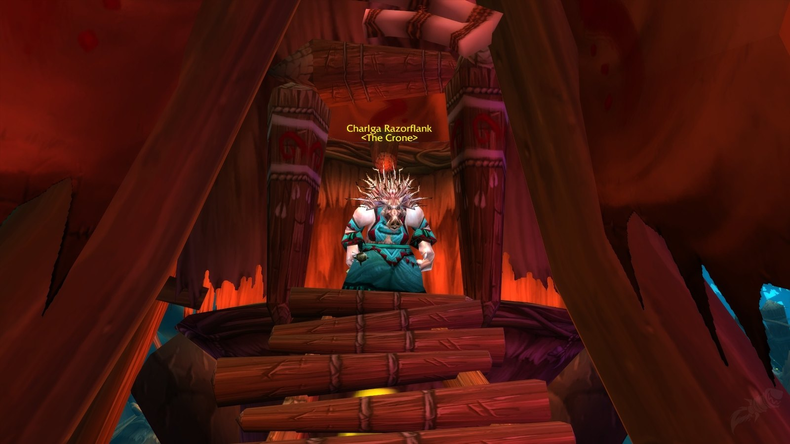
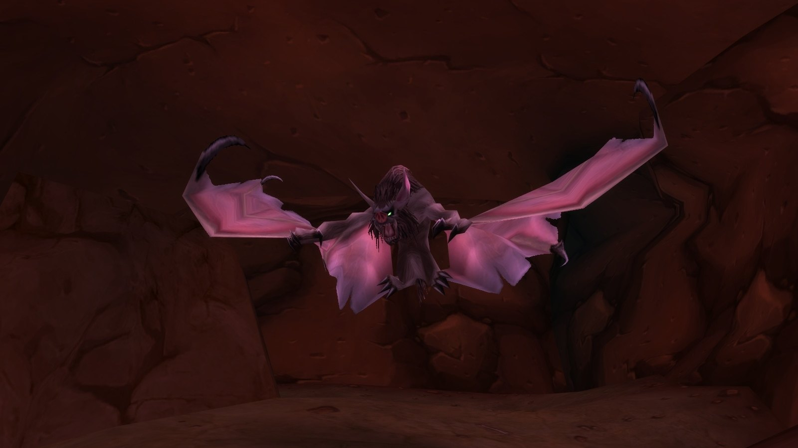

## Come arrivarci

**Horde.** Vola a Camp Taurajo e cavalca verso sud. Gira a ovest appena prima del Great Lift verso Thousand Needles; l’ingresso è tra i rovi a /way 42.3 89.9.

**Alliance.** Prendi la nave da Booty Bay a Ratchet, cavalca fino al sud di The Barrens e gira a ovest prima del Great Lift.

## Il percorso

Un labirinto di gallerie spinose che va da est a ovest. I numeri corrispondono alla mappa qui sopra.

1. **Le prime grotte.** <a class="wf-wh wf-plain" href="https://www.wowhead.com/forever/npc=6168">Roogug</a> (1) aspetta vicino al portale, con un Earth Rumbler al fianco. È facoltativo, a meno che non vi serva la sua Vial of Phlogiston.
2. **L’est.** <a class="wf-wh wf-plain" href="https://www.wowhead.com/forever/npc=4424">Aggem Thorncurse</a> (2) e <a class="wf-wh wf-plain" href="https://www.wowhead.com/forever/npc=4428">Death Speaker Jargba</a> (3) stanno nelle grotte a est.
3. **Il nord.** <a class="wf-wh wf-plain" href="https://www.wowhead.com/forever/npc=4420">Overlord Ramtusk</a> (4) aspetta con due Razorfen Spearhides. Il raro Earthcaller Halmgar può trovarsi su una piattaforma al centro.
4. **L’estremo ovest.** <a class="wf-wh wf-plain" href="https://www.wowhead.com/forever/npc=4422">Agathelos the Raging</a> (5), un cinghiale gigante, in fondo a una lunga galleria. Il Blind Hunter, un pipistrello raro, si nasconde nella grotta dei pipistrelli a nord-ovest.
5. **La fine.** Willix the Importer e il corpo di Heralath Fallowbrook aspettano in una tenda prima dell’ultimo boss. <a class="wf-wh wf-plain" href="https://www.wowhead.com/forever/npc=4421">Charlga Razorflank</a> (6) siede nella sua capanna.

## Il trash importante

I **Razorfen Totemics** piazzano un Earthgrab Totem che blocca tutti i vicini per 30 secondi. Uccidete prima il totem.

I **Razorfen Dustweavers** lanciano Enveloping Winds, uno stordimento di 10 secondi. Attirateli uno alla volta.

I **Death's Head Adepts** lanciano Chains of Ice. Facili da uccidere, ma pericolosi con un secondo gruppo vicino.

## I boss

### Roogug

Lancia Lightning Bolt e chiama un Earth Rumbler. Uccidete prima l’elementale, o esiliatelo se nel gruppo c’è un Warlock.

### Aggem Thorncurse

Battle Shout, Chain Heal e un Boar Spirit che evoca. Uccidete prima il cinghiale e interrompete ogni cura.

### Death Speaker Jargba

Arriva con due incantatori che colpiscono forte; controllatene almeno uno. Jargba lancia Shadow Bolt e prende il controllo di un giocatore con Dominate Mind. Controllate il giocatore dominato e uccidete Jargba in fretta.

### Overlord Ramtusk

Un boss di livello 32 in Battle Stance con Thunder Clap e Battle Shout, affiancato da due Razorfen Spearhides con un Whirling Barrage letale. Controllateli entrambi se potete.

### Agathelos the Raging

Un cinghiale di livello 33 con molti danni su un solo bersaglio. Rushing Charge, Enrage e Rampage fanno dello scontro una questione di tenere in vita il tank.

### Charlga Razorflank

L’ultimo boss, un’incantatrice con poca armatura in una capanna rialzata. Fatela scendere sulla piattaforma, interrompetela e allargatevi contro Chain Bolt. Si cura con Renew e diventa immune per un po’ con Purity.

Il Blind Hunter nella grotta dei pipistrelli lancia Sonic Burst, un silenzio su tutti i vicini; smettete di lanciare quando inizia. Gli Hunter possono addomesticarlo.

## Cosa non si sa ancora

- **Le probabilità di drop** del bottino dei boss.
- **Le ricompense delle missioni** possono ancora cambiare prima del lancio.
