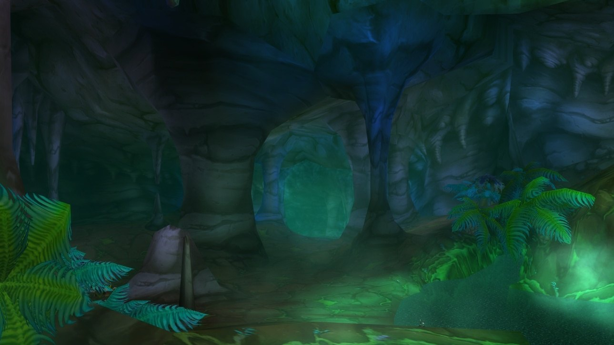
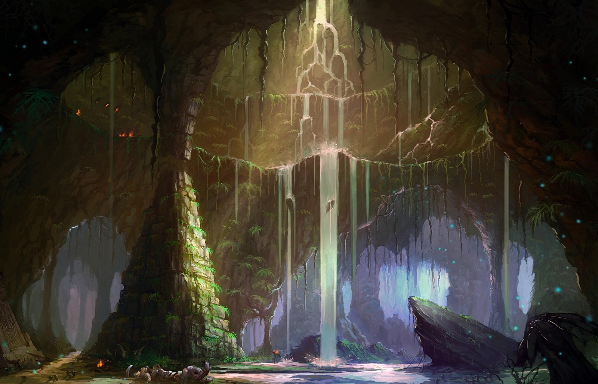
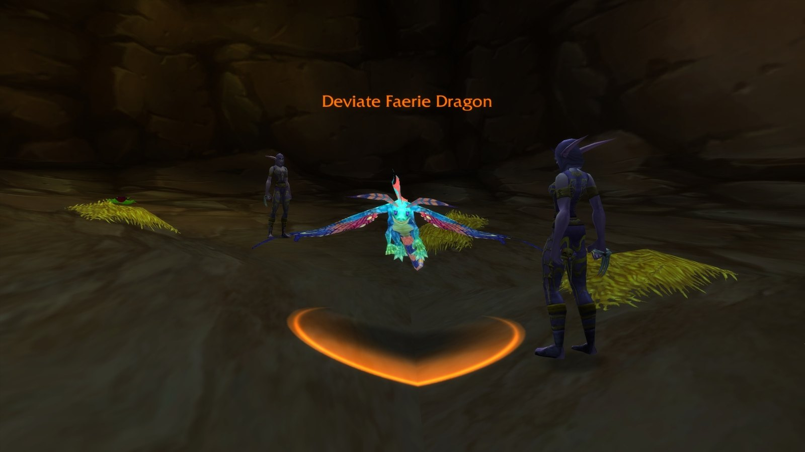
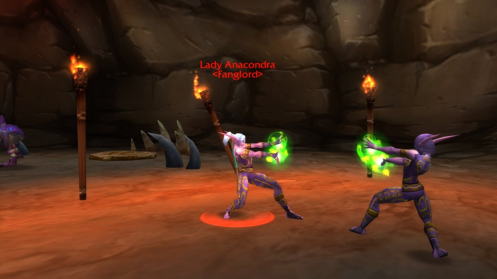
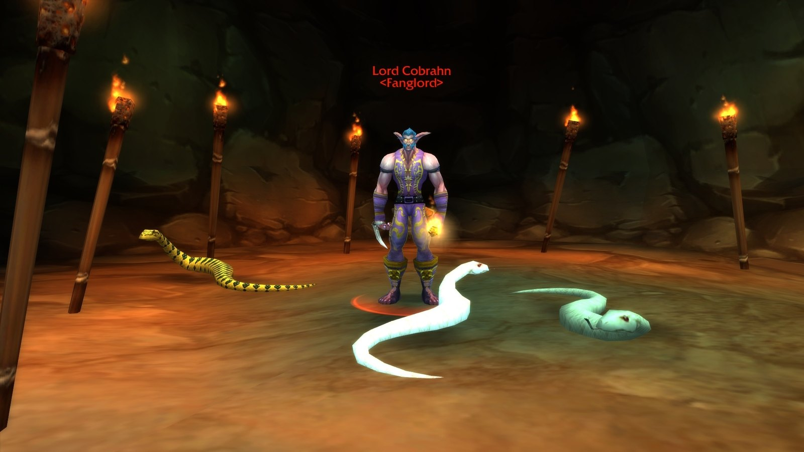
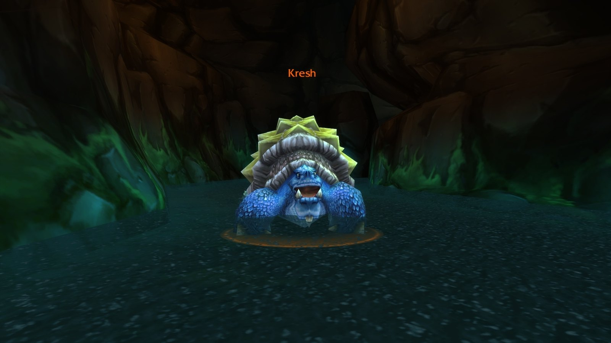
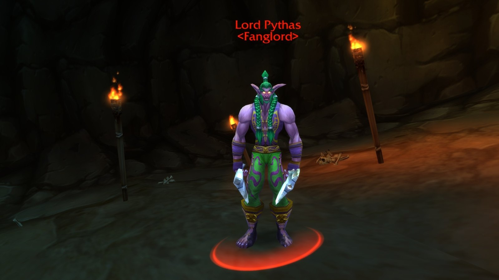
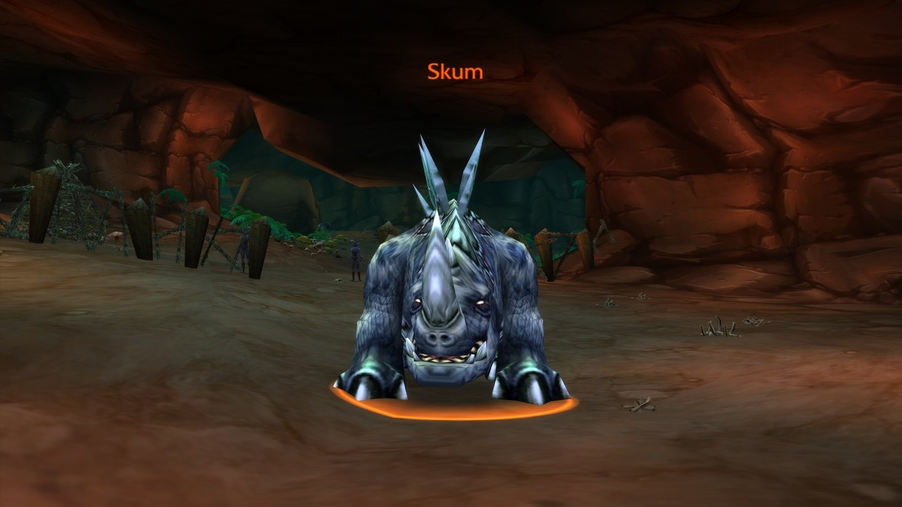
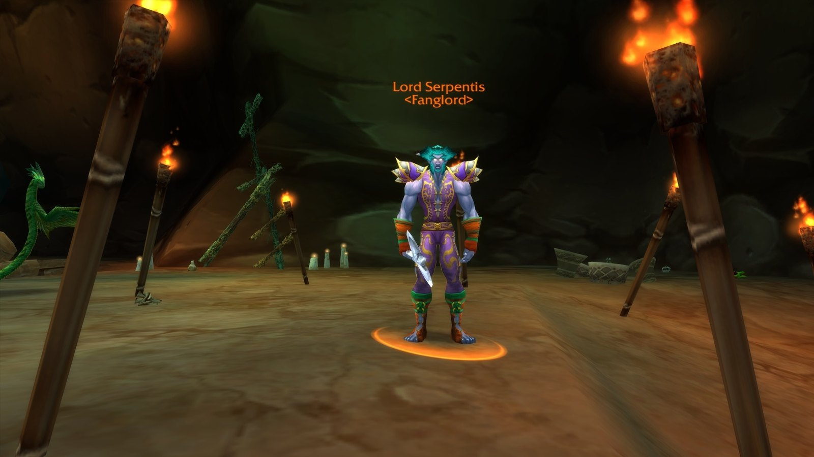
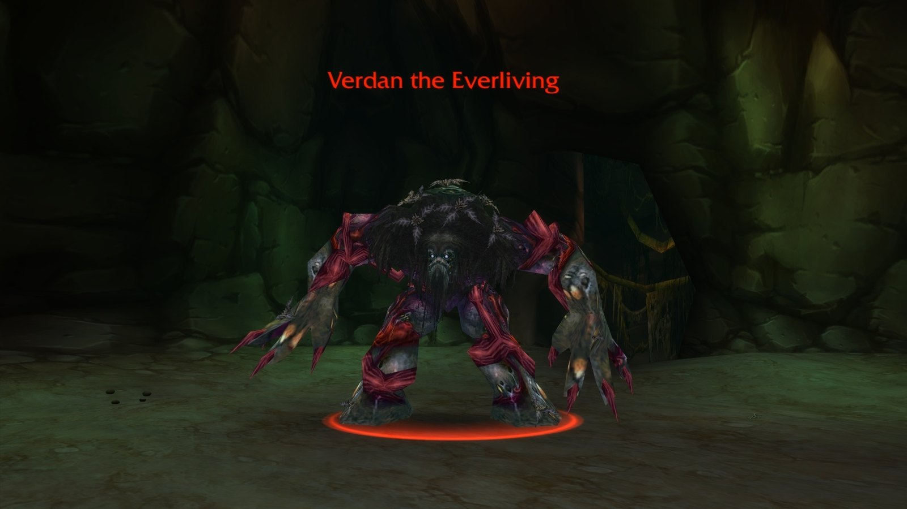

## Come arrivarci

**Horde.** Dai Crossroads vai verso sud-ovest fino alla Lushwater Oasis. L’imbocco della grotta è nel burrone a sud dell’oasi, in /way 46.0 36.3. Il sentiero scende fino a una caverna con una pozza e il portale. In quella grotta esterna pattugliano degli élite.

**Alliance.** Da Astranaar, in Ashenvale, vai verso est, attraversa il fiume e prendi la strada verso sud, dentro The Barrens. Va bene anche la nave da Booty Bay a Ratchet; da Ratchet, cavalca verso ovest.

## Il percorso

Un labirinto su più livelli. Da alcuni salti non si risale, quindi restate uniti. I numeri corrispondono alla mappa qui sopra.

1. **A ovest del portale.** <a class="wf-wh wf-plain" href="https://www.wowhead.com/forever/npc=3671">Lady Anacondra</a> (1) sta dove finisce il fiume. Più a ovest, <a class="wf-wh wf-plain" href="https://www.wowhead.com/forever/npc=3670">Lord Pythas</a> (4) aspetta nella Pit of Fangs e <a class="wf-wh wf-plain" href="https://www.wowhead.com/forever/npc=3669">Lord Cobrahn</a> (2) nella grotta sottostante.
2. **Il fiume.** <a class="wf-wh wf-plain" href="https://www.wowhead.com/forever/npc=3653">Kresh</a> (3) nuota tra le due metà. È facoltativo.
3. **A est del portale.** <a class="wf-wh wf-plain" href="https://www.wowhead.com/forever/npc=5775">Verdan the Everliving</a> (7) e <a class="wf-wh wf-plain" href="https://www.wowhead.com/forever/npc=3673">Lord Serpentis</a> (6) stanno nelle grotte sul lato est. <a class="wf-wh wf-plain" href="https://www.wowhead.com/forever/npc=3674">Skum</a> (5) aspetta più in basso, nella Crag of the Everliving, ed è facoltativo.
4. **Naralex.** Con i quattro Lords of the Fang morti, il Disciple of Naralex all’inizio del dungeon si offre di svegliare il suo maestro. Scortalo fino a Dreamer’s Rock, dove compare <a class="wf-wh wf-plain" href="https://www.wowhead.com/forever/npc=3654">Mutanus the Devourer</a> (8).

Il Deviate Faerie Dragon, un raro, vaga per le grotte a est. Lascia <a class="wf-wh wf-q3" href="https://www.wowhead.com/forever/item=5243">Firebelcher</a> e <a class="wf-wh wf-q3" href="https://www.wowhead.com/forever/item=6632">Feyscale Cloak</a>.

## Il trash importante

**Druids of the Fang.** Il loro Druid’s Slumber addormenta un giocatore fino a 15 secondi, guaritore compreso, e si curano con Healing Touch. Affrontateli uno alla volta, controllate gli altri e interrompete ogni lancio. Una volta in Serpent Form non possono più lanciare incantesimi.

**Raptor.** Con poca salute chiamano i mostri vicini. Ripulite intorno a loro prima del pull.

Portate chi rimuove sonno e veleno: la maggior parte dei wipe qui inizia con un guaritore addormentato o un veleno accumulato.

## I boss

### Lady Anacondra

Lightning Bolt, Sleep, Healing Touch e un’aura di Thorns. Interrompete la cura ogni volta; un secondo druido nel pull va controllato subito.

### Lord Cobrahn

Tre Deviate Pythons non élite lo circondano; uccideteli prima con danni ad area. Lancia Lightning Bolt, Druid’s Slumber e Healing Touch. Sotto metà salute diventa un serpente che avvelena: rimuovete il veleno e continuate a interrompere.

### Kresh

Una tartaruga con molta armatura e nessuna vera meccanica. Gli incantatori fanno più danni. Tiratela fuori dall’acqua, sulla riva.

### Lord Pythas

Arriva con un Druid of the Fang e un Deviate Shambler. Controllate il druido, uccidete lo Shambler e tenete qualcuno su Pythas per interrompere Sleep e Healing Touch. Thunderclap colpisce tutti in mischia.

### Skum

Una lucertola del tuono immune ai danni Nature. Il suo Chained Bolt salta tra i giocatori vicini, quindi allargatevi. Con poca salute scappa: tenetelo sul posto.

### Lord Serpentis

L’unico Lord of the Fang senza trash nel pull. Interrompete Sleep e Healing Touch.

### Verdan the Everliving

Grasping Vines blocca tutti entro 10 metri per 10 secondi e li atterra per 2. Non si può interrompere. I giocatori a distanza e il guaritore stanno alla massima distanza; scudi e cure nel tempo tengono in vita il tank mentre è a terra.

### Mutanus the Devourer

Durante il rituale, ondate di oozes e Deviate Moccasins attaccano il Disciple. Uccidetele prima. Poi Mutanus esce dall’acqua: Thundercrack colpisce tutti quelli vicini, Terrify fa fuggire un giocatore e Naralex’s Nightmare ne addormenta uno. Interrompete il Nightmare e tenetelo lontano dal Disciple. Se il Disciple muore o il gruppo cade, l’evento finisce fino al reset del dungeon.

## Cosa non si sa ancora

- **Le probabilità di drop** del bottino dei boss.
- **Le ricompense delle missioni** possono ancora cambiare prima del lancio.
