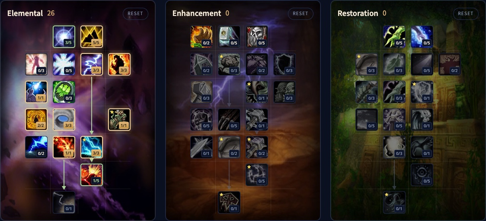

L'Elemental Shaman di WoW Forever combatte a distanza con fulmini e lava. La spec parte lenta, ma quando Lava Burst entra nella build, i grandi critici e i Lightning Bolt in più di Lightning Overload si accumulano in fretta. Con i tuoi totem sei benvenuto in ogni gruppo. Questa guida tratta la build di livello 30, i talenti chiave, la rotazione, i totem, il mana, le stats e le razze.

| | |
|---|---|
| Ruolo | Danni a distanza, su un bersaglio e sui gruppi |
| Build al livello 30 | 21 punti in Elemental, Talented aggiunge Trial by Fire 2/2, Lightning Overload 3/3 ed Elemental Fury 1/5 |
| Talenti chiave | Elemental Focus, Trial by Fire, Earthbound, Lava Burst, Lightning Overload |
| Punti forti | Buoni danni sui gruppi, totem per tutto il raid, tanta utilità |
| Punti deboli | Il mana, nessun controllo forte, il posizionamento dei totem |
| Altre guide dello Shaman | [Enhancement Shaman](/it/guides/enhancement-shaman/), [Restoration Shaman](/it/guides/restoration-shaman/), [Guida al leveling dello Shaman](/it/guides/shaman-leveling/), [build di leveling dello Shaman](/it/leveling/shaman/) |

## Punti forti e deboli

**Danni sui gruppi.** Magma Totem e Fire Nova, ora un incantesimo a sé che esplode dal tuo totem del fuoco attivo, rendono facili i danni ad area. Chain Lightning si aggiunge.

**Potenziamenti per il gruppo.** I totem danno stats, Windfury alle armi e resistenze. In Forever funzionano per tutto il raid, non solo per il tuo gruppo.

**Utilità.** Purge toglie un potenziamento nemico, Earth Shock interrompe, e curi veleni e malattie. Con Improved Ghost Wolf ti muovi in fretta in combattimento, anche al chiuso.

**Mana.** Gli Shaman consumano molto mana, e l'Elemental ancora di più: lanci di continuo per fare danni e i migliori talenti per il mana arrivano tardi. Finché l'equipaggiamento non migliora, è il freno principale della spec.

**Poco controllo.** Nessun controllo forte. Earthbind Totem rallenta, e con Earthbound immobilizza, ma cade ai tuoi piedi.

**Posizionamento.** Windfury Totem deve raggiungere il corpo a corpo, i totem delle stats il gruppo, e Magma Totem i nemici che colpisci con Fire Nova.

## La build di livello 30

La beta si è fermata al livello 30, quindi la build usa 21 punti. Talented, dal sistema Legacy, ne aggiunge 5. [Apri la build nel calcolatore di talenti](/it/talents/shaman/?t=3500331013101).

| Talento | Punti |
|---|---|
| **Convection** | 3/5 |
| **Concussion** | 5/5 |
| **Elemental Alacrity** | 3/3 |
| **Call of Flame** | 3/3 |
| **Elemental Focus** | 1/1 |
| **Trial by Fire** | 1/2 |
| **Eye of the Storm** | 3/3 |
| **Earthbound** | 1/1 |
| **Lava Burst** | 1/1 |

[Apri la versione Talented](/it/talents/shaman/?t=350033102310131) con Trial by Fire 2/2, Lightning Overload 3/3 ed Elemental Fury 1/5.

Lava Burst è nella quinta riga e richiede 20 punti sopra, quindi è il 21° punto. La nostra [guida al leveling dello Shaman](/it/guides/shaman-leveling/) ha una versione in solitaria con il secondo punto in Trial by Fire al posto di Earthbound.

## Cosa fanno i talenti chiave

| Talento | Cosa fa in Forever |
|---|---|
| **Convection** | A 3/5: gli Shock, Lightning Bolt, Lava Burst e Chain Lightning costano il 6% di mana in meno |
| **Concussion** | Lightning Bolt, Chain Lightning ed Earth Shock fanno il 5% di danni in più |
| **Elemental Alacrity** | Lightning Bolt, Chain Lightning e Lava Burst si lanciano 0,5 secondi più in fretta |
| **Call of Flame** | I totem del fuoco, Flame Shock, Fire Nova e Lava Burst fanno il 15% di danni in più, e Flame Shock dura 9 secondi in più |
| **Elemental Focus** | 10% di probabilità, dopo un incantesimo di danno, che il successivo non costi mana |
| **Trial by Fire** | A 2/2: Fire Nova fa il 20% di danni in più con un tempo di ricarica di 4 secondi più breve, e Magma Totem dura 20 secondi in più |
| **Eye of the Storm** | 70% di probabilità che i danni non rallentino Lightning Bolt, Chain Lightning e Lava Burst |
| **Earthbound** | Earthbind Totem immobilizza i nemici vicini per 5 secondi quando lo piazzi |
| **Lava Burst** | Scaglia lava per 113-146 danni da Fuoco, il 20% in più se il tuo Flame Shock è sul bersaglio. Lancio di 2,5 secondi, ricarica di 10 secondi |
| **Lightning Overload** | 10% di probabilità che Lightning Bolt e Chain Lightning lancino una seconda copia a metà danni, gratis e senza minaccia |
| **Elemental Fury** | A 1/5: il 20% di danni critici in più per i tuoi incantesimi di fuoco, gelo e natura e i tuoi Searing e Magma Totem |

Lightning Overload è il talento che rende divertente la spec in Forever: l'incantesimo in più non ti costa nulla. Elemental Fury cresce con ogni punto che aggiungi dopo il livello 30.

## Rotazione

### Un bersaglio

1. Tieni giù Searing Totem. Entra prima in combattimento, per non sprecare il totem.
2. Attacca con Lava Burst.
3. Lancia Flame Shock subito dopo: lo shock istantaneo arriva prima della lava, più lenta, e Lava Burst fa così più danni.
4. Tieni Flame Shock sul bersaglio.
5. Lancia Lava Burst appena è pronto.
6. Riempi con Lightning Bolt.

### Gruppi

1. Tieni giù Magma Totem a portata dei nemici.
2. Attacca con Lava Burst, poi Flame Shock subito dopo.
3. Lancia Fire Nova appena è pronto.
4. Lancia Chain Lightning finché il mana lo permette.

## Il mana

1. **Clearcasting** di Elemental Focus: usalo sempre, anche su un incantesimo non ideale in quel momento.
2. **Convection** fa risparmiare molto in un combattimento intero, tanto più quanto cresce la tua riserva di mana.
3. **Mindfulness**, 3 punti all'inizio dell'albero Restoration, mantiene il 50% della rigenerazione di mana mentre lanci. Vale la pena quando hai punti liberi.
4. **Mana Spring Totem** nello slot del totem dell'acqua, e **pozioni di mana** nelle borse.
5. **Water Shield**, più in basso nell'albero Restoration, restituisce mana con i critici. In Forever non dà mana passivo.

## Totem e movimento

- **Call of the Elements** e gli altri incantesimi Call piazzano un set salvato di quattro totem con un solo tasto. Hanno un tempo di lancio.
- **Totemic Recall** riprende i totem in cambio di un po' di mana. **Totemic Projection** sposta i totem attivi fino a 30 metri, ma costa molto mana: usalo con parsimonia.
- **Windfury Totem** è il miglior potenziamento per il corpo a corpo del gioco. Senza il limite al gruppo, funziona per tutto il raid.
- **Tremor Totem** toglie paura, sonno e ammaliamento agli alleati a portata. Un buon tempismo salva i dungeon.
- **Poison Cleansing Totem** e **Disease Cleansing Totem** tolgono un effetto per impulso.
- **Ghost Wolf** con Improved Ghost Wolf è istantaneo e funziona al chiuso, per riposizionarti in combattimento. Entrare e uscire dalla forma costa un tempo di ricarica globale.

Piazza solo i totem che servono a te e al gruppo, e mettiti d'accordo con gli altri Shaman.

## Incantesimi al passaggio del mouse

Il lancio al passaggio del mouse è integrato in Forever. Attivalo in Options, Combat: gli incantesimi vanno all'unità sotto il mouse, riquadri compresi, mentre tieni il tuo bersaglio. Così usi Purge o curi un veleno senza perdere il bersaglio. Click Casting, nel menu dei tasti, dà a ogni tasto del mouse un incantesimo.

## Stats ed equipaggiamento

Le priorità delle stats per il livello 60 arriveranno dopo il lancio. Fino ad allora:

- **Danni degli incantesimi**: la tua stat di danno principale, e non c'è su ogni pezzo.
- **Probabilità di critico**: ogni critico rende di più il tuo mana, ed Elemental Fury li rende più forti.
- **Hit**: meno importante all'inizio, ma un incantesimo mancato costa danni e mana. Una priorità alta verso il livello 60.
- **Intelletto**: più riserva di mana e più critico degli incantesimi.
- **Spirito**: la tua rigenerazione di mana principale in Forever.
- **Celerità**: incantesimi e tempo di ricarica globale più rapidi, ma Flame Shock non fa tick più in fretta, e consumi mana più rapidamente.

**Armatura.** Stoffa, cuoio o maglia, quello che ha le stats giuste: un tipo di armatura più leggero non ha penalità in Forever. Dungeon e Leatherworking danno buon equipaggiamento per il leveling.

**Arma.** Più danni degli incantesimi possibile, poi Intelletto e hit. Un'arma a una mano con scudo di solito è la scelta migliore, ma va bene anche un bastone migliore.

**Totem.** Lo slot della reliquia dello Shaman. Ancora rari; cercane uno che aiuti il tuo mana.

## Razze e professioni

| Fazione | Razza | Perché |
|---|---|---|
| Alliance | Dwarf | L'unico Shaman dell'Alliance, con l'1% di hit da Artisan's Precision |
| Horde | Orc | Blood Fury per una finestra di danni, la scelta più forte |
| Horde | Troll | Abilità di sopravvivenza e Berserking |
| Horde | Tauren | Abilità razziali difensive, niente per i danni |
| Horde | Windshaper Skyborne | Il 2% di Haste in più per incantesimi e mischia |

**Leatherworking** crea equipaggiamento con buone stats mentre sali di livello, con potere magico, raro all'inizio. **Engineering** crea monili e congegni potenti. **Enchanting** crea presto un buon totem, <a class="wf-wh wf-q3" href="https://www.wowhead.com/forever/item=249398">Polished Driftwood Icon</a>. Di più sui gruppi nelle nostre [guide ai dungeon](/it/guides/dungeons/).
