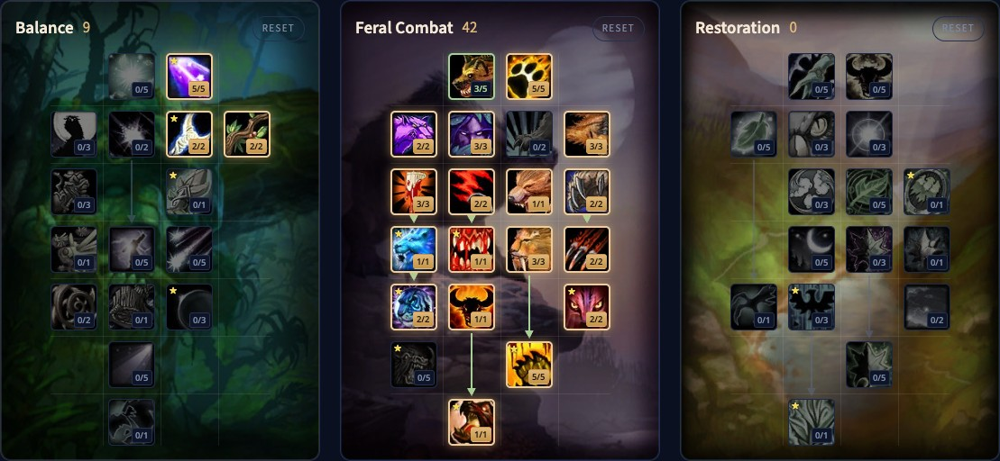

Il Feral Druid di WoW Forever sono due spec in una: un felino che fa danni in mischia con energia e Combo Points, e un orso che tanka con la rabbia. Puoi costruire per uno dei due o tenerli entrambi. Il vecchio powershifting non c'è più, ma Shifting Power trasforma il mana in energia, e puoi usare i consumabili e parlare con la maggior parte dei PNG senza uscire dalla forma. Questa guida copre quattro build per il livello 60, i talenti chiave, le due rotazioni, le risorse, le stats e le razze.

| | |
|---|---|
| Ruolo | Danni in mischia in Cat Form, tank in Bear Form |
| Build per il livello 60 | Ibrida 9/42/0, Felino 9/40/2, Orso 9/42/0, Solo 0/35/16 |
| Talenti chiave | Feral Charge, Shifting Power, Primal Bite, Leader of the Pack, Berserk, Nature's Reach |
| Punti forti | Due ruoli in uno, Leader of the Pack, il personaggio più veloce al chiuso e all'aperto |
| Punti deboli | Danni da ibrido, tre risorse da seguire, difficile da padroneggiare |
| Altre guide del Druid | [Guida al leveling del Druid](/it/guides/druid-leveling/), [Balance Druid](/it/guides/balance-druid/), [Restoration Druid](/it/guides/restoration-druid/) |

## Punti forti e deboli

**Due ruoli.** Il felino fa danni come un Rogue, l'orso tanka come un Warrior, e puoi cambiare a metà combattimento. Fuori forma hai ancora Rebirth, Innervate, Remove Curse e qualche cura.

**Buff da raid.** Mark of the Wild, Thorns e Faerie Fire come ogni Druid, più Leader of the Pack: il 3% di probabilità di critico in più in mischia e a distanza per tutto il gruppo o il raid entro 45 metri. Demoralizing Roar riduce i danni del nemico.

**Mobilità.** Feral Swiftness ti rende il 30% più veloce in Cat Form, anche al chiuso. <a class="wf-wh wf-spell" href="https://www.wowhead.com/forever/spell=1850">Dash</a>, Feral Charge e Pounce accorciano le distanze in combattimento, e Prowl ti fa passare accanto al pericolo.

**Danni da ibrido.** Blizzard tiene gli ibridi un po' sotto le classi di danno pure in media. Puoi ancora finire in cima ai contatori, solo meno spesso di un Rogue.

**Tre risorse.** Il felino segue energia, Combo Points e, per Shifting Power, il mana. L'orso ha la rabbia. Aggiungi sanguinamenti e debuff, e il Feral diventa una delle spec più difficili da padroneggiare.

## Quattro build per il livello 60

Tutte e quattro usano 51 punti, il totale dei talenti al livello 60. Ogni build mette 9 punti in Balance per Genesis 5/5, Nature's Majesty 2/2 e Nature's Reach 2/2, tranne quella in solitaria.

### Ibrida, 9/42/0

Felino e orso in una sola build, per i gruppi di endgame che chiedono l'uno o l'altro ruolo. [Apri la build nel calcolatore di talenti](/it/talents/druid/?t=050022-35230332121132212051).

| Talento | Punti |
|---|---|
| **<a class="wf-wh wf-spell" href="https://www.wowhead.com/forever/spell=16934">Ferocity</a>** | 3/5 |
| **<a class="wf-wh wf-spell" href="https://www.wowhead.com/forever/spell=17003">Heart of the Wild</a>** | 5/5 |
| **Feral Swiftness** | 2/2 |
| **Feral Instinct** | 3/3 |
| **Thick Hide** | 3/3 |
| **Shredding Attacks** | 3/3 |
| **Savage Fury** | 2/2 |
| **Feral Charge** | 1/1 |
| **Sharpened Claws** | 2/2 |
| **Shifting Power** | 1/1 |
| **Primal Bite** | 1/1 |
| **Predatory Strikes** | 3/3 |
| **Blood Frenzy** | 2/2 |
| **Improved Shifting Power** | 2/2 |
| **Leader of the Pack** | 1/1 |
| **Natural Instinct** | 2/2 |
| **Rend and Tear** | 5/5 |
| **Berserk** | 1/1 |

### Felino, 9/40/2

Per un Druid che non tanka mai. [Apri la build nel calcolatore di talenti](/it/talents/druid/?t=050022-55230032121032212051-02). Rispetto alla build ibrida: Ferocity 5/5 invece di 3/5, niente Thick Hide e niente Primal Bite, e Furor 2/5 in Restoration.

### Orso, 9/42/0

Per un Druid che tanka soltanto, con più rabbia e sopravvivenza. [Apri la build nel calcolatore di talenti](/it/talents/druid/?t=050022-55230302120132012451). Rispetto alla build ibrida: Ferocity 5/5 e Natural Reaction 4/5, senza Shredding Attacks, Shifting Power e Improved Shifting Power.

### Solo, 0/35/16

Per missioni e farm in solitaria: cambi di forma più economici e cure su di te efficienti, al prezzo di un po' di rendimento in gruppo. [Apri la build nel calcolatore di talenti](/it/talents/druid/?t=-05230032121032212051-15503001001). Feral Combat come nella build da felino senza Ferocity, e in Restoration Nature's Focus 1/5, Furor 5/5, Naturalist 5/5, Natural Shapeshifter 3/3, Gift of the Earthmother 1/1 e Swiftmend 1/1.

## Cosa fanno i talenti chiave

| Talento | Cosa fa in Forever |
|---|---|
| **Nature's Reach** | Il 4% di probabilità di colpire in più, e il 20% di portata in più per gli incantesimi offensivi di Balance |
| **<a class="wf-wh wf-spell" href="https://www.wowhead.com/forever/spell=17003">Heart of the Wild</a>** | Il 10% di Intellect in più, il 20% di Stamina in più in Bear Form, il 10% di Strength in più in Cat Form |
| **Feral Charge** | Solo da orso: carica un nemico, lo immobilizza e interrompe il suo incantesimo per 4 secondi, poi salta dietro di lui |
| **Shifting Power** | Trasforma subito il 55% del tuo mana base in 40 energia |
| **Primal Bite** | Un morso al 100% dei danni dell'arma più un bonus, con molta minaccia |
| **Blood Frenzy** | 5 rabbia in più con un critico in Bear Form, un Combo Point in più con un critico in Cat Form |
| **Leader of the Pack** | Il 3% di probabilità di critico in più in mischia e a distanza per il gruppo o il raid entro 45 metri |
| **Natural Reaction** | Il 5% di schivata in più e 5 rabbia a ogni schivata |
| **Rend and Tear** | Il 10% di danni in più con le abilità in mischia sui bersagli che sanguinano |
| **Berserk** | Primal Bite colpisce fino a 3 bersagli senza tempo di recupero, il 100% di probabilità di critico in più per i generatori di Combo Points, e rimuove e blocca la paura |
| **Furor** | 10 rabbia entrando in Bear Form; Cat Form ti restituisce l'energia che avevi, più 10 energia per ogni secondo passato fuori da Bear Form |
| **Gift of the Earthmother** | Tempo di recupero globale più corto di 0,5 secondi su Rejuvenation, Swiftmend e Wild Growth |

Per la build in solitaria: un Rejuvenation veloce e Swiftmend ti curano, e torni nella tua forma.

## Rotazione da felino

1. Tieni Thorns su di te quando sei da solo.
2. Tieni Faerie Fire sul bersaglio.
3. Rip a 5 Combo Points.
4. Tieni attivo Rake.
5. Shifting Power appena disponibile quando sei sotto 50 energia.
6. Shred per accumulare Combo Points, o <a class="wf-wh wf-spell" href="https://www.wowhead.com/forever/spell=1082">Claw</a> se non riesci a stare dietro al bersaglio.

Tieni da parte abbastanza energia per rimettere un sanguinamento appena finisce, ma non rinnovarlo prima. Sui mostri che muoiono in fretta, salta i sanguinamenti e resta su Shred o Claw. Ferocious Bite per ora non vale la sua energia.

## Rotazione da orso

1. Tieni Thorns su di te.
2. Tieni Faerie Fire sul bersaglio; serve anche ad attirare a distanza.
3. Tieni attivo Demoralizing Roar.
4. Primal Bite sul bersaglio principale appena disponibile.
5. Lacerate fino a 5 cariche, e tienile attive.
6. <a class="wf-wh wf-spell" href="https://www.wowhead.com/forever/spell=779">Swipe</a> contro più bersagli, <a class="wf-wh wf-spell" href="https://www.wowhead.com/forever/spell=6807">Maul</a> contro uno solo.

Sui mostri deboli: Primal Bite e Maul su un bersaglio, o solo Swipe su un gruppo.

## Tempi di recupero e utilità

- **Growl** provoca un nemico, **Challenging Roar** tutti i nemici intorno a te, con 10 minuti di tempo di recupero.
- **Cower** abbassa la tua minaccia da felino.
- **Barkskin** riduce i danni subiti, in ogni forma.
- **Frenzied Regeneration** trasforma la rabbia in salute in Bear Form. Solo se sei in pericolo, perché quella rabbia è la tua minaccia.
- **<a class="wf-wh wf-spell" href="https://www.wowhead.com/forever/spell=5229">Enrage</a>** dà rabbia ma abbassa l'armatura. Buono per la minaccia, rischioso contro i colpi fisici pesanti.
- **Innervate** e **Rebirth** ti fanno uscire dalla forma. Rebirth è l'unica resurrezione in combattimento del gioco, con un lungo tempo di recupero.

## Risorse e forme

**Il mana continua a rigenerarsi in forma.** È nascosto di default. Attiva il Personal Resource Display in Options, Combat, per vedere se hai il mana per Shifting Power, un incantesimo di utilità o un ritorno in forma.

**L'energia** arriva a 100 e si ricarica a scatti come il mana. **I Combo Points** arrivano a 5 per bersaglio e non passano a un altro bersaglio.

**La rabbia** parte da 0, o da 10 con Furor, e arriva a 100. La ottieni subendo danni, con i critici grazie a Blood Frenzy, con le schivate grazie a Natural Reaction e con Enrage.

**Resta in una forma.** Powershifting e bear weaving non convengono più. In cambio ora puoi usare consumabili e parlare con la maggior parte di PNG e oggetti senza uscire dalla forma.

**I sanguinamenti** ignorano l'armatura e attivano Rend and Tear. Tienili attivi e rinnovali subito dopo che finiscono.

## Posizionamento

Da felino stai dietro al bersaglio: Shred lo richiede, il nemico non può pararti e eviti gli attacchi frontali. Feral Charge ti mette dietro al bersaglio, ma solo da Bear Form. Da orso sei tu a dettare il ritmo: porta gli incantatori dietro un angolo per raggrupparli, poi gira il gruppo di mostri lontano dal tuo gruppo.

## Stats ed equipaggiamento

**Felino:** Hit fino al tetto (Nature's Reach dà il 4%, contro i boss dei raid serve il 9%), poi Expertise fino al suo tetto, poi Crit, Agility (potenza d'attacco e Crit), Strength (il doppio della potenza d'attacco dell'Agility) e potenza d'attacco. La Haste è rara.

**Orso:** le stats del felino per la minaccia, più Defense fino a 440 contro i boss dei raid perché non possano colpirti con critici, Dodge (non puoi bloccare né parare), armatura e Stamina. Un Druid tank incassa i colpi pesanti con tanta salute, non con la mitigazione.

**Equipaggiamento.** Cuoio con le stats qui sopra. In Forever gli attacchi Feral usano i danni dell'arma, quindi cerca un'arma a due mani che colpisca forte, ma non una con stats inutili. Un **idolo** nello slot della reliquia dà un piccolo bonus; portarne due da alternare va bene. L'equipaggiamento del livello 60 non si conosce ancora.

## Razze e professioni

| Fazione | Razza | Perché |
|---|---|---|
| Alliance | Night Elf | Bonus ai critici, buono con una build piena di critici |
| Alliance | Skyborne | Haste e un tempo di recupero per rigenerare mana |
| Horde | Tauren | Stordimento ad area e bonus ai danni critici |
| Horde | Skyborne | Haste e un tempo di recupero di velocità, meno utile di quello per il mana dell'Alliance |

Le differenze sono piccole, quindi scegli la razza che ti piace. **Leatherworking** crea parte del miglior equipaggiamento in cuoio, in parte solo per i conciatori. **Engineering** dà gadget utili. **Herbalism** si addice a un Druid, perché raccogli in Travel Form, e **Alchemy** trasforma quelle erbe nei tuoi consumabili. Di più sui gruppi nelle nostre [guide ai dungeon](/it/guides/dungeons/).
