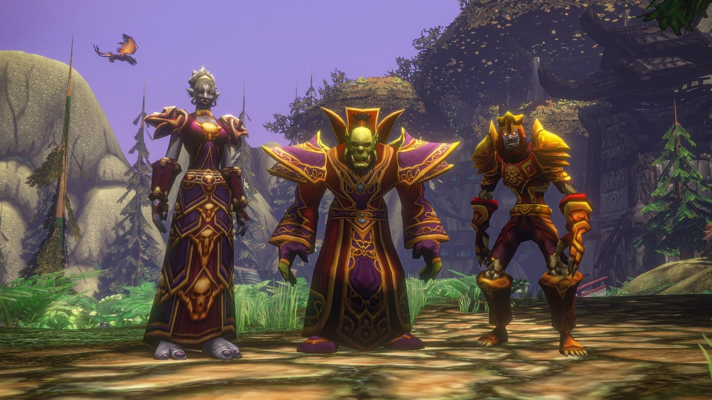

Il Fire Mage di WoW Forever vive di colpi critici. Heating Up trasforma i critici in un Pyroblast rapido, Ignite fa bruciare il bersaglio dopo ogni critico, e il nuovo Fire Power premia ogni effetto di Fuoco sul bersaglio. La spec cresce molto con l’equipaggiamento, ma parte lenta durante il leveling. Questa guida copre le build, la rotazione, il mana, la sopravvivenza e l’equipaggiamento.

| | |
|---|---|
| Ruolo | Danni a distanza, critici e bruciature |
| Build al livello 30 | Da 19 a 21 punti in Fire, Talented aggiunge Critical Mass e probabilità di colpire |
| Talenti chiave | Heating Up, Pyroblast, Ignite, Improved Scorch, <a class="wf-wh wf-spell" href="https://www.wowhead.com/forever/spell=18459">Incineration</a> |
| Punti forti | Danni alti che crescono con l’equipaggiamento, buon mana, utilità per il gruppo |
| Punti deboli | Ha bisogno di probabilità di critico, debole durante il leveling |
| Livellare | [Guida al leveling del Mage](/it/guides/mage-leveling/) |
| Altre spec | [Frost Mage](/it/guides/frost-mage/), [Arcane Mage](/it/guides/arcane-mage/) |

## Cosa cambia per Fire

- **Heating Up è nuovo.** Un talento al livello 25. Ogni colpo critico non periodico con Fireball, Frostfire Bolt, Fire Blast o Scorch rende il tuo prossimo Pyroblast entro 20 secondi più veloce del 25%, fino a 3 accumuli. Fire Blast dà un accumulo a ogni colpo.
- **Critical Mass è più forte.** Il 2% di probabilità di critico per gli incantesimi di Fuoco per punto, il 10% con 5/5.
- **Fire Power è rifatto.** Ora conta i tuoi effetti di Fuoco sul bersaglio, fino a quattro: il 3% di danni da Fuoco in più per effetto con 3/3, quindi al massimo il 12%.
- **Ignite è più debole.** Brucia per il 40% del critico in 4 secondi. Far rotolare Ignite da un critico all’altro non conviene più.
- **Flamestrike non si accumula più.** Su un bersaglio resta una sola bruciatura di Flamestrike.

## Punti forti e deboli

| Punti forti | Punti deboli |
|---|---|
| Pyroblast ora fa parte della rotazione, grazie a Heating Up | Senza probabilità di critico, Heating Up e Ignite fanno poco |
| Cresce molto con la probabilità di critico, l’equipaggiamento e il livello | La spec di Mage più debole durante il leveling |
| Consuma meno mana di Arcane, più avanti con Master of Elements | Meno sopravvivenza di Frost, e niente <a class="wf-wh wf-spell" href="https://www.wowhead.com/forever/spell=11958">Ice Block</a> |
| <a class="wf-wh wf-spell" href="https://www.wowhead.com/forever/spell=1459">Arcane Intellect</a>, <a class="wf-wh wf-spell" href="https://www.wowhead.com/forever/spell=604">Dampen Magic</a>, <a class="wf-wh wf-spell" href="https://www.wowhead.com/forever/spell=1008">Amplify Magic</a>, cibo, acqua e portali | Contro i boss serve probabilità di colpire, che costa punti talento |

## Due build per il livello 30

Entrambe le build usano i 21 punti che hai al livello 30. Talented, dal sistema Legacy, aggiunge 5 punti a ciascuna.

### Build da dungeon

Per i dungeon e i boss di livello superiore. 2/5 in Elemental Precision in Frost evita che i tuoi incantesimi manchino, e 3/3 in Improved Scorch entra anche senza Talented, perché il bonus ai danni da Fuoco è molto forte. Non restano punti per Critical Mass o Master of Elements senza rinunciare alla probabilità di colpire. [Apri la build nel calcolatore dei talenti](/it/talents/mage/?t=-015500301301-002).

| Talento | Punti |
|---|---|
| **Improved Fireball** | 5/5 |
| **<a class="wf-wh wf-spell" href="https://www.wowhead.com/forever/spell=18459">Incineration</a>** | 1/3 |
| **Ignite** | 5/5 |
| **Burning Soul** | 3/3 |
| **Pyroblast** | 1/1 |
| **Improved Scorch** | 3/3 |
| **Heating Up** | 1/1 |
| **Elemental Precision** | 2/5 |

[Apri la versione Talented](/it/talents/mage/?t=-02550030130103-003) con Incineration 2/3, Critical Mass 3/5 ed Elemental Precision 3/5.

### Build in solitario

Per le quest contro mostri del tuo livello o più deboli, quindi senza Elemental Precision. Tutti i punti vanno in Fire, con Incineration 2/3 e il primo punto di Critical Mass per più critici. [Apri la build nel calcolatore dei talenti](/it/talents/mage/?t=-02550030130101).

| Talento | Punti |
|---|---|
| **Improved Fireball** | 5/5 |
| **<a class="wf-wh wf-spell" href="https://www.wowhead.com/forever/spell=18459">Incineration</a>** | 2/3 |
| **Ignite** | 5/5 |
| **Burning Soul** | 3/3 |
| **Pyroblast** | 1/1 |
| **Improved Scorch** | 3/3 |
| **Heating Up** | 1/1 |
| **Critical Mass** | 1/5 |

[Apri la versione Talented](/it/talents/mage/?t=-0255003013010501) con Critical Mass 5/5 e Fire Power 1/3. Vuoi più burst? Prendi <a class="wf-wh wf-spell" href="https://www.wowhead.com/forever/spell=11113">Blast Wave</a> al posto di Fire Power, per un attacco ad area ogni 45 secondi. La [build di leveling del Mage](/it/leveling/mage/) dà un talento per ogni livello dal 10 al 35.

### Cosa fanno i talenti chiave

| Talento | Cosa fa in Forever |
|---|---|
| **Improved Fireball** | Fireball e Frostfire Bolt si lanciano 0,5 secondi più in fretta con 5/5. Obbligatorio |
| **<a class="wf-wh wf-spell" href="https://www.wowhead.com/forever/spell=18459">Incineration</a>** | Il 6% di probabilità di critico in più per Fire Blast e Scorch con 3/3, anche per Arcane Blast e Ice Lance. Ogni punto dà più Heating Up |
| **Ignite** | Ogni critico di Fuoco fa bruciare il bersaglio per il 40% dei danni in 4 secondi |
| **Pyroblast** | Un lancio lungo con danni pesanti e una bruciatura. Il cuore della spec |
| **Burning Soul** | Il 70% di probabilità di continuare il lancio quando subisci danni, e il 30% di minaccia in meno con gli incantesimi di Fuoco |
| **Improved Scorch** | Ogni Scorch aggiunge un accumulo: il 3% di danni da Fuoco in più da parte tua per accumulo, il 15% con 5 |
| **Heating Up** | Pyroblast fino al 75% più veloce dopo i critici. Senza, la spec crolla |
| **Critical Mass** | Il 10% di probabilità di critico in più per gli incantesimi di Fuoco con 5/5 |
| **Fire Power** | Più danni da Fuoco per ogni effetto di Fuoco sul bersaglio, vedi sotto |
| **Elemental Precision** | L’1% di probabilità di colpire in più con gli incantesimi di Fuoco e Gelo per punto. Necessario contro i boss |

## Rotazione

**Un nemico**
1. Prelancia Pyroblast prima di uno scontro con un boss. Attira un mostro normale con Fireball.
2. Lancia Scorch finché Improved Scorch ha 5 accumuli.
3. Lancia Fire Blast appena è pronto: dà sempre un accumulo di Heating Up.
4. Lancia Fireball, e di nuovo Scorch quando gli accumuli stanno per scadere.
5. Lancia Pyroblast appena Heating Up ha 3 accumuli.
6. <a class="wf-wh wf-spell" href="https://www.wowhead.com/forever/spell=1326053">Frost Blast</a> per rallentare un bersaglio a distanza, Frost Nova rango 1 per bloccare un mostro pericoloso, Cone of Cold quando ti raggiunge.
7. Counterspell su un lancio pericoloso, Polymorph su un nemico extra pericoloso.

**Un gruppo di nemici**
1. Lancia Flamestrike, e di nuovo quando la sua bruciatura scade. Non si accumula più.
2. Lancia Blast Wave appena è pronto dopo Flamestrike, se l’hai preso.
3. Ripeti Arcane Explosion.

Ai livelli alti la rotazione è così: Improved Scorch a 5 accumuli, Fire Blast, Fireball, Pyroblast, Fireball, Fire Blast, Pyroblast, e così via.

## Heating Up e Fire Power

**Heating Up** è il nucleo della spec. Ogni colpo critico non periodico dà un accumulo, e ogni accumulo rende il prossimo Pyroblast più veloce del 25%, fino al 75% con 3 accumuli. Ai livelli bassi scatta appena, perché la tua probabilità di critico è bassa. Incineration, Critical Mass, l’equipaggiamento e i livelli lo rendono più affidabile. Fire Blast dà un accumulo a ogni colpo e due con un critico, quindi lo lanci appena è pronto.

**Fire Power** conta gli effetti di Fuoco sul tuo bersaglio, fino a quattro: la bruciatura di Fireball, Improved Scorch, Ignite e la bruciatura di Pyroblast. Gli effetti che mescolano scuole, come <a class="wf-wh wf-spell" href="https://www.wowhead.com/forever/spell=401502">Frostfire Bolt</a>, non contano. Il bonus non appare né come buff né come debuff sul bersaglio. Oscilla tra 2 e 4 effetti: Improved Scorch e Fireball ci sono quasi sempre, Ignite e Pyroblast dipendono dai tuoi critici.

## Mana

Gli incantesimi di Fuoco costano molto, ma Fire chiede meno gestione del mana di Arcane.

- **Master of Elements** con 3/3 restituisce il 30% del costo base di ogni critico di Fuoco o Gelo. Fuori portata al livello 30, ma più avanti scatta quasi sempre.
- **<a class="wf-wh wf-spell" href="https://www.wowhead.com/forever/spell=6117">Mage Armor</a>** dal livello 34 mantiene il 50% della tua rigenerazione di mana mentre lanci. Una puntata su Arcane Meditation la porta al 100%.
- **<a class="wf-wh wf-spell" href="https://www.wowhead.com/forever/spell=12051">Evocation</a>** ricarica il tuo mana in pochi secondi, con un tempo di recupero lungo. Tienilo per i lunghi scontri con i boss. Un High Order Skyborne può combinarlo con <a class="wf-wh wf-spell" href="https://www.wowhead.com/forever/spell=1259705">Read Leyline</a>.
- **Le gemme di mana** come <a class="wf-wh wf-spell" href="https://www.wowhead.com/forever/spell=759">Conjure Mana Agate</a> restituiscono mana con una sola carica per gemma. Preparane una nuova prima di ogni scontro lungo.
- **Le pozioni di mana** restituiscono molto, secondo il loro livello.

## Sopravvivenza

Fire sopravvive meno di Frost e non ha Ice Block. Uccidi il bersaglio prima che uccida te, e scegli i tuoi scontri. <a class="wf-wh wf-spell" href="https://www.wowhead.com/forever/spell=1953">Blink</a> e Frost Nova ti tirano fuori dalla maggior parte dei guai. <a class="wf-wh wf-spell" href="https://www.wowhead.com/forever/spell=1463">Mana Shield</a> costa troppo mana per usarlo sempre, ma Mana Shield con Evocation può salvarti come ultima risorsa.

Usa Frost Blast o Frostbolt rango 1 per rallentare un bersaglio a distanza, Cone of Cold come rallentamento istantaneo (i primi quattro bersagli rallentano di più), e Polymorph per togliere un bersaglio dallo scontro. Blast Wave stordisce anche tutto intorno a te. Recinti, colline ed edifici bloccano la linea di vista, e questo ti fa guadagnare lanci.

## Tempi di recupero e utilità

- **Frost Nova** serve in attacco e in difesa. Usala più spesso che puoi.
- **Fire Blast** va lanciato appena è pronto, per Heating Up.
- **Blast Wave** fa danni pesanti intorno a te e stordisce, buono per il burst o come rallentamento quando Cone of Cold è in recupero.
- **<a class="wf-wh wf-spell" href="https://www.wowhead.com/forever/spell=475">Remove Lesser Curse</a>** rimuove Curses e Banes. Usalo in fretta su quelli pericolosi.
- **Amplify Magic** fa subire più danni dagli incantesimi a un membro del gruppo, ma anche ricevere più cure. Buono contro i danni fisici.
- **Dampen Magic** riduce i danni degli incantesimi, ma anche le cure ricevute. Usalo contro gli incantatori, non contro nemici che ti abbattono in fretta.
- **Polymorph** un bersaglio pericoloso a ogni pull di gruppo.

## Stats ed equipaggiamento

L’ordine esatto al livello 60 arriverà dopo il lancio. Queste stats aiutano un Fire Mage:

- **Il potere magico e il potere magico da Fuoco** per primi. Quello da Fuoco aiuta solo gli incantesimi di Fuoco, e funziona con Fire Power.
- **La probabilità di critico** è il cuore della spec: un critico fa il 50% di danni in più, e Heating Up, Incineration, Critical Mass, Ignite e Combustion si basano tutti su di essa.
- **L’Intellect** per più riserva di mana e più probabilità di critico.
- **La Haste** dà lanci più rapidi. Ai livelli bassi ce l’hanno solo il Troll (<a class="wf-wh wf-spell" href="https://www.wowhead.com/forever/spell=20554">Berserking</a>) e l’High Order Skyborne (<a class="wf-wh wf-spell" href="https://www.wowhead.com/forever/spell=1259710">Wind Blessed</a>).
- **Lo Spirit e il mana ogni 5 secondi** aiutano appena Mage Armor mantiene parte della rigenerazione mentre lanci.
- **La Stamina** è su quasi tutto l’equipaggiamento. Non serve cercarne di più.

**Armatura.** Stoffa con potere magico, Intellect e Stamina. <a class="wf-wh wf-q3" href="https://www.wowhead.com/forever/item=273044">Violet Sorcerer's Robes</a> al livello 27 è una nuova veste con Intellect e potere magico. Più avanti trovi probabilità di critico e Haste sull’equipaggiamento.

**Armi.** Le armi hanno ricevuto molto più potere magico in Forever. Cerca Intellect, Stamina e potere magico, come <a class="wf-wh wf-q3" href="https://www.wowhead.com/forever/item=274158">Death Prophet Spine</a>, ma un’arma con solo potere magico, come <a class="wf-wh wf-q3" href="https://www.wowhead.com/forever/item=2169">Buzzer Blade</a>, può essere la scelta migliore.

**Bacchette.** Le nuove bacchette di Enchanting ti portano avanti: <a class="wf-wh wf-q2" href="https://www.wowhead.com/forever/item=11287">Lesser Magic Wand</a> e <a class="wf-wh wf-q2" href="https://www.wowhead.com/forever/item=11288">Greater Magic Wand</a> all’inizio, <a class="wf-wh wf-q2" href="https://www.wowhead.com/forever/item=249232">Lesser Eternal Wand</a> e <a class="wf-wh wf-q2" href="https://www.wowhead.com/forever/item=249237">Greater Eternal Wand</a> dopo. <a class="wf-wh wf-q4" href="https://www.wowhead.com/forever/item=279246">Torch of Light</a> aspetta al livello 60. Cerca potere magico e danni al secondo della bacchetta.

## Razze e professioni

| Fazione | Razza | Perché |
|---|---|---|
| Orda | Orc | <a class="wf-wh wf-spell" href="https://www.wowhead.com/forever/spell=20572">Blood Fury</a>: il 10% di potere magico in più. <a class="wf-wh wf-spell" href="https://www.wowhead.com/forever/spell=1299026">Shatter Curse</a>: il 5% di danni magici subiti in meno |
| Orda | Troll | <a class="wf-wh wf-spell" href="https://www.wowhead.com/forever/spell=20554">Berserking</a>: lanci più veloci del 10%. <a class="wf-wh wf-spell" href="https://www.wowhead.com/forever/spell=1260270">Rapid Regeneration</a> è uno strumento di sopravvivenza di cui Fire ha bisogno |
| Orda | Undead | <a class="wf-wh wf-spell" href="https://www.wowhead.com/forever/spell=1260201">Touch of the Grave</a> è l’unico tratto razziale utile in PvE. Più forte in PvP |
| Alleanza | Human | <a class="wf-wh wf-spell" href="https://www.wowhead.com/forever/spell=20597">Ruthless</a>: l’1% di probabilità di critico in più. <a class="wf-wh wf-spell" href="https://www.wowhead.com/forever/spell=20598">The Human Spirit</a>: il 10% di Spirit in più, vale di più con Mage Armor |
| Alleanza | High Order Skyborne | <a class="wf-wh wf-spell" href="https://www.wowhead.com/forever/spell=1259710">Wind Blessed</a>: il 2% di Haste. <a class="wf-wh wf-spell" href="https://www.wowhead.com/forever/spell=1259705">Read Leyline</a>: rigenerazione extra, anche con Evocation. <a class="wf-wh wf-spell" href="https://www.wowhead.com/forever/spell=1259707">Elemental Insight</a>: il 5% di danni in più contro gli Elementals |
| Alleanza | Gnome | <a class="wf-wh wf-spell" href="https://www.wowhead.com/forever/spell=1259817">Eureka!</a> è un burst breve. <a class="wf-wh wf-spell" href="https://www.wowhead.com/forever/spell=20591">Expansive Mind</a>: più mana, che conta meno più avanti |

Orc è la scelta migliore in PvE, Troll la seconda. Per l’Alleanza, Human viene prima per la probabilità di critico e l’High Order Skyborne dopo. Gnome ha ricevuto nerf in beta e resta interessante soprattutto con Engineering. Niente di tutto ciò è abbastanza forte da scartare una razza che ti piace di più.

**Professioni.** Tailoring crea set di stoffa con potere magico e Intellect, e si abbina a Enchanting per le tue bacchette e i tuoi incantamenti. Engineering è il miglior compagno di Tailoring se vuoi il massimo dei danni. Herbalism rifornisce Alchemy, che crea elisir, pozioni e fiale.
