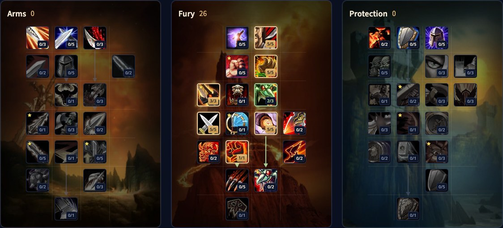

Il Fury Warrior di WoW Forever è il berserker: due armi, colpi rapidi e una barra di Rage che si riempie a ogni colpo critico. La rotazione è veloce e reattiva, e Cleave e Whirlwind fanno di Fury una delle migliori spec contro più nemici. Questa guida tratta la build di livello 30, la rotazione, la Rage, lo stance dancing, le stats, le armi e le razze.

| | |
|---|---|
| Ruolo | Danni in mischia con due armi |
| Build al livello 30 | 26 punti in Fury, con i 5 punti extra di Talented |
| Talenti chiave | Cruelty, Unbridled Wrath, Furious Precision, Dual Wield Specialization, Enrage, Death Wish |
| Punti forti | Rotazione veloce e reattiva, danni ad area ravvicinata molto forti |
| Punti deboli | Un kit da PvE che non fa nulla per la tua sopravvivenza |
| Livellare | [Guida al leveling del Warrior](/it/guides/warrior-leveling/), [build di leveling del Warrior](/it/leveling/warrior/) |
| Altre spec | [Arms Warrior](/it/guides/arms-warrior/), [Protection Warrior](/it/guides/protection-warrior/) |

## Cosa cambia per Fury

- **Cruelty** dà il 5% di probabilità di critico in mischia in più a 5/5.
- **Unbridled Wrath** ha ora il 60% di probabilità di dare 1 Rage extra a ogni colpo in mischia a 5/5.
- **Furious Precision è nuovo.** Il 10% di probabilità di colpire in più con la mano secondaria a 3/3.
- **Dual Wield Specialization fa di più.** Il 25% di danni in più con la mano secondaria e il 50% di Rage in più dai suoi attacchi.
- **Enrage** dà il 30% di probabilità di ottenere il 10% di danni fisici in più per 12 secondi dopo essere stato colpito.
- **Death Wish** dà il 20% di danni fisici in più e immunità alla paura per 30 secondi, ma subisci il 5% di danni in più.
- **Bloodthirst non dipende più dall’arma.** Infligge il 45% del tuo potere d’attacco più 30, il che lo rende forte con le armi a una mano, e dà il 10% di velocità di movimento.

## Punti forti e deboli

| Punti forti | Punti deboli |
|---|---|
| Ogni critico dà una scarica di Rage, così la rotazione resta viva | Berserker Stance e Death Wish ti rendono più facile da uccidere |
| Cleave e Whirlwind rendono Fury imbattibile contro i gruppi | Niente nella spec ti aiuta contro i giocatori |
| Recklessness e Death Wish per un grande burst | Whirlwind colpisce tutto intorno a te, quindi il tuo tank deve stare al passo |

## La build di livello 30

Questa build usa 26 punti: i 21 punti del livello 30 più 5 di Talented nel sistema Legacy. Senza Talented fermati a 21 punti; la [build di leveling del Warrior](/it/leveling/warrior/) dà l’ordine per livello. [Apri la build nel calcolatore dei talenti](/it/talents/warrior/?t=-0505302505001).

| Talento | Punti |
|---|---|
| **Cruelty** | 5/5 |
| **Unbridled Wrath** | 5/5 |
| **Furious Precision** | 3/3 |
| **Blood Craze** | 2/3 |
| **Dual Wield Specialization** | 5/5 |
| **Enrage** | 5/5 |
| **Death Wish** | 1/1 |

Dopo il livello 30 arrivano Flurry, per il 25% di velocità d’attacco in più dopo un critico, e Bloodthirst in fondo all’albero.

## Cosa fanno i talenti chiave

| Talento | Cosa fa in Forever |
|---|---|
| **Cruelty** | Il 5% di probabilità di critico in più. Più critici vuol dire più Rage |
| **Unbridled Wrath** | Il 60% di probabilità di 1 Rage extra a ogni colpo |
| **Furious Precision** | Il 10% di probabilità di colpire in più con la mano secondaria |
| **Dual Wield Specialization** | Il 25% di danni in più con la mano secondaria e il 50% di Rage in più |
| **Enrage** | Il 10% di danni fisici in più per 12 secondi, abbastanza spesso da contare |
| **Death Wish** | Un tempo di recupero offensivo forte, ancora più forte con Recklessness |
| **Flurry** | Il 25% di velocità d’attacco in più per 3 colpi dopo un critico. Dopo il livello 30 |
| **Bloodthirst** | Un attacco istantaneo basato sul potere d’attacco invece che sui danni dell’arma. Dopo il livello 30 |

## Rotazione

1. Spendi la Rage in eccesso su Heroic Strike, o Cleave contro più nemici, per non sprecarla mai.
2. Tieni attivo Battle Shout.
3. Accumula Sunder Armor.
4. Execute quando il bersaglio è abbastanza basso.
5. Bloodthirst, appena lo hai.
6. Whirlwind, appena lo hai.
7. Hamstring quando nient’altro è pronto e ti avanza Rage.

**Stance dancing.** Rend scala meglio in Forever e Overpower costa poca Rage, quindi brevi passaggi in Battle Stance per Rend e Overpower possono rendere. Cambiando perdi gran parte della Rage, quindi non accumularla in Battle Stance e tieni breve il passaggio.

## Tempi di recupero e utilità

- **Retaliation** e **Shield Wall** quando il bersaglio sei tu.
- **Berserker Rage** per ignorare gli effetti di paura e inabilitazione.
- **Recklessness** è il tempo di recupero offensivo più forte del gioco.
- **Death Wish** solo per Fury, al massimo insieme a Recklessness.
- **Bloodrage** liberamente, per Rage extra.

## Mobilità

Resta sul boss. Fuori dal combattimento, Charge dà Rage e ti porta subito nello scontro, ma cambiare postura per usarlo svuota gran parte della Rage, quindi spesso conviene solo se il tank è davanti a te. In combattimento hai Intercept, che funziona in Berserker Stance ma costa Rage.

## Rage

La Rage è tutto. Con Rage infinita non smetteresti mai di premere tasti, quindi pianifica e tienine abbastanza per gli attacchi importanti. Se un Heroic Strike fa aspettare Bloodthirst o Whirlwind un secondo o due, è stato un errore. Tieni la Rage in movimento: mai piena, mai vuota.

## Stats ed equipaggiamento

L’ordine esatto al livello 60 arriverà dopo il lancio. Queste stats aiutano un Fury Warrior:

- **Probabilità di colpire.** Un colpo mancato non fa nulla e non dà Rage.
- **Probabilità di critico.** Più danni e più Rage, una delle stats migliori. Anche l’Agilità dà un po’ di critico.
- **Forza e potere d’attacco.** La tua stat principale: 1 di Forza dà 2 di potere d’attacco, quindi la Forza vale di più per punto.

**Armatura.** La piastra è ideale, ma maglia o cuoio con le stats giuste possono essere migliori. Forever non penalizza un tipo di armatura più leggero, hai solo meno armatura. I fabbri creano buon equipaggiamento da leveling per ogni spec del Warrior, e i dungeon ne hanno molto altro.

**Armi.** La parte più importante dell’equipaggiamento. Combatti con due armi, meglio con una mano principale lenta che colpisca forte. Un’arma a distanza conta solo per le sue stats.

## Razze e professioni

Ogni razza può essere Warrior. Ogni scelta funziona, ma alcune sono più forti.

| Fazione | Razza | Perché |
|---|---|---|
| Alleanza | Human | <a class="wf-wh wf-spell" href="https://www.wowhead.com/forever/spell=20597">Ruthless</a>: il 2% di probabilità di critico in più. La scelta più forte |
| Alleanza | Dwarf | Più danni critici, ma molto più debole di Human |
| Alleanza | Gnome | Un tempo di recupero di burst che può essere molto forte |
| Alleanza | Night Elf | Elune's Light, un tempo di recupero di critico per Rage e danni a comando |
| Alleanza | High Order Skyborne | <a class="wf-wh wf-spell" href="https://www.wowhead.com/forever/spell=1259710">Wind Blessed</a>: celerità, rara e forte per te |
| Orda | Orc | <a class="wf-wh wf-spell" href="https://www.wowhead.com/forever/spell=20572">Blood Fury</a> per il potere d’attacco e critico extra |
| Orda | Troll | Più danni alle Bestie e Berserking per velocità d’attacco a comando |
| Orda | Undead | Touch of the Grave infligge danni e ti cura un poco |
| Orda | Tauren | War Stomp, più danni critici e Plainsrunning per la velocità finché continui a muoverti |
| Orda | Windshaper Skyborne | Celerità e un tempo di recupero di velocità molto comodo |

**Professioni.** Blacksmithing crea parte del miglior equipaggiamento di maglia e piastra, molto riservato ai fabbri. Engineering ha congegni utili per ogni spec.
