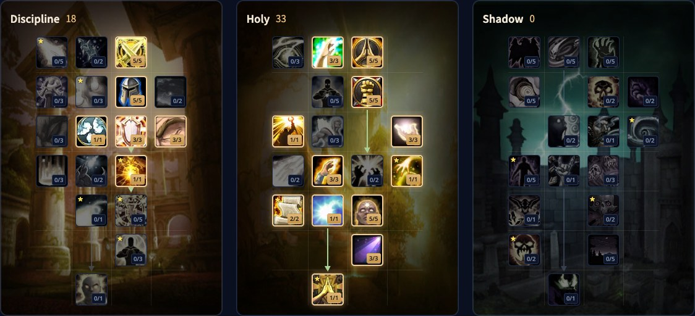

L’Holy Priest di WoW Forever è un guaritore con una risposta per ogni ferita: Renew per i danni costanti, Flash Heal e Binding Heal per la rapidità, Greater Heal per i colpi grossi e Prayer of Mending per tutta l’incursione. I nuovi talenti premiano chi alterna le cure. Questa guida tratta la build, le cure in ogni situazione, il mana, le cure al passaggio del mouse, le stats e l’equipaggiamento.

| | |
|---|---|
| Ruolo | Guaritore, al meglio nelle cure di gruppo e d’incursione |
| Build per il livello 60 | 18/33/0, con i talenti della build della beta del 15 ottobre |
| Talenti chiave | Improved Renew, Binding Heal, Spiritual Guidance, Litany of Light, Spiritual Healing, Prayer of Mending, Meditation |
| Punti forti | Un guaritore da incursione molto solido con molti strumenti |
| Punti deboli | Quasi nessuna mobilità, casualità in Prayer of Mending |
| Livellare | [Guida al leveling del Priest](/it/guides/priest-leveling/), [build di leveling del Priest](/it/leveling/priest/) |
| Altre spec | [Discipline Priest](/it/guides/discipline-priest/), [Shadow Priest](/it/guides/shadow-priest/) |

## Cosa cambia per Holy

- **Prayer of Mending è il nuovo ultimo talento.** Una cura che aspetta su un bersaglio e salta sul prossimo che subisce danni, fino a 5 volte.
- **Binding Heal è nuovo.** Cura un alleato e te stesso insieme, più o meno al costo di un Flash Heal.
- **Litany of Light è nuovo.** Mana restituito quando la tua cura è un incantesimo diverso dal precedente.
- **Spiritual Guidance è rifatto.** Fino al 25% del tuo Spirito totale diventa potere di cura.
- **Inspiration conta ogni cura critica non periodica.** Il 25% di armatura in più sul bersaglio per 15 secondi.
- **Meditation è più forte.** Il 50% della rigenerazione del mana continua mentre lanci, a 3/3.

## Punti forti e deboli

| Punti forti | Punti deboli |
|---|---|
| Un guaritore da incursione molto solido | Quasi nessun modo di muoversi in fretta |
| Un incantesimo per ogni situazione, da Renew a Prayer of Mending | I salti di Prayer of Mending sono casuali |
| Buon mana grazie a Meditation e Litany of Light | Meno adatto di Discipline a tenere in vita un solo tank |
| Fear Ward, Dispel Magic e Abolish Disease per il gruppo | |

## La build di livello 60 (18/33/0)

Questa build usa tutti i 51 punti del livello 60. I 18 punti in Discipline pagano Twin Disciplines, Mental Strength, Inner Focus, Improved Power Word: Shield, Meditation e Soul Warding. Il resto va in Holy fino a Prayer of Mending. [Apri la build nel calcolatore dei talenti](/it/talents/priest/?t=00500500133001-03505103030121531).

| Talento | Punti |
|---|---|
| **Twin Disciplines** | 5/5 |
| **Mental Strength** | 5/5 |
| **Inner Focus** | 1/1 |
| **Improved Power Word: Shield** | 3/3 |
| **Meditation** | 3/3 |
| **Soul Warding** | 1/1 |
| **Improved Renew** | 3/3 |
| **Holy Specialization** | 5/5 |
| **Divine Fury** | 5/5 |
| **Holy Nova** | 1/1 |
| **Inspiration** | 3/3 |
| **Improved Healing** | 3/3 |
| **Binding Heal** | 1/1 |
| **Litany of Light** | 2/2 |
| **Spirit of Redemption** | 1/1 |
| **Spiritual Guidance** | 5/5 |
| **Spiritual Healing** | 3/3 |
| **Prayer of Mending** | 1/1 |

**Punti liberi.**

- Resti senza mana con tanto Renew? Sposta qualche punto su Mental Agility, che abbassa il costo degli incantesimi istantanei.
- Se alla tua incursione mancano dissipazioni offensive e tocca a te, qualche punto in Holy Precision fa mancare meno Dispel Magic.
- Twilight Focus aiuta contro i rallentamenti del lancio, ma solo negli scontri in cui subisci danni mentre lanci.

## Cosa fanno i talenti chiave

| Talento | Cosa fa in Forever |
|---|---|
| **Improved Renew** | Il 15% di cure in più da Renew a 3/3. Un modo economico per rafforzare un incantesimo che lanci di continuo |
| **Binding Heal** | Cura il tuo bersaglio e te stesso più o meno al costo di un Flash Heal. Due cure al prezzo di una |
| **Spiritual Guidance** | Fino al 25% del tuo Spirito totale come cure extra, così lo Spirito non va mai sprecato |
| **Litany of Light** | Il 10% del costo base restituito quando passi a un’altra cura |
| **Spiritual Healing** | Il 10% di cure in più da tutti i tuoi incantesimi |
| **Prayer of Mending** | Una cura che salta nell’incursione verso chi viene colpito |
| **Meditation** | Il 50% della rigenerazione del mana mentre lanci. Ogni Priest lo vuole |

## Le cure in ogni situazione

Un guaritore non ha una rotazione fissa. Rispondi ai danni che arrivano e al tuo compito.

**Curare un tank**
- Renew su un tank che subisce danni costanti.
- Power Word: Shield sul tank prima di un colpo grosso, e su di te contro i rallentamenti del lancio. Uno scudo su un incantatore lo protegge anche da questi rallentamenti.
- Flash Heal o Binding Heal quando il tank ha bisogno di salute in fretta.
- Greater Heal quando sai che arriva un colpo grosso, o quando servono molte cure in una volta. Combinalo con Inner Focus.
- Holy Nova o Prayer of Mending quando più persone subiscono danni.

**Curare il gruppo** (il punto forte di Holy)
- Renew sul maggior numero possibile di bersagli che subiscono danni costanti.
- Scudi su chi sta per subire un colpo grosso.
- Flash Heal o Binding Heal per rialzare i bersagli uno dopo l’altro.
- Greater Heal con Inner Focus per i buchi grandi.
- Holy Nova quando tutto il gruppo subisce danni insieme.

**Tempi di recupero e utilità**
- **Abolish Disease** per primo quando gira una malattia importante.
- **Inner Focus** con le cure grosse: nessun costo in mana e più probabilità di critico.
- **Dispel Magic** per togliere effetti magici agli alleati, o potenziamenti magici ai nemici.
- **Fade** quando la tua minaccia rischia di diventare troppo alta, prima di prendere l’aggro.

## Mana e cure al passaggio del mouse

**Mana.** Meditation mantiene il 50% della rigenerazione del mana mentre lanci. Litany of Light ti premia quando alterni le cure, e in uno scontro lungo fa risparmiare molto mana.

**Cure al passaggio del mouse.** La cura va sul riquadro dell’unità sotto il mouse invece che sul tuo bersaglio. Tieni il boss come bersaglio, vedi cosa lancia e quanta salute gli resta, e reagisci più in fretta. Forever usa l’interfaccia moderna, quindi non servono macro né addon: attivalo in Opzioni, Combattimento. Nei Comandi trovi anche Click Casting per assegnare le cure ai tasti del mouse.

## Mobilità

Il Priest non ha quasi strumenti per muoversi in fretta. Scegli un posto a portata di tutto il gruppo, e usa Renew e gli scudi quando devi camminare.

## Stats ed equipaggiamento

L’ordine per un Holy Priest:

1. **Potere di cura.** L’effetto più grande su quanto curi.
2. **Intelletto.** Una riserva di mana più grande e più critici con le cure.
3. **Mana ogni 5 secondi.** Il modo migliore per recuperare mana al di fuori dei talenti.
4. **Spirito.** Meno utile per il mana del mana ogni 5 secondi, ma Spiritual Guidance lo trasforma in cure.
5. **Probabilità di critico.** Bella per le cure grosse, ma prima assicurati che il mana basti.

**Armatura.** La stoffa con potere di cura va bene per te.

**Arma.** <a class="wf-wh wf-q3" href="https://www.wowhead.com/forever/item=2816">Death Speaker Scepter</a> da Razorfen Kraul aggiunge molto potere di cura. Tienila d’occhio mentre livelli.

**Set Pristine.** I sarti creano i pezzi Pristine, come <a class="wf-wh wf-q3" href="https://www.wowhead.com/forever/item=253961">Pristine Gown</a>, con modelli della Commerce Society a Redridge Mountains o nei Barrens. Forti, ma una deviazione durante il leveling.

**Anello.** <a class="wf-wh wf-q3" href="https://www.wowhead.com/forever/item=281635">Philanthropist's Ring</a> dà 10 di potere magico in cambio di 20 libri. Vedi la [guida ai libri della biblioteca](/it/guides/library-books/).

## Razze e professioni

| Fazione | Razza | Perché |
|---|---|---|
| Alleanza | Gnome | Eureka per il mana, Expansive Mind per una riserva più grande e Contingency Plan come cura d’emergenza |
| Alleanza | Human | <a class="wf-wh wf-spell" href="https://www.wowhead.com/forever/spell=20597">Ruthless</a> per i critici, e Divine Grace toglie Weakened Soul così puoi rimettere uno scudo in emergenza |
| Orda | Undead | Dark Sacrifice è un ottimo strumento per il mana. Troll non offre quasi nulla a un guaritore |

Le differenze tra le razze sono minime. Scegli la razza che ti piace.

**Professioni.** Tailoring ti dà equipaggiamento di stoffa, e Forever aggiunge nuovi modelli, come le cinture di livello 10 con potere di cura. Enchanting crea bacchette e incantamenti tuoi. Engineering riceve nuovi schemi e monili in Forever e resta sempre una scelta forte.
