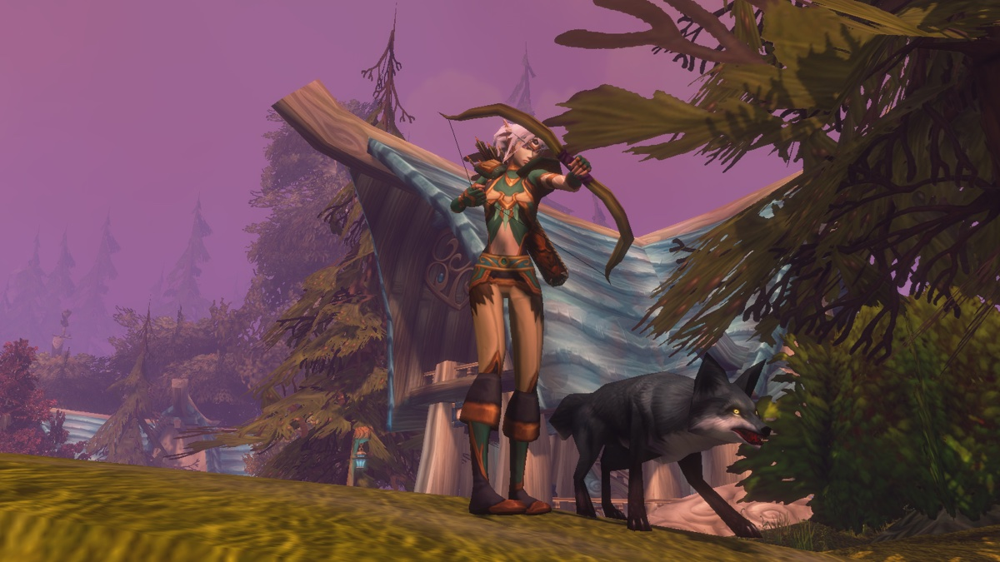
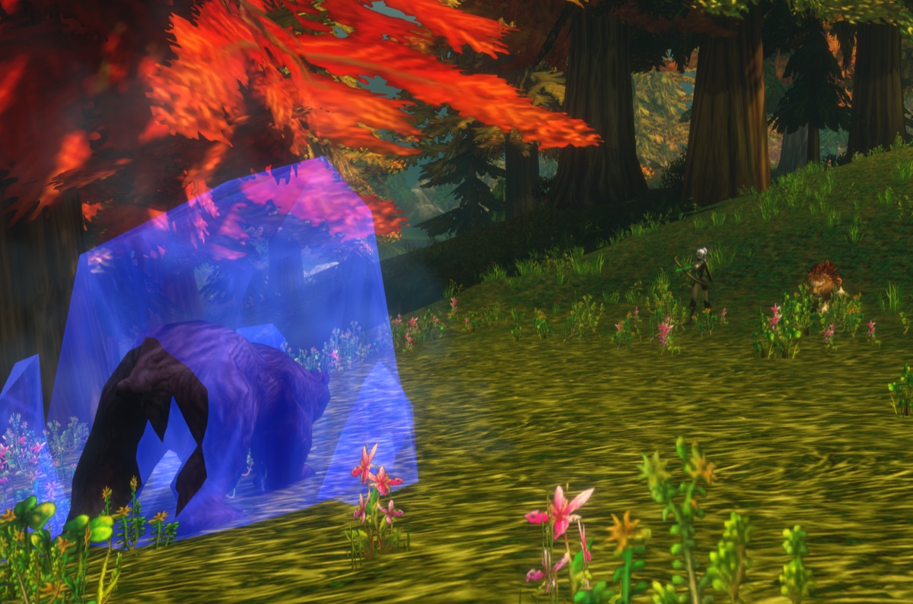
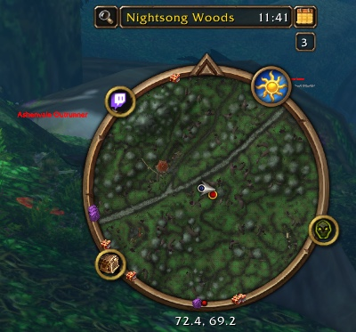

L’Hunter è una delle classi più forti per livellare. Fai danni da lontano, controlli i mostri con trappole e rallentamenti, e il tuo famiglio incassa i colpi. I primi 10 livelli sono lenti, finché non addomestichi un famiglio e ricevi il primo punto talento. In WoW Forever, nuove abilità dei famigli e nuovi talenti danno più profondità alla classe. Questa guida copre le build, la rotazione, i livelli chiave, l’equipaggiamento, i famigli, le trappole e il tracciamento.

| | |
|---|---|
| Spec più facile per livellare | Beast Mastery |
| Talenti chiave | <a class="wf-wh wf-spell" href="https://www.wowhead.com/forever/spell=19552">Deadly Aspects</a>, Unleashed Fury, <a class="wf-wh wf-spell" href="https://www.wowhead.com/forever/spell=19598">Ferocity</a>, Summon Hawk, <a class="wf-wh wf-spell" href="https://www.wowhead.com/forever/spell=1223755">Focused Fire</a> |
| Punti forti | Danni a distanza, un famiglio che tanka, controllo, viaggi rapidi |
| Punti deboli | Un inizio lento fino al livello 10, mana e munizioni |
| Ordine dei talenti per livello | [Build di leveling dell’Hunter](/it/leveling/hunter/) |
| Guide per spec | [Beast Mastery Hunter](/it/guides/beast-mastery-hunter/), [Marksmanship Hunter](/it/guides/marksmanship-hunter/), [Survival Hunter](/it/guides/survival-hunter/) |
| Build fino al livello 60 | Dopo il lancio del 4 novembre |

## Con quale spec livellare

Tutti e tre gli alberi vanno bene. **Beast Mastery** è il più fluido: il famiglio fa più danni e resiste di più, e con <a class="wf-wh wf-spell" href="https://www.wowhead.com/forever/spell=2649">Growl</a> tiene il mostro su di sé mentre tu tiri. **Marksmanship** fa più danni con i tuoi colpi, quindi rubi più spesso la minaccia e devi kitare. **Survival** mescola mischia, trappole e colpi, ed è la più impegnativa.

Gli Hunter se la cavano bene anche contro mostri di qualche livello in più, grazie alla gittata e a <a class="wf-wh wf-spell" href="https://www.wowhead.com/forever/spell=13809">Frost Trap</a>. Le build qui sotto sono fatte per la beta, che si ferma al livello 30, con 21 punti. Talented, dal sistema Legacy, dà 5 punti in più, e raggiungi ogni talento fino a cinque livelli prima. Le build di livello 60 arriveranno dopo il lancio.

## Livelli da 1 a 10

Parti senza talenti e senza famiglio, con <a class="wf-wh wf-spell" href="https://www.wowhead.com/forever/spell=75">Auto Shot</a> e Raptor Strike. I mostri ti raggiungono in fretta, quindi spesso li finisci in mischia.

1. Tieni attivo <a class="wf-wh wf-spell" href="https://www.wowhead.com/forever/spell=13163">Aspect of the Monkey</a> appena lo hai, al livello 4.
2. Attira con Auto Shot.
3. Lancia <a class="wf-wh wf-spell" href="https://www.wowhead.com/forever/spell=1978">Serpent Sting</a>.
4. Lancia Arcane Shot appena è pronto.
5. Lancia <a class="wf-wh wf-spell" href="https://www.wowhead.com/forever/spell=5116">Concussive Shot</a> per rallentare il mostro e tenere le distanze.
6. Arretra tra un colpo e l’altro.
7. Usa Raptor Strike quando il mostro ti raggiunge, e finiscilo in mischia.

Inizia ogni pull dal punto più lontano possibile: ogni metro in più è un colpo in più. Stats a questi livelli: Agility, poi potenza d’attacco, poi Intellect, poi Stamina e Spirit, poi armatura.

## Build Beast Mastery di livello 30

La build consigliata per livellare. Il famiglio colpisce più forte e resiste più a lungo, con un po’ di mana e velocità in più. [Apri la build nel calcolatore dei talenti](/it/talents/hunter/?t=512020050411).

| Talento | Punti |
|---|---|
| **<a class="wf-wh wf-spell" href="https://www.wowhead.com/forever/spell=19552">Deadly Aspects</a>** | 5/5 |
| **<a class="wf-wh wf-spell" href="https://www.wowhead.com/forever/spell=19583">Endurance Training</a>** | 1/5 |
| **<a class="wf-wh wf-spell" href="https://www.wowhead.com/forever/spell=1223755">Focused Fire</a>** | 2/2 |
| **<a class="wf-wh wf-spell" href="https://www.wowhead.com/forever/spell=19559">Pathfinding</a>** | 2/2 |
| **Unleashed Fury** | 5/5 |
| **<a class="wf-wh wf-spell" href="https://www.wowhead.com/forever/spell=19598">Ferocity</a>** | 4/5 |
| **Summon Hawk** | 1/1 |
| **<a class="wf-wh wf-spell" href="https://www.wowhead.com/forever/spell=19578">Spirit Bond</a>** | 1/2 |

Ordine: Deadly Aspects dal 10 al 14, Focused Fire al 15 e 16, Pathfinding al 17 e 18, Endurance Training al 19, Unleashed Fury dal 20 al 24, Ferocity dal 25 al 28, Summon Hawk al 29 e Spirit Bond al 30.

Tutto sul famiglio? Prendi <a class="wf-wh wf-spell" href="https://www.wowhead.com/forever/spell=19596">Bestial Swiftness</a> e più punti in Ferocity. Con i 5 punti di Talented prendi anche <a class="wf-wh wf-spell" href="https://www.wowhead.com/forever/spell=19577">Intimidation</a> e un punto in <a class="wf-wh wf-spell" href="https://www.wowhead.com/forever/spell=19621">Frenzy</a>.

1. Tieni attivo <a class="wf-wh wf-spell" href="https://www.wowhead.com/forever/spell=13165">Aspect of the Hawk</a>.
2. Manda il famiglio e avvia Auto Shot.
3. Lancia Serpent Sting.
4. Lancia Summon Hawk appena è pronto, quando lo hai.
5. Lancia Arcane Shot quando ci sono due falchi con almeno 6 secondi rimasti. Summon Hawk e Arcane Shot condividono la ricarica.
6. Lancia Aimed Shot appena è pronto.
7. Lancia <a class="wf-wh wf-spell" href="https://www.wowhead.com/forever/spell=3045">Rapid Fire</a> appena è pronto.
8. <a class="wf-wh wf-spell" href="https://www.wowhead.com/forever/spell=2974">Wing Clip</a>, Concussive Shot o Frost Trap quando un mostro si gira verso di te.

Stats: Agility, potenza d’attacco, critico, Intellect, Stamina e Spirit, Strength, armatura.

## Build Marksmanship di livello 30

Il massimo dei danni dai tuoi colpi, senza rinunciare al famiglio. Il famiglio tiene meno bene la minaccia, quindi attiri più spesso i mostri e devi kitare. Salta il nuovo talento <a class="wf-wh wf-spell" href="https://www.wowhead.com/forever/spell=415370">Lone Wolf</a> mentre livelli: il 20% di danni in più non compensa la perdita del famiglio. [Apri la build nel calcolatore dei talenti](/it/talents/hunter/?t=-00503520015).

| Talento | Punti |
|---|---|
| **<a class="wf-wh wf-spell" href="https://www.wowhead.com/forever/spell=19426">Lethal Attacks</a>** | 5/5 |
| **<a class="wf-wh wf-spell" href="https://www.wowhead.com/forever/spell=19416">Efficiency</a>** | 3/5 |
| **Careful Aim** | 5/5 |
| **<a class="wf-wh wf-spell" href="https://www.wowhead.com/forever/spell=415405">Rapid Killing</a>** | 2/2 |
| **Trueshot Aura** | 1/1 |
| **<a class="wf-wh wf-spell" href="https://www.wowhead.com/forever/spell=19485">Mortal Shots</a>** | 5/5 |

Ordine: Lethal Attacks dal 10 al 14, Careful Aim dal 15 al 19, Efficiency dal 20 al 22, Rapid Killing al 23 e 24, Mortal Shots dal 25 al 29 e Trueshot Aura al 30.

Efficiency rende più economici i tuoi colpi. <a class="wf-wh wf-spell" href="https://www.wowhead.com/forever/spell=1223987">Rapid Recuperation</a> ti fa rigenerare mana mentre lanci e fa risparmiare molte bevute, ma è in fondo all’albero: lo ottieni al più presto al livello 30, quindi la beta lo usa appena. Rubi la minaccia troppo spesso? Prendi <a class="wf-wh wf-spell" href="https://www.wowhead.com/forever/spell=19407">Improved Concussive Shot</a> e Scatter Shot per più controllo. I 5 punti di Talented lasciano spazio per questo senza perdere molti danni.

1. Tieni attivi Aspect of the Hawk e Trueshot Aura.
2. Manda il famiglio e avvia Auto Shot.
3. Lancia Serpent Sting.
4. Lancia Arcane Shot appena è pronto.
5. Lancia Aimed Shot appena è pronto.
6. Lancia Rapid Fire appena è pronto.
7. Wing Clip, Concussive Shot o Frost Trap quando un mostro si gira verso di te.

Stats: Agility, potenza d’attacco, critico, Intellect, Stamina e Spirit, Strength, armatura.

## Build Survival di livello 30

Survival alterna mischia, trappole e colpi. È difficile quando un mostro si gira verso di te: tornare a distanza richiede tempo. In cambio hai più controllo e più difesa. [Apri la build nel calcolatore dei talenti](/it/talents/hunter/?t=--5032002300501).

| Talento | Punti |
|---|---|
| **<a class="wf-wh wf-spell" href="https://www.wowhead.com/forever/spell=24293">Improved Tracking</a>** | 5/5 |
| **<a class="wf-wh wf-spell" href="https://www.wowhead.com/forever/spell=19184">Entrapment</a>** | 3/5 |
| **<a class="wf-wh wf-spell" href="https://www.wowhead.com/forever/spell=19159">Savage Strikes</a>** | 2/2 |
| **<a class="wf-wh wf-spell" href="https://www.wowhead.com/forever/spell=19239">Clever Traps</a>** | 2/2 |
| **<a class="wf-wh wf-spell" href="https://www.wowhead.com/forever/spell=19290">Surefooted</a>** | 3/3 |
| **<a class="wf-wh wf-spell" href="https://www.wowhead.com/forever/spell=1310627">Predator's Edge</a>** | 5/5 |
| **Resourcefulness** | 1/2 |

Ordine: Improved Tracking dal 10 al 14, Savage Strikes al 15 e 16, Entrapment dal 17 al 19, Surefooted dal 20 al 22, Clever Traps al 23 e 24, Predator's Edge dal 25 al 29 e Resourcefulness al 30.

Puoi giocarla in due modi: alternare colpi e mischia, oppure combattere solo in mischia. Con i 5 punti di Talented prendi anche Strider Kick ed Expose Prey.

**Alternare mischia e distanza**
1. Tieni attivo Aspect of the Hawk o <a class="wf-wh wf-spell" href="https://www.wowhead.com/forever/spell=13161">Aspect of the Beast</a>, e il tracciamento giusto per il tipo di mostro.
2. Manda il famiglio e avvia Auto Shot.
3. Lancia Serpent Sting, Arcane Shot e Aimed Shot.
4. Lancia Rapid Fire appena è pronto.
5. Vai in mischia e lancia Raptor Strike, <a class="wf-wh wf-spell" href="https://www.wowhead.com/forever/spell=13795">Immolation Trap</a>, Mongoose Bite quando si illumina e Strider Kick se lo hai.
6. Arretra e tira di nuovo.
7. Wing Clip, Concussive Shot o Frost Trap quando rubi la minaccia.

**Solo mischia**
1. Tieni attivo Aspect of the Beast e il tracciamento giusto.
2. Manda il famiglio, avvia Auto Shot, lancia Serpent Sting e Arcane Shot, e Rapid Fire appena è pronto.
3. Vai in mischia e usa Raptor Strike, Immolation Trap, Mongoose Bite e Strider Kick appena sono pronti.
4. Wing Clip, Concussive Shot o Frost Trap quando devi kitare.

Stats: Agility, potenza d’attacco, critico, Strength, Intellect, Stamina e Spirit, armatura.

## Livelli chiave

| Livello | Cosa ottieni | Da chi |
|---|---|---|
| 1 | Auto Shot, Raptor Strike, <a class="wf-wh wf-spell" href="https://www.wowhead.com/forever/spell=1494">Track Beasts</a> | Di base, istruttore di classe |
| 4 | Aspect of the Monkey, Serpent Sting | Istruttore di classe |
| 6 | Arcane Shot, <a class="wf-wh wf-spell" href="https://www.wowhead.com/forever/spell=1130">Hunter's Mark</a> | Istruttore di classe |
| 8 | Concussive Shot | Istruttore di classe |
| 10 | <a class="wf-wh wf-spell" href="https://www.wowhead.com/forever/spell=1515">Tame Beast</a>, <a class="wf-wh wf-spell" href="https://www.wowhead.com/forever/spell=5149">Beast Training</a> | Missione di classe |
| 10 | <a class="wf-wh wf-spell" href="https://www.wowhead.com/forever/spell=6991">Feed Pet</a>, <a class="wf-wh wf-spell" href="https://www.wowhead.com/forever/spell=982">Revive Pet</a>, <a class="wf-wh wf-spell" href="https://www.wowhead.com/forever/spell=883">Call Pet</a>, <a class="wf-wh wf-spell" href="https://www.wowhead.com/forever/spell=2641">Dismiss Pet</a>, Aspect of the Hawk, <a class="wf-wh wf-spell" href="https://www.wowhead.com/forever/spell=19883">Track Humanoids</a> | Istruttore di classe |
| 10 | Primo punto talento | Albero dei talenti |
| 12 | <a class="wf-wh wf-spell" href="https://www.wowhead.com/forever/spell=136">Mend Pet</a>, Wing Clip | Istruttore di classe |
| 14 | <a class="wf-wh wf-spell" href="https://www.wowhead.com/forever/spell=1513">Scare Beast</a>, <a class="wf-wh wf-spell" href="https://www.wowhead.com/forever/spell=6197">Eagle Eye</a>, <a class="wf-wh wf-spell" href="https://www.wowhead.com/forever/spell=1002">Eyes of the Beast</a> | Istruttore di classe |
| 16 | Mongoose Bite, Immolation Trap | Istruttore di classe |
| 18 | <a class="wf-wh wf-spell" href="https://www.wowhead.com/forever/spell=2643">Multi-Shot</a> | Istruttore di classe |
| 20 | Aimed Shot, <a class="wf-wh wf-spell" href="https://www.wowhead.com/forever/spell=5118">Aspect of the Cheetah</a>, <a class="wf-wh wf-spell" href="https://www.wowhead.com/forever/spell=1499">Freezing Trap</a> | Istruttore di classe |
| 20 | Polearms | Istruttore d’armi |
| 22 | Scorpid Sting | Istruttore di classe |
| 24 | <a class="wf-wh wf-spell" href="https://www.wowhead.com/forever/spell=19885">Track Hidden</a> | Istruttore di classe |
| 25 | Summon Hawk, Trueshot Aura | Albero dei talenti |
| 26 | Rapid Fire, <a class="wf-wh wf-spell" href="https://www.wowhead.com/forever/spell=19880">Track Elementals</a> | Istruttore di classe |
| 28 | Frost Trap | Istruttore di classe |
| 30 | Feign Death, Aspect of the Beast | Istruttore di classe |
| 30 | Intimidation, Strider Kick, Expose Prey, Scatter Shot | Albero dei talenti |
| 32 | <a class="wf-wh wf-spell" href="https://www.wowhead.com/forever/spell=1543">Flare</a>, <a class="wf-wh wf-spell" href="https://www.wowhead.com/forever/spell=19878">Track Demons</a> | Istruttore di classe |
| 34 | <a class="wf-wh wf-spell" href="https://www.wowhead.com/forever/spell=13813">Explosive Trap</a> | Istruttore di classe |
| 36 | <a class="wf-wh wf-spell" href="https://www.wowhead.com/forever/spell=3034">Viper Sting</a> | Istruttore di classe |
| 40 | <a class="wf-wh wf-spell" href="https://www.wowhead.com/forever/spell=13159">Aspect of the Pack</a>, <a class="wf-wh wf-spell" href="https://www.wowhead.com/forever/spell=19882">Track Giants</a> | Istruttore di classe |
| 40 | <a class="wf-wh wf-spell" href="https://www.wowhead.com/forever/spell=19574">Bestial Wrath</a>, Sniper Shot, Lacerating Strikes | Albero dei talenti |
| 40 | Cavalcatura, Dual Specialization | Istruttori |
| 46 | <a class="wf-wh wf-spell" href="https://www.wowhead.com/forever/spell=20043">Aspect of the Wild</a> | Istruttore di classe |
| 50 | <a class="wf-wh wf-spell" href="https://www.wowhead.com/forever/spell=19879">Track Dragonkin</a> | Istruttore di classe |
| 60 | <a class="wf-wh wf-spell" href="https://www.wowhead.com/forever/spell=19801">Tranquilizing Shot</a> | Istruttore di classe |

Aimed Shot non è più un talento: ogni Hunter lo impara al livello 20. I livelli dei talenti sono i più precoci senza Talented; con Talented li raggiungi fino a cinque livelli prima.

## La missione di classe

Al livello 10 ogni Hunter fa Taming the Beast. La catena insegna Tame Beast e Beast Training, per addomesticare e addestrare il tuo primo famiglio. Parte dalla tua zona iniziale: Teldrassil per i Night Elf, Dun Morogh per i Dwarf, [Zephras Isle](/it/guides/zephras-isle/) per il High Order Skyborne, Mulgore per i Tauren e Durotar per Orc e Troll.

## Dove livellare

Il livello minimo consigliato per ogni zona. I livelli dei dungeon sono nella [guida ai dungeon](/it/guides/dungeons/).

| Livello | Zone |
|---|---|
| **1** | Elwynn Forest, Dun Morogh, Teldrassil, [Zephras Isle](/it/guides/zephras-isle/), Durotar, Mulgore, Tirisfal Glades |
| **10** | Westfall, Loch Modan, Darkshore, The Barrens, Silverpine Forest |
| **15** | Redridge Mountains, Stonetalon Mountains |
| **18** | Ashenvale |
| **20** | Wetlands, Hillsbrad Foothills, Duskwood |
| **25** | Thousand Needles |
| **30** | Alterac Mountains, Arathi Highlands, Desolace, Stranglethorn Vale |
| **35** | Badlands, Dustwallow Marsh, Feralas, Riverglades, Swamp of Sorrows |
| **40** | Shen'dralas, Tanaris, The Hinterlands |
| **43** | Searing Gorge |
| **45** | Azshara, Felwood, Blasted Lands |
| **48** | Un'Goro Crater |
| **50** | Burning Steppes, Western Plaguelands |
| **53** | Winterspring, Eastern Plaguelands |
| **55** | Silithus, Deadwind Pass |
| **60** | Mount Hyjal |

## Armi

Un Hunter può usare più tipi di armi di qualsiasi altra classe. La maggior parte li impari da un istruttore d’armi.

| Arma | Alleanza | Orda |
|---|---|---|
| **Daggers** | Note dall’inizio | Note dall’inizio |
| **Axes a una e due mani** | Buliwyf Stonehand (Ironforge) | Hanashi, Sayoc (Orgrimmar) |
| **Swords a una e due mani** | Woo Ping (Stormwind) | Archibald (Undercity) |
| **Fist weapons** | Ilyenia Moonfire (Darnassus), Buliwyf Stonehand (Ironforge) | Sayoc (Orgrimmar) |
| **Staves** | Ilyenia Moonfire (Darnassus), Woo Ping (Stormwind) | Hanashi, Sayoc (Orgrimmar), Ansekhwa (Thunder Bluff) |
| **Polearms**, dal livello 20 | Woo Ping (Stormwind) | Archibald (Undercity) |
| **Bows** | Ilyenia Moonfire (Darnassus) | Hanashi, Sayoc (Orgrimmar) |
| **Crossbows** | Bixi Wobblebonk (Ironforge), Woo Ping (Stormwind) | Archibald (Undercity) |
| **Guns** | Buliwyf Stonehand (Ironforge) | Ansekhwa (Thunder Bluff) |
| **Thrown** | Bixi Wobblebonk (Ironforge), Ilyenia Moonfire (Darnassus) | Hanashi, Sayoc (Orgrimmar) |

Ogni volta che impari un nuovo tipo di arma, devi prima allenarne l’abilità prima di colpire con affidabilità.

## Equipaggiamento

**Le armi a distanza** sono la tua principale fonte di danni. Ecco scelte forti dal livello 13 al 30:

| Livello | Oggetto | Fonte |
|---|---|---|
| 13 a 16 | <a class="wf-wh wf-q3" href="https://www.wowhead.com/forever/item=272999">Barbaric Crossbow</a> | Ragefire Chasm |
| 13 a 16 | <a class="wf-wh wf-q3" href="https://www.wowhead.com/forever/item=279894">Calibrated Blunderbuss</a> | Missione nella Hall of Thanes, solo Alleanza |
| 19 a 22 | <a class="wf-wh wf-q3" href="https://www.wowhead.com/forever/item=6469">Venomstrike</a> | Wailing Caverns |
| 22 a 29 | <a class="wf-wh wf-q3" href="https://www.wowhead.com/forever/item=3078">Naga Heartpiercer</a> | Blackfathom Deeps |
| 23 a 29 | <a class="wf-wh wf-q3" href="https://www.wowhead.com/forever/item=273843">Fallenroot Longbow</a> | Blackfathom Deeps |
| 29 a 30 | <a class="wf-wh wf-q3" href="https://www.wowhead.com/forever/item=274084">Quilboar Blaster</a> | Missione a Razorfen Kraul |

**Le armi da mischia** contano soprattutto per Survival, che punta sui danni dell’arma. Per le altre spec un’arma da mischia serve soprattutto per le stats.

**Equipaggiamento creato e bottino dei dungeon.** Leatherworking ha ricevuto presto nuove ricette forti, come <a class="wf-wh wf-q3" href="https://www.wowhead.com/forever/item=252425">Dark Leather Boots</a>, <a class="wf-wh wf-q3" href="https://www.wowhead.com/forever/item=252504">Brawler's Leather Hood</a> e <a class="wf-wh wf-q3" href="https://www.wowhead.com/forever/item=252521">Stalker's Leather Belt</a>. I dungeon danno miglioramenti come <a class="wf-wh wf-q3" href="https://www.wowhead.com/forever/item=271212">Bloodied Chestwraps</a> e <a class="wf-wh wf-q3" href="https://www.wowhead.com/forever/item=9624">Triprunner Dungarees</a>.

## Professioni

Livella le professioni insieme al tuo Hunter, per raccogliere e creare al livello giusto. I campi danno buff a ogni professione, e in Forever li riceve anche il famiglio.

- **Cooking** è indispensabile: il cibo con buff dà esperienza extra, e ti serve per un falò.
- **Leatherworking** crea un buon equipaggiamento vincolato da leveling e dà un buff all’esperienza riposata al campo.
- **Skinning** va con Leatherworking, e Aspect of the Cheetah ti porta in fretta da un mostro all’altro. Il suo buff del campo dà il 2% di probabilità di critico.
- **Herbalism** si adatta a un Hunter sempre in viaggio. Il suo buff del campo dà Intellect.
- **Alchemy** va con Herbalism, per le pozioni. Il suo buff del campo dà rigenerazione di mana.
- **Engineering** crea gadget, esplosivi e mirini per la tua arma a distanza. Il Reagent Bot del campo vende cibo, acqua e materiali.
- **Mining** va con Engineering. Il suo buff del campo dà potenza d’attacco in mischia, utile per Survival e il famiglio.
- **Fishing** va con Cooking. Il suo buff del campo aumenta tutte le stats dell’8%.
- **First Aid** dà bende e pozioni. Il suo buff del campo dà Stamina a te e al famiglio.

## Consumabili

- **Cibo e acqua.** Resta Well Fed per l’esperienza extra; qualsiasi cibo con buff è meglio di niente. Porta acqua del tuo livello, perché dovrai bere.
- **Pozioni.** Pozioni curative per le emergenze, ora anche da First Aid. First Aid crea anche rimedi contro Poisons, Diseases e Bleeds, che un Hunter non può rimuovere altrimenti. Aiutano anche le pozioni di mana.
- **Gli elisir** con le stats giuste costano tenerli attivi, ma valgono la pena per una missione o un mostro difficile.
- **Munizioni.** Tieni pieni la faretra o la giberna. Senza frecce né proiettili non puoi tirare.

## Famigli

Il famiglio è il cuore della classe. Tieni d’occhio dove si trova, quali abilità usa e le sue ricariche: così puoi reagire a quello che fa un mostro, o evitare del tutto il pericolo. In Forever il famiglio riceve anche i buff del Camping, purché sia evocato mentre sei seduto al falò.

Le abilità dei famigli aggiungono utilità, come <a class="wf-wh wf-spell" href="https://www.wowhead.com/forever/spell=24423">Demoralizing Screech</a> e <a class="wf-wh wf-spell" href="https://www.wowhead.com/forever/spell=7272">Dust Cloud</a>.

## Controllo e pull

Gli Hunter eccellono nel controllo: Frost Trap, Freezing Trap, Wing Clip e Concussive Shot, rafforzati da Entrapment, Clever Traps, Improved Concussive Shot e <a class="wf-wh wf-spell" href="https://www.wowhead.com/forever/spell=19228">Improved Wing Clip</a>. Scatter Shot e Intimidation aggiungono altro. Il tuo strumento migliore resta il famiglio, che tiene il mostro mentre tu mantieni le distanze.

Scare Beast fa fuggire di paura una Beast fino a 10 secondi al rango 1. Può correre verso un altro gruppo, quindi usalo con cautela. In PvP funziona contro i famigli degli Hunter e i Druid in forma animale.

Puoi attirare quasi tutto da lontano con un colpo. Gli Hunter concatenano bene anche i pull: Serpent Sting e le trappole di fuoco continuano a fare effetto mentre passi al mostro successivo. Attenzione ai mostri ancora vivi, che possono correre verso un altro gruppo.

## Movimento

- **Aspect of the Cheetah** dà il 30% di velocità, ma resti Dazed per 4 secondi se subisci danni. Pathfinding aggiunge fino al 6%.
- **Aspect of the Pack** dal livello 40 fa lo stesso per il tuo gruppo, con lo stesso rischio per tutti. Utile per viaggiare, non in combattimento.
- **<a class="wf-wh wf-spell" href="https://www.wowhead.com/forever/spell=5384">Feign Death</a>** ti fa uscire dal combattimento. Usalo per attraversare una zona pericolosa o per raccogliere qualcosa mentre i mostri ti attaccano.
- **Il famiglio** può attirare i mostri lontano da te, così attraversi una zona affollata senza combattere tutto.

## Mana

Gli Hunter usano il mana per tutto, e incantesimi come Aimed Shot costano molto. Porta acqua e qualche pozione di mana. Ogni albero ha un talento per il mana in combattimento: <a class="wf-wh wf-spell" href="https://www.wowhead.com/forever/spell=19590">Bestial Discipline</a>, Rapid Recuperation e Resourcefulness. Per questo lo Spirit è prezioso mentre livelli. Non usare mai tutto il mana: tienine abbastanza per una trappola o Feign Death se un pull va storto.

## Tracciamento

Il tracciamento mostra sulla minimappa i mostri di un tipo. Aiuta ogni Hunter, soprattutto Survival grazie a Improved Tracking. In PvE vedi arrivare le pattuglie, in PvP vedi i giocatori nemici. Track Hidden rivela i giocatori in furtività.

| Colore | Significato |
|---|---|
| **Verde con bordo argentato** | Giocatore amico |
| **Verde con bordo dorato** | PNG amico |
| **Rosso con bordo argentato** | Giocatore nemico |
| **Rosso con bordo dorato** | PNG nemico |
| **Oro con bordo dorato** | PNG neutrale, ostile appena lo attacchi |

## Aspect e ricariche

Può essere attivo un solo Aspect alla volta.

| Aspect | Cosa fa |
|---|---|
| **Aspect of the Hawk** | Più potenza d’attacco a distanza |
| **Aspect of the Beast** | Più potenza d’attacco in mischia, e non puoi essere tracciato |
| **Aspect of the Monkey** | 8% di schivata in più |
| **Aspect of the Cheetah** | 30% di velocità, Dazed se vieni colpito |
| **Aspect of the Pack** | 30% di velocità per il gruppo, Dazed se colpiti |
| **Aspect of the Wild** | Resistenza alla natura per il gruppo |

- **Scorpid Sting** è cambiato: riduce del 2% la probabilità di colpire del bersaglio per 20 secondi. Non si somma con <a class="wf-wh wf-spell" href="https://www.wowhead.com/forever/spell=5570">Insect Swarm</a> di un Balance Druid, ma aiuta il tank contro i boss quando non c’è un Druid.
- **Tranquilizing Shot** al livello 60 rimuove un effetto di Frenzy da un mostro. Importante nei raid.
- **Rapid Fire** aumenta la velocità d’attacco a distanza e in mischia del 40% per 15 secondi, con 5 minuti di ricarica. Rapid Killing in Marksmanship toglie 2 minuti.
- **Grandi talenti:** Bestial Wrath per Beast Mastery, Sniper Shot per Marksmanship e Strider Kick per Survival.
- **Flare** rivela i nemici nascosti e invisibili entro 10 metri per 30 secondi.
- **Eagle Eye** ti fa guardare molto lontano, con gittata illimitata, solo all’aperto.
- **Eyes of the Beast** ti fa controllare direttamente il famiglio, per esempio per esplorare o attirare da lontano.

Altro su cibo, campi ed esperienza riposata nella [guida all’esperienza](/it/guides/experience/).
