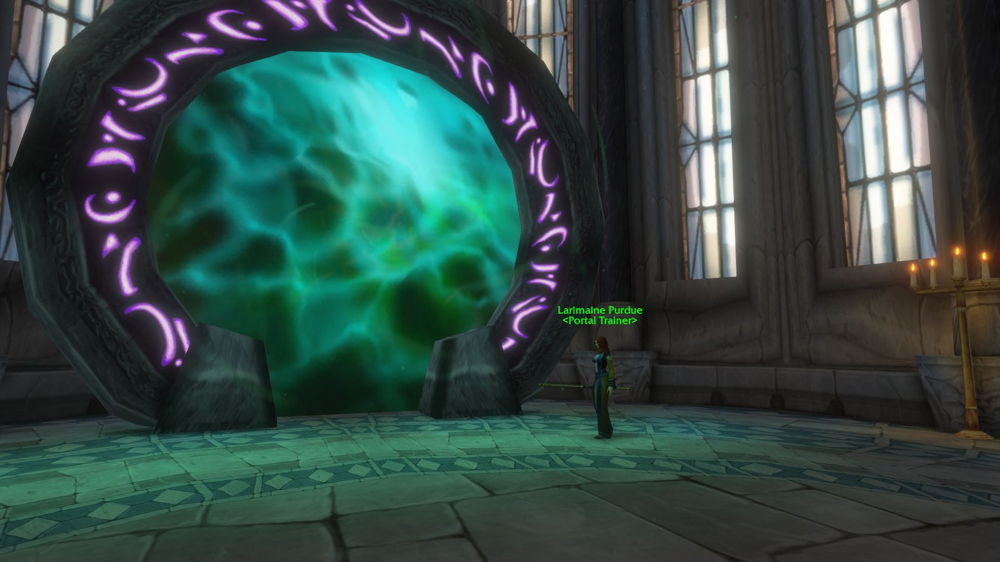
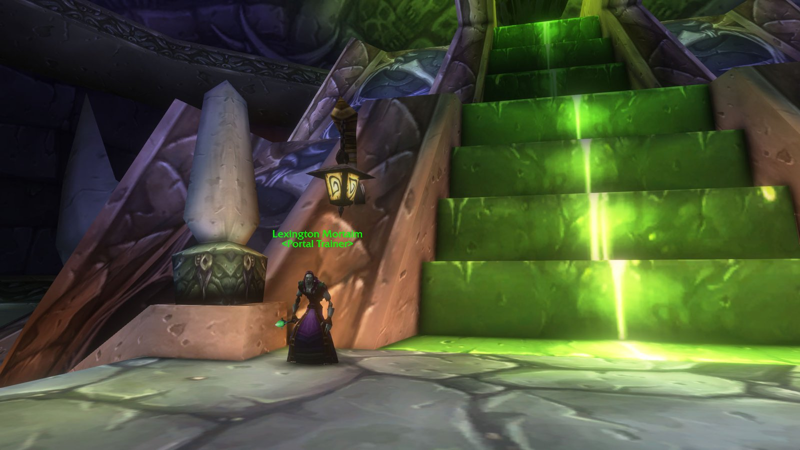

I Mage di World of Warcraft: Forever possono teletrasportarsi nelle capitali della loro fazione e aprire portali per il gruppo. Questa guida elenca ogni incantesimo con livello e costo, le rune che servono e dove si trova ogni Portal Trainer.

| | |
|---|---|
| Teletrasporti | Dal livello 20, 20 argento per incantesimo |
| Portali | Dal livello 40, 1 oro 50 argento per incantesimo |
| Reagenti | <a class="wf-wh wf-q1" href="https://www.wowhead.com/forever/item=17031">Rune of Teleportation</a> (10 argento) e <a class="wf-wh wf-q1" href="https://www.wowhead.com/forever/item=17032">Rune of Portals</a> (20 argento) |
| Istruttori | Un Portal Trainer in ogni capitale, accanto agli istruttori dei Mage |

## Come si imparano

Ogni capitale ha il suo Portal Trainer, che insegna solo il teletrasporto e il portale per quella città. Per avere tutte le destinazioni visiti le tre capitali della tua fazione. Ogni lancio richiede una runa, in vendita da qualsiasi venditore di reagenti. Con il talento Legacy <a class="wf-wh wf-spell" href="https://www.wowhead.com/forever/spell=1225503">Reagent Economy</a> quelle rune non servono più; vedi il [calcolatore Legacy](/it/talents/legacy/).

## Teletrasporti

Un teletrasporto porta solo te: 10 secondi di lancio per 120 mana, e sei in città.

| Incantesimo | Fazione | Livello |
|---|---|---|
| <a class="wf-wh wf-spell" href="https://www.wowhead.com/forever/spell=3561">Teleport: Stormwind</a> | Alliance | 20 |
| <a class="wf-wh wf-spell" href="https://www.wowhead.com/forever/spell=3562">Teleport: Ironforge</a> | Alliance | 20 |
| <a class="wf-wh wf-spell" href="https://www.wowhead.com/forever/spell=3565">Teleport: Darnassus</a> | Alliance | 30 |
| <a class="wf-wh wf-spell" href="https://www.wowhead.com/forever/spell=3567">Teleport: Orgrimmar</a> | Horde | 20 |
| <a class="wf-wh wf-spell" href="https://www.wowhead.com/forever/spell=3563">Teleport: Undercity</a> | Horde | 20 |
| <a class="wf-wh wf-spell" href="https://www.wowhead.com/forever/spell=3566">Teleport: Thunder Bluff</a> | Horde | 30 |

## Portali

Un portale resta accanto a te per 60 secondi e tutto il gruppo può cliccarci, anche tu. Costa 850 mana, 10 secondi di lancio e ha 1 minuto di ricarica.

| Incantesimo | Fazione | Livello |
|---|---|---|
| <a class="wf-wh wf-spell" href="https://www.wowhead.com/forever/spell=10059">Portal: Stormwind</a> | Alliance | 40 |
| <a class="wf-wh wf-spell" href="https://www.wowhead.com/forever/spell=11416">Portal: Ironforge</a> | Alliance | 40 |
| <a class="wf-wh wf-spell" href="https://www.wowhead.com/forever/spell=11419">Portal: Darnassus</a> | Alliance | 50 |
| <a class="wf-wh wf-spell" href="https://www.wowhead.com/forever/spell=11417">Portal: Orgrimmar</a> | Horde | 40 |
| <a class="wf-wh wf-spell" href="https://www.wowhead.com/forever/spell=11418">Portal: Undercity</a> | Horde | 40 |
| <a class="wf-wh wf-spell" href="https://www.wowhead.com/forever/spell=11420">Portal: Thunder Bluff</a> | Horde | 50 |

## Portal Trainer

| Istruttore | Città | Dove | /way |
|---|---|---|---|
| <a class="wf-wh wf-plain" href="https://www.wowhead.com/forever/npc=2485">Larimaine Purdue</a> | Stormwind | Mage Quarter | 50.3 86.0 |
| <a class="wf-wh wf-plain" href="https://www.wowhead.com/forever/npc=2489">Milstaff Stormeye</a> | Ironforge | Mystic Ward | 26.0 8.6 |
| <a class="wf-wh wf-plain" href="https://www.wowhead.com/forever/npc=4165">Elissa Dumas</a> | Darnassus | Temple of the Moon | 40.6 82.0 |
| <a class="wf-wh wf-plain" href="https://www.wowhead.com/forever/npc=5958">Thuul</a> | Orgrimmar | Valley of Spirits | 38.6 85.8 |
| <a class="wf-wh wf-plain" href="https://www.wowhead.com/forever/npc=2492">Lexington Mortaim</a> | Undercity | Magic Quarter | 84.6 16.8 |
| <a class="wf-wh wf-plain" href="https://www.wowhead.com/forever/npc=5957">Birgitte Cranston</a> | Thunder Bluff | Spirit Rise | 22.4 16.4 |

Perso in città? Chiedi a una guardia dell'istruttore dei Mage: il Portal Trainer è lì vicino.

## Altro per i Mage

Comprehension, Study e ogni pergamena sono nella [guida alle pergamene del Mage](/it/guides/mage-scrolls/). La strada verso il 60 è nella [guida al livellamento del Mage](/it/guides/mage-leveling/).
