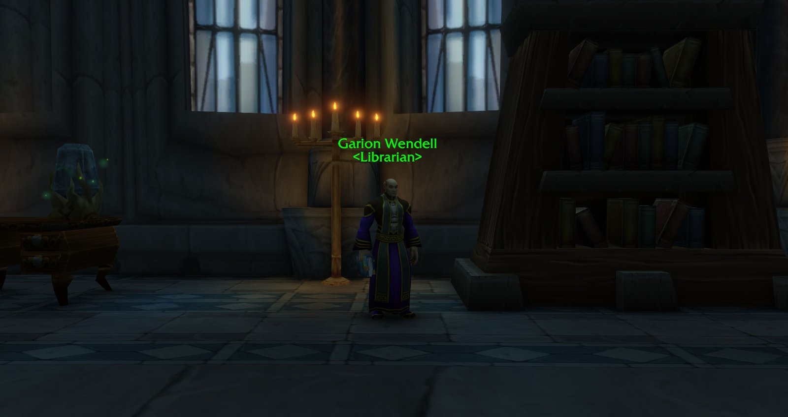

I Mage di World of Warcraft: Forever possono decifrare pergamene che cadono dai mostri, per benefici, effetti sulle armi e perfino danni. Questa guida copre Comprehend Scroll, l'abilità Comprehension, Study per le pergamene della biblioteca e tutte le 28 pergamene per livello.

| | |
|---|---|
| Incantesimo | <a class="wf-wh wf-spell" href="https://www.wowhead.com/forever/spell=1296017">Comprehend Scroll</a>, dall'istruttore dei Mage al livello 6 |
| Abilità | Comprehension, fino a 5 volte il tuo livello (300 al 60) |
| Pergamene extra | <a class="wf-wh wf-spell" href="https://www.wowhead.com/forever/spell=1302508">Study</a> con una <a class="wf-wh wf-q1" href="https://www.wowhead.com/forever/item=17056">Light Feather</a>, una volta all'ora in biblioteca |
| Livelli | 4, da 1, 15, 50 e 175 punti |

## Comprehension

Al livello 6 l'istruttore dei Mage ti insegna <a class="wf-wh wf-spell" href="https://www.wowhead.com/forever/spell=1296017">Comprehend Scroll</a>. Questo sblocca Comprehension, un'abilità che funziona come una professione e arriva a 300. La tua abilità non può mai superare 5 volte il tuo livello, quindi 300 arriva solo al livello 60.

Le pergamene cadono dai mostri per tutte le classi, di vari tipi secondo il livello del mostro. Finché non le decifri hanno nomi strani, quindi non sai cosa fanno. Decifrate, qualsiasi Mage può usarle, e alcune si vendono alla casa d'aste.

Attenzione alle borse: le pergamene decifrate si impilano fino a 5 dello stesso tipo, ma ogni pergamena non decifrata occupa un posto tutto suo, anche con lo stesso nome.

## Study: pergamene dalla biblioteca

I Mage hanno un secondo modo per ottenere pergamene. Il primo [libro della biblioteca](/it/guides/library-books/) che consegni dà l'abilità Research e l'incantesimo <a class="wf-wh wf-spell" href="https://www.wowhead.com/forever/spell=1302508">Study</a>. Per l'Alliance ce n'è uno nella Hall of Explorers di Ironforge, per l'Horde nella Valley of Spirits di Orgrimmar. Lo porti a <a class="wf-wh wf-plain" href="https://www.wowhead.com/forever/npc=211033">Garion Wendell</a> a Stormwind o a <a class="wf-wh wf-plain" href="https://www.wowhead.com/forever/npc=211022">Owen Thadd</a> a Undercity.

Study richiede una <a class="wf-wh wf-q1" href="https://www.wowhead.com/forever/item=17056">Light Feather</a> e 6 secondi di lancio, e ha 1 ora di ricarica. Funziona solo in una biblioteca e dà un <a class="wf-wh wf-q1" href="https://www.wowhead.com/forever/item=277651">Bundle of Scrolls</a> con di solito da 2 a 4 pergamene decifrate. Non tutte le librerie contano come biblioteca. Questi posti funzionano:

- la Mage Tower di Stormwind
- la Royal Library di Stormwind Keep
- il Magic Quarter di Undercity
- la Great Library di Dalaran

## Pergamene di livello 1

Puoi leggerle appena hai Comprehension.

| Pergamena | Effetto |
|---|---|
| <a class="wf-wh wf-q1" href="https://www.wowhead.com/forever/item=215257">Scroll of Comprehension</a> | +15 di Comprehension per 1 ora |
| <a class="wf-wh wf-q2" href="https://www.wowhead.com/forever/item=275067">Scroll of Imbue Chillknife</a> | Pugnale: a volte rallenta il bersaglio col gelo quando colpisci, 1 ora |
| <a class="wf-wh wf-q2" href="https://www.wowhead.com/forever/item=274947">Scroll of Imbue Lesser Flame</a> | Bastone: fino a 4 danni Fire in più, 1 ora |
| <a class="wf-wh wf-q1" href="https://www.wowhead.com/forever/item=213564">Scroll of Minor Evocation</a> | 300 mana in 4 secondi, ricarica di 8 minuti |
| <a class="wf-wh wf-q1" href="https://www.wowhead.com/forever/item=275069">Scroll of Rat Familiar</a> | famiglio ratto per 1 ora, +2 Intellect |

## Pergamene di livello 2: 15 punti, livello 16

| Pergamena | Effetto |
|---|---|
| <a class="wf-wh wf-q1" href="https://www.wowhead.com/forever/item=217495">Scroll of Cryoblast</a> | da 115 a 129 danni Frost entro 5 metri, ricarica di 1 minuto |
| <a class="wf-wh wf-q1" href="https://www.wowhead.com/forever/item=277484">Scroll of Confuse Beast</a> | Una Beast ti infligge il 15% di danni Physical in meno |
| <a class="wf-wh wf-q1" href="https://www.wowhead.com/forever/item=277483">Scroll of Frog Familiar</a> | famiglio rana per 1 ora, +6 Intellect |
| <a class="wf-wh wf-q2" href="https://www.wowhead.com/forever/item=277487">Scroll of Imbue Baleflame</a> | Bastone: i bersagli hanno 2 di resistenza Fire in meno, 1 ora |
| <a class="wf-wh wf-q2" href="https://www.wowhead.com/forever/item=277485">Scroll of Imbue Frost</a> | Bastone: fino a 8 danni Frost in più, 1 ora |
| <a class="wf-wh wf-q2" href="https://www.wowhead.com/forever/item=277488">Scroll of Imbue Iceknife</a> | Pugnale: a volte congela il bersaglio quando colpisci, 1 ora |
| <a class="wf-wh wf-q2" href="https://www.wowhead.com/forever/item=277489">Scroll of Imbue Spark</a> | Spada: Fire Blast a volte si ricarica quando vieni colpito in mischia, 1 ora |
| <a class="wf-wh wf-q2" href="https://www.wowhead.com/forever/item=277486">Scroll of Imbue Striking</a> | Bastone: a volte lancia un Arcane Missile sui bersagli colpiti con un incantesimo, 1 ora |
| <a class="wf-wh wf-q3" href="https://www.wowhead.com/forever/item=277490">Scroll of the Saber</a> | Trasforma la Blade of Silverlaine in un'arma più forte |

## Pergamene di livello 3: 50 punti, livello 25

| Pergamena | Effetto |
|---|---|
| <a class="wf-wh wf-q1" href="https://www.wowhead.com/forever/item=277493">Scroll of Cat Familiar</a> | famiglio gatto per 1 ora, +12 Intellect |
| <a class="wf-wh wf-q2" href="https://www.wowhead.com/forever/item=277496">Scroll of Imbue Balefrost</a> | Bastone: i bersagli hanno 3 di resistenza Frost in meno, 1 ora |
| <a class="wf-wh wf-q2" href="https://www.wowhead.com/forever/item=277494">Scroll of Imbue Accuracy</a> | Bastone: +0,5% di probabilità di colpire con gli incantesimi, 1 ora |
| <a class="wf-wh wf-q2" href="https://www.wowhead.com/forever/item=277497">Scroll of Imbue Flame</a> | Bastone: fino a 12 danni Fire in più, 1 ora |
| <a class="wf-wh wf-q2" href="https://www.wowhead.com/forever/item=277498">Scroll of Imbue Manablade</a> | Pugnale: a volte ripristina mana quando colpisci, 1 ora |
| <a class="wf-wh wf-q2" href="https://www.wowhead.com/forever/item=277495">Scroll of Imbue Quickening</a> | Bastone: gli incantesimi di danno possono velocizzare gli attacchi con la bacchetta, 1 ora |
| <a class="wf-wh wf-q1" href="https://www.wowhead.com/forever/item=277492">Scroll of Khadgar's Unlocking</a> | Apre una serratura fino a difficoltà 125 |
| <a class="wf-wh wf-q1" href="https://www.wowhead.com/forever/item=277491">Scroll of Rebuke Elemental</a> | Un Elemental subisce il 15% di danni in più dai tuoi incantesimi per 20 secondi, fino al livello 50 |
| <a class="wf-wh wf-q3" href="https://www.wowhead.com/forever/item=217496">Scroll of the Blade</a> | Trasforma la Hypnotic Blade in un'arma più forte |

## Pergamene di livello 4: 175 punti, livello 46

| Pergamena | Effetto |
|---|---|
| <a class="wf-wh wf-q3" href="https://www.wowhead.com/forever/item=277504">Scroll of Wit</a> | Trasforma la Witchblade in un'arma più forte |
| <a class="wf-wh wf-q1" href="https://www.wowhead.com/forever/item=277499">Scroll of Greater Cryoblast</a> | da 448 a 568 danni Frost entro 5 metri, ricarica di 1 minuto |
| <a class="wf-wh wf-q2" href="https://www.wowhead.com/forever/item=277500">Scroll of Imbue Greater Flame</a> | Bastone: fino a 20 danni Fire in più, 1 ora |
| <a class="wf-wh wf-q2" href="https://www.wowhead.com/forever/item=277501">Scroll of Imbue Greater Frost</a> | Bastone: fino a 20 danni Frost in più, 1 ora |
| <a class="wf-wh wf-q2" href="https://www.wowhead.com/forever/item=277502">Scroll of Imbue Precision</a> | Bastone: +1% di probabilità di critico, 1 ora |

## Altro per i Mage

Teletrasporti, portali e i loro istruttori sono nella [guida ai portali del Mage](/it/guides/mage-portals/). La strada verso il 60 è nella [guida al livellamento del Mage](/it/guides/mage-leveling/).
