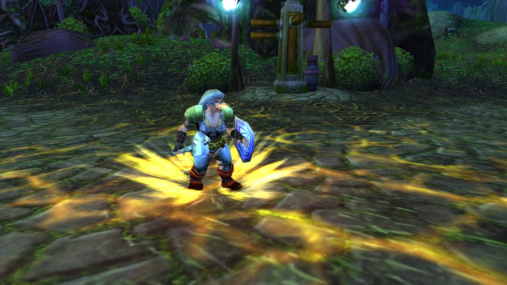

Il Paladin livella lentamente ma in sicurezza. Ti curi da solo, hai una protezione contro quasi ogni errore, e in Forever fai più dell'attacco automatico: Judgement e Holy Strike partono ogni volta che sono pronti. Al livello 30 scegli tra Retribution, Protection e una build Holy che fa danni con Holy Shock. Questa guida copre le build, la rotazione, i livelli chiave, le missioni di classe e seal, aure e blessing.

| | |
|---|---|
| Spec più facile per livellare | Retribution, con un'arma lenta a due mani |
| Talenti chiave | Seal of Command, Conviction, Sanctified Judgement, Vengeance, <a class="wf-wh wf-spell" href="https://www.wowhead.com/forever/spell=20111">Two-Handed Weapon Specialization</a> |
| Punti di forza | Difficile da uccidere, si cura da solo, un seal per ogni situazione |
| Punti deboli | Uccide un mostro alla volta, mana tra un combattimento e l'altro, poco per fuggire |
| Talento per livello | [Build di leveling del Paladin](/it/leveling/paladin/) |
| Build fino al livello 60 | Dopo il lancio del 4 novembre |

## Con quale spec livellare

Puoi livellare con tutte e tre. **Retribution** è la scelta classica: una grande arma a due mani, Seal of Command e colpi pesanti. **Protection** è altrettanto veloce se ti piace raccogliere quattro mostri e bruciarli con Consecration perdendo appena vita. **Holy** fa pochi danni finché non ha Holy Shock, ma poi si gioca quasi come Protection, con più potere magico e più cure.

Nei primi 20-30 livelli metti i punti in Retribution, anche se più avanti vuoi fare il tank nei dungeon con uno scudo. In ogni spec, la maggior parte dei danni viene dagli stessi tre tasti: un seal, Judgement e Holy Strike.

Le build qui sotto sono pensate per la beta, che si ferma al livello 30. Ognuna ha 26 punti: li hai al livello 30 con cinque punti in più da Talented del sistema Legacy, oppure al livello 35 senza. Il calcolatore dei talenti mostra una build così come livello 35, perché conta ogni punto come un livello. Le build per il livello 60 arriveranno dopo il lancio.

## Livelli da 1 a 10

Inizi con <a class="wf-wh wf-spell" href="https://www.wowhead.com/forever/spell=20154">Seal of Righteousness</a>, <a class="wf-wh wf-spell" href="https://www.wowhead.com/forever/spell=635">Holy Light</a> e <a class="wf-wh wf-spell" href="https://www.wowhead.com/forever/spell=465">Devotion Aura</a>. Judgement e Blessing of Might arrivano al 4, Divine Protection e Holy Strike al 6, Hammer of Justice all'8. Fino al livello 6 colpisci soprattutto con l'arma.

1. Tieni addosso una blessing e un'aura.
2. Lancia Seal of Righteousness prima di ingaggiare.
3. Lancia Judgement mentre corri verso il mostro.
4. Lancia Holy Strike.
5. Lancia Judgement e Holy Strike ogni volta che sono pronti e rinnova il seal quando scade.

Curati con Holy Light quando serve. Se ti serve una cura in combattimento, lancia prima Divine Protection su di te: così niente può interrompere l'incantesimo.

Statistiche a questi livelli: prima Forza e potere d'attacco, poi Tempra, poi potere magico, poi armatura.

## Build Retribution di livello 30

La build consigliata per livellare. Colpisci forte con un'arma lenta a due mani, e la build ruota attorno al mana: Sanctified Judgement restituisce mana a ogni Judgement, così uccidi un mostro dopo l'altro con poco riposo. Funziona anche sui gruppi, con Consecration sempre attiva. [Apri la build nel calcolatore dei talenti](/it/talents/paladin/?t=--50125031201330).

| Talento | Punti |
|---|---|
| **<a class="wf-wh wf-spell" href="https://www.wowhead.com/forever/spell=20060">Deflection</a>** | 5/5 |
| **Improved Judgement** | 1/2 |
| **Holy Conduit** | 2/2 |
| **Conviction** | 5/5 |
| **Sanctified Judgement** | 3/3 |
| **Seal of Command** | 1/1 |
| **Pursuit of Justice** | 2/2 |
| **Sacred Arbiter** | 1/1 |
| **<a class="wf-wh wf-spell" href="https://www.wowhead.com/forever/spell=20111">Two-Handed Weapon Specialization</a>** | 3/3 |
| **<a class="wf-wh wf-spell" href="https://www.wowhead.com/forever/spell=20049">Vengeance</a>** | 3/3 |

Seal of Command dà ai tuoi colpi una probabilità di ripetere il 70% dei danni dell'arma come danni Sacri, quindi più l'arma è lenta e pesante, meglio è. Conviction e Vengeance lavorano insieme: più colpi critici, e ogni colpo critico aumenta i tuoi danni per 30 secondi. Sacred Arbiter rafforza Holy Strike e gli fa rinnovare il tuo Judgement sul mostro. Pursuit of Justice ti fa correre il 15% più veloce, e fa risparmiare molto tempo tra una missione e l'altra.

C'è poco margine. L'unica vera scelta è un punto in meno nella quinta fila per <a class="wf-wh wf-spell" href="https://www.wowhead.com/forever/spell=20066">Repentance</a>, che mette fuori combattimento un umanoide fino a 6 secondi.

1. Tieni attivi Blessing of Might e Retribution Aura.
2. Lancia Seal of Command prima di ingaggiare. Sotto il livello 20, con un'arma a una mano o con molto potere magico, usa Seal of Righteousness.
3. Lancia Judgement mentre corri verso il mostro.
4. Lancia Holy Strike.
5. Lancia Judgement e Holy Strike ogni volta che sono pronti e rinnova il seal.

Il Judgement di Seal of Command fa quasi il doppio dei danni a un bersaglio stordito. Apri con Hammer of Justice, poi lancia Judgement.

Statistiche: Forza e potere d'attacco, poi Tempra, poi potere magico e Intelletto, poi armatura.

## Build Protection di livello 30

Fatta per incassare. Raccogli un gruppo di mostri, metti giù Consecration e lascia che si consumino sul tuo scudo. Ti servono un'arma a una mano e uno scudo. [Apri la build nel calcolatore dei talenti](/it/talents/paladin/?t=-05302133013014).

| Talento | Punti |
|---|---|
| **Redoubt** | 5/5 |
| **<a class="wf-wh wf-spell" href="https://www.wowhead.com/forever/spell=20189">Precision</a>** | 3/3 |
| **<a class="wf-wh wf-spell" href="https://www.wowhead.com/forever/spell=20096">Anticipation</a>** | 2/5 |
| **Improved Seal of Fury** | 1/1 |
| **Improved Righteous Fury** | 3/3 |
| **<a class="wf-wh wf-spell" href="https://www.wowhead.com/forever/spell=20148">Shield Specialization</a>** | 3/3 |
| **Swift Judgement** | 1/1 |
| **One-Handed Weapon Specialization** | 3/3 |
| **Templar's Bulwark** | 1/1 |
| **Reckoning** | 4/5 |

Con Redoubt e <a class="wf-wh wf-spell" href="https://www.wowhead.com/forever/spell=20148">Shield Specialization</a> blocchi spesso, e ogni parata restituisce mana. Improved Seal of Fury restituisce mana quando lo scudo di Seal of Fury si esaurisce. Reckoning ti dà attacchi extra dopo una parata e dopo un colpo critico contro di te. Templar's Bulwark è il tuo pulsante d'emergenza: uno scudo grande quanto la tua vita massima per 8 secondi.

1. Tieni attivi Blessing of Kings e Retribution Aura.
2. Lancia Seal of Fury prima di ingaggiare.
3. Lancia Judgement mentre corri verso il mostro.
4. Lancia Consecration quando sei in mischia.
5. Lancia Holy Strike.
6. Lancia Judgement, Holy Strike e Consecration ogni volta che sono pronti e rinnova il seal.

Consecration colpisce più forte i primi quattro mostri che ci entrano, quindi quattro è il numero giusto da attirare. Seal of Fury è anche la tua provocazione: il suo Judgement costringe un mostro ad attaccarti per 4 secondi. Altro in [questo articolo](/it/news/paladins-get-a-taunt-with-seal-of-fury/).

Statistiche: prima potere magico, poi Tempra, poi Intelletto, poi Forza, poi armatura.

## Build Shockadin di livello 30

Livellare da guaritore non è consigliato, ma uno Shockadin fa più danni di quanto pensi. Quasi tutto ciò che fa un Paladin ora scala con il potere magico, e questa build Holy aggiunge Holy Shock e cure migliori. [Apri la build nel calcolatore dei talenti](/it/talents/paladin/?t=0522300302212121).

| Talento | Punti |
|---|---|
| **Divine Intellect** | 5/5 |
| **Healing Light** | 2/3 |
| **Spiritual Focus** | 2/2 |
| **Improved Seals** | 3/3 |
| **<a class="wf-wh wf-spell" href="https://www.wowhead.com/forever/spell=1310899">Reverence</a>** | 3/3 |
| **Infusion of Light** | 2/2 |
| **Illumination** | 2/5 |
| **Divine Favor** | 1/1 |
| **Divine Precision** | 2/3 |
| **Holy Shock** | 1/1 |
| **Consecrated Ground** | 2/2 |
| **Holy Power** | 1/5 |

Holy Shock è una scarica istantanea di danni Sacri, oppure una cura istantanea su un alleato. Improved Seals aumenta i danni dei tuoi seal e dei Judgement. Reverence mantiene parte della rigenerazione di mana mentre lanci, e Divine Precision fa mancare meno i tuoi incantesimi Sacri.

1. Tieni attivi Blessing of Kings e Retribution Aura.
2. Lancia Seal of Righteousness prima di ingaggiare.
3. Ingaggia con Holy Shock.
4. Lancia Judgement mentre corri verso il mostro.
5. Lancia Consecration quando sei in mischia.
6. Lancia Holy Strike.
7. Lancia Holy Shock, Judgement, Holy Strike e Consecration ogni volta che sono pronti e rinnova il seal.

Statistiche: prima potere magico, poi Tempra, poi Intelletto, poi Forza, poi armatura.

## Livelli chiave

| Livello | Cosa ottieni | Da |
|---|---|---|
| 1 | Seal of Righteousness, Holy Light, Devotion Aura | Dall'inizio, istruttore di classe |
| 4 | Blessing of Might, Judgement | Istruttore di classe |
| 6 | Divine Protection, Holy Strike, <a class="wf-wh wf-spell" href="https://www.wowhead.com/forever/spell=21082">Seal of the Crusader</a> | Istruttore di classe |
| 8 | Hammer of Justice, <a class="wf-wh wf-spell" href="https://www.wowhead.com/forever/spell=1152">Purify</a> | Istruttore di classe |
| 10 | Blessing of Protection, Lay on Hands, <a class="wf-wh wf-spell" href="https://www.wowhead.com/forever/spell=1311649">Seal of Fury</a> | Istruttore di classe |
| 10 | Primo punto talento | Albero dei talenti |
| 12 | <a class="wf-wh wf-spell" href="https://www.wowhead.com/forever/spell=7328">Redemption</a> | Missione di classe |
| 14 | Blessing of Wisdom | Istruttore di classe |
| 16 | Retribution Aura, Righteous Fury | Istruttore di classe |
| 18 | Blessing of Freedom | Istruttore di classe |
| 20 | Blessing of Kings, Consecration, Exorcism, Flash of Light | Istruttore di classe |
| 20 | Armi ad asta | Istruttore di armi |
| 20 | Seal of Command | Albero dei talenti |
| 22 | Concentration Aura, Seal of Justice | Istruttore di classe |
| 24 | Turn Undead | Istruttore di classe |
| 26 | Salvation, Revoke | Istruttore di classe |
| 28 | Shadow Resistance Aura | Istruttore di classe |
| 30 | Divine Intervention, Seal of Light | Istruttore di classe |
| 34 | Divine Shield | Istruttore di classe |
| 38 | Seal of Wisdom | Istruttore di classe |
| 40 | Blessing of Light, cavalcatura, Dual Specialization | Istruttori |
| 42 | Cleanse | Istruttore di classe |
| 44 | Hammer of Wrath | Istruttore di classe |
| 46 | <a class="wf-wh wf-spell" href="https://www.wowhead.com/forever/spell=6940">Blessing of Sacrifice</a> | Istruttore di classe |
| 52 | <a class="wf-wh wf-spell" href="https://www.wowhead.com/forever/spell=25782">Greater Blessing of Might</a> | Istruttore di classe |
| 54 | <a class="wf-wh wf-spell" href="https://www.wowhead.com/forever/spell=25894">Greater Blessing of Wisdom</a> | Istruttore di classe |
| 60 | <a class="wf-wh wf-spell" href="https://www.wowhead.com/forever/spell=25898">Greater Blessing of Kings</a>, <a class="wf-wh wf-spell" href="https://www.wowhead.com/forever/spell=25890">Greater Blessing of Light</a>, <a class="wf-wh wf-spell" href="https://www.wowhead.com/forever/spell=25895">Mass Salvation</a> | Istruttore di classe |

Con punti in Talented del sistema Legacy raggiungi ogni talento fino a cinque livelli prima.

## Le missioni di classe

I Paladin hanno alcune missioni di classe con ricompense che valgono il viaggio. I Paladin Forsaken hanno anche una loro zona iniziale con molte missioni proprie; sono normali missioni iniziali e qui non compaiono.

| Livello | Ricompensa | Alliance | Horde |
|---|---|---|---|
| 12 | Redemption | The Tome of Divinity | A Lesson in Divinity |
| 20 | <a class="wf-wh wf-q2" href="https://www.wowhead.com/forever/item=9607">Bastion of Stormwind</a> e Sense Undead | The Tome of Valor | |
| 20 | <a class="wf-wh wf-q3" href="https://www.wowhead.com/forever/item=6953">Verigan's Fist</a> | The Test of Righteousness | |
| 20 | <a class="wf-wh wf-q2" href="https://www.wowhead.com/forever/item=268484">Moonsilver Blade</a> | | <a href="https://www.wowhead.com/forever/quest=95126">The Moonsilver Blade</a> |
| 20 | <a class="wf-wh wf-q3" href="https://www.wowhead.com/forever/item=267369">Wolfsbane</a> | | <a href="https://www.wowhead.com/forever/quest=95140">Old Fire-Eye</a> |
| 22 | <a class="wf-wh wf-q3" href="https://www.wowhead.com/forever/item=277205">Cloak of the Divine Storm</a> | <a href="https://www.wowhead.com/forever/quest=78093">Return to Delgren</a> | |
| 60 | Summon Charger, Summon Forsaken Charger | Non ancora noto | Non ancora noto |

**Verigan's Fist** è la mazza a due mani dell'Alliance e ora ha un effetto. Altro in [questo articolo](/it/news/verigans-fist-gets-a-proc-like-the-horde-blade/). La **Cloak of the Divine Storm** viene da una catena che per ora solo l'Alliance può completare, vedi [questo articolo](/it/news/paladins-earn-a-cloak-only-the-alliance-can-get/). I Paladin Forsaken ottengono al livello 60 [un destriero tutto loro](/it/news/wow-forever-forsaken-charger/).

## Armi

| Arma | Alliance | Horde |
|---|---|---|
| **Mazze a una mano** | Note dall'inizio | Note dall'inizio |
| **Asce a una e due mani** | Buliwyf Stonehand (Ironforge) | Hanashi, Sayoc (Orgrimmar) |
| **Spade a una e due mani** | Woo Ping (Stormwind) | Archibald (Undercity) |
| **Mazze a due mani** | Buliwyf Stonehand (Ironforge) | Ansekhwa (Thunder Bluff) |
| **Armi ad asta**, dal livello 20 | Woo Ping (Stormwind) | Archibald (Undercity) |

Quando impari un nuovo tipo di arma, devi prima allenarne l'abilità prima di colpire con affidabilità.

## Equipaggiamento

**L'arma** è il miglioramento più importante, che tu colpisca con essa o la porti per le statistiche.

- **Retribution** vuole armi lente e pesanti. Rafforzano Holy Strike e Seal of Command.
- **Protection** vuole armi più veloci, per più colpi con Seal of Fury. Un'arma con molto potere magico ha spesso meno danni al secondo, e lo scambio di solito conviene.
- **Holy** vuole un'arma a una mano con più potere magico possibile. Seal of Righteousness fa più danni per colpo con armi lente, quindi non serve la più veloce.

**I libram** vanno nello slot della reliquia e danno bonus di classe. Il primo è <a class="wf-wh wf-q3" href="https://www.wowhead.com/forever/item=249397">Tenets of the Silver Hand</a>, creato dagli incantatori e vincolato. Mentre livelli non vale la fatica, a meno che tu non livelli Enchanting.

## Professioni

Livella le professioni insieme al tuo Paladin, così raccogli e crei al livello giusto. I campi danno bonus a ogni professione.

- **Cooking** è indispensabile: il cibo con bonus dà esperienza in più, e ti serve per un fuoco da campo.
- **Blacksmithing** crea il tuo equipaggiamento, anche pezzi vincolati con statistiche che trovi raramente altrove. Se vuoi puntare sul potere magico, Blacksmithing te ne dà molto di più.
- **Mining** va con Blacksmithing, a meno che tu non preferisca comprare tutto il minerale.

## Consumabili

- **Cibo e acqua.** Resta Well Fed per l'esperienza in più; qualsiasi cibo con bonus è meglio di niente. Porta acqua del tuo livello, perché ti fermerai per il mana. Acqua nuova arriva circa ogni 10 livelli.
- **Pozioni.** Pozioni di cura per le emergenze, ora anche da First Aid. Le pozioni di mana aiutano quando attiri un gruppo dopo l'altro.
- **Gli elisir** con le statistiche giuste costano molto da mantenere, ma valgono la pena per una missione o un mostro difficile.
- **Reagenti.** Mentre livelli non te ne servono. Le Greater Blessing dal livello 52 costano <a class="wf-wh wf-q1" href="https://www.wowhead.com/forever/item=21177">Symbol of Kings</a>, e Divine Intervention costa <a class="wf-wh wf-q1" href="https://www.wowhead.com/forever/item=17033">Symbol of Divinity</a>.

## Seal

Un seal è un potenziamento su di te per 30 secondi. Judgement lo scatena sul mostro per un effetto extra, senza consumare il seal. Puoi avere un solo seal attivo alla volta.

- **Seal of Righteousness** aggiunge danni Sacri ai tuoi colpi, di più per colpo con un'arma lenta. Il suo Judgement infligge una scarica di danni Sacri.
- **Seal of the Crusader** dà potere d'attacco e ti fa attaccare il 40% più veloce, ma ogni colpo fa meno danni. Il suo Judgement fa subire al mostro più danni Sacri, e aiuta molto, perché quasi tutti i tuoi danni sono Sacri.
- **Seal of Fury** è il seal del tank. Aggiunge danni Sacri ai colpi e, finché porti uno scudo, ti dà uno scudo assorbente a ogni colpo. Il suo Judgement è la tua provocazione.
- **Seal of Command** è un talento Retribution. I tuoi colpi a volte colpiscono di nuovo con danni Sacri. Il suo Judgement fa quasi il doppio a un bersaglio stordito o inabilitato, quindi combinalo con Hammer of Justice o Repentance.
- **Seal of Justice** dà ai tuoi colpi una probabilità di stordire. Il suo Judgement impedisce a un mostro di fuggire con poca vita.
- **Seal of Light** ti cura un po' a ogni colpo. Il suo Judgement fa curare un po' chiunque colpisca il mostro in mischia.
- **Seal of Wisdom** restituisce un po' di mana a ogni colpo. Il suo Judgement fa restituire mana ad attacchi e incantesimi contro il mostro.

## Aure

Un'aura agisce su tutto il tuo gruppo intorno a te. Puoi averne una attiva.

- **Devotion Aura** dà armatura in più, utile contro i mostri da mischia.
- **Retribution Aura** infligge danni Sacri a ogni mostro che ti colpisce. La tua aura per livellare.
- **Concentration Aura** rende meno probabile che i danni rallentino i tuoi incantesimi. Soprattutto per il PvP e alcuni boss.
- **Le aure di resistenza** a Ombra, Gelo e Fuoco, contro mostri o classi che infliggono quel tipo di danni.

## Blessing

Una blessing dura un'ora. Ogni Paladin può mettere una blessing su ogni giocatore.

- **Blessing of Might** dà potere d'attacco.
- **Blessing of Wisdom** dà rigenerazione di mana.
- **Blessing of Kings** aumenta tutte le statistiche di una percentuale.
- **Blessing of Light** aumenta le cure ricevute dagli incantesimi del Paladin.

Ci sono poi blessing brevi per un momento preciso. Contano come la tua unica blessing su quel giocatore, quindi dopo ridagli la sua blessing abituale.

- **Blessing of Protection** rende il bersaglio immune agli attacchi fisici, ma anche lui non può attaccare con un'arma.
- **Blessing of Freedom** rende il bersaglio immune a rallentamenti e immobilizzazioni.
- **Blessing of Sacrifice** sposta su di te parte dei danni di ogni colpo.

Dal livello 52 impari le Greater Blessing, che potenziano in un colpo ogni giocatore di una classe nel tuo gruppo. Mentre livelli ti servono di rado.

**Salvation** in Forever non è più una blessing. Riduce la minaccia di un membro del gruppo del 30% per un'ora, e aiuta tutti in un dungeon tranne il tank. L'hai messa al tank per sbaglio? Toglila con Revoke.

## Cure e difesa

Anche se non sei un guaritore, ti curi spesso.

- **Holy Light** è lento e cura molto.
- **Flash of Light** è veloce e cura meno.
- **Lay on Hands** cura quanto la tua vita massima, ma costa tutto il mana. Ha un tempo di recupero di 20 minuti.
- **Holy Shock**, un talento Holy, cura un alleato o danneggia un mostro, all'istante.

Hammer of Justice stordisce per 3 secondi, uno degli stordimenti più forti di Forever. Turn Undead è una paura solo per i non morti. Divine Shield, Divine Protection e Blessing of Protection sono le tue immunità: riprendi fiato, curati e torna a combattere. Condividono Forbearance, quindi non puoi concatenarle. Divine Shield dimezza anche i tuoi danni finché dura. Purify rimuove veleni e malattie, e Cleanse, dal livello 42, anche la magia.

Altro su cibo, campi ed esperienza riposata nella [guida all'esperienza](/it/guides/experience/).
