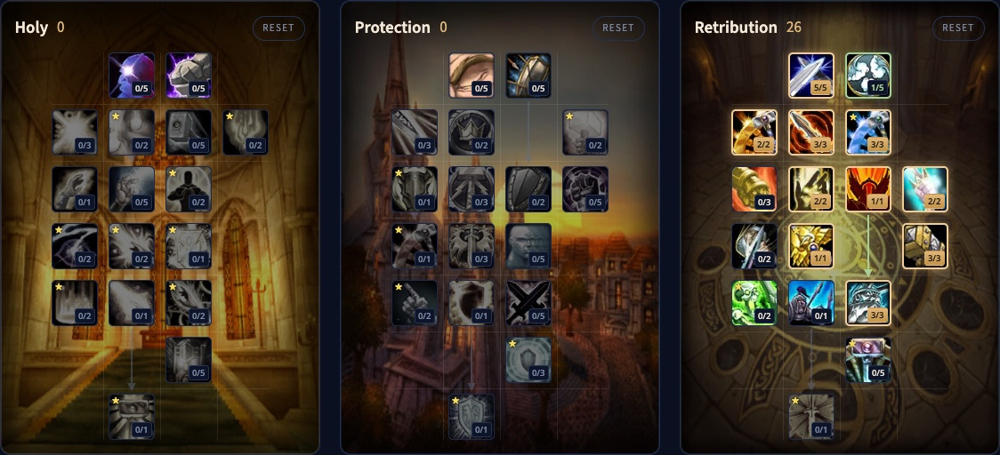

Il Retribution Paladin di WoW Forever è il guerriero sacro con una grande arma a due mani. Colpisci piano ma forte, lanci qualche incantesimo nel mezzo, e quasi tutto ora scala con il potere magico. Non premi un tasto a ogni tempo globale, ma Judgement, Holy Strike e Consecration ti tengono occupato. Questa guida copre la build di livello 30, la rotazione, i sigilli, le benedizioni, le stats e le razze.

| | |
|---|---|
| Ruolo | Danni in mischia con un'arma a due mani lenta |
| Build al livello 30 | 21 punti in Retribution, Talented aggiunge Two-Handed Weapon Specialization e Vengeance |
| Talenti chiave | Conviction, Sanctified Judgement, Seal of Command, Sacred Arbiter, Vengeance, Twist of Light |
| Punti forti | Utilità di gruppo, molto difficile da uccidere, grandi picchi di danno |
| Punti deboli | Lento a raggiungere il bersaglio, il mana può finire |
| Livellare | [Guida al leveling del Paladin](/it/guides/paladin-leveling/), [build di leveling del Paladin](/it/leveling/paladin/) |

## Punti forti e deboli

**Utilità di gruppo.** Ogni gruppo vuole due Paladin. Porti benedizioni, un'aura, Judgement e bolle. Niente di questo è esclusivo di Retribution, ma porti tutto.

**Difficile da uccidere.** Piastre, Divine Shield, Lay on Hands e le tue cure ti tengono in piedi quando il guaritore non ce la fa. Per questo Retribution rende bene negli scontri duri.

**Lento ad arrivare.** Niente carica, niente traslazione, niente scatto. Pursuit of Justice dà il 15% di velocità, e basta.

**Il mana.** Non accumuli una risorsa prima dello scontro, ma il mana può finire. Sanctified Judgement e Holy Conduit aiutano, e Judgement of Wisdom aiuta tutto il gruppo.

## La build di livello 30

La beta si è fermata al livello 30, quindi la build usa 21 punti. Talented, dal sistema Legacy, ne aggiunge 5. [Apri la build nel calcolatore di talenti](/it/talents/paladin/?t=--5012503120101).

| Talento | Punti |
|---|---|
| **Deflection** | 5/5 |
| **Improved Judgement** | 1/2 |
| **Holy Conduit** | 2/2 |
| **Conviction** | 5/5 |
| **Sanctified Judgement** | 3/3 |
| **Seal of Command** | 1/1 |
| **Pursuit of Justice** | 2/2 |
| **Sacred Arbiter** | 1/1 |
| **Vengeance** | 1/3 |

[Apri la versione Talented](/it/talents/paladin/?t=--5012503120133) con Two-Handed Weapon Specialization 3/3 e Vengeance 3/3.

**Benediction al posto di Deflection.** Deflection dà solo parata. Se resti senza mana negli scontri lunghi, metti quei 5 punti in Benediction: incantesimi e abilità istantanei costano allora il 10% di mana in meno.

## Cosa fanno i talenti chiave

| Talento | Cosa fa in Forever |
|---|---|
| **Improved Judgement** | Judgement torna 1 secondo prima per punto |
| **Holy Conduit** | Consecration, Holy Wrath, Exorcism e Hammer of Wrath costano il 40% di mana in meno |
| **Conviction** | Il 5% di probabilità di critico in più in mischia |
| **Sanctified Judgement** | Judgement restituisce il 60% del costo in mana del sigillo giudicato |
| **Seal of Command** | Probabilità di infliggere di nuovo il 70% dei danni dell'arma come danni Sacri, quindi un'arma lenta ci guadagna di più |
| **Pursuit of Justice** | Il 15% di velocità di movimento, anche in sella |
| **Sacred Arbiter** | Holy Strike infligge il 20% di danni in più e rinnova ogni Judgement sul bersaglio, anche quelli di altri Paladin |
| **Two-Handed Weapon Specialization** | Il 6% di danni in più con armi a due mani |
| **Vengeance** | Il 3% di danni Fisici e Sacri in più per 30 secondi dopo un critico, cumulabile 3 volte |
| **Champion of the Light** | Danni magici pari fino al 30% del tuo Intelletto |
| **Instrument of Law** | Hammer of Wrath si lancia 1 secondo prima, e generi il 20% di minaccia in meno senza Righteous Fury |
| **Twist of Light** | I sigilli costano il 20% in meno, e un Seal of Command o Seal of Righteousness sostituito agisce ancora per un colpo |

Champion of the Light, Instrument of Law e Twist of Light sono nelle file 6 e 7, fuori portata al livello 30. Sono il motivo per scendere ancora nell'albero dopo il lancio.

## Rotazione

1. Lancia Seal of the Crusader prima del pull.
2. Apri con Judgement, per lasciare Judgement of the Crusader sul bersaglio.
3. Lancia Seal of Command e tienilo attivo.
4. Lancia Judgement appena è pronto.
5. Lancia Holy Strike appena è pronto.
6. Tieni attivo Consecration.
7. Contro gli Undead, lancia Exorcism appena è pronto.
8. Con Twist of Light, tieni attivi Seal of Command e Seal of Righteousness quando puoi.

## Sigilli e Judgement

Ogni Paladin può tenere un solo Judgement su un bersaglio, quindi scegli in base al gruppo e allo scontro.

- **Seal of the Crusader** è debole da solo. Lo usi per il suo Judgement, che aumenta i danni Sacri subiti dal bersaglio. Un grande aiuto per te, ma non per il resto del gruppo.
- **Seal of Wisdom** e il suo Judgement restituiscono mana. Il gruppo ti ringrazierà se lo tieni sul boss.
- **Seal of Light** e il suo Judgement restituiscono un po' di cure, utile negli scontri con tanti piccoli danni ad area.
- **Seal of Command** è il tuo sigillo da danno. Il suo Judgement infligge anche un bel colpo di danni Sacri.
- **Seal of Righteousness** aggiunge danni Sacri a ogni colpo e colpisce forte quando viene giudicato. Con Twist of Light è il secondo sigillo accanto a Seal of Command.

## Tempi di recupero e utilità

- **Divine Shield**, **Divine Protection** e **Blessing of Protection** sono forti tempi di recupero difensivi, e tutti e tre causano Forbearance. Sotto Divine Protection o Blessing of Protection non puoi attaccare, quindi Divine Shield viene prima.
- **Lay on Hands** ti cura del tutto all'istante. Costa tutto il tuo mana e ne restituisce un po', quindi usalo con attenzione.
- **Blessing of Sacrifice** ti passa parte dei danni di un alleato. La quantità è piccola, quindi funziona meglio contro tanti colpi piccoli. Poi ridai all'alleato la sua benedizione normale.
- **Divine Intervention** protegge un alleato da tutto per 3 minuti, ma ti uccide. Usala come assicurazione contro un wipe, su un guaritore lontano dal boss, perché resusciti il gruppo.

## Benedizioni in gruppo

Prima di uno scontro, dai a ciascuno la benedizione giusta, e a tutti tranne il tank anche Blessing of Salvation. Durante lo scontro tieni d'occhio il gruppo: Blessing of Protection a chi prende minaccia, Blessing of Freedom a chi resta bloccato nel posto sbagliato, e Blessing of Sacrifice a un incantatore sommerso da piccoli mostri.

## Stats ed equipaggiamento

Le priorità delle stats per il livello 60 arriveranno dopo il lancio. Fino ad allora, contano queste:

- **Indice di colpo**, perché attacchi e incantesimi vadano a segno.
- **Probabilità di critico**, che lavora con Conviction e Vengeance.
- **Forza e potere d'attacco** per i danni in mischia. La Forza dà 2 di potere d'attacco per punto.
- **Potere magico e Intelletto**, perché quasi tutto il tuo kit scala con il potere magico. Champion of the Light aggiunge danni magici dall'Intelletto.
- **Agilità**, per un po' di probabilità di critico.

**Armatura.** Guarda le stats, non il tipo. Cuoio o persino stoffa possono battere le piastre se le stats sono giuste. Ai livelli bassi Blacksmithing è quasi indispensabile, perché piastre e maglia con potere magico sono rare. Anche i dungeon hanno buoni pezzi.

**Arma.** Un'arma a due mani lenta con molti danni, per Seal of Command e Holy Strike.

**Librams.** I Paladin portano un libram nello slot a distanza, con un piccolo bonus passivo. Scegline uno adatto ai tuoi incantesimi.

## Razze e professioni

| Fazione | Razza | Perché |
|---|---|---|
| Alliance | Human | Probabilità di critico in più, la scelta migliore |
| Alliance | Dwarf | L'1% di hit con Artisan's Precision, e Stoneform come forte tempo di recupero difensivo |
| Horde | Undead | Un effetto che infligge danni e ti cura un po'; l'unico Paladin dell'Horde |

**Blacksmithing** crea parte delle migliori piastre e maglie, molte solo per i fabbri. **Engineering** offre aggeggi utili a ogni specializzazione. Altro sulle razze in [Razze e classi](/it/guides/races-and-classes/).
