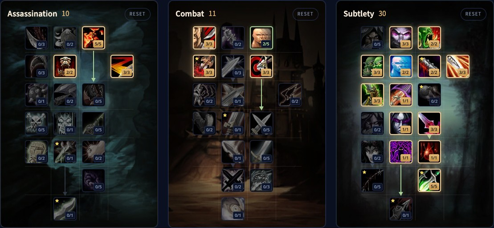

Il Subtlety Rogue di WoW Forever ha finalmente due vere build PvE. Una infligge enormi Ambush critici, e il nuovo talento Cutthroat ti fa usare Ambush in combattimento. L'altra punta sui sanguinamenti, con Hemorrhage, un Rupture più forte e il nuovo Thousand Cuts. Anche i veleni ora possono fare critici e scalano con il potere d'attacco. Questa guida copre entrambe le build per il livello 30 e il 60, le rotazioni, l'energia, i veleni, la sopravvivenza, le stats e le razze.

| | |
|---|---|
| Ruolo | Danni in mischia, con pugnali o sanguinamenti |
| Build | Ambush con Cutthroat (10/11/30) e sanguinamento con Thousand Cuts (12/8/31) al livello 60 |
| Talenti chiave | Malice, Opportunity, Initiative, Ghostly Strike, Serrated Blades, Preparation, Hemorrhage, Cutthroat, Thousand Cuts |
| Punti forti | Due stili di gioco, i sanguinamenti ignorano l'armatura, tanto controllo |
| Punti deboli | Ha bisogno di equipaggiamento, i talenti migliori solo ad alto livello |
| Livellare | [Guida al leveling del Rogue](/it/guides/rogue-leveling/), [build di leveling del Rogue](/it/leveling/rogue/) |

## Punti forti e deboli

**Due stili di gioco.** Ambush con Cutthroat o sanguinamenti con Hemorrhage. Entrambi reggono bene negli scontri lunghi.

**I sanguinamenti ignorano l'armatura.** Rupture e Garrote ignorano del tutto l'armatura, e questo paga contro mostri e boss molto corazzati.

**Controllo.** Kick, Gouge, Sap, Cheap Shot, Kidney Shot e Blind, più veleni che rallentano, allungano i lanci o riducono le cure.

**Dipende dallo scontro.** La build Ambush deve stare dietro al bersaglio, il che si adatta meglio a dungeon e incursioni che al mondo aperto. Alcuni mostri sono immuni ai sanguinamenti.

**Ha bisogno di equipaggiamento.** Rupture, Garrote e i veleni scalano con il potere d'attacco e possono fare critici, quindi ti servono entrambi.

**Ha bisogno di livelli.** I talenti migliori sono in fondo all'albero. Molti giocatori livellano con un'altra specializzazione e passano a Subtlety più tardi.

## Build di livello 30

Al livello 30 hai 21 punti, e Talented ne aggiunge 5. Entrambe le build sono spiegate nella nostra [guida al leveling del Rogue](/it/guides/rogue-leveling/).

- **Ambush:** uccide i mostri il più in fretta possibile con Ambush critici da Stealth. [Apri la build](/it/talents/rogue/?t=02-02-032320331), [versione Talented](/it/talents/rogue/?t=025-02-032320331).
- **Sanguinamento:** Garrote, Hemorrhage e Rupture, con Serrated Blades per un Rupture più forte e Preparation per uno Slice and Dice in più. [Apri la build](/it/talents/rogue/?t=--0323220310013001), [versione Talented](/it/talents/rogue/?t=002--0323220310013211).

## Build Ambush con Cutthroat di livello 60: 10/11/30

La beta si è fermata al livello 30, ma gli alberi dei talenti del livello 60 sono nei file del gioco. Abbiamo verificato questa build punto per punto nel [nostro calcolatore di talenti](/it/talents/rogue/?t=005023-302303-032322331001301105). Cutthroat fa di Backstab il tuo generatore principale e ti dà effetti per usare Ambush in combattimento. Serrated Blades aggiunge il 9% di penetrazione dell'armatura, e Hemorrhage copre gli scontri in cui non puoi stare dietro al mostro.

| Talento | Punti |
|---|---|
| **Malice** (Assassination) | 5/5 |
| **Murder** (Assassination) | 2/2 |
| **Improved Slice and Dice** (Assassination) | 3/3 |
| **Improved Eviscerate** (Combat) | 3/3 |
| **Lightning Reflexes** (Combat) | 2/5 |
| **Puncturing Wounds** (Combat) | 3/3 |
| **Precision** (Combat) | 3/3 |
| **Master of Deception** | 3/3 |
| **Opportunity** | 2/2 |
| **Setup** | 3/3 |
| **Elusiveness** | 2/2 |
| **Dirty Tricks** | 2/2 |
| **Improved Ambush** | 3/3 |
| **Initiative** | 3/3 |
| **Ghostly Strike** | 1/1 |
| **Premeditation** | 1/1 |
| **Serrated Blades** | 3/3 |
| **Preparation** | 1/1 |
| **Hemorrhage** | 1/1 |
| **Cutthroat** | 5/5 |

Non restano abbastanza punti per Relentless Strikes, quindi Murder prende gli ultimi 2 punti in Assassination. Ruthlessness 2/3 è un'alternativa, con meno probabilità di effetto.

## Build a sanguinamento con Thousand Cuts di livello 60: 12/8/31

Fino in fondo all'albero Subtlety. [Apri la build nel calcolatore di talenti](/it/talents/rogue/?t=0053031-302003-1323220310013211501). Quietus aumenta i danni di Hemorrhage e Ghostly Strike contro i mostri sotto il 35% di salute, e Thousand Cuts rende Hemorrhage più economico a ogni tick di Rupture.

| Talento | Punti |
|---|---|
| **Malice** (Assassination) | 5/5 |
| **Ruthlessness** (Assassination) | 3/3 |
| **Improved Slice and Dice** (Assassination) | 3/3 |
| **Relentless Strikes** (Assassination) | 1/1 |
| **Improved Eviscerate** (Combat) | 3/3 |
| **Lightning Reflexes** (Combat) | 2/5 |
| **Precision** (Combat) | 3/3 |
| **Camouflage** | 1/5 |
| **Master of Deception** | 3/3 |
| **Opportunity** | 2/2 |
| **Setup** | 3/3 |
| **Elusiveness** | 2/2 |
| **Dirty Tricks** | 2/2 |
| **Initiative** | 3/3 |
| **Ghostly Strike** | 1/1 |
| **Premeditation** | 1/1 |
| **Serrated Blades** | 3/3 |
| **Dirty Deeds** | 2/2 |
| **Preparation** | 1/1 |
| **Hemorrhage** | 1/1 |
| **Quietus** | 5/5 |
| **Thousand Cuts** | 1/1 |

## Cosa fanno i talenti chiave

| Talento | Cosa fa in Forever |
|---|---|
| **Malice** | Il 5% di critico in più con attacchi e veleni |
| **Remorseless Attacks** | Dopo un'uccisione, il 40% di critico in più sul prossimo Sinister Strike, Backstab, Ambush, Mutilate o Ghostly Strike |
| **Ruthlessness** | Le mosse finali hanno il 60% di probabilità di aggiungere un punto combo |
| **Improved Slice and Dice** | Slice and Dice dura il 45% in più |
| **Relentless Strikes** | Le mosse finali hanno il 20% di probabilità per punto combo di restituire 25 di energia |
| **Precision** | Il 3% di probabilità di colpire in più |
| **Opportunity** | Backstab, Garrote, Ambush e Mutilate infliggono il 10% di danni in più |
| **Master of Deception** | I mostri ti individuano in Stealth come se avessi 3 livelli in più |
| **Setup** | Un punto combo ogni volta che schivi un attacco o resisti a un incantesimo |
| **Initiative** | Ambush, Garrote e Cheap Shot aggiungono un punto combo in più |
| **Ghostly Strike** | Il 180% dei danni dell'arma con un pugnale e il 15% di schivata in più per 7 secondi |
| **Serrated Blades** | I tuoi attacchi ignorano il 9% dell'armatura, e Rupture infligge il 30% di danni in più |
| **Premeditation** | Aggiunge 2 punti combo al bersaglio |
| **Preparation** | Azzera il tempo di recupero delle altre abilità da Rogue |
| **Hemorrhage** | Il 145% dei danni dell'arma con un pugnale, e il 15% di danni di Rupture in più sul bersaglio per 15 secondi |
| **Dirty Deeds** | Cheap Shot e Garrote costano 20 di energia in meno, e Garrote non richiede più di stare dietro al bersaglio |
| **Quietus** | Sinister Strike, Ghostly Strike e Hemorrhage infliggono il 10% di danni in più sotto il 35% di salute |
| **Cutthroat** | Backstab ha il 15% di probabilità di permettere il prossimo Ambush senza Stealth entro 10 secondi |
| **Thousand Cuts** | Ogni tick di Rupture riduce di 3 l'energia del prossimo Hemorrhage o Backstab, fino a 5 volte |

## Rotazione

### Build Ambush

1. Entra in Stealth e lancia Premeditation.
2. Apri con Ambush.
3. Resta dietro al bersaglio e usa Backstab come generatore. Dove non puoi stare dietro, usa Hemorrhage.
4. Usa Ghostly Strike appena è pronto.
5. Usa Ambush a ogni effetto di Cutthroat quando hai meno di 5 punti combo. Con 5, prima una mossa finale.
6. Con 5 punti combo, lancia Slice and Dice e rinnovalo quando scade.
7. Negli scontri lunghi, lancia Expose Armor con i 5 punti combo successivi.
8. Il resto va in Eviscerate.
9. Vanish e Ambush per un picco di danni, e Preparation per azzerare i tempi di recupero o fuggire.

### Build a sanguinamento

1. Entra in Stealth e lancia Premeditation.
2. Apri con Garrote.
3. Usa Hemorrhage come generatore e Ghostly Strike appena è pronto.
4. Con 5 punti combo, lancia Slice and Dice, poi Rupture con i 5 successivi.
5. Spendi Thousand Cuts su Hemorrhage prima o al raggiungimento di 5 accumuli.
6. Il resto va in Eviscerate, ed Expose Armor sui boss se il gruppo ne ha bisogno.
7. Vanish e Garrote per un picco di danni, e Preparation per azzerare i tempi di recupero o fuggire.

### Più mostri

I Rogue non hanno danni ad area: uccidi un mostro alla volta. Non cambiare mai bersaglio mentre accumuli punti combo, o li perdi.

## Stealth, punti combo e mosse finali

Stealth ti rallenta, fino al 50% ai livelli bassi e al 30% al livello 60, quindi non viaggi con lui, ma lo usi contro la maggior parte dei mostri. In Stealth hai le aperture: Ambush per un colpo grosso, Garrote per un sanguinamento, Sap e Cheap Shot per neutralizzare.

I tuoi generatori sono prima Sinister Strike, poi Backstab, Ghostly Strike e Hemorrhage. Le tue mosse finali sono Eviscerate, Slice and Dice, Expose Armor e Rupture. Tenere attivo Slice and Dice è il tuo aumento di danni più grande. Kidney Shot stordisce un mostro pericoloso.

## Energia

L'energia ora torna in modo continuo, 1 punto ogni 0,1 secondi, cioè 10 al secondo. Thousand Cuts fa risparmiare fino a 15 di energia su un Hemorrhage, e Thistle Tea ne restituisce una bella quantità con un lungo tempo di recupero. Per il resto: non generare mai un punto combo oltre 5, e non spendere energia in Kick, Feint, Gouge o Blind senza motivo.

## Veleni

Dal livello 20, una catena di missioni ti insegna a creare veleni. Usa Instant Poison e Deadly Poison nella maggior parte degli scontri: Instant Poison sulle armi lente, Deadly Poison su quelle veloci. Passa a Crippling, Mind-numbing o Wound Poison quando un mostro va rallentato, deve lanciare più lentamente o ricevere meno cure.

## Sopravvivenza

I Rogue colpiscono forte ma cadono in fretta. Valuta ogni pull: usa Sap su un mostro di un gruppo, meglio se un incantatore. Apri con Cheap Shot, continua con Kidney Shot e allunga con Gouge o Blind quando ti servono energia o tempi di recupero. Usa Evasion quando devi incassare, interrompi con Kick ogni incantatore, e Vanish quando nient'altro funziona.

## Stats ed equipaggiamento

Le priorità delle stats per il livello 60 arriveranno dopo il lancio. Fino ad allora:

- **Agilità**: 1 di potere d'attacco per punto, l'1% di critico ogni 29 di Agilità, l'1% di schivata ogni 14,5 di Agilità.
- **Potere d'attacco**, che ora aumenta anche i danni dei veleni.
- **Probabilità di critico**, anche per veleni e Rupture.
- **Forza**: 1 di potere d'attacco per punto, nient'altro.
- **Tempra** per la salute, presente su quasi tutto l'equipaggiamento.
- **Spirito** solo per rigenerare tra uno scontro e l'altro.

**Armatura.** Cuoio con le stats qui sopra. Set come Defias Leather ed Embrace of the Viper sono buoni mentre livelli.

**Armi.** Le armi ora sono molto più forti a ogni livello. Va bene ogni tipo, ma le tue abilità scalano meglio con i pugnali, e la build Ambush ne ha bisogno. Buoni esempi sono Meteor Shard, Toxic Revenger, Assassin's Blade e Torturing Poker.

## Razze e professioni

| Fazione | Razza | Perché |
|---|---|---|
| Alliance | Human | L’1% di critico con Ruthless |
| Alliance | Night Elf | Elune's Light, il 10% di critico per 15 secondi; Shadowmeld e uno Stealth migliore |
| Alliance | Gnome | Eureka! per un picco di danni, Engineering Specialization con Engineering |
| Alliance | Dwarf | Stoneform rimuove sanguinamenti, veleni e malattie; Artisan's Precision dà l'1% di hit |
| Alliance | Skyborne | Il 2% di celerità con Wind Blessed |
| Horde | Orc | Il 10% di potere d'attacco con Blood Fury, la scelta migliore |
| Horde | Troll | Il 10% di celerità con Berserking e uno strumento di sopravvivenza |
| Horde | Undead | Meglio in PvP; Cannibalize fa risparmiare tempo nel mondo aperto |
| Horde | Skyborne | Il 2% di celerità con Wind Blessed |

**Leatherworking** con Skinning è la coppia migliore: un buon equipaggiamento in cuoio a ogni livello, kit d'armatura e la Camp Tent del campeggio, che velocizza il leveling. **Engineering** porta aggeggi ed esplosivi per più danni, ed è il miglior partner di Leatherworking se salti Skinning. **Herbalism** con **Alchemy** ti dà elisir, pozioni e fiale.
