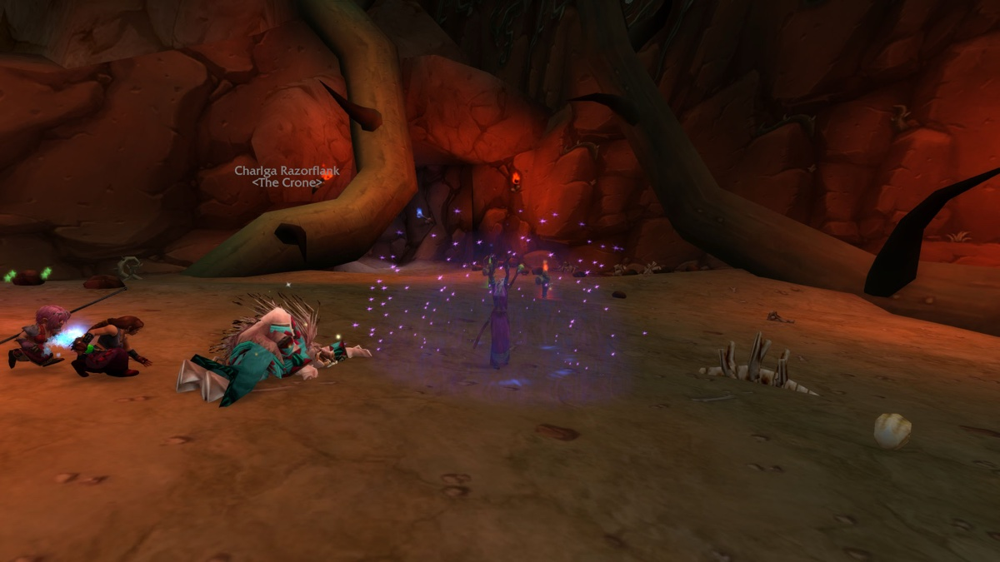

De Arcane Mage heeft in WoW Forever eindelijk eigen schadespells. Arcane Blast stapelt spell damage, Missile Barrage maakt Arcane Missiles gratis en snel, en Arcane Wrath is een zware nuke die meegroeit met je mana. De spec slaat hard op één doelwit, maar verbruikt snel mana en hangt af van procs. Deze gids behandelt de builds, de rotatie, mana, overleven en gear.

| | |
|---|---|
| Rol | Burst op afstand op één doelwit |
| Build op level 30 | 21 punten in Arcane, Talented voegt Arcane Mind en Arcane Instability toe |
| Belangrijkste talenten | Arcane Blast, Missile Barrage, Arcane Wrath, <a class="wf-wh wf-spell" href="https://www.wowhead.com/forever/spell=11213">Arcane Concentration</a>, Arcane Meditation |
| Sterk in | Hoge schade, groeit met gear, utility voor de groep |
| Zwak in | Heel moeilijk manabeheer, afhankelijk van procs en gear |
| Levelen | [Levelgids voor de Mage](/nl/guides/mage-leveling/) |
| Talentvolgorde per level | [Levelbuild voor de Mage](/nl/leveling/mage/) |
| Andere specs | [Frost Mage](/nl/guides/frost-mage/), [Fire Mage](/nl/guides/fire-mage/) |

## Wat er verandert voor Arcane

- **Arcane Blast is nieuw.** Een talent op level 20 met een cast van 1,5 seconde. Elke cast geeft 15% van je Intellect als spell damage, tot 4 stacks, en maakt de volgende Arcane Blast 175% duurder.
- **Missile Barrage is nieuw.** Op 2/2 heeft Arcane Blast 40% kans, en Arcane Wrath, <a class="wf-wh wf-spell" href="https://www.wowhead.com/forever/spell=133">Fireball</a>, <a class="wf-wh wf-spell" href="https://www.wowhead.com/forever/spell=116">Frostbolt</a> en Frostfire Bolt 20%, om je volgende Arcane Missiles gratis en twee keer zo snel te maken. Treffers van Arcane Missiles hebben ook 10% kans.
- **Arcane Wrath is nieuw.** Een talent op level 25: cast van 3,5 seconden, cooldown van 6 seconden, met extra spell damage gelijk aan 5% van je maximale mana.
- **Arcane Meditation is sterker.** Op 3/3 loopt 50% van je manaregeneratie door tijdens het casten. Met <a class="wf-wh wf-spell" href="https://www.wowhead.com/forever/spell=6117">Mage Armor</a> op level 34 wordt dat 100%.
- **De oude ondersteunende talenten blijven.** <a class="wf-wh wf-spell" href="https://www.wowhead.com/forever/spell=11213">Arcane Concentration</a>, Arcane Mind, <a class="wf-wh wf-spell" href="https://www.wowhead.com/forever/spell=15058">Arcane Instability</a> en Arcane Power doen nog wat ze deden, nu voor een spec met echte schade.

## Sterktes en zwaktes

| Sterktes | Zwaktes |
|---|---|
| Hoge schade op één doelwit met Arcane Blast en Arcane Wrath | Arcane Blast wordt vanaf de derde stack heel duur |
| Groeit sterk met Intellect, spell damage en level | Zonder goede gear en een grote manapool sta je droog |
| <a class="wf-wh wf-spell" href="https://www.wowhead.com/forever/spell=1459">Arcane Intellect</a>, <a class="wf-wh wf-spell" href="https://www.wowhead.com/forever/spell=604">Dampen Magic</a>, <a class="wf-wh wf-spell" href="https://www.wowhead.com/forever/spell=1008">Amplify Magic</a>, eten, water en portals | Zonder Clearcasting- of Missile Barrage-procs valt de rotatie uit elkaar |
| Missile Barrage maakt van Arcane Missiles een echte schadespell | Minder overleving dan Frost, en geen <a class="wf-wh wf-spell" href="https://www.wowhead.com/forever/spell=11958">Ice Block</a> |

## Twee builds voor level 30

Beide builds gebruiken de 21 punten die je op level 30 hebt. Talented uit het Legacy-systeem geeft elk 5 punten extra: Arcane Mind 5/5 en Arcane Instability 1/3.

### Build voor één doelwit

Om te questen en in de open wereld. 5/5 <a class="wf-wh wf-spell" href="https://www.wowhead.com/forever/spell=11237">Improved Channeling</a> houdt je casts gaande als monsters je raken, en de build gaat zo diep als hij kan richting Arcane Mind. De prijs is de 6% critical strike chance van <a class="wf-wh wf-spell" href="https://www.wowhead.com/forever/spell=11242">Arcane Impact</a>. [Open de build in de talentcalculator](/nl/talents/mage/?t=03520050001003101).

| Talent | Punten |
|---|---|
| **<a class="wf-wh wf-spell" href="https://www.wowhead.com/forever/spell=11222">Arcane Focus</a>** | 3/5 |
| **<a class="wf-wh wf-spell" href="https://www.wowhead.com/forever/spell=11237">Improved Channeling</a>** | 5/5 |
| **Missile Barrage** | 2/2 |
| **<a class="wf-wh wf-spell" href="https://www.wowhead.com/forever/spell=11213">Arcane Concentration</a>** | 5/5 |
| **Arcane Blast** | 1/1 |
| **Arcane Meditation** | 3/3 |
| **Arcane Wrath** | 1/1 |
| **Arcane Mind** | 1/5 |

[Open de Talented-versie](/nl/talents/mage/?t=035200500010031051) met Arcane Mind 5/5 en Arcane Instability 1/3.

### Build voor dungeons

Voor dungeons, als iemand anders tankt. <a class="wf-wh wf-spell" href="https://www.wowhead.com/forever/spell=11210">Arcane Subtlety</a> verlaagt de threat van je Arcane-spells met 30%, zodat je Arcane Explosion kunt spammen, en Arcane Impact 3/3 geeft 6% extra critical strike chance. Zonder Improved Channeling vertragen monsters die je raken elke cast. [Open de build in de talentcalculator](/nl/talents/mage/?t=03022050031003101).

| Talent | Punten |
|---|---|
| **<a class="wf-wh wf-spell" href="https://www.wowhead.com/forever/spell=11222">Arcane Focus</a>** | 3/5 |
| **Missile Barrage** | 2/2 |
| **<a class="wf-wh wf-spell" href="https://www.wowhead.com/forever/spell=11210">Arcane Subtlety</a>** | 2/2 |
| **<a class="wf-wh wf-spell" href="https://www.wowhead.com/forever/spell=11213">Arcane Concentration</a>** | 5/5 |
| **<a class="wf-wh wf-spell" href="https://www.wowhead.com/forever/spell=11242">Arcane Impact</a>** | 3/3 |
| **Arcane Blast** | 1/1 |
| **Arcane Meditation** | 3/3 |
| **Arcane Wrath** | 1/1 |
| **Arcane Mind** | 1/5 |

[Open de Talented-versie](/nl/talents/mage/?t=030220500310031051) met Arcane Mind 5/5 en Arcane Instability 1/3. De [levelbuild voor de Mage](/nl/leveling/mage/) geeft een talent voor elk level van 10 tot 35.

### Wat de belangrijkste talenten doen

| Talent | Wat het doet in Forever |
|---|---|
| **<a class="wf-wh wf-spell" href="https://www.wowhead.com/forever/spell=11237">Improved Channeling</a>** | Op 5/5 verliest Arcane Missiles nooit casttijd als je schade krijgt, Arcane Blast en Arcane Wrath in 70% van de gevallen |
| **<a class="wf-wh wf-spell" href="https://www.wowhead.com/forever/spell=11222">Arcane Focus</a>** | 1% meer kans om te raken met Arcane-spells per punt. Nodig tegen bazen en monsters boven je level |
| **Missile Barrage** | Gratis Arcane Missiles die twee keer zo snel channelen, zie hierboven |
| **<a class="wf-wh wf-spell" href="https://www.wowhead.com/forever/spell=11213">Arcane Concentration</a>** | 10% kans na een schadespell om je volgende schadespell gratis te maken |
| **Arcane Blast** | Stapelende spell damage, het hart van de spec |
| **Arcane Meditation** | 50% van je manaregeneratie loopt door tijdens het casten |
| **Arcane Wrath** | Een zware nuke die meegroeit met je maximale mana |
| **<a class="wf-wh wf-spell" href="https://www.wowhead.com/forever/spell=11242">Arcane Impact</a>** | 6% meer critical strike chance met Arcane-spells op 3/3 |
| **Arcane Mind** | 10% meer Intellect en 100% meer critical strike damage voor Arcane-spells op 5/5 |
| **<a class="wf-wh wf-spell" href="https://www.wowhead.com/forever/spell=15058">Arcane Instability</a>** | 1% meer schade en critical strike chance per punt |

## Rotatie

**Eén vijand**
1. Cast Arcane Blast om stacks op te bouwen en schade te doen.
2. Gebruik elke Clearcasting-proc op Arcane Blast.
3. Cast Arcane Missiles zodra Missile Barrage procet.
4. Cast Arcane Wrath bij 3 of 4 stacks van Arcane Blast.
5. Kun je geen Arcane Blast meer betalen en staat Arcane Wrath op cooldown? Cast Fireball of Frostbolt om op Missile Barrage te vissen, of Arcane Missiles zonder proc.
6. <a class="wf-wh wf-spell" href="https://www.wowhead.com/forever/spell=2136">Fire Blast</a> terwijl je beweegt.
7. <a class="wf-wh wf-spell" href="https://www.wowhead.com/forever/spell=1326053">Frost Blast</a> om een doelwit van ver te vertragen, <a class="wf-wh wf-spell" href="https://www.wowhead.com/forever/spell=122">Frost Nova</a> rank 1 om een gevaarlijk monster vast te zetten, <a class="wf-wh wf-spell" href="https://www.wowhead.com/forever/spell=120">Cone of Cold</a> als het bij je is.
8. <a class="wf-wh wf-spell" href="https://www.wowhead.com/forever/spell=2139">Counterspell</a> op een gevaarlijke cast, <a class="wf-wh wf-spell" href="https://www.wowhead.com/forever/spell=118">Polymorph</a> op een gevaarlijke extra vijand.

**Een groep vijanden**
- Spam <a class="wf-wh wf-spell" href="https://www.wowhead.com/forever/spell=1449">Arcane Explosion</a>. Neem de build voor dungeons als je dat vaak doet.

## Stacks van Arcane Blast en procs

De spec speelt in burnfases. De eerste Arcane Blast start een buff van 15 seconden die tot 4 stapelt. Vier Arcane Blasts na elkaar en dan de rest zou ideaal zijn, maar de manakost laat dat zelden toe, zeker op lage levels. Dus spreid je je Arcane Blasts en leun je op twee procs.

1. **Eerst Clearcasting.** Gebruik het op Arcane Blast voor een gratis stack, zeker als je al op 4 stacks zit.
2. **Dan Missile Barrage.** Arcane Missiles kan zelf een nieuwe Missile Barrage of Clearcasting geven.
3. **Arcane Wrath twee keer per venster.** Eén keer bij 3 stacks en één keer bij 4, voor de buff afloopt. Meer Haste maakt de lange cast makkelijker.

Helemaal geen procs? Spaar mana voor het volgende venster. Cast Arcane Wrath op cooldown tot de buff afloopt, en schakel dan naar Fireball of Frostbolt om op Missile Barrage te vissen. Vanaf level 40 werkt <a class="wf-wh wf-spell" href="https://www.wowhead.com/forever/spell=401502">Frostfire Bolt</a> daar ook voor.

## Mana

Bij Arcane draait alles om mana. Buiten gevechten geeft <a class="wf-wh wf-spell" href="https://www.wowhead.com/forever/spell=5504">Conjure Water</a> je eindeloos water. In een gevecht stuur je je mana op drie manieren: Arcane Blast inhouden als je laag zit, je procs laten samenvallen met je duurste spells, en directe mana gebruiken.

- **<a class="wf-wh wf-spell" href="https://www.wowhead.com/forever/spell=12051">Evocation</a>** vanaf level 20 verhoogt je manaregeneratie 8 seconden lang met 1500%, met een cooldown van 8 minuten. Bewaar het voor lange bossgevechten. Een High Order Skyborne kan het combineren met <a class="wf-wh wf-spell" href="https://www.wowhead.com/forever/spell=1259705">Read Leyline</a>.
- **Manastenen** zoals <a class="wf-wh wf-spell" href="https://www.wowhead.com/forever/spell=759">Conjure Mana Agate</a> vanaf level 28 geven 375 tot 425 mana, één lading per steen. Maak een nieuwe voor elk lang gevecht.
- **Manapotions** geven veel, afhankelijk van hun level.

Vanaf de derde stack van Arcane Blast is gedachteloos casten de snelste weg naar een lege manabalk. Arcane Meditation en later Mage Armor dragen je, maar alleen als je je momenten kiest.

## Overleven

Arcane overleeft minder goed dan Frost en heeft geen Ice Block. Dood een doelwit voor het jou doodt, en kies je gevechten. <a class="wf-wh wf-spell" href="https://www.wowhead.com/forever/spell=1953">Blink</a> en Frost Nova halen je uit de meeste problemen. <a class="wf-wh wf-spell" href="https://www.wowhead.com/forever/spell=1463">Mana Shield</a> kost te veel mana om altijd te gebruiken, maar Mana Shield met Evocation kan je als laatste redmiddel redden.

Gebruik Frost Blast of Frostbolt rank 1 om een doelwit van ver te vertragen, Cone of Cold als directe slow en Polymorph om een doelwit uit het gevecht te halen. Hekken, heuvels, gebouwen en bomen breken de zichtlijn: een vijand moet eromheen lopen, en dat geeft je casts. Breek tegen een caster de zichtlijn als Counterspell op cooldown staat.

## Cooldowns en utility

- **<a class="wf-wh wf-spell" href="https://www.wowhead.com/forever/spell=122">Frost Nova</a>** is voor aanval en verdediging. Gebruik het zo vaak als je kunt.
- **<a class="wf-wh wf-spell" href="https://www.wowhead.com/forever/spell=12043">Presence of Mind</a>** maakt je volgende spell direct: Arcane Blast of Arcane Wrath voor burst, of Polymorph in nood.
- **<a class="wf-wh wf-spell" href="https://www.wowhead.com/forever/spell=475">Remove Lesser Curse</a>** verwijdert Curses en Banes. Gebruik het snel op gevaarlijke.
- **<a class="wf-wh wf-spell" href="https://www.wowhead.com/forever/spell=1008">Amplify Magic</a>** laat een groepslid meer schade van spells krijgen, maar ook meer healing. Goed tegen fysieke schade.
- **<a class="wf-wh wf-spell" href="https://www.wowhead.com/forever/spell=604">Dampen Magic</a>** verlaagt de schade van spells, maar ook de healing die je krijgt. Gebruik het tegen casters, niet tegen vijanden die je snel neerhalen.
- **<a class="wf-wh wf-spell" href="https://www.wowhead.com/forever/spell=118">Polymorph</a>** een gevaarlijk doelwit bij elke pull in groep.

## Stats en gear

De exacte volgorde op level 60 volgt na de launch. Deze stats helpen een Arcane Mage:

- **Spell damage en Arcane spell damage** eerst. Arcane spell damage helpt alleen Arcane-spells.
- **Intellect** telt zwaarder voor Arcane dan voor de andere Mage-specs: een grotere manapool, 10% extra uit Arcane Mind, en Arcane Blast zet er per stack 15% van om in spell damage.
- **Critical strike chance.** Arcane Impact en Arcane Mind maken crits sterker. <a class="wf-wh wf-spell" href="https://www.wowhead.com/forever/spell=18459">Incineration</a> in de Fire-boom geeft Arcane Blast 6% extra critical strike chance.
- **Haste** betekent snellere casts en meer procs. Op lage levels krijgen alleen Troll (<a class="wf-wh wf-spell" href="https://www.wowhead.com/forever/spell=20554">Berserking</a>) en High Order Skyborne (<a class="wf-wh wf-spell" href="https://www.wowhead.com/forever/spell=1259710">Wind Blessed</a>) het.
- **Spirit en mana per 5 seconden** zijn voor Arcane meer waard dan voor andere Mages, dankzij Arcane Meditation en later Mage Armor.
- **Stamina** zit op de meeste gear. Je hoeft er niet extra naar te zoeken.

**Armor.** Cloth met spell damage, Intellect en Stamina. <a class="wf-wh wf-q3" href="https://www.wowhead.com/forever/item=273044">Violet Sorcerer's Robes</a> op level 27 is een nieuwe robe met 15 Intellect en spell damage.

**Wapens.** Wapens kregen in Forever veel meer spell damage. Zoek naar Intellect, Stamina en spell damage, zoals <a class="wf-wh wf-q3" href="https://www.wowhead.com/forever/item=274158">Death Prophet Spine</a>, maar een wapen met alleen spell damage, zoals <a class="wf-wh wf-q3" href="https://www.wowhead.com/forever/item=2169">Buzzer Blade</a>, kan de betere keuze zijn.

**Wands.** De nieuwe wands van Enchanting dragen je: <a class="wf-wh wf-q2" href="https://www.wowhead.com/forever/item=11287">Lesser Magic Wand</a> en <a class="wf-wh wf-q2" href="https://www.wowhead.com/forever/item=11288">Greater Magic Wand</a> vroeg, <a class="wf-wh wf-q2" href="https://www.wowhead.com/forever/item=249232">Lesser Eternal Wand</a> en <a class="wf-wh wf-q2" href="https://www.wowhead.com/forever/item=249237">Greater Eternal Wand</a> later. <a class="wf-wh wf-q4" href="https://www.wowhead.com/forever/item=279246">Torch of Light</a> wacht op level 60. Kijk naar spell damage en schade per seconde van de wand.

## Races en tradeskills

| Factie | Ras | Waarom |
|---|---|---|
| Horde | Orc | <a class="wf-wh wf-spell" href="https://www.wowhead.com/forever/spell=20572">Blood Fury</a>: 10% meer spell power met dezelfde cooldown van 3 minuten als Arcane Power. <a class="wf-wh wf-spell" href="https://www.wowhead.com/forever/spell=20574">Savage</a>: 1% meer critical strike chance. <a class="wf-wh wf-spell" href="https://www.wowhead.com/forever/spell=1299026">Shatter Curse</a>: 5% minder magische schade |
| Horde | Troll | <a class="wf-wh wf-spell" href="https://www.wowhead.com/forever/spell=20554">Berserking</a>: 10% snellere casts. <a class="wf-wh wf-spell" href="https://www.wowhead.com/forever/spell=1260270">Rapid Regeneration</a> is een overlevingsmiddel dat Arcane nodig heeft |
| Horde | Undead | <a class="wf-wh wf-spell" href="https://www.wowhead.com/forever/spell=1260201">Touch of the Grave</a> is de enige racial die helpt in PvE. Sterker in PvP |
| Alliance | High Order Skyborne | <a class="wf-wh wf-spell" href="https://www.wowhead.com/forever/spell=1259710">Wind Blessed</a>: 3% Haste. <a class="wf-wh wf-spell" href="https://www.wowhead.com/forever/spell=1259705">Read Leyline</a>: extra regeneratie, ook met Evocation. <a class="wf-wh wf-spell" href="https://www.wowhead.com/forever/spell=1259707">Elemental Insight</a>: 5% meer schade tegen Elementals |
| Alliance | Human | <a class="wf-wh wf-spell" href="https://www.wowhead.com/forever/spell=20597">Ruthless</a>: 2% meer critical strike chance. <a class="wf-wh wf-spell" href="https://www.wowhead.com/forever/spell=20598">The Human Spirit</a>: 5% meer Spirit, meer waard zodra je Mage Armor hebt |
| Alliance | Gnome | <a class="wf-wh wf-spell" href="https://www.wowhead.com/forever/spell=1259817">Eureka!</a> is korte burst met Arcane Power. <a class="wf-wh wf-spell" href="https://www.wowhead.com/forever/spell=20591">Expansive Mind</a>: 5% meer mana, wat later minder telt |

Orc is de sterkste keuze in PvE, Troll de tweede. Bij de Alliance komt de High Order Skyborne eerst en Human tweede. Gnome kreeg nerfs op de beta en blijft vooral interessant met Engineering. Niets ervan is sterk genoeg om een ras over te slaan dat je liever speelt.

**Tradeskills.** Tailoring maakt cloth-sets met spell damage en Intellect, en past bij Enchanting voor je eigen wands en enchants. Engineering is de beste partner voor Tailoring als je de meeste schade wilt. Herbalism voedt Alchemy, dat elixirs, potions en flasks maakt.
