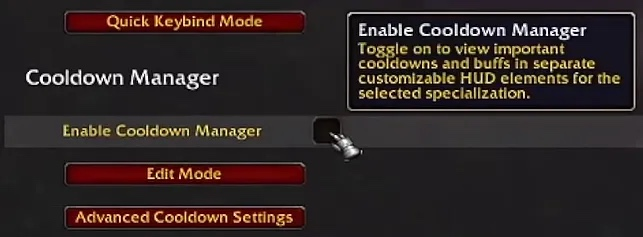
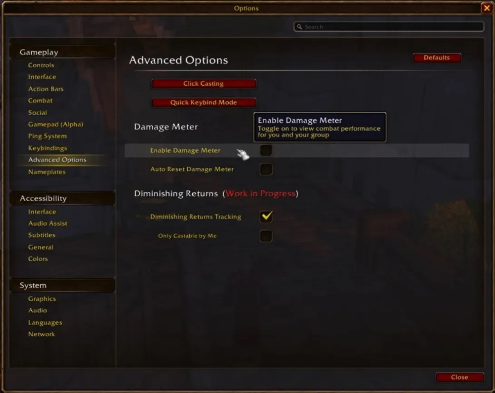
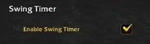
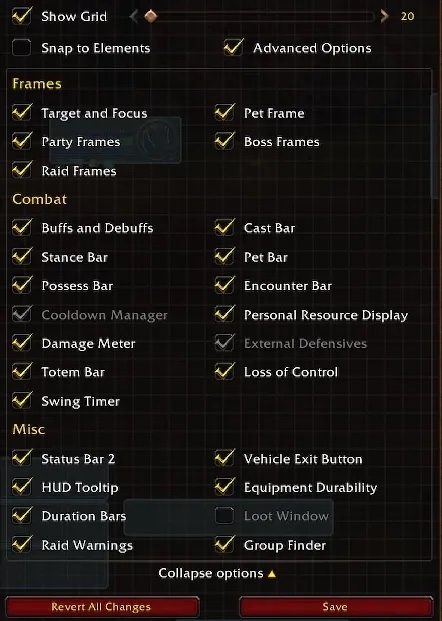
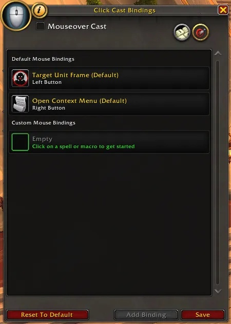

WoW Forever heeft dezelfde beperkingen voor addons als het moderne spel sinds Midnight. Addons zien minder en kunnen minder in een gevecht, en WeakAuras werkt niet meer. In ruil zitten er een paar tools in het spel zelf: een Cooldown Manager, een Damage Meter, een Swing Timer, Edit Mode en Click Casting. Deze gids toont waar je ze aanzet.

| | |
|---|---|
| WeakAuras | Werkt niet in Forever |
| Waar beginnen | Options, Advanced Options |
| Ingebouwd | Cooldown Manager, Damage Meter, Swing Timer, Edit Mode, Click Casting |
| Dingen plaatsen | Edit Mode, via het Escape-menu |
| Addons | Nog toegelaten, als ze voor Forever gemaakt zijn |

## Cooldown Manager

De Cooldown Manager komt het dichtst bij WeakAuras. Hij leest je buffs en actiebalken en toont de spells die je kiest in een eigen venster. Ook trinkets en drankjes kan je volgen.

1. Open het spelmenu en kies Options.
2. Ga naar Advanced Options.
3. Vink Enable Cooldown Manager aan. Hij staat standaard uit.
4. Open Edit Mode om hem te plaatsen.
5. Typ /cdm om te kiezen welke spells verschijnen.

Hij vervangt niet alles. Eigen triggers, geavanceerde gevechtsinfo en hulp bij je rotatie kunnen onder de nieuwe regels niet. Hij toont de belangrijkste informatie, en daar houdt het op.

## Damage Meter

Voor gewone gevechtsstatistieken heb je geen addon meer nodig.

1. Open het spelmenu en kies Options.
2. Ga naar Advanced Options, het deel Damage Meter.
3. Vink Enable Damage Meter aan. Auto Reset Damage Meter maakt hem vanzelf leeg.
4. Open Edit Mode om hem te verplaatsen en te vergroten.

Het keuzemenu op de meter zelf kiest wat hij toont. Het tandwiel zet de gegevens terug op nul, past de weergave aan en opent extra vensters.

## Swing Timer

De ingebouwde Swing Timer toont wanneer je volgende automatische aanval landt, handig om abilities rond je slagen te timen. Zet hem aan in dezelfde Advanced Options en plaats hem met Edit Mode.

## Edit Mode

Edit Mode deelt je interface in. Open het via het Escape-menu. Naast de Cooldown Manager, de Damage Meter en de Swing Timer verplaatst het frames zoals die van je party en raid, de castbalk, de totembalk, buffs en debuffs, Loss of Control en de Personal Resource Display.

## Click Casting en mouseover

Click Casting koppelt spells aan muisklikken of toetscombinaties op je unit frames, zodat je een groepslid healt of helpt zonder het eerst te selecteren. Stel het in onder Click Casting in het menu Key Bindings, of met de knop Click Casting in Advanced Options. Het venster heeft ook een vakje Mouseover Cast.

Mouseover-casting voor al je spells staat onder Options, Combat: je spells gaan dan naar de unit onder je muis, terwijl je je eigen doelwit houdt. Meer daarover in onze gidsen voor healers, zoals [Restoration Shaman](/nl/guides/restoration-shaman/).

## Welke addons nog werken

Forever verbiedt addons niet. De regels beperken hoe addons gevechtsinformatie lezen en reageren op beschermde gegevens, zoals in het moderne spel. Addons voor de interface, tassen, actiebalken en ander gemak werken nog, zolang ze compatibel zijn met Forever.

- **Oude addons voor Classic** werken niet gegarandeerd. Zoek een versie die voor WoW Forever is aangeduid.
- **Kijk eerst in het spel.** De Cooldown Manager, Damage Meter, Swing Timer en Click Casting dekken veel van waar spelers addons voor gebruikten.
- **Levelgidsen** draaien ook als addon. Welke bij je past, staat in onze [vergelijking van leveladdons](/nl/compare/leveling-addons-forever/).
