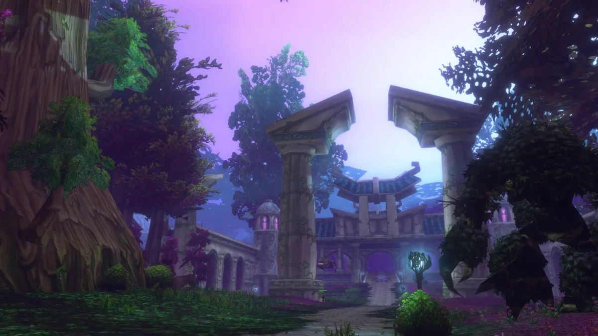

Reizen tussen de hoofdsteden gaat in WoW Forever makkelijker dan in Classic. Een nieuwe boot vanuit Stormwind Harbor vaart naar Darnassus, zonder de lange tocht door de Wetlands. Deze gids toont stap voor stap de snelste weg tussen de hoofdsteden van beide factions.

## In het kort

| Van | Naar | Hoe |
|---|---|---|
| Stormwind | Ironforge | Deeprun Tram, later rechtstreeks vliegen |
| Stormwind | Darnassus | Boot naar Auberdine, boot naar Rut'theran Village, portaal |
| Orgrimmar | Undercity | Zeppelin vanaf de toren buiten Orgrimmar |
| Orgrimmar | Thunder Bluff | Te voet door The Barrens, later rechtstreeks vliegen |

Alle routes werken ook in de andere richting. Elk vliegpunt en elke boot staat in de [gids voor vliegroutes](/nl/guides/flight-paths/), en een Mage gaat sneller met [portalen](/nl/guides/mage-portals/).

## Van Stormwind naar Ironforge

De Deeprun Tram vertrekt in het Dwarven District van Stormwind. Loop door het portaal het tramstation in en stap op een van beide treinen: ze gaan allebei naar hetzelfde station in Ironforge. Spring niet rond op de trein, want je kunt eraf vallen. Dan moet je de lange tunnel te voet afleggen. In Ironforge brengt het portaal van het station je naar Tinker Town.

Vliegen gaat sneller, maar pas als je beide vliegpunten hebt. <a class="wf-wh wf-plain" href="https://www.wowhead.com/forever/npc=352">Dungar Longdrink</a> staat in het zuidwesten van het Trade District in Stormwind (/way 66.2 62.4), <a class="wf-wh wf-plain" href="https://www.wowhead.com/forever/npc=1573">Gryth Thurden</a> bij de Great Forge in Ironforge (/way 55.8 48.0). Neem dus één keer de tram, haal het vliegpunt op en vlieg vanaf dan.

## Van Stormwind naar Darnassus

1. **Stormwind Harbor naar Auberdine.** De haven is nieuw in Forever. Neem de boot aan de linkerkant: op die kade staan ballista's en symbolen van de Night Elves, dus je ziet hem meteen.
2. **Auberdine naar Rut'theran Village.** Auberdine heeft drie aanlegplaatsen: die waar je aankomt, een links naar Rut'theran Village en een rechts naar Menethil Harbor. De boot naar Rut'theran legt aan aan de noordkant van Auberdine. Haal eerst het vliegpunt van <a class="wf-wh wf-plain" href="https://www.wowhead.com/forever/npc=3841">Caylais Moonfeather</a> (/way 36.4 45.6) op als je het nog niet hebt.
3. **Rut'theran Village naar Darnassus.** Loop door het gloeiende portaal in de boom. <a class="wf-wh wf-plain" href="https://www.wowhead.com/forever/npc=3838">Vesprystus</a> in Rut'theran (/way 58.4 94.0) vliegt naar Auberdine.

Night Elves kennen de vliegroute tussen Rut'theran Village en Auberdine van bij het begin, ook als ze nooit in Auberdine waren. Op weg naar Stormwind hoeven ze dus nooit op de boot te wachten.

## Van Orgrimmar naar Undercity

De zeppelin is snel en is niet veranderd. De toren staat net buiten de poort van Orgrimmar, aan de rechterkant. Klim naar boven en stap op de zeppelin die naast de zeppelinmeester aanlegt: hij vliegt naar Tirisfal Glades, vlak bij Undercity.

Op de terugweg staat de toren in Tirisfal tussen Brill en Undercity. Beide torens hebben ook een zeppelin naar Grom'gol in Stranglethorn Vale, dus kijk goed op welke je stapt.

## Van Orgrimmar naar Thunder Bluff

Dit is de eerste keer nog altijd een lange wandeling. Neem onderweg elk vliegpunt mee, dan hoef je ze nooit meer te lopen.

1. Haal het vliegpunt van <a class="wf-wh wf-plain" href="https://www.wowhead.com/forever/npc=3310">Doras</a> op de toren in de Valley of Strength (/way 45.2 63.8).
2. Verlaat Orgrimmar richting Razor Hill en volg de weg naar het oosten tot Far Watch Post aan de rand van Durotar.
3. Ga verder The Barrens in en naar het zuiden tot de Crossroads. Haal het vliegpunt van <a class="wf-wh wf-plain" href="https://www.wowhead.com/forever/npc=3615">Devrak</a> (/way 51.4 30.2).
4. Volg de Gold Road naar het zuiden tot Camp Taurajo en haal het vliegpunt van <a class="wf-wh wf-plain" href="https://www.wowhead.com/forever/npc=10378">Omusa Thunderhorn</a> (/way 44.4 59.0). Blijf op de weg als je nog laag level bent.
5. Loop naar het westen Mulgore in, volg de weg tot Bloodhoof Village en verder naar het noorden, tot aan de voet van Thunder Bluff. De liften brengen je naar boven.
6. Haal het vliegpunt van <a class="wf-wh wf-plain" href="https://www.wowhead.com/forever/npc=2995">Tal</a>, in de grote totem in het midden van de stad (/way 46.8 50.0).

Vanaf dan liggen Orgrimmar en Thunder Bluff één vlucht uit elkaar.
