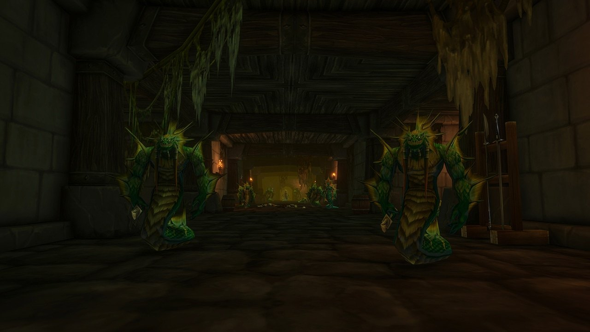

## De weg erheen

Alcaz Prison is een nieuwe dungeon voor World of Warcraft: Forever, voor level 48 tot 53, op Alcaz Island voor de kust van Dustwallow Marsh. Neem vanaf de steiger het pad links de heuvel op naar het grote gebouw. Het portaal staat in de kelder, rond /way 75 15.

## Het verhaal

De gevangenis op Alcaz Island zou lang belangrijke gevangenen hebben vastgehouden, King Varian Wrynn incluis, maar niemand kon erin. In Forever gaan de deuren open. Binnen vechten de Defias Brotherhood en naga tegen elkaar, en wachten nieuwe stukjes van een bekend mysterie, volgens [Blizzard](/nl/news/blizzard-describes-all-nine-new-dungeons/).

## De bazen

### The Questioner

De eerste baas. Laat hem leven als je de geheime vermomming wilt: de quest <a href="https://www.wowhead.com/forever/quest=96335">The Man in the Iron Chains</a> aan het einde van de dungeon stuurt je naar hem terug.

### Blazeroar

De enige baas die al bekend is, genoemd in de Legacy-uitdaging van de dungeon.

## De geheime vermomming

Hier begint een verborgen reeks die eindigt bij de <a class="wf-wh wf-q3" href="https://www.wowhead.com/forever/item=279471">Alcaz Operative Insignia</a>, een toy die je 10 minuten als Defias-agent vermomt. Ruim de dungeon op zonder The Questioner te doden, neem <a href="https://www.wowhead.com/forever/quest=96335">The Man in the Iron Chains</a> aan het einde, en volg dan het spoor naar Moonbrook in Westfall en verder naar Stormwind (Alliance) of Booty Bay (Horde) voor een <a class="wf-wh wf-q2" href="https://www.wowhead.com/forever/item=279450">Fractured Insignia</a>. Zes daarvan vormen de toy. De stappen staan in [de post over de toy](/nl/news/alcaz-prison-hides-a-defias-disguise-toy/).

## Wat nog niet bekend is

- **De andere bazen** en hoe de gevechten werken.
- **De kaart** van binnen.
- **De buit** en **de andere quests**.
