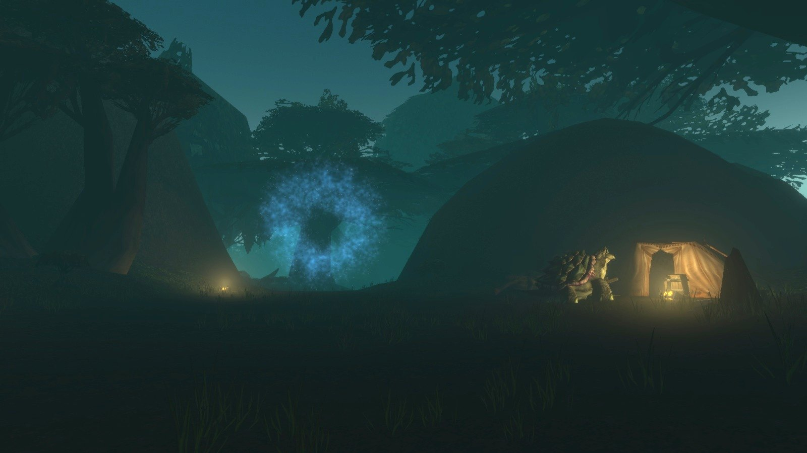
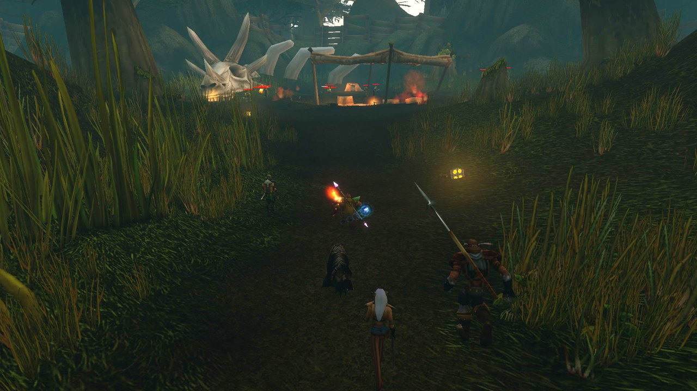
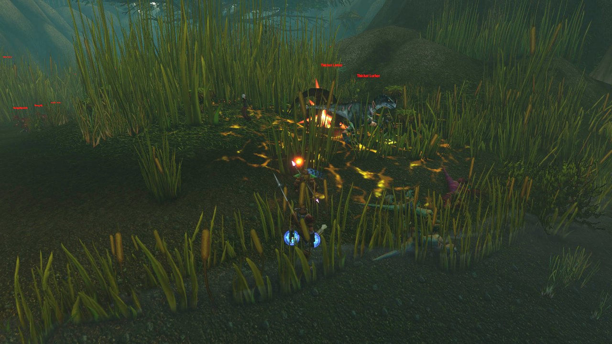
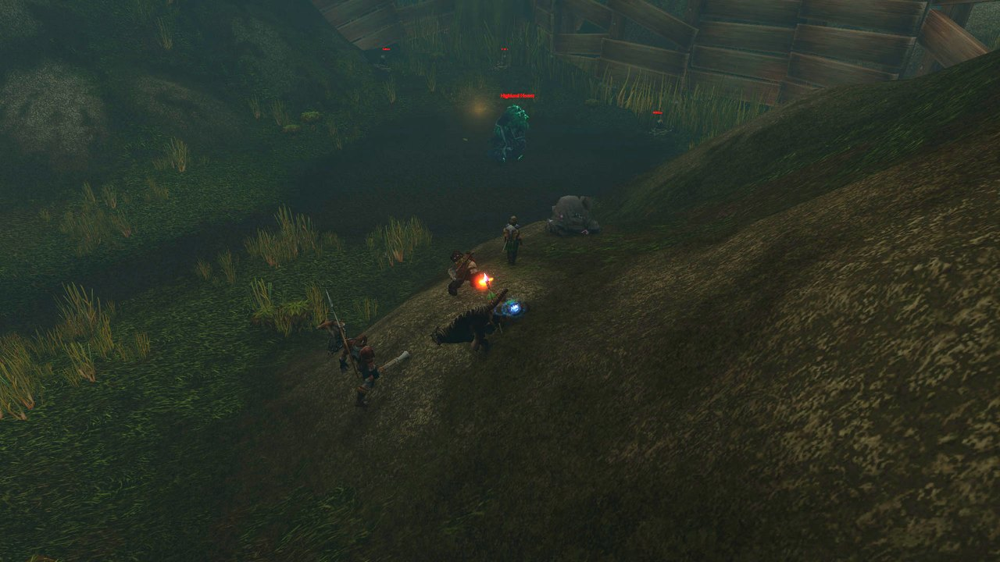
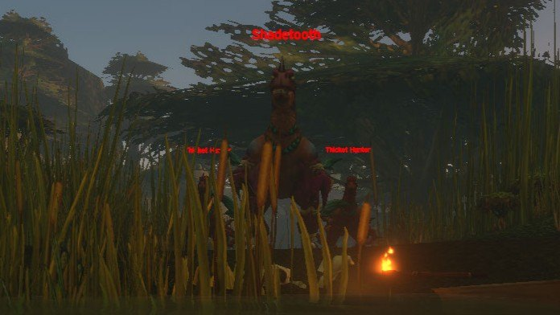
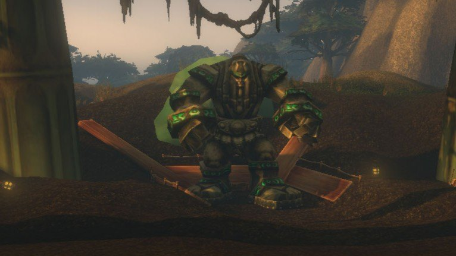

## De weg erheen

Het portaal staat op de heuvel ten zuidoosten van Whelgar's Excavation Site in de Wetlands, op /way 47.8 56.3. Nieuwe wegen leiden de heuvel op; in Classic kon je dit deel van de Wetlands niet bereiken.

**Alliance.** Menethil Harbor ligt dichtbij en heeft nu een boot naar Stormwind via Auberdine. Door Loch Modan lopen kan ook.

**Horde.** Een langere tocht te voet vanuit Undercity of The Sepulcher: naar het zuiden door Silverpine Forest, naar het oosten door Hillsbrad Foothills en de Arathi Highlands, voorbij Stromgarde Keep. Ga bij de grote splitsing naar het noorden naar Hammerfall voor het vluchtpunt en voor Dragonmaw Rumors van Zaruk op /way 74.4 35.6: zonder die quest krijgt de Horde Open the Maw niet. Ga daarna naar het zuiden de Wetlands in. Pik onderweg ook het vluchtpunt in Tarren Mill op.

**Het laatste stuk.** Het pad de heuvel op begint bij de meeting stone, op /way 53.9 65.4, links van Thelgen Rock. De spinnen onderweg zijn niet elite.

## De route

1. **The Lost Marsh.** Crocolisks en jonge raptors rond een meer. <a class="wf-wh wf-plain" href="https://www.wowhead.com/forever/npc=260322">Saltspine</a> patrouilleert langs de rand.
2. **The Stalker's Thicket.** Een pad door hoog gras vol raptors. <a class="wf-wh wf-plain" href="https://www.wowhead.com/forever/npc=260325">Shadetooth</a> patrouilleert over het hele pad met twee Thicket Hunters.
3. **The Lost Dig Site.** Orcs van de Dragonmaw-clan, met de tent van Daewyn voor de quest van de Alliance.
4. **Ten noorden van de opgraving.** <a class="wf-wh wf-plain" href="https://www.wowhead.com/forever/npc=260808">Highland Horror</a> wacht tussen Oil Slimes; met een voorzichtige pull laat je de slijmen staan. Alleen de Alliance heeft hem nodig.
5. **The Site of the Guardian.** Ten zuiden van de opgraving, voorbij Highland Lurkers en Highland Spiders. <a class="wf-wh wf-plain" href="https://www.wowhead.com/forever/npc=260326">Relic Guardian</a> staat inactief in een arena; Ardin wacht op een houten bouwsel vlakbij.

## Belangrijke trash

**Het hoge gras.** Het gevaarlijkste deel van de dungeon. Thicket Lurkers en Stalkers verstoppen zich in groepjes van drie in het gras en duiken op als je dichtbij komt. Thicket Matriarchs roepen Lurkers te hulp bij weinig health. Blijf op het smalle pad, vecht op open plekken, en zit er een Matriarch in een groep, dood dan eerst de andere monsters.

**Raptors.** Young Riptooths komen per drie en bijten hard; dood ze een voor een. Thicket Hunters veroorzaken Infected Wound, een ziekte waardoor het doelwit meer fysieke schade krijgt: haal die snel weg. Matriarchs en Lurkers zetten Rend Flesh.

**Crocolisks.** Marsh Skulkers veroorzaken Muculent Rot, dat Stamina en Spirit verlaagt, en Tendon Rip vertraagt het doelwit sterk.

**Orcs van de Dragonmaw.** Saboteurs gooien bommen op een plek waar je uit kunt stappen. Warders casten Mortal Strike en Net, 10 seconden vast. Thaumaturgists casten Immolate en Curse of Weakness en komen met een vuurelementaal: dood die eerst.

**Spinnen.** Highland Lurkers en Spiders vergiftigen hun doelwit. Haal het gif zo snel mogelijk weg.

**Raptors roepen hulp.** Valt je er een aan, dan doen de andere in de buurt mee. Ruim elke groep rond een gevecht op, anders komt de halve thicket aangelopen.

**Ziektes.** Infected Wound, Muculent Rot en Highland Venom van de spinnen, dat snelheid en schade verlaagt, zijn allemaal ziektes. Een manier om ziektes te genezen maakt de dungeon veel makkelijker.

## De bazen

### Saltspine

Een eenvoudig gevecht als de omgeving leeg is; hij patrouilleert langs het meer, dus trek hem alleen. <a class="wf-wh wf-spell" href="https://www.wowhead.com/forever/spell=3604">Tendon Rip</a> vertraagt de tank sterk, en <a class="wf-wh wf-spell" href="https://www.wowhead.com/forever/spell=1316382">Dust Storm</a> verlaagt de trefkans van iedereen binnen 10 yards met 25%, dus casters houden afstand. Maak eerst een droge plek vrij en trek hem daarheen.

### Shadetooth

Een genadeloos gevecht met twee Thicket Hunters naast zich. Haal hun Infected Wound snel weg, en zet beide adds het hele gevecht onder crowd control, of één terwijl je de andere doodt. Shadetooth gebruikt Rend en Terrifying Roar, een angst van 5 seconden die spelers makkelijk het gras in jaagt: een Tremor Totem of Fear Ward op de tank helpt, anders ruim je eerst het gras op. Bij 20% health wordt hij woest.

Ruim eerst de crocoliskbaai links op en vecht daar. De Thicket Hunters kunnen niet zwemmen, maar sleep het gevecht niet terug naar de plek van de eerste baas, want die reset.

### Highland Horror

Een questbaas voor de Alliance zonder eigen loot: hij laat de Horrible Rootcore voor Horrors in the Highland vallen. Hij cast Entangling Roots en Wild Regeneration. Het gevaar zijn de slijmen rond hem; trek hem alleen en dood hem snel.

### Relic Guardian

Start het gevecht met het Archival Panel rechts van de inactieve wachter. De laatste baas is level 31, dus aanvallen missen vaker, en hij heeft veel health en slaat de tank hard. Thunderclap vertraagt iedereen binnen 10 yards, Arcing Smash raakt wie voor hem staat, Knock Away verlaagt de threat van de tank en War Stomp gooit iedereen bij hem omver en stunt: ranged spelers houden afstand. Hij is te stunnen en te vertragen, en zelfs te kiten.

## Wat nog niet bekend is

- **Waar de Bloody Map naartoe leidt**, de beloning van Open the Maw.
- **Wanneer Highland Hides en Prehistoric Prism gerepareerd worden**: beide zijn kapot op de beta.
- **De dropkansen** van de loot van de bazen, behalve de Titan Relic.
