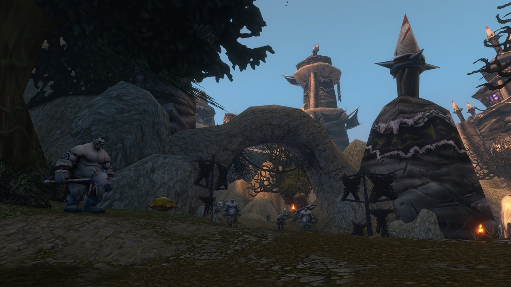

## De weg ernaartoe

Krol'dok Stronghold is een nieuwe dungeon in World of Warcraft: Forever, voor level 40 tot 45, in het nieuwe gebied de Riverglades. Het ogrefort staat op een heuvel boven Sunnyglade aan de noordkant van het gebied. De ingang is een verstopte grot net ten westen van de grote poorten, op /way 37.5 37.5.

Ogre-verkenners ontvoeren reizigers en plunderen dorpen in heel de Riverglades, en hun spoor leidt hierheen. Na het donker klinkt vreemd gezang uit het fort.

## De indeling

Een kronkelend pad loopt heuvelop tussen ruwe gebouwen, werkplaatsen en kampen, langs bewaakte doorgangen. Een grote houten brug leidt naar de top, waar de grootste gebouwen staan. <a class="wf-wh wf-plain" href="https://www.wowhead.com/forever/npc=278310">Krol'dok Centurion</a> is een van de elite-ogres die je tegenkomt.

## De sleutels

De speldata heeft twee sleutels voor het fort, <a class="wf-wh wf-q1" href="https://www.wowhead.com/forever/item=267089">Krol'dok Compound Key</a> en <a class="wf-wh wf-q1" href="https://www.wowhead.com/forever/item=271721">Krol'dok Ogre Key</a>. <a class="wf-wh wf-q1" href="https://www.wowhead.com/forever/item=271721">Krol'dok Ogre Key</a> kan vallen bij Overlord Mugg. Een questreeks die begint met de Krol'dok Moulding van Tunk geeft een sleutel naar een kortere weg, zie de [quests](/nl/guides/dungeons/kroldok-stronghold/quests/).

## De bazen

De kaart bovenaan toont de route en de zes bazen in volgorde. Q is een questplek onderweg.

1. **Slavecrusher Grox**, in de eerste bocht na de ingang.
2. **Twilight Commander Zarmok**, aan de voet van de eerste klim.
3. **War Handler Ashka**, aan de oostkant, bij de rivier.
4. **Nar'gurk**, tussen de kampen aan de westkant.
5. **Bossman Toof**, op weg naar de top.
6. **Overlord Mugg**, bovenaan het fort. Hij wordt genoemd in de Legacy-uitdaging van de dungeon en laat <a class="wf-wh wf-q1" href="https://www.wowhead.com/forever/item=267086">Eye of Mugg</a> vallen, een questitem.

## Wat nog niet bekend is

- **Hoe de gevechten werken** en welke baas wat laat vallen.
- **De buit**, ook de stukken van de set Krol'dok Battlegear.
- **De quests**, ook die van de twee items <a class="wf-wh wf-q1" href="https://www.wowhead.com/forever/item=267137">Krol'dok Moulding</a>.
