## De weg erheen

**Horde.** Wandel van Brill naar de Undercity en ga de ruïnes van Lordaeron erboven in, niet de liften naar beneden. Het portaal ligt meteen links na de poort.

**Alliance.** Een lange weg:

1. Neem de boot van Stormwind Harbor naar Auberdine.
2. Neem in Auberdine de boot naar Menethil Harbor, en blijf aan boord tot Southshore in Hillsbrad Foothills.
3. Volg de weg vanaf Southshore naar het noorden, langs Hillsbrad Fields en om Dalaran heen.
4. Zwem naar het noorden door Lordamere Lake in Silverpine Forest tot Tirisfal Glades.
5. Volg de weg naar de ruïnes van Lordaeron.

Skyborne aan de kant van de Alliance kunnen een portaal nemen van de Mage Tower in Stormwind naar Dalaran en bij stap 3 beginnen.

**De precieze plek.** Loop door de voorpoort van de ruïnes en kijk voor de burcht naar links: het portaal ligt boven aan een trap, op /way 72.4 11.6. Wie binnen sterft, komt als geest terug op de binnenplaats, vlakbij. Buiten, op de lange weg van de Alliance, liggen de Spirit Healers ver uit elkaar, en op een PvP-ruleset gaat de route door veel land van de Horde.

## De route door de dungeon

Bijna de hele dungeon ligt buiten, en mist en bewegende schaduwen verbergen wat verderop staat. De [dungeonvideo van Blizzard](/nl/news/blizzard-shows-three-launch-dungeons-in-a-video/) raadt aan naar open, verlichte grond te pullen, waar elke vijand zichtbaar blijft.

De dungeon lijkt open en verwarrend, maar de route is een U. De echte uitdaging is de dichtheid: groepen staan dicht bij elkaar, patrouilles kruisen, en de healer zit snel zonder mana. Vanaf het portaal:

1. **Captain Truman.** De Alliance gaat links voor Abominable Creatures. Ga daarna de trap af naar het oosten.
2. **Het raam.** Sla de grote poort vol spinnenwebben over en spring rechts door het raam. Zo mis je een paar groepen.
3. **Witherfang** patrouilleert daar in de steeg. Ruim de kleine groepen spinnen op, dan de baas.
4. **Naar het zuiden, langs de linkermuur**, voor zo weinig mogelijk trash. Bij drie Ghostly Citizens ga je rechts een doorgang in naar het westen: daar staat The Baron.
5. **Over de muur.** Achter The Baron leunt een gebroken pilaar tegen een lage muur. Spring erop en eroverheen. Hunters en Warlocks sturen hun pet eerst weg.
6. **Langs het kerkhof.** Recht vooruit ligt een kerkhof achter een ijzeren hek, met een oproepcirkel: Rath'mael komt als laatste. Houd de rechterkant en ga eromheen.
7. **Viktor the Vile.** Net voorbij een gang naar een binnenplaats staat een uitgebrand huis met een haard. Ruim de omgeving op, wacht op volle mana en klik op het vuur.
8. **The Abandoned.** Op de binnenplaats voorbij het kerkhof staat een beeld met gloeiende ogen. Klik erop voor de golven; The Abandoned komt uit het beeld.
9. **Het raam naar Bjork.** Verlaat de binnenplaats door de plek met een smalle trap, ga aan het eind rechts en spring door een groot raam. Daar patrouilleert Bjork.
10. **Rath'mael.** Ga recht naar het zuiden naar het kerkhof. Daar ligt ook het lichaam van Edward, nodig voor beide facties.

De Alliance loopt naar buiten in plaats van een Hearthstone te gebruiken: de Head of the Baron gaat naar Captain Truman bij de ingang.

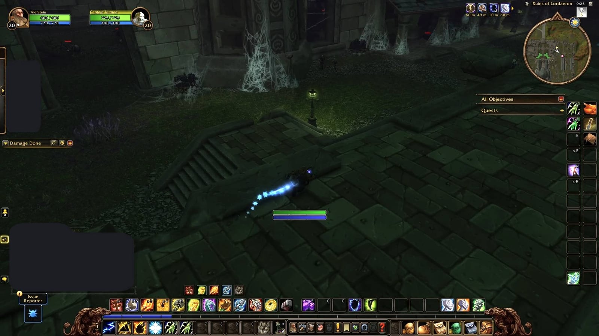

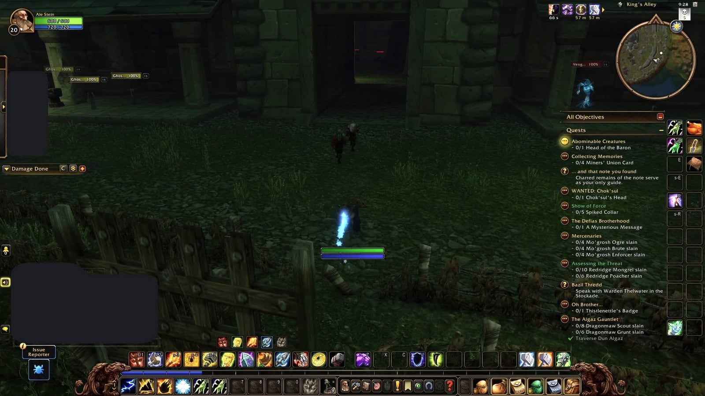

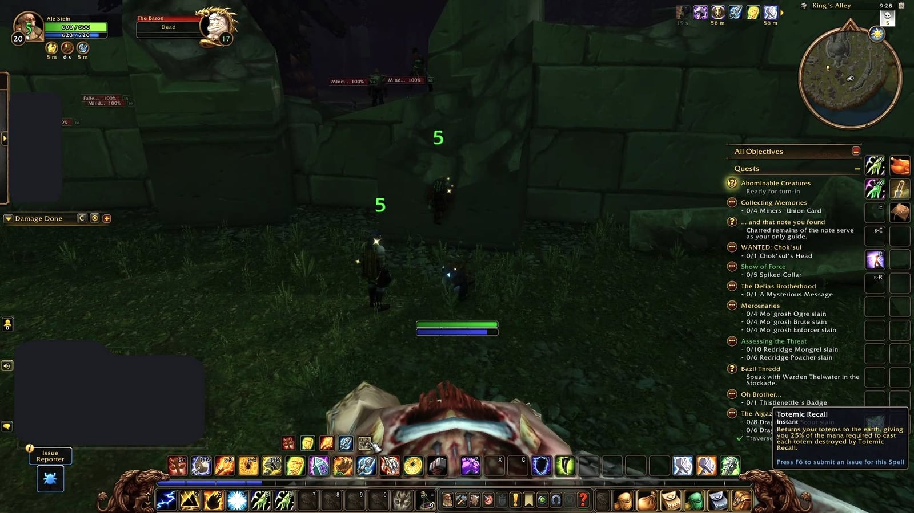

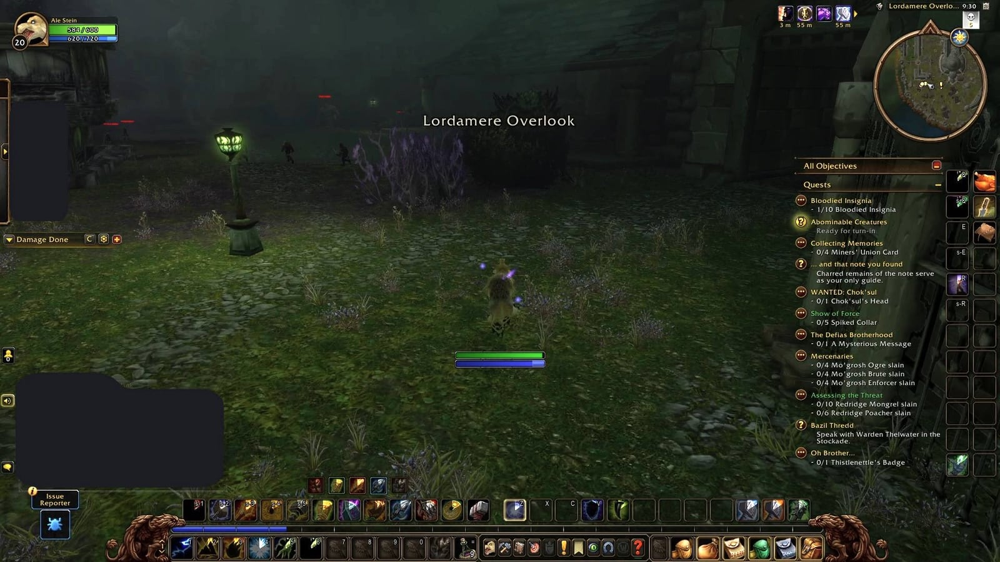

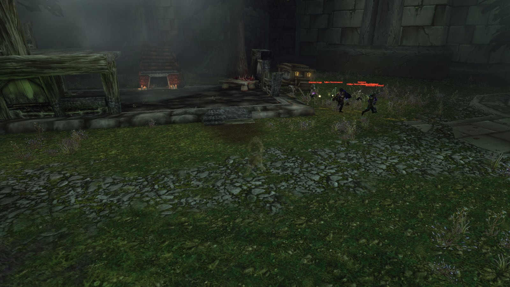

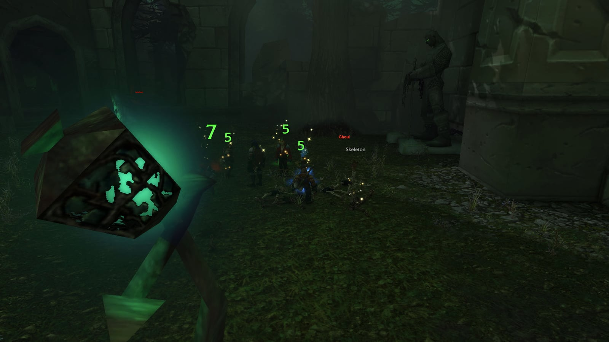

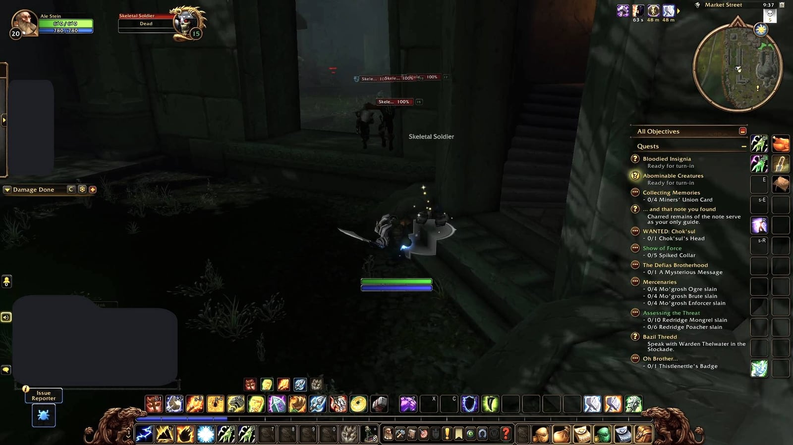

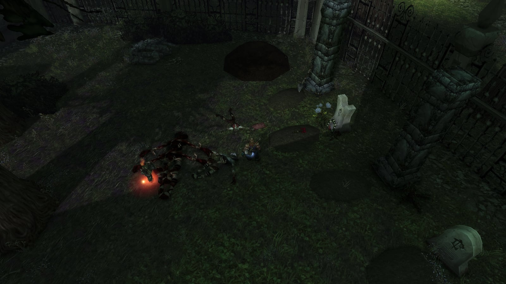

## Trash

De trash slaat minder hard dan in de Hall of Thanes, maar de groepjes staan dicht op elkaar en sommige patrouilleren. Twee groepjes tegelijk pullen is het grootste gevaar. Crowd control en stuns zoals [Hammer of Justice](https://www.wowhead.com/forever/spell=853) helpen, en Paladins doen het goed vanaf level 20 met [Exorcism](https://www.wowhead.com/forever/spell=879), dat undead hard raakt.

**Spinnen.** Venom Lurkers, Spiders en Tarantulas aan het begin. Niet sterk op zich, maar sommige groepjes patrouilleren. Trek ze terug naar een vrijgemaakte plek.

**Skeletal Soldiers en Shrieking Banshees.** Bij The Baron. De soldaten slaan hard in grote groepen en de banshees silencen.

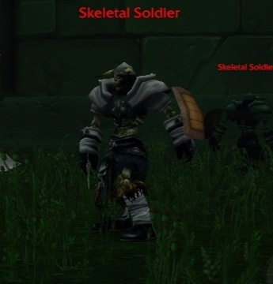

**Flesh Golems.** Ze patrouilleren door Lordamere Overlook, doen zware schade en gebruiken Knock Away, dat threat laat zakken. Let op waar de tank landt, zodat niemand in een ander groepje vliegt.

**Ghouls en Ragged Ghouls.** Groepjes van drie of vier met sterke meleeslagen, dicht bij andere groepjes.

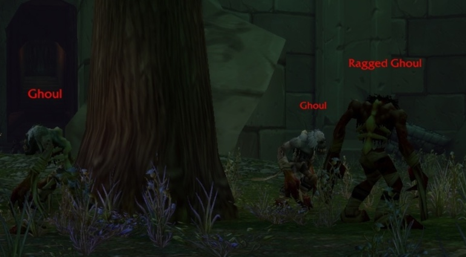

**Deep Widows en Broodlings.** Ook aan het begin, met gifaanvallen. Ongevaarlijk tenzij je er te veel tegelijk pullt.

**Skeletal Mages.** Ze zetten Frost Armor op zichzelf; haal die weg en ze vallen sneller.

**Wailing Banshees.** Een vloek die de hit chance van hun doelwit verlaagt.

**Stone Watchers.** Gargoyles op de bovenste verdiepingen die zich als beeld voordoen tot je dichtbij komt. In het gevecht worden ze weer steen: immuun voor fysieke schade en ze herstellen health. Raak ze in die fase met magie.

## De zes bazen

Elke volgorde werkt. Elke baas laat blauwe items vallen; per baas zijn er drie bekend uit de beta.

### Witherfang

Een grote spin die met twee kleinere spinnen door King's Alley patrouilleert. Ruim eerst de trash op zijn pad op, zodat hij alleen komt, en dood de kleine spinnen snel. Zijn [Leech Poison](https://www.wowhead.com/forever/spell=3358) zuigt 40 seconden lang elke 5 seconden 15 health weg; een speler die gif verwijdert, haalt het van de tank. Witherfang laat ook de Highly Toxic Strain voor The New Plague vallen.

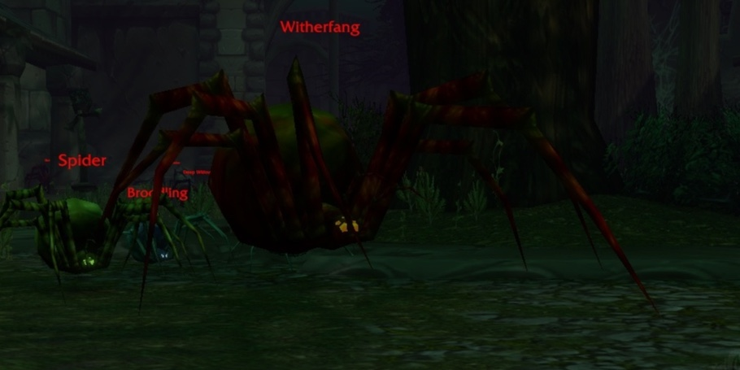

Ze trekt haar patrouille niet mee: een pull van op afstand brengt haar alleen.

### The Baron

Een abomination met één vaardigheid die telt: [Knockout](https://www.wowhead.com/forever/spell=17307), zware directe schade die het doelwit wegslaat, stunt en threat laat zakken. Een tank die niet op volle gezondheid staat, kan eraan sterven. Stun hem zo vaak mogelijk. Hij laat het Head of the Baron vallen voor de Alliance en het Abominable Head voor de Horde.

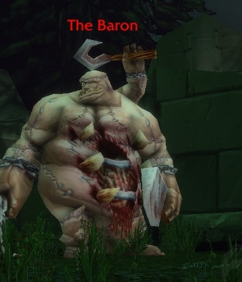

Tank hem met je rug tegen een muur. Hij raakt ook iedereen rondom hem in melee: melee staat achter hem, spelers op afstand houden afstand van hem en van elkaar, zodat de stun op de tank hem niet in een groepje stuurt.

### Viktor the Vile

De baas die de meeste groepen missen. Steek de Kindled Flame aan in de schouw van een gebouw in het zuidwesten van Lordamere Overlook, bij het kerkhof. Vijf golven adds volgen voor Viktor komt. Hij slaat hard en heeft dezelfde Leech Poison als Witherfang, dus laat de tank eerst aggro nemen. In de beta verschijnt Viktor soms niet.

De golven putten de groep meer uit dan Viktor zelf, dus begin alleen met volle mana.

### The Abandoned

Hij wacht in Market Street, op de weg vanuit Lordamere Overlook. Een standbeeld daar start drie golven adds, en dan komt hij tevoorschijn. Hij cast [Frost Nova](https://www.wowhead.com/forever/spell=1220855), vertraagt wie hem in melee raakt, en zuigt de tank leeg met [Life Drain](https://www.wowhead.com/forever/spell=1266011), een cast van 2 seconden. Een stun voor het einde van de cast houdt die tegen.

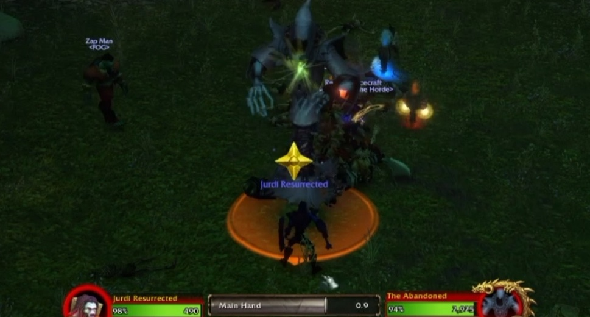

Zijn Frost Armor is niet weg te halen. Tijdens de golven blijven ondoden soms vastzitten in de gangen en stokt het gevecht: ga ze dan halen.

### Bjork

Een kort gevecht. Zijn enige vaardigheid is een kort [Anti-Magic Shield](https://www.wowhead.com/forever/spell=1301635), dat hem 3 seconden immuun maakt voor magie. Casters wachten het af.

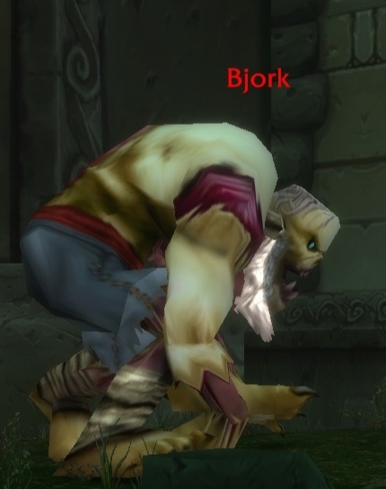

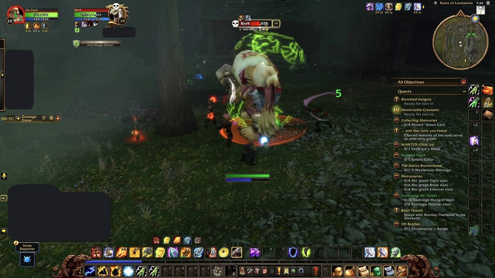

### Rath'mael

Rath'mael staat op het kerkhof, met Edward Heartweaver en de Blood-Stained Letter vlakbij. Zijn enige vaardigheid is [Flamestrike](https://www.wowhead.com/forever/spell=1279983), altijd op de plek waar de tank stond toen de cast begon. Stap eruit en vecht verder op een nieuwe plek, of stun hem voor hij cast. Zijn loot vraagt level 19, het hoogste in de dungeon.

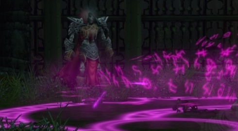

De cast is te onderbreken, en dat spaart de melee-spelers.

## Een rare: de Lordaeron Captain

Een rare met een kleine kans om te verschijnen aan de westkant van de dungeon. De Alliance kan hem niet doden; voor de Horde is hij vijandig. Een eenvoudig gevecht: trek alleen geen achtergebleven adds mee.

## Wat nog niet bekend is

- Welke baas als eindbaas telt. De baas van level 20 heeft geen vaste plaats in de volgorde; gangbare routes eindigen bij Rath'mael.
- Of Viktor the Vile bij de launch altijd verschijnt. In de beta doet hij dat soms niet.
- Waar de rest van Rotmender's Raiment valt, en bij welke stap Unending Torment Slain Baron's Signet geeft.
- Hoeveel experience The Wrath of Rath'mael geeft

Het nieuws over de dungeon staat in de post [Zes bazen wachten in vrije volgorde in de Ruins of Lordaeron](/nl/news/six-bosses-in-any-order-in-the-ruins-of-lordaeron/). Alle dungeons staan in de [dungeongids](/nl/guides/dungeons/).
