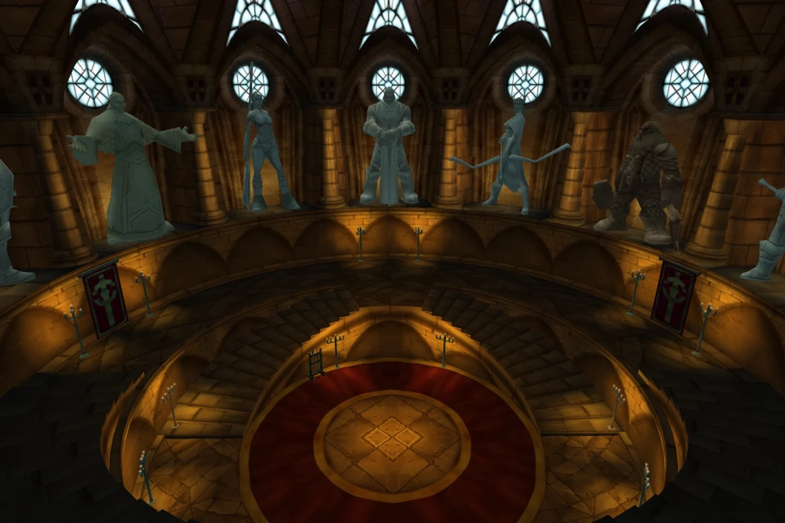

## De weg erheen

Het Scarlet Monastery staat aan de oostkant van Tirisfal Glades, op /way 85.1 31.4. De deur van de Armory vraagt The Scarlet Key van het einde van de [Library](/nl/guides/dungeons/scarlet-monastery-library/), of een Rogue met Lockpicking 175.

## De route

Een rechte lijn. Het cijfer hoort bij de kaart hierboven.

1. **The Training Grounds.** Een grote binnenplaats vol soldaten en rekruten van de Scarlet.
2. **The Footman's Armory en The Crusader's Armory.** Zalen met soldaten, chaplains en defenders. Trek één groep tegelijk.
3. **The Hall of Champions.** <a class="wf-wh wf-plain" href="https://www.wowhead.com/forever/npc=3975">Herod</a> (1) wacht in de ronde zaal aan het einde.

## Belangrijke trash

**Scarlet Chaplains en Myrmidons.** De chaplains schermen af en genezen, de Myrmidons worden woest en slaan hard. Onderbreek de genezingen en dood de casters eerst.

**De rekruten na Herod.** Als Herod sterft, stormt een grote groep Scarlet Trainees uit de Training Grounds binnen. Ze zijn zwak; ga bij elkaar staan en dood ze met area damage.

## De bazen

### Herod

Cleave en Whirlwind, en hij wordt woest bij weinig health. Terwijl hij rondtolt, stapt iedereen achteruit, ook de melee, tot het voorbij is. Hou de cooldowns van de tank bij voor de woede.

## Wat nog niet bekend is

- **Herod's Shoulder**: of die nog valt in Forever.
- **De dropkansen** van zijn loot.
