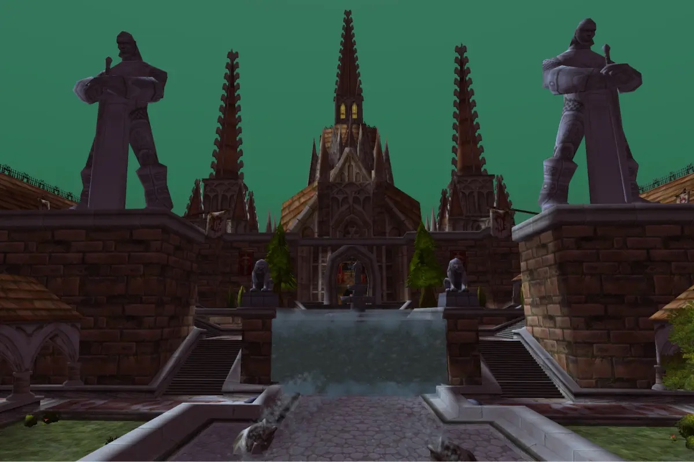

## De weg erheen

Het Scarlet Monastery staat aan de oostkant van Tirisfal Glades, op /way 85.1 31.4. Het heeft vier vleugels, elk met een eigen ingang: de Graveyard, de [Library](/nl/guides/dungeons/scarlet-monastery-library/), de [Armory](/nl/guides/dungeons/scarlet-monastery-armory/) en de [Cathedral](/nl/guides/dungeons/scarlet-monastery-cathedral/). Groepen doen ze meestal in die volgorde. De Graveyard is de deur aan de achterkant van het klooster, voorbij het kerkhof.

Voor de Horde ligt de Undercity vlakbij. De Alliance heeft een lange reis; Southshore in de Hillsbrad Foothills is het dichtste vluchtpunt.

## De route

De cijfers horen bij de kaart hierboven.

1. **The Chamber of Atonement.** Vanaf het portaal leidt een gang naar <a class="wf-wh wf-plain" href="https://www.wowhead.com/forever/npc=3983">Interrogator Vishas</a> (1). Vorrel Sengutz zit gevangen in dezelfde ruimte.
2. **The Forlorn Cloister.** Een binnenplaats vol undead. Een van drie rares kan hier verschijnen: Azshir the Sleepless, de Fallen Champion of Ironspine.
3. **Honor's Tomb.** <a class="wf-wh wf-plain" href="https://www.wowhead.com/forever/npc=4543">Bloodmage Thalnos</a> (2) wacht helemaal achteraan.

## Belangrijke trash

**Undead in het Forlorn Cloister.** Geesten en skeletten staan in kleine groepjes tussen de graven. Trek ze groep per groep; de casters ertussen slaan harder dan ze lijken.

**De rares.** Azshir gebruikt Call of the Grave, Terrify en Soul Siphon. De Fallen Champion gebruikt Rend, Cleave en Execute. Ironspine gebruikt Curse of Weakness en Poison Cloud.

## De bazen

### Interrogator Vishas

Cast Shadow Word: Pain en Immolate. Een kort gevecht; haal de damage over time weg waar het kan.

### Bloodmage Thalnos

Flame Spike, Fire Nova, Flame Shock en Shadow Bolt. Fire Nova verbrandt iedereen dicht bij hem, dus de melee houden hun health hoog en stappen weg als het kan.

## Wat nog niet bekend is

- **De dropkansen** van de loot van de bazen en de rares.
- **Hoe vaak elke rare verschijnt.**
