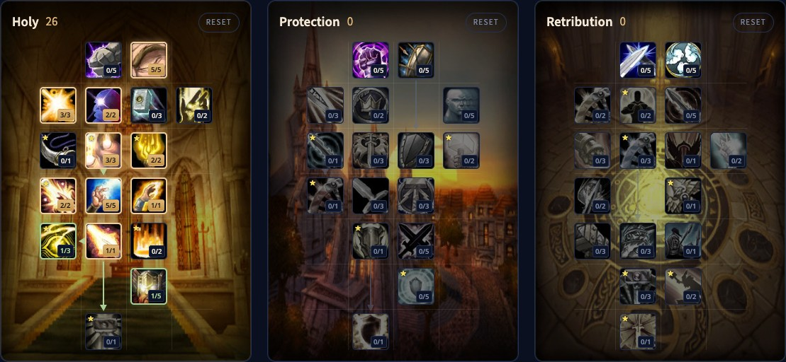

De Holy Paladin in WoW Forever is de eenvoudigste healer van het spel. Je cast heals met een casttijd, heelt voor grote getallen en leeft van critical strikes, die je via Illumination mana teruggeven. Je hebt geen healing over time en geen schilden: je heelt wat gewond is. Deze gids behandelt de build voor level 30, Holy Shock en Light's Vigil, de healprioriteit, mana, seals, stats en races.

| | |
|---|---|
| Rol | Healer, vooral op één doelwit |
| Build op level 30 | 21 punten in Holy, Talented voegt Healing Light, Purifying Power, Divine Precision en Holy Power toe |
| Belangrijkste talenten | Divine Intellect, Reverence, Illumination, Divine Favor, Holy Shock, Light's Vigil |
| Sterk in | Grote heals, utility voor de groep, heel moeilijk te doden |
| Zwak in | Vooral reactief, maar één groepsheal |
| Levelen | [Levelgids voor de Paladin](/nl/guides/paladin-leveling/), [levelbuild voor de Paladin](/nl/leveling/paladin/) |

## Sterktes en zwaktes

**Utility voor de groep.** Elke groep wil twee Paladins. Jij brengt blessings, een aura, Judgements en bubbels.

**Moeilijk te doden.** Plate, Divine Shield en je eigen heals houden je in leven in gevechten waarin anderen sneuvelen.

**Vooral reactief.** Zonder healing over time of schilden reageer je op schade. Je kunt toch vooruitdenken: begin een heal voor de grote klap valt en breek hem af als hij toch niet nodig blijkt.

**Eén groepsheal.** Light's Vigil is je enige manier om de hele party te helen, en hij is duur.

## De build voor level 30

De beta stopte op level 30, dus de build gebruikt 21 punten. Talented uit het Legacy-systeem voegt er 5 aan toe. [Open de build in de talentcalculator](/nl/talents/paladin/?t=05220003025101).

| Talent | Punten |
|---|---|
| **Divine Intellect** | 5/5 |
| **Healing Light** | 2/3 |
| **Spiritual Focus** | 2/2 |
| **Reverence** | 3/3 |
| **Infusion of Light** | 2/2 |
| **Illumination** | 5/5 |
| **Divine Favor** | 1/1 |
| **Holy Shock** | 1/1 |

[Open de Talented-versie](/nl/talents/paladin/?t=0532000322511101) met Healing Light 3/3, Purifying Power 2/2, Divine Precision 1/3 en Holy Power 1/5.

Holy Shock zit in de vijfde rij en vraagt 20 punten erboven. Met 21 punten is er dus plaats voor precies de acht talenten hierboven. De Talented-versie is de volledige build van 26 punten.

## Wat de belangrijkste talenten doen

| Talent | Wat het doet in Forever |
|---|---|
| **Divine Intellect** | 10% meer Intellect |
| **Healing Light** | Holy Light, Flash of Light en Holy Shock helen 12% meer |
| **Spiritual Focus** | 70% kans om geen casttijd te verliezen als je schade krijgt, voor Flash of Light, Holy Light en Light's Vigil |
| **Reverence** | 30% van je manaregeneratie loopt door terwijl je cast |
| **Purifying Power** | Cleanse en Purify kosten 20% minder, Exorcism en Holy Wrath komen 33% sneller terug |
| **Infusion of Light** | Een kritieke Holy Shock of Flash of Light maakt je volgende Holy Light 1 seconde sneller |
| **Illumination** | Een kritieke heal geeft mana terug gelijk aan 50% van de basiskost van de spell |
| **Divine Favor** | Je volgende Flash of Light, Holy Light of Holy Shock is kritiek |
| **Divine Precision** | 18% meer kans om te raken met Holy-spells, zodat Judgement en Holy Shock landen |
| **Holy Shock** | Een instant stoot Holy-schade op een vijand, of een instant heal op een bondgenoot |
| **Holy Power** | 15% meer critical strike chance voor Holy Shock en Holy Strike, 5% voor alle andere spells |
| **Light's Vigil** | Je volgende Holy Shock op het doelwit heeft geen cooldown en heelt zijn hele party |

Light's Vigil zit in de zevende rij, buiten bereik op level 30. Spiritual Focus werkt het best samen met Concentration Aura. Divine Favor en Illumination versterken elkaar: een zekere kritieke heal geeft ook mana terug.

## Healprioriteit

Hou je seal actief, meestal Seal of Wisdom, en hou zijn Judgement op het doelwit.

1. Holy Shock als iemand kan sterven voor een heal met casttijd landt, of als je moet helen terwijl je beweegt.
2. Holy Light als een doelwit veel schade gaat krijgen. Begin er op tijd aan.
3. Holy Light meteen na een proc van Infusion of Light.
4. Flash of Light voor lichte schade.
5. Light's Vigil alleen als de groep echt een groepsheal nodig heeft.

## Seals en Judgements

Elke Paladin kan maar één Judgement op een doelwit houden.

- **Seal of Wisdom** en zijn Judgement geven je groep mana terug. Hou hem op de boss.
- **Seal of Light** en zijn Judgement geven wat genezing terug, handig tegen veel kleine schade rondom.
- **Seal of the Crusader** verhoogt de Holy-schade op een doelwit. Dat helpt een healer zelden, en een Protection- of Retribution-Paladin in de groep brengt hem meestal mee.

## Cooldowns en utility

- **Divine Shield**, **Divine Protection** en **Blessing of Protection** zijn sterke defensieve cooldowns, en alle drie geven ze Forbearance.
- **Lay on Hands** heelt een doelwit meteen volledig. Hij kost al je mana en geeft een beetje terug, dus gebruik hem met zorg.
- **Blessing of Sacrifice** verplaatst een deel van de schade op een bondgenoot naar jou, het best tegen veel kleine klappen. Geef de bondgenoot daarna zijn gewone blessing terug.
- **Divine Intervention** beschermt één bondgenoot 3 minuten tegen alles, maar kost jou het leven. Gebruik hem als redding bij een wipe, op een andere healer ver van de boss.

Geef voor een gevecht iedereen de juiste blessing, en iedereen behalve de tank ook Blessing of Salvation. Tijdens het gevecht: Blessing of Protection op wie threat trekt, Blessing of Freedom op wie vastzit.

## Stats en gear

Statprioriteiten voor level 60 volgen na de launch. Tot dan:

- **Healing power en spell power**, voor sterkere en goedkopere heals: met meer healing power volstaat een lagere rank.
- **Intellect**, voor meer mana en meer critical strike chance.
- **Critical strike chance**, voor grotere heals en meer procs van Illumination.
- **Spirit en mana per 5 seconden.** Dankzij Reverence regenereert Spirit ook in gevecht mana, en dat telt in lange gevechten.

**Armor.** Kijk naar de stats, niet naar het type. Cloth en leather met healing power zijn vaak beter dan plate. Op lage levels helpt Blacksmithing, want plate en mail met spell power zijn zeldzaam.

**Wapen.** Paladins kunnen geen staven dragen, dus je draagt meestal een eenhandig wapen met een schild of een off-hand. Je wapen is vaak je belangrijkste stuk, ook al zwaai je er zelden mee.

**Librams.** Een libram in het ranged-slot geeft een kleine passieve bonus. Kies er een die bij je heals past.

## Races en tradeskills

| Factie | Ras | Waarom |
|---|---|---|
| Alliance | Human | Extra critical strike chance, de beste keuze |
| Alliance | Dwarf | 1% hit uit Artisan's Precision, en Stoneform als defensieve cooldown |
| Horde | Undead | Een proc die schade doet en je een beetje heelt; de enige Paladin van de Horde |

**Blacksmithing** maakt een deel van de beste plate en mail, veel ervan alleen voor blacksmiths. **Engineering** geeft elke spec handige gadgets. Meer over helen in groepen in onze [dungeongidsen](/nl/guides/dungeons/).
