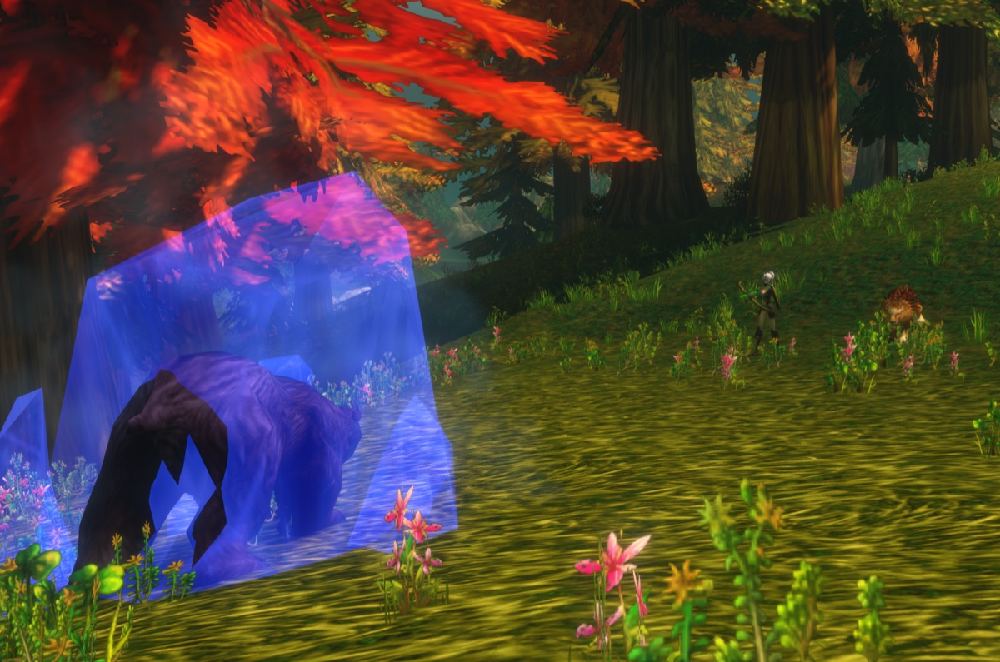
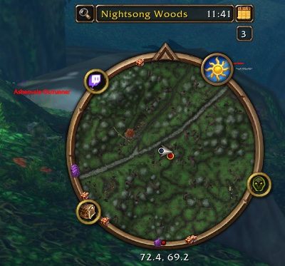

De Hunter is een van de sterkste classes om te levelen. Je doet schade van afstand, je houdt monsters onder controle met traps en slows, en je pet vangt de klappen op. De eerste 10 levels gaan traag, tot je een pet temt en je eerste talentpunt krijgt. In WoW Forever geven nieuwe petabilities en nieuwe talenten de class meer diepgang. Deze gids behandelt de builds, de rotatie, de belangrijke levels, gear, pets, traps en tracking.

| | |
|---|---|
| Makkelijkste spec om te levelen | Beast Mastery |
| Belangrijkste talenten | <a class="wf-wh wf-spell" href="https://www.wowhead.com/forever/spell=19552">Deadly Aspects</a>, Unleashed Fury, <a class="wf-wh wf-spell" href="https://www.wowhead.com/forever/spell=19598">Ferocity</a>, Summon Hawk, <a class="wf-wh wf-spell" href="https://www.wowhead.com/forever/spell=1223755">Focused Fire</a> |
| Sterk in | Schade van afstand, een pet die tankt, crowd control, snel reizen |
| Zwak in | Een trage start tot level 10, mana en munitie |
| Talentvolgorde per level | [Levelbuild voor de Hunter](/nl/leveling/hunter/) |
| Gidsen per spec | [Beast Mastery Hunter](/nl/guides/beast-mastery-hunter/), [Marksmanship Hunter](/nl/guides/marksmanship-hunter/), [Survival Hunter](/nl/guides/survival-hunter/) |
| Builds tot level 60 | Ja, de [levelbuild](/nl/leveling/hunter/) gaat tot 60 |

## Met welke spec levelen

Alle drie de bomen levelen. **Beast Mastery** gaat het vlotst: je pet doet meer schade en overleeft meer, en met <a class="wf-wh wf-spell" href="https://www.wowhead.com/forever/spell=2649">Growl</a> houdt hij het monster op zich terwijl jij schiet. **Marksmanship** doet meer schade met je eigen schoten, dus trek je vaker threat en moet je kiten. **Survival** mengt melee, traps en schoten, en vraagt het meest van je.
## Level 1 tot 10

Je begint zonder talenten en zonder pet, met <a class="wf-wh wf-spell" href="https://www.wowhead.com/forever/spell=75">Auto Shot</a> en Raptor Strike. Monsters bereiken je snel, dus vaak maak je ze in melee af.

1. Houd <a class="wf-wh wf-spell" href="https://www.wowhead.com/forever/spell=13163">Aspect of the Monkey</a> aan zodra je het hebt, op level 4.
2. Pull met Auto Shot.
3. Cast <a class="wf-wh wf-spell" href="https://www.wowhead.com/forever/spell=1978">Serpent Sting</a>.
4. Cast Arcane Shot op cooldown.
5. Cast <a class="wf-wh wf-spell" href="https://www.wowhead.com/forever/spell=5116">Concussive Shot</a> om het monster te vertragen en afstand te houden.
6. Stap achteruit tussen je schoten.
7. Gebruik Raptor Strike zodra het monster bij je is, en maak het in melee af.

Begin elke pull van zo ver als je kunt: elke extra meter is een extra schot. Stats op deze levels: Agility, dan attack power, dan Intellect, dan Stamina en Spirit, dan armor.

## Talentbuilds

De [levelbuild voor de Hunter](/nl/leveling/hunter/) geeft het talent voor elk level van 10 tot 60. [Open het eindresultaat in de talentcalculator](/nl/talents/hunter/?t=5120221405101241-00503520005).

Voor level 60 heeft elke specgids zijn eigen builds voor raids, levelen en PvP: [Beast Mastery](/nl/guides/beast-mastery-hunter/), [Survival](/nl/guides/survival-hunter/) en [Marksmanship](/nl/guides/marksmanship-hunter/).

## Belangrijke levels

| Level | Wat je krijgt | Van |
|---|---|---|
| 1 | Auto Shot, Raptor Strike, <a class="wf-wh wf-spell" href="https://www.wowhead.com/forever/spell=1494">Track Beasts</a> | Standaard, classtrainer |
| 4 | Aspect of the Monkey, Serpent Sting | Classtrainer |
| 6 | Arcane Shot, <a class="wf-wh wf-spell" href="https://www.wowhead.com/forever/spell=1130">Hunter's Mark</a> | Classtrainer |
| 8 | Concussive Shot | Classtrainer |
| 10 | <a class="wf-wh wf-spell" href="https://www.wowhead.com/forever/spell=1515">Tame Beast</a>, <a class="wf-wh wf-spell" href="https://www.wowhead.com/forever/spell=5149">Beast Training</a> | Classquest |
| 10 | <a class="wf-wh wf-spell" href="https://www.wowhead.com/forever/spell=6991">Feed Pet</a>, <a class="wf-wh wf-spell" href="https://www.wowhead.com/forever/spell=982">Revive Pet</a>, <a class="wf-wh wf-spell" href="https://www.wowhead.com/forever/spell=883">Call Pet</a>, <a class="wf-wh wf-spell" href="https://www.wowhead.com/forever/spell=2641">Dismiss Pet</a>, Aspect of the Hawk, <a class="wf-wh wf-spell" href="https://www.wowhead.com/forever/spell=19883">Track Humanoids</a> | Classtrainer |
| 10 | Eerste talentpunt | Talentboom |
| 12 | <a class="wf-wh wf-spell" href="https://www.wowhead.com/forever/spell=136">Mend Pet</a>, Wing Clip | Classtrainer |
| 14 | <a class="wf-wh wf-spell" href="https://www.wowhead.com/forever/spell=1513">Scare Beast</a>, <a class="wf-wh wf-spell" href="https://www.wowhead.com/forever/spell=6197">Eagle Eye</a>, <a class="wf-wh wf-spell" href="https://www.wowhead.com/forever/spell=1002">Eyes of the Beast</a> | Classtrainer |
| 16 | Mongoose Bite, Immolation Trap | Classtrainer |
| 18 | <a class="wf-wh wf-spell" href="https://www.wowhead.com/forever/spell=2643">Multi-Shot</a> | Classtrainer |
| 20 | Aimed Shot, <a class="wf-wh wf-spell" href="https://www.wowhead.com/forever/spell=5118">Aspect of the Cheetah</a>, <a class="wf-wh wf-spell" href="https://www.wowhead.com/forever/spell=1499">Freezing Trap</a> | Classtrainer |
| 20 | Polearms | Wapentrainer |
| 22 | Scorpid Sting | Classtrainer |
| 24 | <a class="wf-wh wf-spell" href="https://www.wowhead.com/forever/spell=19885">Track Hidden</a> | Classtrainer |
| 25 | Summon Hawk, Trueshot Aura | Talentboom |
| 26 | Rapid Fire, <a class="wf-wh wf-spell" href="https://www.wowhead.com/forever/spell=19880">Track Elementals</a> | Classtrainer |
| 28 | Frost Trap | Classtrainer |
| 30 | Feign Death, Aspect of the Beast | Classtrainer |
| 30 | Intimidation, Strider Kick, Expose Prey, Scatter Shot | Talentboom |
| 32 | <a class="wf-wh wf-spell" href="https://www.wowhead.com/forever/spell=1543">Flare</a>, <a class="wf-wh wf-spell" href="https://www.wowhead.com/forever/spell=19878">Track Demons</a> | Classtrainer |
| 34 | <a class="wf-wh wf-spell" href="https://www.wowhead.com/forever/spell=13813">Explosive Trap</a> | Classtrainer |
| 36 | <a class="wf-wh wf-spell" href="https://www.wowhead.com/forever/spell=3034">Viper Sting</a> | Classtrainer |
| 40 | <a class="wf-wh wf-spell" href="https://www.wowhead.com/forever/spell=13159">Aspect of the Pack</a>, <a class="wf-wh wf-spell" href="https://www.wowhead.com/forever/spell=19882">Track Giants</a> | Classtrainer |
| 40 | <a class="wf-wh wf-spell" href="https://www.wowhead.com/forever/spell=19574">Bestial Wrath</a>, Sniper Shot, Lacerating Strikes | Talentboom |
| 40 | Rijden, Dual Specialization (50 goud) | Trainers |
| 46 | <a class="wf-wh wf-spell" href="https://www.wowhead.com/forever/spell=20043">Aspect of the Wild</a> | Classtrainer |
| 50 | <a class="wf-wh wf-spell" href="https://www.wowhead.com/forever/spell=19879">Track Dragonkin</a> | Classtrainer |
| 60 | <a class="wf-wh wf-spell" href="https://www.wowhead.com/forever/spell=19801">Tranquilizing Shot</a> | Classtrainer |

Aimed Shot is geen talent meer: elke Hunter leert het op level 20. De talentlevels zijn de vroegste zonder Talented; met Talented haal je ze tot vijf levels eerder.

## De classquest

Op level 10 doet elke Hunter Taming the Beast. De reeks leert je Tame Beast en Beast Training, zodat je je eerste pet kunt temmen en trainen. Hij begint in je startgebied: Teldrassil voor Night Elves, Dun Morogh voor Dwarves, [Zephras Isle](/nl/guides/zephras-isle/) voor de High Order Skyborne, Mulgore voor Tauren en Durotar voor Orcs en Trolls.

## Waar levelen

Het laagste aanbevolen level per zone. De levels van de dungeons staan in de [dungeongids](/nl/guides/dungeons/).

| Level | Zones |
|---|---|
| **1** | Elwynn Forest, Dun Morogh, Teldrassil, [Zephras Isle](/nl/guides/zephras-isle/), Durotar, Mulgore, Tirisfal Glades |
| **10** | Westfall, Loch Modan, Darkshore, The Barrens, Silverpine Forest |
| **15** | Redridge Mountains, Stonetalon Mountains |
| **18** | Ashenvale |
| **20** | Wetlands, Hillsbrad Foothills, Duskwood |
| **25** | Thousand Needles |
| **30** | Alterac Mountains, Arathi Highlands, Desolace, Riverglades, Stranglethorn Vale |
| **35** | Badlands, Dustwallow Marsh, Feralas, Swamp of Sorrows |
| **40** | Shen'dralas, Tanaris, The Hinterlands |
| **43** | Searing Gorge |
| **45** | Azshara, Felwood, Blasted Lands |
| **48** | Un'Goro Crater |
| **50** | Burning Steppes, Western Plaguelands |
| **53** | Winterspring, Eastern Plaguelands |
| **55** | Silithus, Deadwind Pass |
| **60** | Mount Hyjal |

## Wapens

Een Hunter kan meer soorten wapens gebruiken dan elke andere class. De meeste leer je bij een wapentrainer.

| Wapen | Alliance | Horde |
|---|---|---|
| **Daggers** | Bekend vanaf de start | Bekend vanaf de start |
| **Een- en tweehandige axes** | Buliwyf Stonehand (Ironforge) | Hanashi, Sayoc (Orgrimmar) |
| **Een- en tweehandige swords** | Woo Ping (Stormwind) | Archibald (Undercity) |
| **Fist weapons** | Ilyenia Moonfire (Darnassus), Buliwyf Stonehand (Ironforge) | Sayoc (Orgrimmar) |
| **Staves** | Ilyenia Moonfire (Darnassus), Woo Ping (Stormwind) | Hanashi, Sayoc (Orgrimmar), Ansekhwa (Thunder Bluff) |
| **Polearms**, vanaf level 20 | Woo Ping (Stormwind) | Archibald (Undercity) |
| **Bows** | Ilyenia Moonfire (Darnassus) | Hanashi, Sayoc (Orgrimmar) |
| **Crossbows** | Bixi Wobblebonk (Ironforge), Woo Ping (Stormwind) | Archibald (Undercity) |
| **Guns** | Buliwyf Stonehand (Ironforge) | Ansekhwa (Thunder Bluff) |
| **Thrown** | Bixi Wobblebonk (Ironforge), Ilyenia Moonfire (Darnassus) | Hanashi, Sayoc (Orgrimmar) |

Leer je een nieuw soort wapen, dan moet je eerst de skill trainen voor je er betrouwbaar mee raakt.

## Gear

**Afstandswapens** zijn je grootste bron van schade. Dit zijn sterke keuzes van level 13 tot 30:

| Level | Item | Bron |
|---|---|---|
| 13 tot 16 | <a class="wf-wh wf-q3" href="https://www.wowhead.com/forever/item=272999">Barbaric Crossbow</a> | Ragefire Chasm |
| 13 tot 16 | <a class="wf-wh wf-q3" href="https://www.wowhead.com/forever/item=279894">Calibrated Blunderbuss</a> | Quest in de Hall of Thanes, alleen Alliance |
| 19 tot 22 | <a class="wf-wh wf-q3" href="https://www.wowhead.com/forever/item=6469">Venomstrike</a> | Wailing Caverns |
| 22 tot 29 | <a class="wf-wh wf-q3" href="https://www.wowhead.com/forever/item=3078">Naga Heartpiercer</a> | Blackfathom Deeps |
| 23 tot 29 | <a class="wf-wh wf-q3" href="https://www.wowhead.com/forever/item=273843">Fallenroot Longbow</a> | Blackfathom Deeps |
| 29 tot 30 | <a class="wf-wh wf-q3" href="https://www.wowhead.com/forever/item=274084">Quilboar Blaster</a> | Quest in Razorfen Kraul |

**Meleewapens** tellen vooral voor Survival, dat leunt op wapenschade. Voor de andere specs is een meleewapen vooral een drager van stats.

**Gemaakte gear en dungeonloot.** Leatherworking kreeg vroeg sterke nieuwe recepten, zoals <a class="wf-wh wf-q3" href="https://www.wowhead.com/forever/item=252425">Dark Leather Boots</a>, <a class="wf-wh wf-q3" href="https://www.wowhead.com/forever/item=252504">Brawler's Leather Hood</a> en <a class="wf-wh wf-q3" href="https://www.wowhead.com/forever/item=252521">Stalker's Leather Belt</a>. Dungeons geven upgrades zoals <a class="wf-wh wf-q3" href="https://www.wowhead.com/forever/item=271212">Bloodied Chestwraps</a> en <a class="wf-wh wf-q3" href="https://www.wowhead.com/forever/item=9624">Triprunner Dungarees</a>.

## Beroepen

Level je beroepen samen met je Hunter, zodat je op het juiste level verzamelt en maakt. Kampen geven buffs voor elk beroep, en in Forever krijgt je pet ze ook.

- **Cooking** is een must: buffvoedsel geeft extra experience, en je hebt het nodig voor een kampvuur.
- **Leatherworking** maakt sterke soulbound levelgear en geeft een buff voor rested experience aan je kamp.
- **Skinning** hoort bij Leatherworking, en Aspect of the Cheetah brengt je snel van monster naar monster. De kampbuff geeft 2% critical strike chance.
- **Herbalism** past bij een Hunter die veel onderweg is. De kampbuff geeft Intellect.
- **Alchemy** hoort bij Herbalism, voor potions. De kampbuff geeft manaregeneratie.
- **Engineering** maakt gadgets, explosieven en scopes voor je afstandswapen. De Reagent Bot aan je kamp verkoopt eten, water en materialen.
- **Mining** hoort bij Engineering. De kampbuff geeft melee attack power, goed voor Survival en je pet.
- **Fishing** hoort bij Cooking. De kampbuff verhoogt alle stats met 8%.
- **First Aid** geeft verband en potions. De kampbuff geeft Stamina aan jou en je pet.

## Verbruiksgoederen

- **Eten en water.** Blijf Well Fed voor de extra experience; elk buffvoedsel is beter dan geen. Neem water van je level mee, want je zult moeten drinken.
- **Potions.** Healing potions voor noodgevallen, nu ook uit First Aid. First Aid maakt ook middeltjes tegen Poisons, Diseases en Bleeds, die een Hunter anders niet kan verwijderen. Manapotions helpen ook.
- **Elixirs** met de juiste stats zijn duur om bij te houden, maar de moeite waard voor een moeilijke quest of een moeilijk monster.
- **Munitie.** Houd je quiver of ammo pouch vol. Zonder pijlen of kogels kun je niet schieten.

## Pets

Je pet is het hart van de class. Let op waar hij staat, welke abilities hij gebruikt en zijn cooldowns: zo kun je reageren op wat een monster doet, of gevaar helemaal vermijden. In Forever krijgt je pet ook de buffs van Camping, zolang hij opgeroepen is terwijl je bij het kampvuur zit. Sinds 10 november heeft je pet 115% van zijn normale health in plaats van 150%, wat een bug was, [meer in onze post](/nl/news/hunter-pets-lose-health-and-warlock-pets-gain-it/).

Petabilities brengen extra utility, zoals <a class="wf-wh wf-spell" href="https://www.wowhead.com/forever/spell=24423">Demoralizing Screech</a> en <a class="wf-wh wf-spell" href="https://www.wowhead.com/forever/spell=7272">Dust Cloud</a>.

## Crowd control en pulls

Hunters blinken uit in controle: Frost Trap, Freezing Trap, Wing Clip en Concussive Shot, sterker gemaakt met Entrapment, Clever Traps, Improved Concussive Shot en <a class="wf-wh wf-spell" href="https://www.wowhead.com/forever/spell=19228">Improved Wing Clip</a>. Scatter Shot en Intimidation voegen nog meer toe. Je beste middel blijft je pet, die het monster vasthoudt terwijl jij afstand houdt.

Scare Beast laat een Beast op rank 1 tot 10 seconden in angst wegrennen. Hij kan in een andere groep lopen, dus gebruik het voorzichtig. In PvP werkt het tegen pets van Hunters en Druids in dierenvorm.

Je kunt bijna alles van afstand pullen met een schot. Hunters chainpullen ook goed: Serpent Sting en je fire traps blijven tikken terwijl jij naar het volgende monster gaat. Let wel op monsters die nog leven, want die kunnen in een andere groep lopen.

## Bewegen

- **Aspect of the Cheetah** geeft 30% snelheid, maar je bent 4 seconden Dazed als je schade krijgt. Pathfinding voegt tot 6% toe.
- **Aspect of the Pack** vanaf level 40 doet hetzelfde voor je groep, met hetzelfde risico voor iedereen. Goed om te reizen, niet in een gevecht.
- **<a class="wf-wh wf-spell" href="https://www.wowhead.com/forever/spell=5384">Feign Death</a>** haalt je uit het gevecht. Gebruik het om door een gevaarlijk gebied te komen of om iets te looten terwijl monsters je aanvallen.
- **Je pet** kan monsters van je weglokken, zodat je door een druk gebied komt zonder tegen alles te vechten.

## Mana

Hunters gebruiken mana voor alles, en spells zoals Aimed Shot kosten veel. Neem water en een paar manapotions mee. Elke boom heeft een talent voor mana in een gevecht: <a class="wf-wh wf-spell" href="https://www.wowhead.com/forever/spell=19590">Bestial Discipline</a>, Rapid Recuperation en Resourcefulness. Daardoor is Spirit waardevol tijdens het levelen. Gebruik nooit al je mana: houd genoeg over voor een trap of Feign Death als een pull misloopt.

## Tracking

Tracking toont monsters van één soort op je minimap. Het helpt elke Hunter, Survival het meest, dankzij Improved Tracking. In PvE zie je patrouilles aankomen, in PvP zie je vijandige spelers. Track Hidden toont spelers in stealth.

| Kleur | Betekenis |
|---|---|
| **Groen met zilveren rand** | Vriendelijke speler |
| **Groen met gouden rand** | Vriendelijke NPC |
| **Rood met zilveren rand** | Vijandige speler |
| **Rood met gouden rand** | Vijandige NPC |
| **Goud met gouden rand** | Neutrale NPC, vijandig zodra je aanvalt |

## Aspects en cooldowns

Er kan maar één Aspect tegelijk actief zijn.

| Aspect | Wat het doet |
|---|---|
| **Aspect of the Hawk** | Meer ranged attack power |
| **Aspect of the Beast** | Meer melee attack power, en je kunt niet getrackt worden |
| **Aspect of the Monkey** | 8% meer dodge |
| **Aspect of the Cheetah** | 30% snelheid, Dazed als je geraakt wordt |
| **Aspect of the Pack** | 30% snelheid voor je groep, Dazed als je geraakt wordt |
| **Aspect of the Wild** | Nature resistance voor je groep |

- **Scorpid Sting** is veranderd: het verlaagt de kans om te raken van het doelwit met 2% gedurende 20 seconden. Het stapelt niet met <a class="wf-wh wf-spell" href="https://www.wowhead.com/forever/spell=5570">Insect Swarm</a> van een Balance Druid, maar helpt je tank tegen bazen als er geen Druid is.
- **Tranquilizing Shot** op level 60 verwijdert een Frenzy-effect van een monster. Belangrijk in raids.
- **Rapid Fire** verhoogt je ranged en melee attack speed 15 seconden lang met 40%, met een cooldown van 5 minuten. Rapid Killing in Marksmanship haalt er 2 minuten af.
- **Grote talenten:** Bestial Wrath voor Beast Mastery, Sniper Shot voor Marksmanship en Strider Kick voor Survival.
- **Flare** toont verborgen en onzichtbare vijanden binnen 10 yards, 30 seconden lang.
- **Eagle Eye** laat je ver vooruit kijken, met onbeperkt bereik, alleen buiten.
- **Eyes of the Beast** laat je je pet zelf besturen, bijvoorbeeld om te verkennen of van ver te pullen.

Meer over eten, kampen en rested XP staat in de [experiencegids](/nl/guides/experience/).
