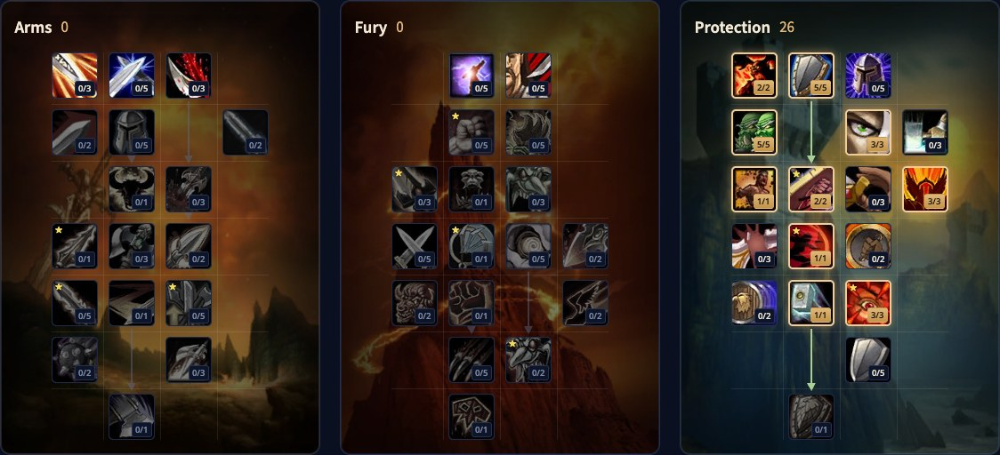

De Protection Warrior in WoW Forever is de klassieke ridder: zware armor, een groot shield en geen magie, alleen kreten, stampen en klappen. Nieuwe talenten geven Rage bij elke block, dodge en parry, en Vanguard laat je chargen in Defensive Stance. Deze gids behandelt de build voor level 30, de threat-rotatie, debuffs, Rage, stats, gear en races.

| | |
|---|---|
| Rol | Tank met een shield |
| Build op level 30 | 26 punten in Protection, met de 5 extra punten van Talented |
| Belangrijkste talenten | Shield Specialization, Anticipation, Master of Defense, Defiance, Last Stand, Vanguard |
| Sterk in | Sterke defensieve cooldowns, veel controle over het gevecht |
| Zwak in | Weinig te doen als je niet tankt, heeft Rage nodig |
| Levelen | [Levelgids voor de Warrior](/nl/guides/warrior-leveling/), [levelbuild voor de Warrior](/nl/leveling/warrior/) |
| Andere specs | [Arms Warrior](/nl/guides/arms-warrior/), [Fury Warrior](/nl/guides/fury-warrior/) |

## Wat er verandert voor Protection

- **Shield Specialization** geeft 5% meer block chance en 5 Rage bij elke block bij 5/5.
- **Master of Defense is nieuw.** 5 Rage bij elke dodge en parry zolang je een shield draagt.
- **Vanguard is nieuw.** Charge werkt in Defensive Stance.
- **Focused Rage is nieuw.** Je offensieve aanvallen kosten 3 Rage minder bij 3/3.
- **Defiance** geeft 15% meer threat in Defensive Stance met een shield bij 3/3.
- **Last Stand** geeft nu 30% van je maximale health voor 20 seconden.
- **Bastion** geeft 10% meer schade zolang je een shield draagt bij 5/5, en **Shield Slam** dispelt ook de helft van de keren een Magic-effect.
- **Improved Shield Wall** haalt 11 minuten van de cooldown van Shield Wall bij 2/2.

## Sterktes en zwaktes

| Sterk in | Zwak in |
|---|---|
| Shield Wall en Last Stand kunnen een gevecht winnen | Zwak als je niet de tank bent, en een tweehandig wapen lost dat niet op |
| Shield Bash, Intercept, Thunder Clap en Demoralizing Shout bepalen het tempo | Heeft Rage nodig, en krijgt die vooral door geraakt te worden |
| Rage van blocks, dodges en parries | Tegen casters kom je snel Rage tekort |

Omdat Protection zo weinig doet buiten het tanken, spelen veel Warriors een schade-spec met Dual Specialization, of nemen ze vast de rol van main tank op zich.

## De build voor level 30

Deze build gebruikt 26 punten: de 21 punten van level 30 plus 5 van Talented uit het Legacy-systeem. Zonder Talented stop je bij 21 punten; de [levelbuild voor de Warrior](/nl/leveling/warrior/) geeft de volgorde per level. [Open de build in de talentcalculator](/nl/talents/warrior/?t=--2505301203010013).

| Talent | Punten |
|---|---|
| **Improved Bloodrage** | 2/2 |
| **Shield Specialization** | 5/5 |
| **Anticipation** | 5/5 |
| **Improved Revenge** | 3/3 |
| **Last Stand** | 1/1 |
| **Master of Defense** | 2/2 |
| **Defiance** | 3/3 |
| **Vanguard** | 1/1 |
| **Concussion Blow** | 1/1 |
| **Focused Rage** | 3/3 |

Na level 30 komen Bastion, Improved Shield Wall, Improved Thunder Clap, Improved Sunder Armor en Shield Slam onderaan de boom.

## Wat de belangrijkste talenten doen

| Talent | Wat het doet in Forever |
|---|---|
| **Shield Specialization** | Meer block chance en 5 Rage per block |
| **Anticipation** | 20 meer Defense Skill bij 5/5 |
| **Master of Defense** | 5 Rage per dodge en parry met een shield |
| **Improved Revenge** | 60% meer schade van Revenge, dus meer threat |
| **Defiance** | 15% meer threat in Defensive Stance met een shield |
| **Last Stand** | 30% extra maximale health voor 20 seconden |
| **Vanguard** | Open elke pull met Charge, zonder Defensive Stance te verlaten |
| **Focused Rage** | 3 Rage minder voor je offensieve aanvallen |
| **Shield Slam** | Een sterke instant aanval die ook kan dispellen. Na level 30 |

## Rotatie

1. Besteed extra Rage aan Heroic Strike, of Cleave tegen meerdere vijanden, zodat het nooit verloren gaat.
2. Houd Battle Shout op.
3. Houd Thunder Clap en Demoralizing Shout op.
4. Stapel Sunder Armor.
5. Revenge telkens het klaar is.
6. Zet Rend op het doelwit en houd het daar.
7. Shield Slam, zodra je het hebt.

## Cooldowns en utility

- **Shield Wall** en **Retaliation** zijn heel nuttig, maar Retaliation vraagt Battle Stance.
- **Last Stand** is een sterke defensieve cooldown.
- **Berserker Rage** negeert Fear- en Incapacitate-effecten, maar alleen in Berserker Stance.
- **Recklessness** is de sterkste schade-cooldown in het spel, maar vraagt ook Berserker Stance.
- **Bloodrage** vrij gebruiken, voor extra Rage.
- **Challenging Shout** dwingt vijanden jou aan te vallen, anders dan Taunt, dus je blijft tanken door immuniteiten heen.

## Beweging

Blijf op de boss. Open met Charge voor Rage en een directe start, in Defensive Stance dankzij Vanguard. In gevecht heb je Intercept, maar alleen in Berserker Stance, en dat kost je Rage en laat je meer schade nemen.

## Debuffs en Rage

**Debuffs.** Houd Sunder Armor op de vijand voor meer schade en meer threat. Houd Thunder Clap en Demoralizing Shout altijd actief: vallen ze weg, dan krijg je veel meer schade. Rend schaalt goed en geeft een flinke portie threat.

**Rage.** Plan vooruit en houd genoeg over voor je belangrijke aanvallen. Laat Heroic Strike Shield Slam of Revenge een seconde of twee wachten, dan was dat een fout. Houd je Rage in beweging: nooit vol, nooit leeg.

## Stats en gear

De exacte volgorde op level 60 volgt na de lancering. Deze stats helpen een Protection Warrior:

- **Hit chance.** Een misser doet niets en geeft geen Rage.
- **Stamina, Armor en avoidance.** Meer health is altijd beter voor een tank. Zoek een evenwicht tussen verdediging en genoeg aanval om threat te houden.
- **Strength en attack power.** 1 Strength geeft 2 attack power.
- **Critical strike chance.** Meer schade en meer Rage.
- **Agility.** Wat critical strike chance en Armor.

**Armor.** Je armor telt zwaar. Mail tot level 40, daarna Plate. Een lichter armortype kost je zoveel mitigatie dat je moeite krijgt om te overleven. Blacksmiths maken goede levelgear, en dungeons hebben nog veel meer.

**Wapens.** Je wapen telt nog altijd voor threat. Draag altijd een shield, voor Bastion en Shield Slam. Een afstandswapen telt alleen voor zijn stats.

## Races en tradeskills

Elk ras kan Warrior spelen. Elke keuze werkt, maar sommige zijn sterker.

| Factie | Ras | Waarom |
|---|---|---|
| Alliance | Human | <a class="wf-wh wf-spell" href="https://www.wowhead.com/forever/spell=20597">Ruthless</a>: 2% meer critical strike chance |
| Alliance | Dwarf | Meer critical strike-schade, en Stoneform is een uitstekende defensieve cooldown |
| Alliance | Gnome | Een burst-cooldown die heel sterk kan zijn |
| Alliance | Night Elf | Elune's Light voor Rage en schade op afroep, plus extra dodge chance en bewegingssnelheid |
| Alliance | High Order Skyborne | <a class="wf-wh wf-spell" href="https://www.wowhead.com/forever/spell=1259710">Wind Blessed</a>: Haste, zeldzaam en sterk voor jou |
| Horde | Orc | <a class="wf-wh wf-spell" href="https://www.wowhead.com/forever/spell=20572">Blood Fury</a>, extra critical strike chance en een sterke cooldown tegen magische schade |
| Horde | Troll | Meer schade tegen Beasts, Berserking voor aanvalssnelheid en snellere health-regeneratie |
| Horde | Undead | Touch of the Grave doet schade en heelt je een beetje |
| Horde | Tauren | De meeste health van alle races, War Stomp en Plainsrunning voor snelheid zolang je blijft bewegen |
| Horde | Windshaper Skyborne | Haste en een snelheids-cooldown die van pas komt |

**Tradeskills.** Blacksmithing maakt een deel van de beste Mail- en Plate-gear, veel ervan alleen voor Blacksmiths. Engineering heeft handige gadgets voor elke spec.
