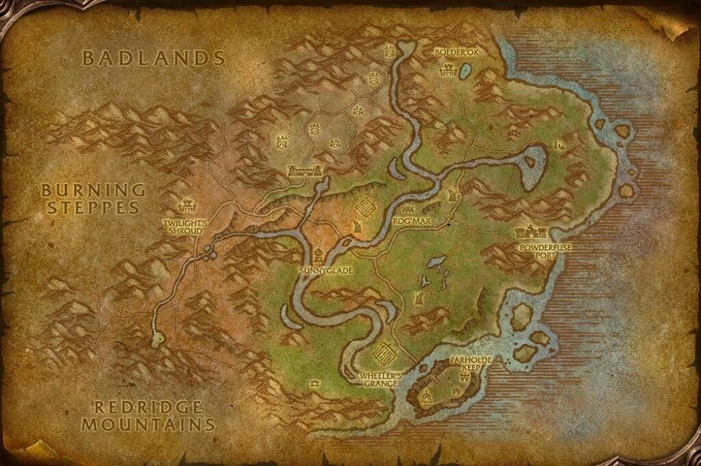
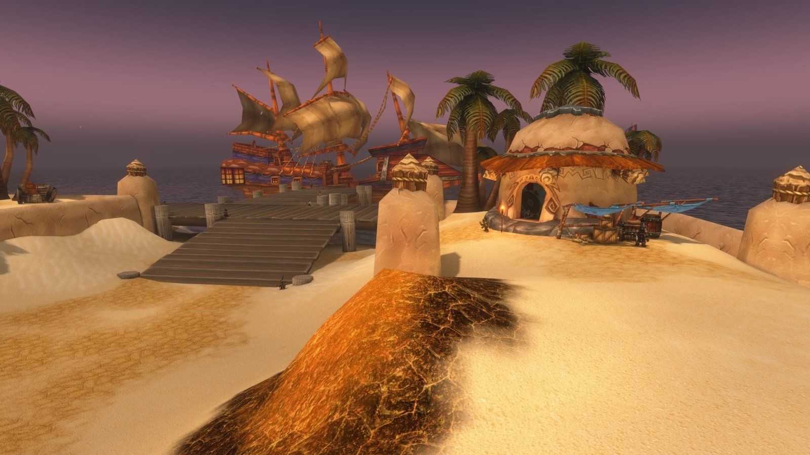
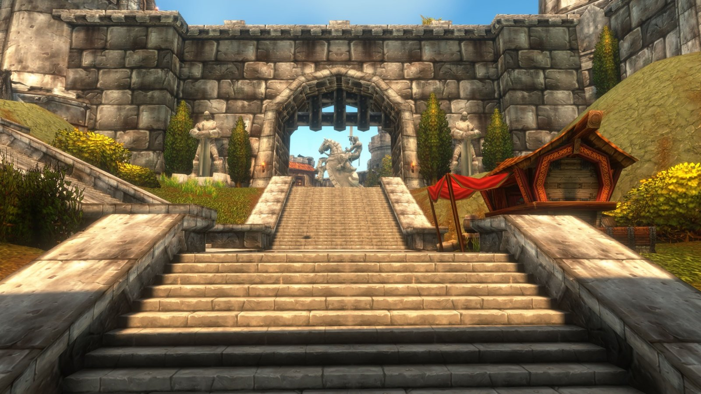
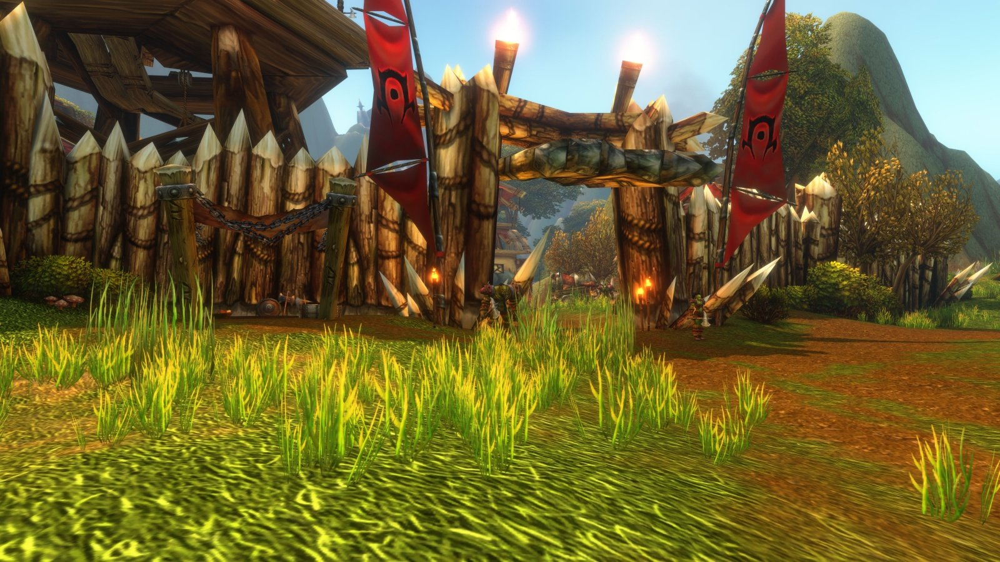
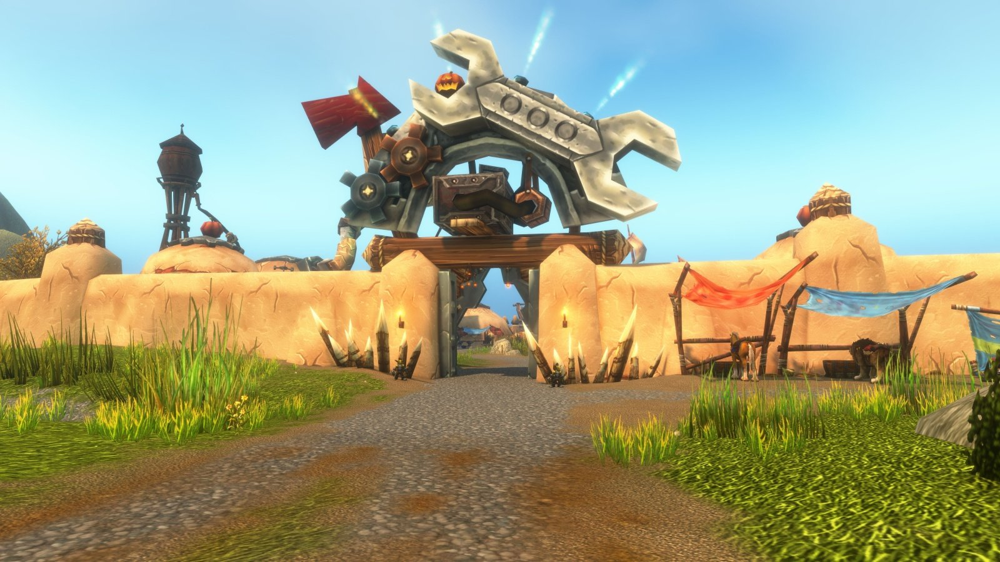
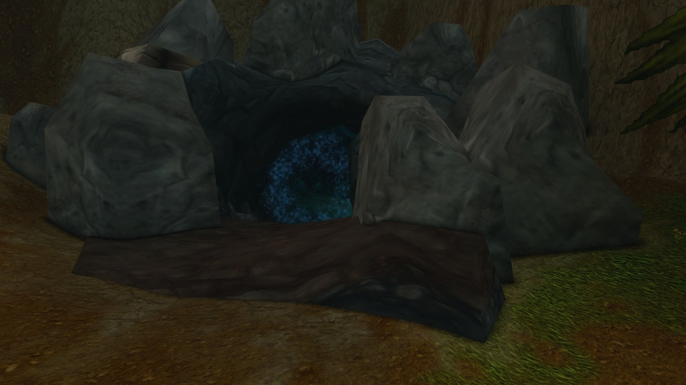

De Riverglades is een nieuwe zone in WoW Forever, aan de oostkust van de Eastern Kingdoms. Rivieren, graslanden en vervallen burchten liggen tussen Redridge Mountains, de Burning Steppes en de Badlands. Veel spelers noemen het de beste levelzone van Forever. Deze gids toont hoe je er komt, de dorpen, de quests, de Bloodmaster's Ring en de dungeon.

| | |
|---|---|
| Levels | Ongeveer 36 tot 44, best vanaf 40 |
| Grenst aan | Redridge Mountains, Burning Steppes, Badlands |
| Alliance | Farholde Keep, Brotherhood of the Horse |
| Horde | Rog'mar, Bolder'ok Clan |
| Neutraal | Powderfuse Port, een goblinstadje |
| Dungeon | [Krol'dok Stronghold](/nl/guides/dungeons/kroldok-stronghold/), level 40 tot 45 |

## Erheen gaan

Er zijn drie wegen naar binnen:

- **Uit Redridge Mountains**, de snelste weg voor de Alliance. Volg vanuit Lakeshire de weg naar het noorden tot de rand van de kaart, richting de poort van de Burning Steppes. Op het kruispunt wijst een wegwijzer naar de Riverglades: neem het rechterpad en na een korte wandeling sta je in de Bristle Hills, in het westen van de zone. De weg loopt daarna naar het zuiden, naar Farholde Keep, de basis van de Alliance.
- **Uit de Badlands**, over de weg in het zuiden van de zone. Voor de Horde is dat zonder vliegpunt de makkelijkste weg.
- **Met de boot** vanuit Steamwheedle Port in Tanaris, ten oosten van Gadgetzan (/way 68.6 23.0). De boot legt aan in Powderfuse Port (/way 80.6 54.6). Terug naar Kalimdor gaat op dezelfde manier. Vanuit de haven volgt de Horde de weg naar Rog'mar.

<figure class="wf-embed" data-wf-video="JYy08rjb3K4">
  <button type="button" class="wf-embed__play">
    
    
      How to get to the Riverglades in WoW Forever
      Speel de video af. Nutri op YouTube, 6 minuten.
    
  </button>
</figure>

## Dorpen en vliegpunten

- **Farholde Keep**, in het zuiden, is het dorp van de Alliance en de thuisbasis van de Brotherhood of the Horse, de cavalerie die Stormwind verliet. Vliegmeester <a class="wf-wh wf-plain" href="https://www.wowhead.com/forever/npc=257087">Gretchen Mayberry</a> staat op /way 60.6 81.4.
- **Rog'mar**, in het midden van de zone, is het kamp van de Horde. Vliegmeester <a class="wf-wh wf-plain" href="https://www.wowhead.com/forever/npc=255993">Grakna</a> staat op /way 59.6 45.2.
- **Powderfuse Port**, aan de oostkust, is een neutraal goblinstadje met de boot naar Tanaris en het [Black Market Auction House](/nl/guides/bmah/). Er staat geen vliegmeester.

Waar elk vliegpunt heen vliegt, staat in de [gids over vliegroutes](/nl/guides/flight-paths/).

## Quests

De quests in de Riverglades zijn lineairder dan in de meeste zones van Classic. Rond je een reeks af, dan verschijnt de volgende meestal in hetzelfde dorp. Spelers merken ook weinig concurrentie voor monsters. Alle quests in de zone samen zijn ongeveer 4 tot 5 levels waard.

De Alliance werkt voor de Brotherhood of the Horse, de Horde voor de Bolder'ok Clan. Ze vechten tegen elkaar en tegen de Twilight's Hammer. Het verhaal achter Farholde Keep staat in het kortverhaal [Cost of Honor](/nl/news/cost-of-honor-tells-the-past-of-the-riverglades/).

**Een verborgen quest voor de Horde.** <a class="wf-wh wf-plain" href="https://www.wowhead.com/forever/npc=257079">Cavalry Scout Alturin</a> rijdt over de hoofdweg uit Farholde Keep. Dood hem en hij laat <a href="https://www.wowhead.com/forever/quest=93971">Farholde Scouting Report</a> vallen, een quest zonder voorloper die je in Rog'mar inlevert voor 4.850 experience. Wie hem aanvalt, staat open voor PvP.

**Neem deze spullen mee.** Een paar quests vragen items die je thuis kunt kopen of maken. Je bespaart een rit als je ze meebrengt:

| Item | Quest | Factie |
|---|---|---|
| 10 <a class="wf-wh wf-q1" href="https://www.wowhead.com/forever/item=769">Chunk of Boar Meat</a> | <a href="https://www.wowhead.com/forever/quest=95162">Paletusk Harvesting</a> | Horde |
| 10 <a class="wf-wh wf-q1" href="https://www.wowhead.com/forever/item=3241">Heavy Weightstone</a> | <a href="https://www.wowhead.com/forever/quest=96026">Step Two: More Rock</a> | Horde |
| 12 <a class="wf-wh wf-q1" href="https://www.wowhead.com/forever/item=3575">Iron Bar</a> en 4 <a class="wf-wh wf-q1" href="https://www.wowhead.com/forever/item=4304">Thick Leather</a> | <a href="https://www.wowhead.com/forever/quest=94974">Key Ingredients</a> | Horde |
| 12 <a class="wf-wh wf-q1" href="https://www.wowhead.com/forever/item=3575">Iron Bar</a> en 4 <a class="wf-wh wf-q1" href="https://www.wowhead.com/forever/item=4304">Thick Leather</a> | <a href="https://www.wowhead.com/forever/quest=94981">Key Ingredients</a> | Alliance |

Key Ingredients hoort bij de reeks voor de sleutel van Krol'dok Stronghold, zie verderop.

**Recente fixes.** De hotfixes van 13 november losten hier drie dingen op: Jezap Jinglesprocket, gastheer van de Bloodmaster's Ring, geeft zijn quests weer, Gaseous Gold toont het juiste aantal, en houtstapels kun je alleen nog looten tijdens hun quest. Drie vijanden [slaan sinds 11 november zachter](/nl/news/judgement-now-counts-as-a-ranged-attack/).

## De Bloodmaster's Ring

De Bloodmaster's Ring is een vechtkuil in de stijl van de Ring of Blood, op /way 65.6 21.4 in ogergebied. Je vecht een voor een tegen steeds sterkere vechters van de Bolder'ok. Elk gevecht geeft ongeveer zoveel experience als een dungeonquest. Op een PvP-realm kan het er druk zijn met de andere factie.

1. <a href="https://www.wowhead.com/forever/quest=94668">Bloodmaster's Ring</a>: meld je bij Jezap aan de ring.
2. <a href="https://www.wowhead.com/forever/quest=94669">Pay to Play</a>: betaal de borg van 1 goud om mee te doen.
3. Gevechten: <a href="https://www.wowhead.com/forever/quest=94670">Bloodmaster's Ring</a>, <a href="https://www.wowhead.com/forever/quest=94739">Bloodmaster's Ring</a>, <a href="https://www.wowhead.com/forever/quest=94962">Bloodmaster's Ring</a> en <a href="https://www.wowhead.com/forever/quest=94964">Bloodmaster's Ring</a>, tegen Mog'thar op level 43.
4. Omweg, nog niet bevestigd: <a href="https://www.wowhead.com/forever/quest=94733">Our Ogre Friend</a>, <a href="https://www.wowhead.com/forever/quest=94734">A Boar's Delight</a> en <a href="https://www.wowhead.com/forever/quest=94737">A Treat for a Friend</a>.
5. Laatste gevechten: <a href="https://www.wowhead.com/forever/quest=94965">Bloodmaster's Ring</a> en <a href="https://www.wowhead.com/forever/quest=95063">Bloodmaster's Ring</a>.

Na Snufflesnout kies je 3 <a class="wf-wh wf-q1" href="https://www.wowhead.com/forever/item=3928">Superior Healing Potion</a> of 2 <a class="wf-wh wf-q1" href="https://www.wowhead.com/forever/item=13443">Superior Mana Potion</a>. De hele reeks eindigt met een keuze uit drie ringen voor level 45:

| Ring | Stats |
|---|---|
| <a class="wf-wh wf-q3" href="https://www.wowhead.com/forever/item=275043">Bloodmaster's Ring</a> | 7 Stamina, 6 Intellect, tot 9 spell damage en healing |
| <a class="wf-wh wf-q3" href="https://www.wowhead.com/forever/item=275044">Bloodsport Band</a> | 6 Stamina, 5 health per 5 seconden, 22 attack power |
| <a class="wf-wh wf-q3" href="https://www.wowhead.com/forever/item=275045">Ogre Horn Ring</a> | 4 Strength, 3 Agility, 10 Stamina, 3 Defense |

Meer over de kuil staat in [de post over de ring](/nl/news/the-riverglades-get-their-own-ring-of-blood/).

## Krol'dok Stronghold

De dungeon van de zone is een ogerburcht voor level 40 tot 45, met zes bazen. De ingang ligt op de heuvels ten noorden van Sunnyglade, ten noordoosten van Twilight's Shroud, op /way 37.5 37.5. De spirit healer staat vlak buiten.

De meeste dungeonquests openen pas na het verhaal van de zone. Aan de kant van de Alliance is dat een reeks van ongeveer tien quests in Farholde Keep. De uitzondering valt binnen: <a class="wf-wh wf-plain" href="https://www.wowhead.com/forever/npc=259256">Tunk</a> laat de Krol'dok Moulding vallen, die de reeks begint voor een sleutel naar een kortere weg in de dungeon. Bazen, quests en buit staan in de [gids over Krol'dok Stronghold](/nl/guides/dungeons/kroldok-stronghold/).

## Zeldzame Hunter-pets

Hunters kunnen in de Riverglades drie zeldzame beesten temmen, allemaal van level 41 of 42. Elk beest is ook het doel van een quest, dus andere spelers doden ze ook. Je temt een beest alleen tot je eigen level.

| Pet | Familie | Level | Waar |
|---|---|---|---|
| <a class="wf-wh wf-plain" href="https://www.wowhead.com/forever/npc=263315">Ombassa</a> | Cat, elite | 41 | /way 59.6 53.6, alleen via een quest |
| <a class="wf-wh wf-plain" href="https://www.wowhead.com/forever/npc=260235">Trapclaw</a> | Crab | 42 | Onder water op /way 82.4 53.5 |
| <a class="wf-wh wf-plain" href="https://www.wowhead.com/forever/npc=263380">Ghostmaw</a> | Crocolisk, elite | 42 | De middelste rivier, van Wheeler's Grange (/way 51.3 75.3) tot Rog'mar (/way 63.5 36.5) |

- **Ombassa** verschijnt alleen als je de <a class="wf-wh wf-q1" href="https://www.wowhead.com/forever/item=271779">Tallstrider Call</a> gebruikt tijdens <a href="https://www.wowhead.com/forever/quest=95986">King of the Wild Plains</a> (Alliance) of <a href="https://www.wowhead.com/forever/quest=96105">King of the Wild Plains</a> (Horde). Tem hem bij de eerste oproep: dood je hem dan, kun je hem voor jezelf niet meer oproepen. Gebruik na het temmen de oproep opnieuw, dood de nieuwe Ombassa en neem <a class="wf-wh wf-q1" href="https://www.wowhead.com/forever/item=281052">Ombassa's Hide</a> mee voor de quest. Hij valt elke 1,6 seconden aan en eet vlees en vis.
- **Trapclaw** vraagt geen quest en loopt een vaste route, maar hij komt traag terug. Spelers met <a href="https://www.wowhead.com/forever/quest=95254">WANTED: Trapclaw</a> doden hem voor <a class="wf-wh wf-q1" href="https://www.wowhead.com/forever/item=268586">Trapclaw's Pincer</a>, dus reken op wachten. Hij valt elke 2,0 seconden aan.
- **Ghostmaw** heeft de langste route van de drie. <a href="https://www.wowhead.com/forever/quest=95991">WANTED: Ghostmaw</a> (Alliance) en <a href="https://www.wowhead.com/forever/quest=95992">WANTED: Ghostmaw</a> (Horde) vragen zijn <a class="wf-wh wf-q1" href="https://www.wowhead.com/forever/item=271828">Ghostmaw's Fang</a>, dus ook hier strijd je met andere spelers. Hij valt elke 2,0 seconden aan.

Meer pets en hoe je ze traint staan in de [levelgids voor de Hunter](/nl/classes/hunter/leveling/).

## Verzamelen

De Riverglades heeft kruiden en ertsen voor verzamelaars halverwege hun beroep.

| Herbalism | Mining |
|---|---|
| <a class="wf-wh wf-q1" href="https://www.wowhead.com/forever/item=3821">Goldthorn</a> | <a class="wf-wh wf-q1" href="https://www.wowhead.com/forever/item=2772">Iron Ore</a> |
| <a class="wf-wh wf-q1" href="https://www.wowhead.com/forever/item=3358">Khadgar's Whisker</a> | <a class="wf-wh wf-q2" href="https://www.wowhead.com/forever/item=2775">Silver Ore</a> |
| <a class="wf-wh wf-q1" href="https://www.wowhead.com/forever/item=3356">Kingsblood</a> | <a class="wf-wh wf-q2" href="https://www.wowhead.com/forever/item=2776">Gold Ore</a> |
| <a class="wf-wh wf-q1" href="https://www.wowhead.com/forever/item=3357">Liferoot</a> | |
| <a class="wf-wh wf-q1" href="https://www.wowhead.com/forever/item=3820">Stranglekelp</a> | |
| <a class="wf-wh wf-q1" href="https://www.wowhead.com/forever/item=3355">Wild Steelbloom</a> | |

Routes en skillniveaus staan in de gidsen over [Herbalism](/nl/tradeskills/forever/herbalism/) en [Mining](/nl/tradeskills/forever/mining/).
