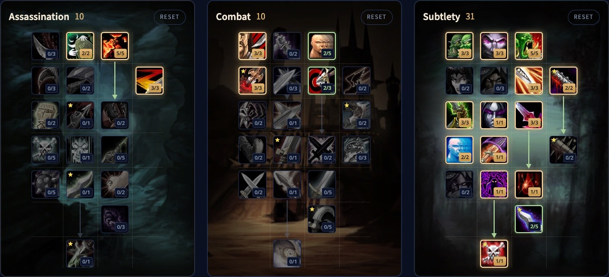

> **Update 4 november:** de builds en talenten hieronder volgen de nieuwe bomen uit de ontwikkelnotities van 2 november, meer in [onze post](/nl/news/rogues-get-shank-and-death-mark-in-a-big-rework/).

De Subtlety Rogue in WoW Forever heeft twee echte PvE-builds. De ene deelt enorme kritieke Ambushes uit, en Ghostly Strike laat je Ambush in gevecht gebruiken. De andere bouwt op bleeds, met Hemorrhage en een sterkere Rupture. Beide eindigen in Death Mark, een finishing move die je schade opslaat en later loslaat. Poisons landen nu critical strikes en schalen met attack power. Deze gids behandelt beide builds voor level 30 en 60, de rotaties, Energy, poisons, overleven, stats en races.

| | |
|---|---|
| Rol | Melee-schade, met dolken of bleeds |
| Builds | Ambush (10/10/31) en bleed (12/8/31), allebei met Death Mark, op level 60 |
| Belangrijkste talenten | Malice, Opportunity, Initiative, Ghostly Strike, Serrated Blades, Preparation, Hemorrhage, Boot Knife, Death Mark |
| Sterk in | Twee speelstijlen, bleeds negeren armor, veel crowd control |
| Zwak in | Heeft gear nodig, beste talenten pas op hoog level |
| Levelen | [Levelgids voor de Rogue](/nl/guides/rogue-leveling/), [levelbuild voor de Rogue](/nl/leveling/rogue/) |

## Sterktes en zwaktes

**Twee speelstijlen.** Ambush met Ghostly Strike of bleeds met Hemorrhage, allebei met Death Mark onderaan. Beide houden goed stand in lange gevechten.

**Bleeds negeren armor.** Rupture en Garrote negeren armor volledig, en dat loont tegen zwaar gepantserde monsters en bosses.

**Crowd control.** Kick, Gouge, Sap, Cheap Shot, Kidney Shot en Blind, plus poisons die vertragen, casts verlengen of genezing verlagen.

**Hangt af van het gevecht.** De Ambush-build moet achter het doelwit staan, wat beter past bij dungeons en raids dan bij de open wereld. Sommige monsters zijn immuun voor bleeds.

**Heeft gear nodig.** Rupture, Garrote en poisons schalen met attack power en kunnen critical strikes landen, dus je hebt allebei nodig.

**Heeft levels nodig.** De beste talenten zitten onderaan de boom. Veel spelers levelen met een andere spec en stappen later over naar Subtlety.

## Builds voor level 30

Op level 30 heb je 21 punten, en Talented voegt er 5 toe. Beide builds staan uitgelegd in onze [levelgids voor de Rogue](/nl/guides/rogue-leveling/).

- **Ambush:** doodt monsters zo snel mogelijk met kritieke Ambushes vanuit Stealth. [Open de build](/nl/talents/rogue/?t=02--333003031021), [Talented-versie](/nl/talents/rogue/?t=025--333003031021).
- **Bleed:** Garrote, Hemorrhage en Rupture, met Serrated Blades voor een sterkere Rupture en Preparation voor een extra Slice and Dice. [Open de build](/nl/talents/rogue/?t=--3320002313210001), [Talented-versie](/nl/talents/rogue/?t=002--3322002313210011).

## Ambush-build met Death Mark voor level 60: 10/10/31

De beta stopte op level 30, maar de talentbomen voor level 60 zitten in de spelbestanden. We hebben deze build punt voor punt nagekeken in [onze talentcalculator](/nl/talents/rogue/?t=025003-302302-335003231321001121). Backstab is je belangrijkste generator, en Ghostly Strike laat je volgende Ambush zonder Stealth toe. Serrated Blades voegt 9% armor penetration toe, Hemorrhage dekt gevechten waarin je niet achter het monster kunt staan, en Death Mark onderaan slaat je schade op en laat die na 6 seconden los.

| Talent | Punten |
|---|---|
| **Remorseless Attacks** (Assassination) | 2/2 |
| **Malice** (Assassination) | 5/5 |
| **Improved Slice and Dice** (Assassination) | 3/3 |
| **Coup de Grace** (Combat) | 3/3 |
| **Lightning Reflexes** (Combat) | 2/5 |
| **Puncturing Wounds** (Combat) | 3/3 |
| **Precision** (Combat) | 2/3 |
| **Setup** | 3/3 |
| **Master of Deception** | 3/3 |
| **Opportunity** | 5/5 |
| **Improved Ambush** | 3/3 |
| **Dirty Tricks** | 2/2 |
| **Initiative** | 3/3 |
| **Premeditation** | 1/1 |
| **Serrated Blades** | 3/3 |
| **Elusiveness** | 2/2 |
| **Ghostly Strike** | 1/1 |
| **Preparation** | 1/1 |
| **Hemorrhage** | 1/1 |
| **Boot Knife** | 2/5 |
| **Death Mark** | 1/1 |

Murder is weg sinds 2 november, dus de laatste 2 punten in Assassination gaan naar Remorseless Attacks. Ruthlessness 2/3 is een alternatief.

## Bleedbuild met Death Mark voor level 60: 12/8/31

Helemaal naar beneden in de Subtlety-boom. [Open de build in de talentcalculator](/nl/talents/rogue/?t=015303-302003-332210231321001151). Hemorrhage laat je Rupture en Garrote 15% harder raken, Boot Knife 5/5 maakt van elke Shank 2 Combo Points, en Death Mark slaat de schade van Garrote en Rupture dubbel zo snel op.

| Talent | Punten |
|---|---|
| **Remorseless Attacks** (Assassination) | 1/2 |
| **Malice** (Assassination) | 5/5 |
| **Ruthlessness** (Assassination) | 3/3 |
| **Improved Slice and Dice** (Assassination) | 3/3 |
| **Coup de Grace** (Combat) | 3/3 |
| **Lightning Reflexes** (Combat) | 2/5 |
| **Precision** (Combat) | 3/3 |
| **Setup** | 3/3 |
| **Master of Deception** | 3/3 |
| **Opportunity** | 2/5 |
| **Dirty Deeds** | 2/2 |
| **Camouflage** | 1/3 |
| **Dirty Tricks** | 2/2 |
| **Initiative** | 3/3 |
| **Premeditation** | 1/1 |
| **Serrated Blades** | 3/3 |
| **Elusiveness** | 2/2 |
| **Ghostly Strike** | 1/1 |
| **Preparation** | 1/1 |
| **Hemorrhage** | 1/1 |
| **Boot Knife** | 5/5 |
| **Death Mark** | 1/1 |

## Wat de belangrijkste talenten doen

| Talent | Wat het doet in Forever |
|---|---|
| **Malice** | 5% meer critical strike chance met aanvallen en poisons |
| **Remorseless Attacks** | Na een kill 40% meer critical strike chance op je volgende Sinister Strike, Backstab, Ambush, Mutilate of Ghostly Strike |
| **Ruthlessness** | Finishing moves hebben 60% kans om een Combo Point toe te voegen |
| **Improved Slice and Dice** | Slice and Dice duurt 45% langer |
| **Precision** | 3% meer kans om te raken |
| **Opportunity** | Backstab, Garrote, Ambush en Mutilate doen tot 20% meer schade, op 5/5 |
| **Master of Deception** | Monsters zien je in Stealth alsof je 3 levels hoger bent |
| **Setup** | Op 3/3: 45% kans op een Combo Point als je een aanval ontwijkt of een spell weerstaat |
| **Initiative** | Ambush, Garrote en Cheap Shot geven een extra Combo Point |
| **Ghostly Strike** | 180% wapenschade met een dolk, 15% meer dodge voor 7 seconden, en je volgende Ambush of Garrote binnen 7 seconden vraagt geen Stealth |
| **Serrated Blades** | Je aanvallen negeren 9% armor, en Rupture doet 30% meer schade |
| **Premeditation** | Voegt 2 Combo Points toe aan je doelwit |
| **Preparation** | Rondt de cooldown van je andere Rogue-abilities meteen af |
| **Hemorrhage** | 145% wapenschade met een dolk, en 15 seconden 15% meer Rupture-schade op het doelwit |
| **Dirty Deeds** | Cheap Shot en Garrote kosten 20 Energy minder, en Garrote hoeft niet meer van achteren |
| **Boot Knife** | Op 5/5 geeft elke Shank 2 Combo Points |
| **Death Mark** | Een finishing move die per Combo Point een deel van je schade opslaat, Garrote en Rupture dubbel zo snel, en die na 6 seconden uitdeelt. 25 Energy, 10 seconden cooldown |

## Rotatie

### Ambush-build

1. Ga in Stealth en cast Premeditation.
2. Open met Ambush.
3. Blijf achter het doelwit en gebruik Backstab als generator. Waar je niet achter kunt staan, gebruik je Hemorrhage.
4. Gebruik Ghostly Strike op cooldown.
5. Gebruik Ambush meteen na Ghostly Strike, dat hem 7 seconden zonder Stealth toelaat. Op 5 Combo Points eerst een finishing move.
6. Op 5 Combo Points cast je Slice and Dice, en je vernieuwt hem als hij afloopt.
7. In lange gevechten cast je Expose Armor bij de volgende 5 Combo Points.
8. Cast Death Mark op 5 Combo Points zodra hij klaar is, en de rest gaat naar Eviscerate.
9. Vanish en Ambush voor een uithaal, en Preparation om je cooldowns te resetten of te ontsnappen.

### Bleedbuild

1. Ga in Stealth en cast Premeditation.
2. Open met Garrote.
3. Gebruik Hemorrhage als generator en Ghostly Strike op cooldown.
4. Op 5 Combo Points cast je Slice and Dice, en Rupture bij de volgende 5.
5. Gebruik Shank zodra hij klaar is: met Boot Knife geeft hij 2 Combo Points.
6. Cast Death Mark op 5 Combo Points terwijl Garrote en Rupture tikken, de rest gaat naar Eviscerate, en Expose Armor op bosses als je groep het nodig heeft.
7. Vanish en Garrote voor een uithaal, en Preparation om je cooldowns te resetten of te ontsnappen.

### Meerdere monsters

Rogues hebben geen schade rondom: dood één monster tegelijk. Wissel nooit van doelwit terwijl je Combo Points opbouwt, anders verlies je ze.

## Stealth, Combo Points en finishing moves

Stealth vertraagt je, tot 50% op lage levels en 30% op level 60, dus je reist er niet mee, maar je gebruikt hem wel tegen de meeste monsters. In Stealth krijg je openers: Ambush voor een grote klap, Garrote voor een bleed, Sap en Cheap Shot om uit te schakelen.

Je generators zijn eerst Sinister Strike, later Backstab, Ghostly Strike en Hemorrhage, plus Shank vanaf level 24. Je finishing moves zijn Eviscerate, Slice and Dice, Expose Armor, Rupture en, onderaan de boom, Death Mark. Slice and Dice actief houden is de grootste schadeboost die je hebt. Kidney Shot stunt een gevaarlijk monster.

## Energy

Energy komt nu vloeiend terug, 1 punt per 0,1 seconde, dus 10 per seconde. Shank, vanaf level 24, kost 5 Energy en geeft er elke 10 seconden 15 terug, en Thistle Tea geeft een flinke hoop terug op een lange cooldown. Verder: bouw nooit een Combo Point boven 5, en geef geen Energy uit aan Kick, Feint, Gouge of Blind zonder reden.

## Poisons

Vanaf level 20 leert een questreeks je poisons maken. Gebruik Instant Poison en Deadly Poison in de meeste gevechten: Instant Poison op trage wapens, Deadly Poison op snelle. Wissel naar Crippling, Mind-numbing of Wound Poison als een monster vertraagd moet worden, trager moet casten of minder genezing moet krijgen.

## Overleven

Rogues slaan hard maar vallen snel. Beoordeel elke pull: Sap één monster uit een groep, bij voorkeur een caster. Open met Cheap Shot, volg met Kidney Shot, en rek het met Gouge of Blind als je Energy of cooldowns nodig hebt. Gebruik Evasion als je klappen moet opvangen, Kick elke caster, en Vanish als niets anders werkt.

## Stats en gear

Statprioriteiten voor level 60 volgen na de launch. Tot dan:

- **Agility**: 1 attack power per punt, 1% critical strike chance per 29 Agility, 1% dodge per 14,5 Agility.
- **Attack power**, die nu ook de schade van je poisons verhoogt.
- **Critical strike chance**, ook voor poisons en Rupture.
- **Strength**: 1 attack power per punt, verder niets.
- **Stamina** voor health, op de meeste gear te vinden.
- **Spirit** alleen voor regeneratie tussen gevechten.

**Armor.** Leather met de stats hierboven. Sets als Defias Leather en Embrace of the Viper zijn goed tijdens het levelen.

**Wapens.** Wapens zijn nu op elk level veel sterker. Elk type werkt, maar je abilities schalen het best met dolken, en de Ambush-build heeft ze nodig. Goede voorbeelden zijn Meteor Shard, Toxic Revenger, Assassin's Blade en Torturing Poker.

## Races en tradeskills

| Factie | Ras | Waarom |
|---|---|---|
| Alliance | Human | 1% critical strike chance uit Ruthless |
| Alliance | Night Elf | Elune's Light, 15 seconden 10% critical strike chance; Shadowmeld en betere Stealth |
| Alliance | Gnome | Eureka! voor een uithaal, Engineering Specialization met Engineering |
| Alliance | Dwarf | Stoneform haalt bleeds, poisons en diseases weg; Artisan's Precision geeft 1% hit |
| Alliance | Skyborne | 2% haste uit Wind Blessed |
| Horde | Orc | 10% attack power uit Blood Fury, de beste keuze |
| Horde | Troll | 10% haste uit Berserking en een hulpmiddel om te overleven |
| Horde | Undead | Beter voor PvP; Cannibalize spaart tijd in de open wereld |
| Horde | Skyborne | 2% haste uit Wind Blessed |

**Leatherworking** met Skinning is het beste paar: sterke leather gear op elk level, armor kits, en de Camp Tent uit het kampeersysteem die het levelen versnelt. **Engineering** brengt gadgets en explosieven voor meer schade en is de beste partner voor Leatherworking als je Skinning overslaat. **Herbalism** met **Alchemy** geeft je elixirs, potions en flasks.
